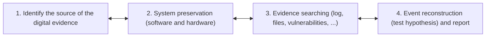

# Fases da Investigação Forense Digital

Embora não exista uma única forma rígida de conduzir uma investigação — desde que se identifique o responsável sem violar qualquer lei no processo —, certas metodologias são mais eficientes do que outras. O processo de investigação da cena de crime digital estrutura-se em **quatro fases principais e bidirecionais**, inspiradas na investigação criminal física: **Identificação da fonte (Preparação)**, **Preservação do sistema**, **Pesquisa de evidências** e **Reconstrução de eventos e relatório**.

---

## O Processo de Investigação

* Não existe uma forma única de conduzir uma investigação.
* O processo específico adotado é flexível, **desde que se encontre a pessoa certa e não se infrinja nenhuma lei durante o processo**.
* Contudo, alguns processos são substancialmente mais eficientes do que outros.

---

## As Quatro Fases Principais

Baseadas no processo de investigação da cena de crime físico, as quatro fases relacionam-se de forma iterativa (permitindo recuar à fase anterior sempre que novas descobertas o exijam):

### Fase 1 — Identificar a Fonte da Evidência Digital (*1 – Preparation*)
* **Identificar fisicamente a origem** da evidência digital.
* **Escolher a melhor abordagem** para a analisar (ex.: *live* vs. *post-mortem*).
* **Apreensão de equipamento** (*equipment seizure*).

### Fase 2 — Preservação do Sistema (*2 – System Preservation*)
* **Objetivos**:
  * Preservar o estado da cena de crime digital.
  * Reduzir a quantidade de evidência que possa ser perdida.
* **Adequação ao contexto**: As ações variam consoante os requisitos **legais, de negócio ou operacionais** da investigação:
  * *Requisitos legais*: podem exigir desligar o sistema da tomada (*unplug*) e efetuar uma cópia integral de todos os dados.
  * *Infeção por spyware ou honeypot*: pode não ser realizada qualquer preservação formal.
  * *Casos que não seguem para tribunal*: podem ser aplicadas técnicas intermédias.

### Fase 3 — Pesquisa de Evidências (*3 – Evidence Searching*)
* **Objetivo**: Encontrar dados que suportem ou refutem hipóteses sobre o incidente (ex.: logs, ficheiros, vulnerabilidades, tráfego de rede).

### Fase 4 — Reconstrução de Eventos e Relatório (*4 – Event Reconstruction and Report*)
* **Objetivo**: Tentar responder às questões sobre os eventos digitais ocorridos no sistema (testar as hipóteses formuladas), correlacionando-os com eventos físicos e elaborando o relatório pericial final.

---

## Implicações Forenses

* **Iteratividade do Processo**: As setas bidirecionais entre as 4 fases demonstram que a descoberta de um novo artefacto durante a *Pesquisa de Evidências* (Fase 3) ou *Reconstrução de Eventos* (Fase 4) pode obrigar o investigador a voltar à *Preservação* (Fase 2) ou a *Identificar novas fontes de evidência* (Fase 1), como um segundo servidor ou dispositivo móvel.
* **Exemplo Prático de Descoberta Iterativa em Windows ([[00 ASSI|ASSI]])**: Se durante a Fase 3 (Pesquisa) o exame à chave `USBSTOR` ([[Artefactos Forenses de Dispositivos USB]]) ou aos metadados de [[Ficheiros LNK (Shell Links) - Metadados e Formato Binário|atalhos LNK]] revelar que documentos críticos foram abertos a partir de uma pen USB externa não recolhida inicialmente, o perito tem de regressar à Fase 1 e Fase 2 para localizar, apreender e preservar esse novo suporte físico. De igual modo, a Fase 4 apoia-se diretamente na [[Matriz de Correlação Forense e Cronologia de Ativação dos Artefactos]] para testar hipóteses temporais.

---

## Perguntas de revisão

- Quais são as duas condições essenciais que qualquer processo de investigação tem de respeitar?
- Quais são as quatro fases principais da metodologia de investigação da cena de crime digital?
- Que tarefas compõem a Fase 1 (Preparação / Identificação da fonte)?
- De que forma os requisitos legais, de negócio ou operacionais alteram as ações tomadas na Fase 2 (Preservação)?

## Notas relacionadas

- [[Investigação Digital e Evidência Digital]]
- [[Investigação Forense Digital - Análise Live vs Post-Mortem]]
- [[Preservação do Sistema e Integridade de Dados]]
- [[Pesquisa de Evidências e Reconstrução de Eventos]]
- [[Artefactos Forenses de Dispositivos USB]]
- [[Matriz de Correlação Forense e Cronologia de Ativação dos Artefactos]]
- [[Capítulo 1 - Método de Investigação]]
