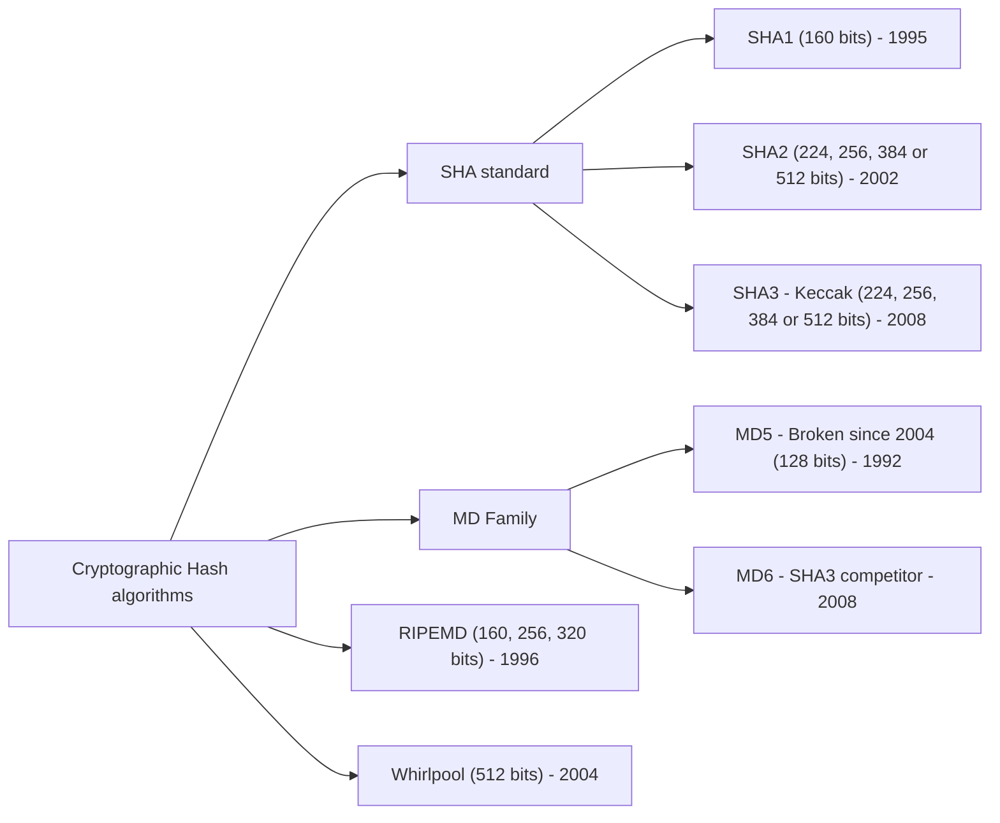

# Preservação do Sistema e Integridade de Dados

Na **Fase 2 (Preservação do Sistema)** aplicam-se técnicas específicas consoante a análise seja *post-mortem* (desligar da corrente, cópias duplicadas e bloqueadores de escrita) ou *live* (suspensão de processos, isolamento subtil de rede e cópia de segurança seletiva). Para garantir a **integridade dos dados** recolhidos, calcula-se um **hash criptográfico**; contudo, como um *hash* isolado não depende de um segredo e pode ser substituído juntamente com a mensagem, a proteção robusta da autenticidade requer **Assinaturas Digitais** baseadas numa chave privada (ex.: Cartão de Cidadão).

---

## Técnicas de Preservação (*Preservation Techniques*)

### 1. Em Análise *Post-Mortem*
* **Desligar a ficha (*pull the plug*)**: cortar imediatamente a alimentação elétrica para reduzir a quantidade de evidência que possa ser sobrescrita no armazenamento.
* **Efetuar cópias duplicadas (*make duplicate copies*)** de todos os dados (trabalhando sempre sobre as cópias).
* **Utilizar bloqueadores de escrita (*write blockers*)**: dispositivos que impedem que qualquer dado seja escrito ou sobrescrito no suporte original de evidência.

### 2. Em Análise *Live*
* **Terminar (*kill*) ou suspender processos suspeitos**.
* **Desligar ou limitar a ligação de rede**:
  * Utilizar um *hub* ou *switch* vazio (*empty hub or switch*) para manter o sinal elétrico de *link up* e **evitar mensagens de registo (*logs*) sobre uma ligação morta (*dead link*)** que poderiam alertar software malicioso ou sobrescrever logs.
  * Utilizar **filtros de rede** para impedir que o perpetrador estabeleça uma ligação remota para apagar dados.
* **Efetuar *backup* de dados importantes** (logs, ficheiros críticos, etc.).

---

## Integridade de Dados e Algoritmos de Hash Criptográficos

Sempre que dados importantes são guardados durante uma análise *post-mortem* ou *live*, deve ser calculado um **hash criptográfico** para demonstrar posteriormente que os dados não sofreram qualquer alteração.

| Família / Padrão | Algoritmo | Tamanho do Resumo (*Digest*) | Ano | Observações Técnicas |
| :--- | :--- | :--- | :---: | :--- |
| **SHA Standard** | `SHA-1` | 160 bits | 1995 | Primeira geração padrão SHA |
| **SHA Standard** | `SHA-2` | 224, 256, 384 ou 512 bits | 2002 | Largamente utilizado (`SHA-256`, `SHA-512`) |
| **SHA Standard** | `SHA-3` (*Keccak*) | 224, 256, 384 ou 512 bits | 2008 | Vencedor da competição SHA-3 |
| **MD Family** | `MD5` | 128 bits | 1992 | **Quebrado desde 2004** (*Broken since 2004*) |
| **MD Family** | `MD6` | Variável | 2008 | Concorrente ao padrão SHA-3 |
| **Outros** | `RIPEMD` | 160, 256 ou 320 bits | 1996 | Alternativa europeia |
| **Outros** | `Whirlpool` | 512 bits | 2004 | Resumo de 512 bits |

---

## Vulnerabilidade do Algoritmo MD5

> [!WARNING] MD5 Quebrado desde 2004
> * O algoritmo `MD5` encontra-se **quebrado desde 2004**, devendo ser utilizado **apenas para efeitos de retrocompatibilidade**.
> * É possível gerar **colisões** (*collisions*): criar ficheiros diferentes que produzem exatamente o mesmo valor de *hash*.
> * **Exemplos clássicos de colisão**:
>   * Demonstração de colisões em executáveis/ficheiros de Peter Selinger (`http://www.mscs.dal.ca/~selinger/md5collision/`).
>   * Criação de um **certificado digital forjado** (*forged digital certificate* — `http://cryptocrats.com/crypto/md5-the-hash-algorithm-is-now-broken/`).

---

## Limitação dos Valores de Hash Isolados e Assinaturas Digitais

Os valores de *hash*, por si sós, **não são suficientes** para garantir a integridade perante um adversário com acesso ao local onde o *hash* é guardado:
* Dada uma mensagem $M$, o seu valor de *hash* é $H(M) = h$.
* Alguém mal-intencionado pode **alterar tanto a mensagem $M$ como o resumo $h$** (substituindo $M$ por $M'$ e $h$ por $H(M')$), uma vez que o cálculo de $h$ **não depende de nenhum segredo**.

### Solução: Assinaturas Digitais (*Digital Signatures*)
* Dependem de uma **chave privada** (*private key*) conhecida apenas pelo signatário.
* A segurança é substancialmente superior quando a assinatura é realizada através de um **dispositivo físico seguro** (*secure device*), como o **Cartão de Cidadão** português.

---

## Implicações Forenses

* **Prova de Não Adulteração**: Em tribunal, assinar digitalmente o relatório e os manifestos de *hashes* (`SHA-256`) com o Cartão de Cidadão no momento da aquisição garante não só a integridade dos dados como a autenticidade e o não-repúdio do perito que realizou a recolha.
* **Isolamento Físico Engenhoso**: Ligar o cabo de rede de um servidor suspeito a um *switch* vazio evita que o sistema operativo detete a queda da interface (`NIC link down`), impedindo o disparo de *scripts* de autodestruição (*dead man's switch*) ou a poluição dos logs do sistema.

---

## Perguntas de revisão

- Porque se recomenda ligar o cabo de rede a um *hub* ou *switch* vazio durante a preservação em análise *live*?
- Porque é que o algoritmo `MD5` só deve ser utilizado para retrocompatibilidade? O que significa existir uma colisão?
- Porque é que guardar apenas o par $(M, H(M))$ não impede a adulteração intencional dos dados? Como é que as assinaturas digitais resolvem este problema?

## Notas relacionadas

- [[Fases da Investigação Forense Digital]]
- [[Pesquisa de Evidências e Reconstrução de Eventos]]
- [[Exercícios Práticos - Integridade de Dados e Hashes]]
- [[Diretrizes de Manuseamento - Identificação, Preservação, Isolamento e Correlação]]
- [[Capítulo 1 - Método de Investigação]]
