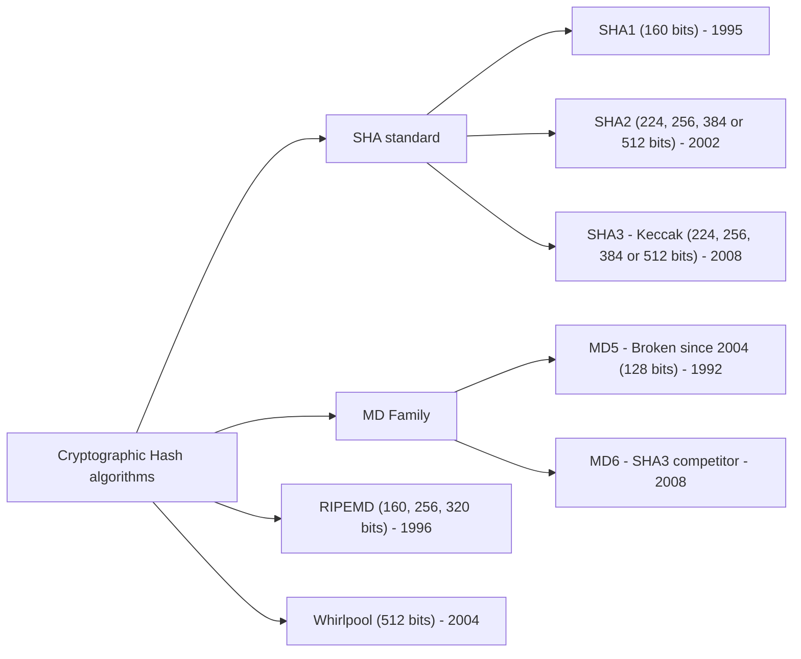

# Preservação do Sistema e Integridade de Dados

A **preservação do sistema** protege vestígios em análises *post-mortem* e *live*, recorrendo a **hashes** resistentes a colisões (`SHA-2`/`SHA-3`) e **assinaturas digitais** para provar integridade e autenticidade.

> [!TIP] Lógica de Funcionamento e Valor Forense
> * **Porque existe (Método / Sistema)**: Suportes digitais são alterados pelo próprio funcionamento do sistema operativo; bloqueadores de escrita (*Write Blockers*), cópias duplicadas e funções de *hash* criptográficas fixam o estado binário exato da evidência recolhida.
> * **Porque importa (Forense / Tribunal)**: Um *hash* isolado ($H(M)=h$) não depende de segredo e pode ser recalculado se alguém adulterar ficheiro e manifesto; só algoritmos sem colisões conhecidos aliados a **assinaturas digitais** (ex.: Cartão de Cidadão) asseguram integridade e não-repúdio em juízo.
> * **Pontos Críticos e Armadilhas para Exame**:
>   * **Isolamento em *live analysis***: ligar o cabo a um *hub* ou *switch* vazio mantém o sinal elétrico de *link up*, evitando mensagens de ligação morta (*dead link*) nos registos.
>   * **`MD5` quebrado desde 2004**: permite gerar **colisões** (dois ficheiros distintos ou um certificado digital forjado com o mesmo resumo); usar **apenas para retrocompatibilidade**.
>   * **Vulnerabilidade do *hash* isolado**: um adversário pode substituir $(M, h)$ por $(M', H(M'))$, exigindo chave privada em dispositivo seguro para assinatura digital.

---

## Técnicas de Preservação: *Post-Mortem* vs. *Live Analysis*

| Abordagem | Técnica de Preservação | Mecanismo e Finalidade Pericial |
| :--- | :--- | :--- |
| **Análise *Post-Mortem*** | **Desligar a ficha (*pull the plug*)** | Cortar imediatamente a alimentação elétrica para reduzir a quantidade de evidência sobrescrita no armazenamento |
| **Análise *Post-Mortem*** | **Efetuar cópias duplicadas** | Duplicar integralmente todos os dados e trabalhar exclusivamente sobre as cópias |
| **Análise *Post-Mortem*** | **Bloqueadores de escrita (*Write Blockers*)** | Impedir fisicamente ou logicamente que qualquer dado seja escrito ou sobrescrito no suporte original |
| **Análise *Live*** | **Terminar ou suspender processos suspeitos** | Interromper execução maliciosa ativa antes que destrua ou exfiltre dados |
| **Análise *Live*** | ***Hub* ou *switch* vazio** | Isolar da rede mantendo o sinal elétrico de *link up*, evitando registos de *dead link* que alertem malware ou sobrescrevam logs |
| **Análise *Live*** | **Filtros de rede** | Impedir que o atacante estabeleça ligação remota para apagar vestígios |
| **Análise *Live*** | **Backup de dados importantes** | Salvaguardar logs críticos e ficheiros voláteis essenciais |

---

## Integridade de Dados e Algoritmos de Hash Criptográficos

Sempre que dados importantes são guardados durante uma análise *post-mortem* ou *live*, deve ser calculado um **hash criptográfico** para demonstrar posteriormente que os dados não sofreram qualquer alteração.

| Família / Padrão | Algoritmo | Tamanho do Resumo | Ano | Observações Técnicas |
| :--- | :--- | :--- | :---: | :--- |
| **SHA Standard** | `SHA-1` | 160 bits | 1995 | Primeira geração padrão SHA |
| **SHA Standard** | `SHA-2` | 224, 256, 384 ou 512 bits | 2002 | Largamente utilizado (`SHA-256`, `SHA-512`) |
| **SHA Standard** | `SHA-3` (*Keccak*) | 224, 256, 384 ou 512 bits | 2008 | Vencedor da competição SHA-3 |
| **MD Family** | `MD5` | 128 bits | 1992 | **Quebrado desde 2004** |
| **MD Family** | `MD6` | Variável | 2008 | Concorrente ao padrão SHA-3 |
| **Outros** | `RIPEMD` | 160, 256 ou 320 bits | 1996 | Alternativa europeia |
| **Outros** | `Whirlpool` | 512 bits | 2004 | Resumo de 512 bits |

---

## Vulnerabilidade do Algoritmo MD5

> [!WARNING] MD5 Quebrado desde 2004
> * O algoritmo `MD5` encontra-se **quebrado desde 2004**, devendo ser utilizado **apenas para efeitos de retrocompatibilidade**.
> * É possível gerar **colisões**: criar ficheiros diferentes que produzem exatamente o mesmo valor de *hash*.
> * **Exemplos clássicos de colisão**:
>   * [Demonstração de colisões MD5 em executáveis/ficheiros por Peter Selinger](http://www.mscs.dal.ca/~selinger/md5collision/).
>   * [Análise da criação de um certificado digital forjado via colisão MD5](http://cryptocrats.com/crypto/md5-the-hash-algorithm-is-now-broken/).

---

## Comparação: `MD5` vs. `SHA-2 / SHA-3` vs. Assinatura Digital

Os valores de *hash*, por si sós, **não são suficientes** para garantir a integridade perante um adversário com acesso ao local onde o *hash* é guardado:

* Dada uma mensagem $M$, o seu valor de *hash* é $H(M) = h$.
* Alguém mal-intencionado pode **alterar tanto a mensagem $M$ como o resumo $h$** (substituindo $M$ por $M'$ e $h$ por $H(M')$), uma vez que o cálculo de $h$ **não depende de nenhum segredo**.
* **Solução — Assinaturas Digitais**: dependem de uma **chave privada** conhecida apenas pelo signatário, sendo a segurança substancialmente superior quando a assinatura é realizada através de um **dispositivo físico seguro**, como o **Cartão de Cidadão** português.

| Mecanismo de Proteção | Tamanho / Base Criptográfica | Resistência a Colisões | Depende de Segredo? | Valor Probatório e Recomendação |
| :--- | :--- | :--- | :---: | :--- |
| **`MD5` isolado** | 128 bits (função pública) | **Quebrado desde 2004** | Não | Apenas para retrocompatibilidade; vulnerável a colisões intencionais |
| **`SHA-2` / `SHA-3` isolado** | 224–512 bits (função pública) | **Forte** (padrão atual) | Não ($H(M)=h$) | Deteta corrupção acidental, mas permite substituir $M \to M'$ e $h \to H(M')$ |
| **Hash (`SHA-2`/`SHA-3`) + Assinatura Digital** | Digest + chave privada assimétrica | **Forte** + autenticidade | **Sim** (chave privada; ex.: **Cartão de Cidadão**) | Garante integridade, autenticidade do perito e não-repúdio em tribunal |

---

## Implicações Forenses

* **Prova de Não Adulteração**: Em tribunal, assinar digitalmente o relatório e os manifestos de *hashes* (`SHA-256`) com o Cartão de Cidadão no momento da aquisição garante não só a integridade dos dados como a autenticidade e o não-repúdio do perito que realizou a recolha.
* **Isolamento Físico Engenhoso**: Ligar o cabo de rede de um servidor suspeito a um *switch* vazio evita que o sistema operativo detete a queda da interface (`NIC link down`), impedindo o disparo de *scripts* de autodestruição (*dead man's switch*) ou a poluição dos logs do sistema.

---

## Além da aula

* **Assinaturas Digitais e Hashes Criptográficos na Segurança e Forense do Windows ([[00 ASSI|ASSI]])**:
  * **Cadeia de Confiança no Arranque ([[UEFI Secure Boot]])**: Tal como uma assinatura digital protege a integridade e autenticidade de uma evidência pericial através de um par de chaves assimétricas, o processo de arranque UEFI valida cada binário (`bootmgr.efi`, `winload.efi`, `ntoskrnl.exe`) recorrendo a certificados e chaves públicas/privadas ([[UEFI Secure Boot - Chaves e Hierarquia]]). Se a chave privada de topo for exposta — como sucedeu na vulnerabilidade [[PKfail - Vulnerabilidade do UEFI Secure Boot|PKfail]] — um atacante consegue assinar *bootkits* maliciosos que passam na verificação criptográfica ([[PKfail - Cadeia de Ataque e Deteção Forense]]).
  * **Validação de Assinaturas de Ferramentas Forenses (`sigcheck`)**: Antes de utilizar binários de extração (como a suite de Eric Zimmerman), a integridade e a assinatura digital do executável podem ser verificadas com o utilitário `sigcheck.exe` da Sysinternals (ver [[Análise Forense e Criação a Pedido do Prefetch]] e [[PKfail - Cadeia de Ataque e Deteção Forense]]).
  * **Hashes Criptográficos Nativos em Artefactos do Windows**: O próprio sistema operativo calcula e guarda resumos criptográficos em artefactos forenses — destacando-se o hash **`SHA-1`** de todos os executáveis inventariados na [[AmCache - Arquitetura, Hives e Evolução para SQLite|AmCache]] (essencial para triagem no VirusTotal em [[Extração da AmCache e Comparação Forense com a ShimCache]]) e o hash **`SHA-256`** (32 bytes) do ficheiro aberto nos separadores `TabState` do [[Artefacto Forense do Bloco de Notas (Notepad Windows 11)]]. Pelo contrário, a hash de 8 caracteres no nome dos ficheiros `.pf` ([[Estrutura Interna e Algoritmo de Hashing do Prefetch]]) **não é um hash criptográfico**, mas apenas uma função de dispersão rápida baseada no caminho.

---

## Perguntas de revisão

1. **Porque se recomenda ligar o cabo de rede a um *hub* ou *switch* vazio durante a preservação em análise *live*?**

> [!success]- Ver Resposta
> Para isolar o sistema da rede mantendo ativo o sinal elétrico de *link up*, evitando mensagens de registo (*logs*) sobre uma ligação morta (*dead link*) que poderiam alertar software malicioso ou sobrescrever registos relevantes.

2. **Que técnicas principais distinguem a preservação em análise *post-mortem* da preservação em análise *live*?**

> [!success]- Ver Resposta
> Na análise *post-mortem* recorre-se a cortar a corrente (*pull the plug*), efetuar cópias duplicadas e usar **Write Blockers**. Na análise *live* suspendem-se ou terminam-se processos suspeitos, isola-se a rede com *hub/switch* vazio ou filtros de rede e faz-se *backup* dos dados críticos.

3. **Porque é que o algoritmo `MD5` só deve ser utilizado para retrocompatibilidade e o que significa existir uma colisão?**

> [!success]- Ver Resposta
> O `MD5` encontra-se **quebrado desde 2004**. Uma colisão significa que é possível criar dois ficheiros distintos (como executáveis diferentes ou certificados digitais forjados) que produzem exatamente o mesmo valor de *hash* de 128 bits.

4. **Porque é que guardar apenas o par $(M, H(M))$ não impede a adulteração intencional dos dados, e como resolvem esse problema as assinaturas digitais?**

> [!success]- Ver Resposta
> Como o cálculo de $H(M)=h$ não depende de nenhum segredo, um atacante com acesso ao local de armazenamento pode alterar $M$ para $M'$ e substituir $h$ por $H(M')$. As **assinaturas digitais** dependem de uma **chave privada** conhecida apenas pelo signatário (especialmente robusta num dispositivo físico seguro como o **Cartão de Cidadão**), impedindo a falsificação do resumo.

## Notas relacionadas

- [[Fases da Investigação Forense Digital]]
- [[Pesquisa de Evidências e Reconstrução de Eventos]]
- [[Exercícios Práticos - Integridade de Dados e Hashes]]
- [[Diretrizes de Manuseamento - Identificação, Preservação, Isolamento e Correlação]]
- [[Princípios de Aquisição Forense, Resposta Inicial e Camadas de Abstração]]
- [[Procedimentos de Aquisição - Post-Mortem vs Live, Erros de Disco, HPA-DCO e Write Blockers]]
- [[Armazenamento da Aquisição - Clonagem vs Imagem, Formatos, Aquisição Remota e Assinatura de Hashes]]
- [[Aquisição em Linha de Comandos no Linux - dcfldd e Derivados do dd]]
- [[UEFI Secure Boot]]
- [[UEFI Secure Boot - Chaves e Hierarquia]]
- [[PKfail - Vulnerabilidade do UEFI Secure Boot]]
- [[PKfail - Cadeia de Ataque e Deteção Forense]]
- [[AmCache - Arquitetura, Hives e Evolução para SQLite]]
- [[Extração da AmCache e Comparação Forense com a ShimCache]]
- [[Análise Forense e Criação a Pedido do Prefetch]]
- [[Artefacto Forense do Bloco de Notas (Notepad Windows 11)]]
- [[Capítulo 1 - Método de Investigação]]
