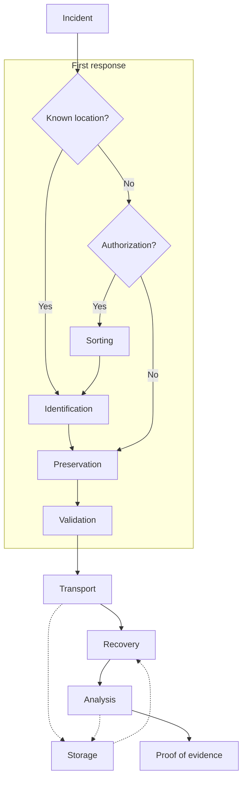

# Princípios e Rota do Manuseamento de Evidência Digital

O manuseamento de evidência digital (*Digital Evidence Handling*) obedece a **quatro princípios fundamentais** que salvaguardam a integridade pericial desde a primeira intervenção (*first responders*), exigindo qualificação técnica para acessos excecionais aos dados originais, manutenção de uma **cadeia de custódia** auditável por terceiros independentes e responsabilidade legal global. Estes princípios materializam-se no fluxograma da **Rota da Evidência Digital**, que governa o percurso do vestígio desde a deteção do incidente até à produção de prova em tribunal.

---

## Princípios do Manuseamento de Evidência Digital (*Principles of Digital Evidence Handling*)

1. **Não alteração dos dados originais (*Princípio 1*)**:
   * As ações desencadeadas pelos primeiros intervenientes (*first responders*) **não devem alterar os dados** mantidos num computador ou num dispositivo de armazenamento que possam vir a ser submetidos a um tribunal como evidência.
2. **Acesso excecional qualificado (*Princípio 2*)**:
   * Em circunstâncias excecionais, se for considerado necessário aceder aos dados originais armazenados num computador ou dispositivo de armazenamento, quem o fizer **tem de possuir competências (*skills*)** para poder prestar depoimento/prova, explicando a relevância e as implicações das suas ações.
3. **Cadeia de custódia e repetibilidade (*Princípio 3*)**:
   * Deve ser criada e preservada uma **cadeia de custódia (*chain of custody*)** ou outro registo de todos os processos aplicados à evidência digital. Uma **terceira parte independente** deve ser capaz de examinar esses processos e **obter exatamente o mesmo resultado**.
4. **Responsabilidade pelo cumprimento legal (*Princípio 4*)**:
   * A pessoa responsável pela investigação tem de assumir a responsabilidade global pelo cumprimento da lei e dos presentes princípios.

---

## Rota da Evidência Digital (*Route of the Digital Evidence*)

O percurso operacional da evidência digital divide-se numa fase inicial de **Primeira Resposta (*First response*)** no local e numa fase subsequente de transporte, armazenamento, recuperação, análise e produção de prova:

### Leitura do Fluxo na Primeira Resposta (*First Response*)
* **Localização conhecida (*Known location?*)**:
  * **Sim (*Yes*)**: avança diretamente para a **Identificação (*Identification*)**, seguida de **Preservação (*Preservation*)** e **Validação (*Validation*)**.
  * **Não (*No*)**: verifica-se se existe **Autorização legal (*Authorization?*)** para realizar uma triagem prévia no local:
    * **Sim (*Yes*)**: executa-se a **Triagem (*Sorting*)** $\rightarrow$ **Identificação (*Identification*)** $\rightarrow$ **Preservação (*Preservation*)** $\rightarrow$ **Validação (*Validation*)**.
    * **Não (*No*)**: não sendo permitida triagem seletiva no local, procede-se diretamente à **Preservação (*Preservation*)** e **Validação (*Validation*)**.
* **Pós-Primeira Resposta**:
  * Após a **Validação**, a evidência segue para **Transporte (*Transport*)**, podendo ir para **Armazenamento (*Storage*)** ou diretamente para **Recuperação (*Recovery*)** e **Análise (*Analysis*)** (com fluxos de arquivo/consulta contínuos com o **Armazenamento**), culminando na **Prova (*Proof of evidence*)**.

---

## Além da aula

* **Normas Internacionais**: Os quatro princípios apresentados correspondem aos célebres **Princípios ACPO (*Association of Chief Police Officers*)** do Reino Unido para evidência digital, os quais serviram igualmente de base à norma internacional **ISO/IEC 27037** (*Guidelines for identification, collection, acquisition, and preservation of digital evidence*).
* **Aplicação na Cadeia de Custódia e Triagem em Windows ([[00 ASSI|ASSI]])**:
  * **Validação de Ferramentas Periciais (Princípio 3 — Repetibilidade)**: No exame a artefactos do Windows, o uso de ferramentas determinísticas de código aberto da suite de Eric Zimmerman (ex.: `PECmd`, `AmcacheParser`, `LECmd`, `JLECmd`, `SrumECmd`, `SBECmd`), devidamente validadas com `sigcheck.exe -i` ([[Análise Forense e Criação a Pedido do Prefetch]]), garante que qualquer terceira parte independente obtenha exatamente os mesmos relatórios CSV/JSON a partir dos mesmos ficheiros de origem.
  * **Acesso Excecional em *First Response* (Princípio 2)**: Quando é necessário recolher dados de um sistema Windows vivo (ex.: executar [[LastActivityView e Reconstituição Temporal Live|LastActivityView]], `powercfg /srumutil` em [[Análise Forense do SRUM e Ferramentas Nativas (powercfg)]] ou montar [[Acesso Forense e Montagem de Shadow Copies|Shadow Copies com mklink/VSCMount]]), o perito tem de saber explicar em tribunal que artefactos foram criados pela própria intervenção (como o ficheiro `.pf` da ferramenta lançada).

---

## Implicações Forenses

* **Auditoria por Terceiros (Princípio 3)**: Qualquer omissão na cadeia de custódia ou na documentação dos comandos executados impede que um perito da defesa ou nomeado pelo tribunal reproduza os resultados, podendo levar à nulidade da prova.
* **Autorização para Triagem (*Sorting*)**: Na *First Response*, quando a localização exata da prova é desconhecida, o perito nunca pode realizar uma pré-análise (*sorting*) nos sistemas sem verificar previamente se o mandado judicial ou enquadramento legal do país o autoriza.

---

## Perguntas de revisão

- Quais são os quatro princípios fundamentais do manuseamento de evidência digital?
- Em que condição excecional é permitido aceder diretamente aos dados originais e que obrigação recai sobre quem o faz?
- Na Rota da Evidência Digital, qual é a diferença de procedimento quando a localização da evidência não é conhecida e existe (ou não existe) autorização legal?

## Notas relacionadas

- [[Diretrizes de Manuseamento - Identificação, Preservação, Isolamento e Correlação]]
- [[Registo, Etiquetagem e Fotografia Pericial (Regras LabCIF)]]
- [[Fases da Investigação Forense Digital]]
- [[Análise Forense e Criação a Pedido do Prefetch]]
- [[LastActivityView e Reconstituição Temporal Live]]
- [[Acesso Forense e Montagem de Shadow Copies]]
- [[Capítulo 1 - Método de Investigação]]
