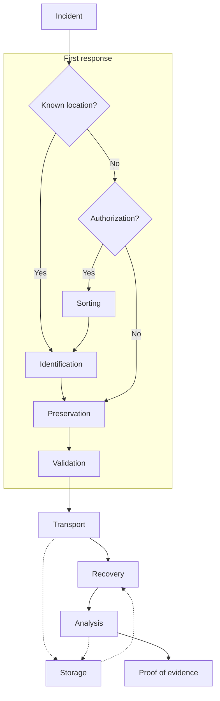

# Princípios e Rota do Manuseamento de Evidência Digital

O manuseamento de evidência digital rege-se por **quatro princípios fundamentais** que salvaguardam a integridade desde os *first responders* e orientam o fluxo operacional da **Rota da Evidência Digital**.

> [!TIP] Lógica de Funcionamento e Valor Forense
> * **Porque existe (Método / Sistema)**: A primeira resposta no local do incidente é crítica e propensa a erros irreversíveis; os quatro princípios (alinhados com as normas ACPO e ISO/IEC 27037) e o fluxograma da rota padronizam decisões sobre triagem, preservação e transporte.
> * **Porque importa (Forense / Tribunal)**: Assegura a **Cadeia de Custódia** (*Chain of Custody*) e a **repetibilidade**, permitindo a qualquer perito independente repetir os procedimentos descritos e obter exatamente o mesmo resultado em juízo.
> * **Pontos Críticos e Armadilhas para Exame**:
>   * **Acesso excecional aos originais (Princípio 2)**: só é válido se quem acede possuir competências técnicas para testemunhar em tribunal sobre a relevância e implicações das suas ações.
>   * **Condição de triagem (*Sorting*) na Rota**: quando a localização da evidência é **desconhecida**, só se realiza *Sorting* prévio se existir **autorização legal**; caso contrário, preserva-se e valida-se diretamente.
>   * **Responsabilidade global (Princípio 4)**: o responsável pela investigação responde pelo cumprimento integral da lei e dos quatro princípios.

---

## Princípios do Manuseamento de Evidência Digital

| Princípio | Regra Fundamental | Exigência Operacional e Legal |
| :---: | :--- | :--- |
| **1** | **Não alteração dos dados originais** | As ações dos *first responders* **não devem alterar os dados** em computadores ou suportes de armazenamento que possam ser submetidos a tribunal como evidência |
| **2** | **Acesso excecional qualificado** | Em circunstâncias excecionais que exijam aceder aos dados originais, o interveniente **tem de possuir competências** para prestar prova e explicar a relevância e implicações das ações |
| **3** | **Cadeia de custódia e repetibilidade** | Deve ser mantida uma **cadeia de custódia** (*Chain of Custody*) de todos os processos aplicados; uma **terceira parte independente** tem de conseguir examiná-los e **obter exatamente o mesmo resultado** |
| **4** | **Responsabilidade pelo cumprimento legal** | A pessoa responsável pela investigação assume a responsabilidade global pelo cumprimento da lei e destes princípios |

---

## Rota da Evidência Digital

O percurso operacional da evidência digital divide-se numa fase inicial de **Primeira Resposta** (*First response*) no local e numa fase subsequente de transporte, armazenamento, recuperação, análise e produção de prova:

### Leitura do Fluxo na Primeira Resposta e Pós-Primeira Resposta

| Etapa / Decisão | Caminho no Fluxograma | Procedimento Aplicado |
| :--- | :--- | :--- |
| **Localização conhecida (`Known location?`)** | **Sim** | Avança diretamente para **Identificação** $\rightarrow$ **Preservação** $\rightarrow$ **Validação** |
| **Localização desconhecida + Autorização** | **Não** $\rightarrow$ **Sim** | Executa **Triagem (*Sorting*)** $\rightarrow$ **Identificação** $\rightarrow$ **Preservação** $\rightarrow$ **Validação** |
| **Localização desconhecida sem Autorização** | **Não** $\rightarrow$ **Não** | Triagem prévia interditada; avança diretamente para **Preservação** $\rightarrow$ **Validação** |
| **Pós-Primeira Resposta** | Após **Validação** | Segue para **Transporte** $\rightarrow$ **Armazenamento** (ou direto a **Recuperação**) $\rightarrow$ **Análise** (com arquivo/consulta contínuos com o **Armazenamento**) $\rightarrow$ **Prova** |

---

## Além da aula

* **Normas Internacionais**: Os quatro princípios apresentados correspondem aos célebres **Princípios ACPO (*Association of Chief Police Officers*)** do Reino Unido para evidência digital, os quais serviram igualmente de base à norma internacional **ISO/IEC 27037** (*Guidelines for identification, collection, acquisition, and preservation of digital evidence*).
* **Aplicação na Cadeia de Custódia e Triagem em Windows ([[00 ASSI|ASSI]])**:
  * **Validação de Ferramentas Periciais (Princípio 3 — Repetibilidade)**: No exame a artefactos do Windows, o uso de ferramentas determinísticas de código aberto da suite de Eric Zimmerman (ex.: `PECmd`, `AmcacheParser`, `LECmd`, `JLECmd`, `SrumECmd`, `SBECmd`), devidamente validadas com `sigcheck.exe -i` ([[Análise Forense e Criação a Pedido do Prefetch]]), garante que qualquer terceira parte independente obtenha exatamente os mesmos relatórios CSV/JSON a partir dos mesmos ficheiros de origem.
  * **Acesso Excecional em *First Response* (Princípio 2)**: Quando é necessário recolher dados de um sistema Windows vivo (ex.: executar [[LastActivityView e Reconstituição Temporal Live|LastActivityView]], `powercfg /srumutil` em [[Análise Forense do SRUM e Ferramentas Nativas (powercfg)]] ou montar [[Acesso Forense e Montagem de Shadow Copies|Shadow Copies com mklink/VSCMount]]), o perito tem de saber explicar em tribunal que artefactos foram criados pela própria intervenção (como o ficheiro `.pf` da ferramenta lançada).

---

## Implicações Forenses

* **Auditoria por Terceiros (Princípio 3)**: Qualquer omissão na cadeia de custódia ou na documentação dos comandos executados impede que um perito da defesa ou nomeado pelo tribunal reproduza os resultados, podendo levar à nulidade da prova.
* **Autorização para Triagem (*Sorting*)**: Na *First Response*, quando a localização exata da prova é desconhecida, o perito nunca pode realizar uma pré-análise (*sorting*) nos sistemas sem verificar previamente se o mandado judicial ou enquadramento legal do país o autoriza.

---

## Perguntas de revisão

1. **Quais são os quatro princípios fundamentais do manuseamento de evidência digital?**

> [!success]- Ver Resposta
> **1.** Não alterar os dados originais nas ações dos *first responders*; **2.** Acesso excecional aos originais apenas por pessoa com competência para prestar depoimento explicando implicações e relevância; **3.** Manutenção da cadeia de custódia e repetibilidade para que uma terceira parte obtenha exatamente o mesmo resultado; **4.** Responsabilidade global pelo cumprimento da lei e dos princípios.

2. **Em que condição excecional é permitido aceder diretamente aos dados originais e que obrigação recai sobre quem o faz?**

> [!success]- Ver Resposta
> Apenas em circunstâncias excecionais em que seja considerado necessário, recaindo sobre o interveniente a obrigação de possuir competências técnicas para **prestar prova/depoimento** explicando a relevância e as implicações das ações executadas.

3. **Na Rota da Evidência Digital, qual é a diferença de procedimento quando a localização da evidência não é conhecida e existe (ou não existe) autorização legal?**

> [!success]- Ver Resposta
> Se existir **autorização**, procede-se primeiro à **Triagem (*Sorting*)**, depois à **Identificação**, **Preservação** e **Validação**. Se **não existir autorização**, é proibido triar no local e avança-se diretamente para a **Preservação** e **Validação**.

4. **A que referenciais internacionais correspondem os quatro princípios de manuseamento de evidência digital?**

> [!success]- Ver Resposta
> Correspondem aos **Princípios ACPO** (*Association of Chief Police Officers*) do Reino Unido, que também serviram de base à norma internacional **ISO/IEC 27037**.

## Notas relacionadas

- [[Diretrizes de Manuseamento - Identificação, Preservação, Isolamento e Correlação]]
- [[Registo, Etiquetagem e Fotografia Pericial (Regras LabCIF)]]
- [[Fases da Investigação Forense Digital]]
- [[Análise Forense e Criação a Pedido do Prefetch]]
- [[LastActivityView e Reconstituição Temporal Live]]
- [[Acesso Forense e Montagem de Shadow Copies]]
- [[Capítulo 1 - Método de Investigação]]
