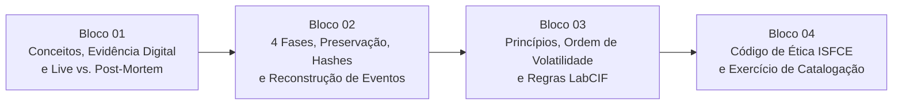

# Capítulo 1 — Método de Investigação (*Investigation Method*)

Índice temático e encadeamento pedagógico do **Capítulo 1 (*Investigation Method*)** da unidade curricular de [[00 AFD1|Análise Forense Digital I (AFD1)]], lecionada pelos docentes **Miguel Frade** e **Baltazar Rodrigues** (LabCIF).

As notas encontram-se organizadas em **4 blocos temáticos numerados** na pasta `AFD1/Capítulo 01 - Método de Investigação/`, cobrindo a totalidade dos 50 diapositivos da apresentação oficial.

> [!TIP] Guia de Consulta Rápida para Exame
> Para tabelas comparativas (*Live* vs. *Post-Mortem*, `MD5` vs. `SHA-2`/`SHA-3` e Assinatura Digital, Ordem de Volatilidade de 7 níveis), regras de etiquetagem e fotografia do LabCIF, comandos `sha256sum` e armadilhas de exame dos Capítulos 1 e 2, consulta a **[[Cheat Sheet - Método de Investigação, Arranque e Aquisição Forense]]**.

---

## 1. Introdução e Conceitos Forenses (`01 - Introdução e Conceitos Forenses`)

| Nota | Descrição e Foco Técnico |
| :--- | :--- |
| [[Investigação Digital e Evidência Digital]] | Método científico na refutação de hipóteses, questões fundamentais, quatro propriedades da evidência digital e desafios. |
| [[Investigação Forense Digital - Análise Live vs Post-Mortem]] | Admissibilidade legal segundo Brian Carrier, comparação entre análise live e post-mortem e caso do servidor comprometido. |

---

## 2. Metodologia de Investigação da Cena de Crime Digital (`02 - Metodologia de Investigação da Cena de Crime Digital`)

| Nota | Descrição e Foco Técnico |
| :--- | :--- |
| [[Fases da Investigação Forense Digital]] | As quatro fases iterativas e bidirecionais da investigação: identificação da fonte, preservação, pesquisa e reconstrução. |
| [[Preservação do Sistema e Integridade de Dados]] | Preservação post-mortem e live, famílias de hash, colisões MD5 desde 2004 e assinaturas digitais. |
| [[Pesquisa de Evidências e Reconstrução de Eventos]] | Pesquisa em ficheiros e rede com base NSRL, reconstrução de eventos e refutação da Trojan defense. |
| [[Exercícios Práticos - Integridade de Dados e Hashes]] | Verificação em lote com sha256sum no Linux, HashCalc no Windows e inversão no CrackStation. |

---

## 3. Manuseamento de Evidência Digital (`03 - Manuseamento de Evidência Digital`)

| Nota | Descrição e Foco Técnico |
| :--- | :--- |
| [[Princípios e Rota do Manuseamento de Evidência Digital]] | Quatro princípios ACPO de primeira resposta, cadeia de custódia, repetibilidade e fluxograma da Rota da Evidência. |
| [[Diretrizes de Manuseamento - Identificação, Preservação, Isolamento e Correlação]] | Estados e fontes de dados, Ordem de Volatilidade em 7 níveis, triagem, isolamento e correlação. |
| [[Registo, Etiquetagem e Fotografia Pericial (Regras LabCIF)]] | Diretriz de registo, sintaxe hierárquica de etiquetas LabCIF, fotografia com escala, caixa 3D e templates. |

---

## 4. Ética Forense e Exercícios (`04 - Ética Forense e Exercícios`)

| Nota | Descrição e Foco Técnico |
| :--- | :--- |
| [[Código de Ética na Investigação Forense Digital (ISFCE)]] | Propósito deontológico e diretrizes da ISFCE com deveres obrigatórios e proibições absolutas do perito. |
| [[Exercício de Projeto - Catalogação e Etiquetagem de Dispositivos e Serviços]] | Guião para o Projeto em Equipa: atributos de dispositivos e serviços, etiquetagem e fotografia com escala. |

---

## Navegação

* [[00 AFD1|Voltar ao Índice de AFD1]]
* [[Cheat Sheet - Método de Investigação, Arranque e Aquisição Forense|Consultar a Cheat Sheet de Exame (Capítulos 1 e 2)]]
* [[Capítulo 2 - Arranque e Aquisição Forense|Avançar para o Capítulo 2 — Arranque e Aquisição Forense]]
* [[Capítulo 3 - Organização de Dados|Avançar para o Capítulo 3 — Organização de Dados]]
* [[Capítulo 1 - Sistemas Operativos, Serviços e Artefactos Forenses|Pontes com ASSI — Capítulo 1 (Artefactos Forenses no Windows)]]
* [[Home|Voltar ao Hub Central do MCIF]]
