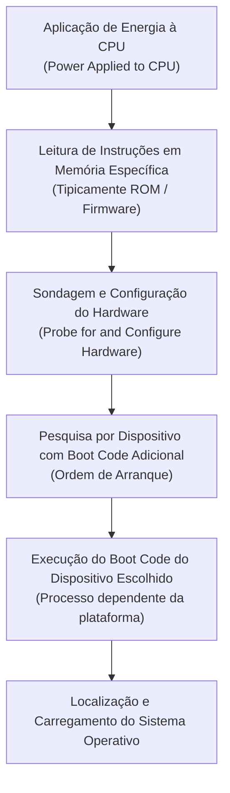

# Arranque Forense e Processo de Boot (BIOS e Código Máquina)

A prática forense padrão consiste em remover fisicamente o disco rígido do computador suspeito, protegê-lo com um bloqueador de escrita (*write-blocker*) e criar a sua imagem forense; contudo, quando o armazenamento está soldado à *motherboard* ou utiliza uma interface proprietária sem adaptador disponível, a aquisição tem de ser realizada com o disco ligado ao próprio equipamento. Como o arranque normal de um computador altera dados no disco primário, o perito deve recorrer a um **dispositivo de arranque forense (*Forensic Boot Device*)**, intercetando o processo de arranque antes de o hardware transferir o controlo para o suporte de armazenamento original.

---

## Motivação para o Arranque Forense (*Forensic Boot*)

### 1. Limitações à Remoção Física do Disco
Embora a extração física do suporte de armazenamento seguida de bloqueio de escrita e criação de imagem seja o procedimento normal, nem sempre é viável:
* Alguns portáteis ultrafinos (*thin laptops*) possuem **chips SSD soldados diretamente à *motherboard***.
* O dispositivo de armazenamento pode utilizar uma **interface de dados não padronizada (*non-standard data interface*)** para a qual o perito não dispõe do conector ou adaptador adequado.
* Nestes cenários, a criação da imagem forense (*imaging*) do dispositivo de armazenamento **tem obrigatoriamente de ser realizada com o disco ligado ao computador suspeito**.

### 2. Impacto do Arranque Normal na Evidência
* O arranque normal (*normal startup*) de um computador **altera dados na unidade de armazenamento primária** durante o processo de *boot*.
* Para proteger a integridade da evidência original (ver [[Preservação do Sistema e Integridade de Dados]]), é indispensável **modificar o processo de arranque** de modo a impedir quaisquer alterações aos dados residentes no disco.

> [!IMPORTANT] Definição e Regra de Ouro do Arranque Forense
> * **Dispositivo de Arranque Forense (*Forensic Boot Device*)**: Disquete de arranque (*boot diskette*), CD-ROM/DVD de arranque ou dispositivo USB de arranque utilizado no computador suspeito para garantir que a unidade de armazenamento **não é alterada nem durante a fase de arranque (*boot*) nem durante a fase de aquisição (*acquisition*)**.
> * **Fronteira de Intocabilidade no Hardware**: O processo normal de arranque inicia-se no hardware do computador e transita posteriormente para o dispositivo de arranque (*boot device*). **Não são efetuadas quaisquer alterações no disco até ao momento em que o computador transfere o controlo para o dispositivo de arranque**.

---

## Fases do Processo de Arranque (*Boot Process Steps*)

A maioria dos sistemas informáticos divide o processo de arranque em **duas fases fundamentais**:
1. **Configurar e iniciar o hardware** (*configure and start the hardware*).
2. **Localizar o sistema operativo e executá-lo** (*find the operating system and run it*).

### Sequência Detalhada desde a Alimentação da CPU
* **Código de Arranque (*Boot Code*)**: Conjunto de instruções máquina (*machine instructions*) utilizadas pelo computador quando está a iniciar.
* Quando é aplicada energia elétrica a uma CPU:
  1. A CPU lê instruções a partir de uma localização específica em memória — tipicamente memória **ROM** (*Read-Only Memory*).
  2. As instruções residentes na ROM forçam o sistema a **sondar (*probe*) e configurar o hardware** instalado.
  3. De seguida, o sistema **procura um dispositivo que possa conter código de arranque adicional**.
  4. Os discos reservam espaço específico para código de arranque (embora esse espaço nem sempre seja utilizado).
  5. O código de arranque desse dispositivo é executado e tenta localizar e carregar um sistema operativo.
  6. Todo o processo subsequente à localização do disco de arranque é **específico de cada plataforma (*platform-specific*)**.

---

## Características do Código de Arranque (*Boot Code Characteristics*)

* **Localização específica**: O código de arranque reside num endereço ou setor estritamente predefinido para que o firmware o consiga localizar sem conhecer o sistema de ficheiros.
* **Instruções em código máquina (*machine code*)**:
  * Exemplo em código máquina (hexadecimal): `0xB400`
  * Representação equivalente em linguagem *Assembly*: `MOV AH, 00`
* **Desafio Forense de Identificação**: Num dispositivo de armazenamento, é **difícil distinguir dados aleatórios (*random data*) de código máquina executável** apenas pela observação direta dos bytes brutos.

---

## Arranque em Sistemas com BIOS (*Basic Input/Output System*)

Nos sistemas baseados em firmware **BIOS** tradicional, o arranque opera por encadeamento de setores:

| Etapa | Mecanismo Técnico no Arranque BIOS |
| :--- | :--- |
| **1. Primeiro Setor do Disco (MBR)** | A BIOS arranca lendo o **primeiro setor do disco rígido** (*Master Boot Record*) e executando o código aí contido — o qual possui **fortes limitações de espaço** (512 bytes no total, partilhados com a tabela de partições). |
| **2. Primeiro Setor da Partição (VBR)** | Esse código do setor de arranque (*boot sector code*), por sua vez, localiza e executa **código adicional situado no primeiro setor da partição ativa** (*Volume Boot Record*). |
| **3. Carregamento do SO** | O código de arranque da partição localiza e carrega o **sistema operativo propriamente dito**. |

---

## Implicações Forenses

* **Interceção Antes do *Handoff* para o Disco Suspeito**: Como o firmware (ROM/BIOS/UEFI) não escreve no disco rígido durante o *Power-On Self-Test (POST)* e a sondagem de hardware, o perito pode entrar na configuração de firmware/menu de *boot* (`F2`, `F12`, `Del`, `Esc`) e redirecionar a transferência de controlo para uma pen USB ou CD-ROM forense sem alterar um único bit da evidência original.
* **Análise de Setores de Arranque**: Como os discos reservam espaço para *boot code* mesmo quando não são discos de sistema (unidades secundárias de dados), e dado que o código máquina (`0xB400`) se confunde visualmente com dados aleatórios ou *slack*, esses setores reservados constituem locais clássicos para ocultação de dados ou persistência de *bootkits* de baixo nível.

---

## Além da aula

* **Correlação com a Representação Binária/Hexadecimal e Artefactos de Arranque em [[00 ASSI|ASSI]] e [[00 AFD1|AFD1]]**:
  * **Leitura de Opcodes em Hexadecimal**: A equivalência apresentada na aula entre a palavra hexadecimal `0xB400` e a instrução Assembly x86 `MOV AH, 00` ilustra na prática a importância da [[Sistemas de Numeração e Conversão entre Bases|conversão hexadecimal]] e da [[Organização de Estruturas de Dados em Binário|interpretação contextual de bytes em binário]] estudadas no Capítulo 3 de AFD1: os mesmos 2 bytes podem representar um número inteiro em [[Endianness e Ordem de Armazenamento|Little-Endian]], dois caracteres [[Codificação de Caracteres - ASCII, Latin-1 e Unicode|Latin-1]] ou uma instrução de processador, consoante a região do disco analisada.
  * **O que muda no Disco num Arranque Normal do Windows**: Caso o perito falhe a interceção do arranque e deixe o sistema operativo Windows suspeito iniciar normalmente a partir do disco interno, dezenas de artefactos forenses estudados em **ASSI** são imediatamente modificados ou sobrescritos: o serviço [[Serviço Prefetch e SysMain - Arquitetura e Funcionamento|SysMain/Prefetch]] atualiza ficheiros `.pf` de arranque (`ntosboot-*.pf`), o [[Volume Shadow Service (VSS) - Arquitetura e Funcionamento|VSS]] pode expurgar *Shadow Copies* antigas por falta de espaço, os hives do [[Estrutura e Hives do Windows Registry|Windows Registry]] (`SYSTEM`, `SOFTWARE`, `SAM`) sofrem escritas transacionais e os serviços em segundo plano ([[Serviços Windows]], [[Windows Search]], [[System Resource Usage Monitor (SRUM) - Arquitetura e Base ESE|SRUM]]) alteram bases de dados críticas.

---

## Perguntas de revisão

- Em que circunstâncias técnicas não é possível seguir a prática forense normal de remover o disco rígido do computador suspeito para o ligar a um bloqueador de escrita externo?
- Em que momento exato do processo de arranque começam a ocorrer alterações aos dados na unidade de armazenamento primária?
- Quais são as duas fases gerais do processo de arranque na maioria dos sistemas informáticos?
- Como funciona o encadeamento de arranque num sistema equipado com BIOS face às limitações de espaço do primeiro setor do disco?

## Notas relacionadas

- [[Processo de Arranque UEFI, Secure Boot e Fluxo do Windows]]
- [[Dispositivos de Arranque Forense - Disquetes DOS, Live CDs Linux, WinFE e USB]]
- [[Procedimentos de Aquisição - Post-Mortem vs Live, Erros de Disco, HPA-DCO e Write Blockers]]
- [[Investigação Forense Digital - Análise Live vs Post-Mortem]]
- [[Preservação do Sistema e Integridade de Dados]]
- [[Sistemas de Numeração e Conversão entre Bases]]
- [[Organização de Estruturas de Dados em Binário]]
- [[UEFI Secure Boot]]
- [[Estrutura e Hives do Windows Registry]]
- [[Serviço Prefetch e SysMain - Arquitetura e Funcionamento]]
- [[Capítulo 2 - Arranque e Aquisição Forense]]
