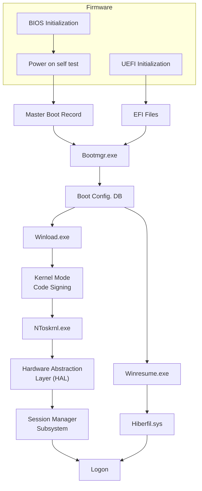

# Processo de Arranque UEFI, Secure Boot e Fluxo do Windows

O firmware UEFI carrega executáveis `.efi` a partir da partição ESP e valida assinaturas digitais no Secure Boot, convergindo com a BIOS no `Bootmgr.exe` para iniciar o Windows.

> [!TIP] Lógica de Funcionamento e Valor Forense
> * **Porque existe (Sistema / Hardware)**: O UEFI supera as restrições da BIOS tradicional (`512 bytes` no MBR e limite de `2 TB`) ao ler diretamente ficheiros `.efi` na partição ESP, independentemente da CPU; o *Secure Boot* bloqueia código de arranque não assinado para impedir *bootkits*.
> * **Porque importa (Forense)**: Se o *Secure Boot* estiver ativo, apenas suportes de arranque forense assinados conseguem iniciar a máquina; além disso, deixar um Windows em hibernação ou *Fast Startup* arrancar pelo disco interno faz o `Winresume.exe` consumir o `Hiberfil.sys`, destruindo a cópia da RAM guardada em disco.
> * **Pontos Críticos e Armadilhas para Exame**:
>   * **Convergência no Windows**: Tanto a via BIOS (`MBR`) como a via UEFI (`EFI Files`) convergem no **`Bootmgr.exe`**, que consulta a **`Boot Config. DB` (BCD)**.
>   * **Bifurcação Normal vs. Hibernação**: O arranque normal executa **`Winload.exe` $\rightarrow$ `Kernel Mode Code Signing` $\rightarrow$ `NToskrnl.exe` $\rightarrow$ `HAL` $\rightarrow$ `Session Manager Subsystem` (`smss.exe`) $\rightarrow$ `Logon`**; a retoma de hibernação desvia para **`Winresume.exe` $\rightarrow$ `Hiberfil.sys` $\rightarrow$ `Logon`**.

---

## Arquitetura UEFI e *Secure Boot Process*

### 1. Características Técnicas do UEFI
Ao contrário da BIOS tradicional (limitada ao código executável do primeiro setor de 512 bytes do disco), o **UEFI (*Unified Extensible Firmware Interface*)**:

* Arranca carregando ficheiros de programa EFI (com a extensão de ficheiro **`.efi`**).
* Estes ficheiros encontram-se armazenados numa partição especial do disco, denominada **EFI System Partition (ESP)**.
* Consegue **ler ficheiros diretamente de uma partição** no disco rígido.
* **Não está limitado ao tamanho do primeiro setor** do disco.
* Permite arrancar sistemas operativos em **discos com capacidade superior a `2 TB`**.
* Opera **independentemente da arquitetura da CPU**.
* Suporta **interfaces gráficas de utilizador (GUI)** logo no arranque.

### 2. Funcionalidade *Secure Boot* e Exigência Forense

* O **Secure Boot** é uma funcionalidade nativa do UEFI.
* Exige que todo o **código de arranque esteja assinado digitalmente**.
* O seu propósito de segurança é **prevenir a instalação de *malware* no código de arranque** (*bootkits* / *rootkits* de arranque).

> [!WARNING] Requisito para o Perito Forense em Sistemas com Secure Boot
> Quando o computador suspeito tem o *Secure Boot* ativo na UEFI, **o examinador forense tem obrigatoriamente de utilizar um dispositivo de arranque forense que suporte *Secure Boot*** (cujos binários `.efi` de arranque possuam uma assinatura digital válida reconhecida pelo firmware), ou o sistema recusará arrancar pelo suporte externo.

---

## Fluxo do Processo de Arranque do Windows

O diagrama seguinte reproduz a arquitetura completa do processo de arranque do Windows apresentada na aula, ilustrando a convergência entre BIOS e UEFI e a bifurcação entre arranque normal e retoma de hibernação, acompanhado da comparação estrutural entre os dois modos de firmware:

### Comparação Estrutural: BIOS (MBR) vs. UEFI (ESP)

| Dimensão Técnica | BIOS (MBR) | UEFI (ESP) |
| :--- | :--- | :--- |
| **Localização do Código** | Primeiro setor físico do disco (**MBR**, 512 bytes) $\rightarrow$ primeiro setor da partição (**VBR**). | Ficheiros executáveis **`.efi`** lidos diretamente da **EFI System Partition (ESP)**. |
| **Restrição de Espaço / Disco** | Forte limite de código nos 512 bytes iniciais; discos limitados a `2 TB` no esquema MBR. | Sem limite de tamanho de setor; arranca em discos **superiores a `2 TB`** (GPT). |
| **Interface e Arquitetura** | Interface textual simples; dependente da arquitetura x86 em modo real de 16 bits. | Suporta **GUI logo no arranque** e opera **independentemente da arquitetura da CPU**. |
| **Segurança no Arranque** | Sem validação criptográfica nativa do código de arranque. | Suporta **Secure Boot**, exigindo assinatura digital válida em todo o código de arranque. |
| **Convergência no Windows** | `BIOS Initialization` $\rightarrow$ `POST` $\rightarrow$ `Master Boot Record` $\rightarrow$ **`Bootmgr.exe`**. | `UEFI Initialization` $\rightarrow$ `EFI Files` $\rightarrow$ **`Bootmgr.exe`**. |

### Análise Sequencial dos Componentes do Arranque Windows

| Etapa / Componente | Função no Encadeamento de Arranque |
| :--- | :--- |
| **1. Camada de Firmware** | • **Via BIOS**: Executa a inicialização da BIOS seguida do autoteste de arranque (*Power On Self Test — POST*), entregando o controlo ao **Master Boot Record (MBR)**. • **Via UEFI**: Executa a inicialização UEFI e carrega diretamente os **ficheiros EFI** a partir da partição ESP. |
| **2. `Bootmgr.exe`** | O *Windows Boot Manager* assume o controlo (quer provenha do MBR/VBR quer do ficheiro `.efi`) e consulta a **Boot Configuration Database (`Boot Config. DB` / BCD)**. |
| **3A. Ramo de Arranque Normal (`Winload.exe`)** | 1. **`Winload.exe`**: Carregador do sistema operativo Windows. 2. **Kernel Mode Code Signing**: Validação da assinatura digital dos componentes e controladores de modo kernel. 3. **`NToskrnl.exe`**: Inicialização da imagem do Kernel do Windows NT. 4. **Hardware Abstraction Layer (HAL)**: Camada de abstração de hardware. 5. **Session Manager Subsystem (`smss.exe`)**: Subsistema de gestão de sessões em modo de utilizador, culminando no ecrã de **`Logon`**. |
| **3B. Ramo de Hibernação (`Winresume.exe`)** | Se a base de dados de configuração de arranque (`Boot Config. DB`) indicar que o sistema foi colocado em hibernação (ou *Fast Startup*), o fluxo desvia para o **`Winresume.exe`**, que lê a imagem da memória guardada em disco no ficheiro **`Hiberfil.sys`** e restaura diretamente a sessão para a fase de **`Logon`**. |

---

## Implicações Forenses

* **Risco Crítico do `Hiberfil.sys` e *Fast Startup***: Se um computador Windows suspeito tiver sido desligado em modo de hibernação (ou com o *Fast Startup* ativo no Windows 10/11, que utiliza hibernação parcial do kernel), o ficheiro `C:\hiberfil.sys` contém uma cópia comprimida da memória RAM anterior. Se o perito deixar a máquina arrancar normalmente pelo disco interno, o `Winresume.exe` irá consumir e invalidar o `Hiberfil.sys`, destruindo evidência volátil preciosa que estava preservada em disco.
* **Integridade da Partição ESP**: Em sistemas UEFI, a *EFI System Partition (ESP)* (tipicamente formatada em FAT32 e oculta sem letra de unidade no Windows) deve ser sempre incluída na aquisição física e inspecionada, pois é nela que residem os binários `.efi` que iniciam o sistema.

---

## Além da aula

* **Aprofundamento Criptográfico do UEFI Secure Boot e Vulnerabilidade PKfail em [[00 ASSI|ASSI]]**:
  * Na unidade curricular de **ASSI**, este mesmo processo de arranque é estudado ao nível da sua hierarquia criptográfica e exploração ofensiva/forense nas notas [[UEFI Secure Boot]] e [[UEFI Secure Boot]]. A validação criptográfica de assinatura digital no código de arranque opera através de 4 variáveis NVRAM: **PK (*Platform Key*)**, **KEK (*Key Exchange Key*)**, **db (*Signature Database* — whitelist)** e **dbx (*Forbidden Signatures Database* — blacklist)**.
  * Na nota [[PKfail - Vulnerabilidade do UEFI Secure Boot]] e em [[PKfail - Vulnerabilidade do UEFI Secure Boot]], analisa-se o caso real (`CVE-2016-5247`) em que a chave privada da *Platform Key* de teste da AMI ("DO NOT TRUST") foi deixada em equipamentos de produção, permitindo a atacantes assinar *bootkits* maliciosos na partição ESP (`bootmgfw.efi`) que contornam o *Secure Boot* e comprometem o `Bootmgr.exe` e o `Winload.exe` antes do `NToskrnl.exe` iniciar.
* **Subsistema de Sessão e Serviços do Windows**:
  * Após o **Session Manager Subsystem (`smss.exe`)** e o `wininit.exe` entrarem em execução no final do fluxograma da aula, é iniciado o *Service Control Manager (`services.exe`)* que lança os processos anfitriões [[svchost.exe]] e os [[Serviços Windows]] estudados no Bloco 03 de ASSI.

---

## Perguntas de revisão

1. **Quais são as principais vantagens técnicas do firmware UEFI face à BIOS tradicional no que respeita à localização do código de arranque e à capacidade máxima dos discos?**

> [!success]- Ver Resposta
> O UEFI não está limitado ao primeiro setor de 512 bytes (MBR), pois lê diretamente ficheiros executáveis **`.efi`** a partir de uma partição dedicada (**EFI System Partition — ESP**), permitindo arrancar sistemas operativos em discos **superiores a `2 TB`**, operar **independentemente da arquitetura da CPU** e apresentar uma **interface gráfica (GUI)** logo no arranque.

2. **Qual é a função do *Secure Boot* no UEFI e que exigência prática impõe às ferramentas de arranque do perito forense?**

> [!success]- Ver Resposta
> O *Secure Boot* exige que todo o código de arranque esteja **assinado digitalmente** para impedir a instalação de *malware* de arranque (*bootkits* / *rootkits*). Na prática, obriga o perito a utilizar um **dispositivo de arranque forense com suporte a *Secure Boot*** (cujos binários `.efi` possuam assinatura válida reconhecida pelo firmware), sob pena de a máquina recusar arrancar pelo suporte externo.

3. **Descreva os dois caminhos possíveis após a leitura da `Boot Config. DB` (`BCD`) pelo `Bootmgr.exe` durante o arranque do Windows.**

> [!success]- Ver Resposta
> * **Ramo de arranque normal**: O controlo passa para o **`Winload.exe`**, que desencadeia a validação do kernel e o carregamento completo do sistema operativo até ao `Logon`.
> * **Ramo de hibernação**: Se o sistema tiver sido hibernado (ou desligado com *Fast Startup*), o controlo passa para o **`Winresume.exe`**, que lê a imagem de memória guardada em **`Hiberfil.sys`** e restaura diretamente a sessão para o `Logon`.

4. **Que passos ocorrem entre a execução do `Winload.exe` e a apresentação do ecrã de `Logon`?**

> [!success]- Ver Resposta
> Após o **`Winload.exe`**, executa-se a verificação **`Kernel Mode Code Signing`** (assinatura digital dos controladores e componentes de modo kernel), carrega-se o núcleo **`NToskrnl.exe`**, inicializa-se a camada **`Hardware Abstraction Layer (HAL)`** e arranca o **`Session Manager Subsystem` (`smss.exe`)**, culminando no ecrã de **`Logon`**.

---

## Navegação e Notas Relacionadas

| Percurso | Nota | Contexto |
| :--- | :--- | :--- |
| **Anterior** | [[Arranque Forense e Processo de Boot (BIOS e Código Máquina)]] | `mesmo bloco` |
| **Seguinte** | [[Dispositivos de Arranque Forense - Disquetes DOS, Live CDs Linux, WinFE e USB]] | `muda para Bloco 02` |
| **Índice** | [[Capítulo 2 - Arranque e Aquisição Forense]] · [[00 AFD1]] | `Bloco 01` |

### Conceitos Relacionados

* [[UEFI Secure Boot]] · `ASSI · Cap. 1`
* [[PKfail - Vulnerabilidade do UEFI Secure Boot]] · `ASSI · Cap. 1`
* [[System e OS Hardening e Vulnerabilidade BitLocker YellowKey (CVE-2026-45585)]] · `ASSI · Cap. 2`
* [[Serviços Windows]] · `ASSI · Cap. 1`
* [[svchost.exe]] · `ASSI · Cap. 1`
* [[Preservação do Sistema e Integridade de Dados]] · `Cap. 1`
