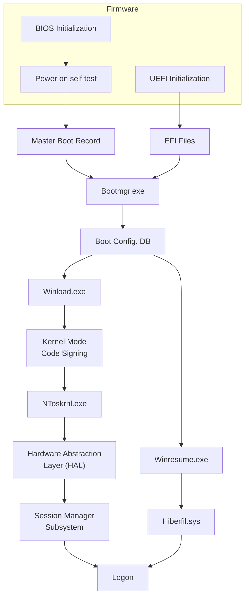

# Processo de Arranque UEFI, Secure Boot e Fluxo do Windows

A arquitetura **UEFI (*Unified Extensible Firmware Interface*)** supera as limitações históricas da BIOS ao carregar ficheiros executáveis `.efi` diretamente a partir de uma partição dedicada — a **EFI System Partition (ESP)** —, suportando discos superiores a `2 TB`, interfaces gráficas no arranque e validação criptográfica através de **Secure Boot**. No sistema operativo Windows, tanto o fluxo legado (BIOS/MBR) como o fluxo moderno (UEFI/EFI) convergem no gestor **`Bootmgr.exe`** e na **Boot Configuration Database (BCD)**, ramificando-se depois entre um arranque frio (`Winload.exe` $\rightarrow$ `NToskrnl.exe`) ou a retoma a partir de hibernação (`Winresume.exe` $\rightarrow$ `Hiberfil.sys`).

---

## Arquitetura UEFI e *Secure Boot Process*

### 1. Características Técnicas do UEFI
Ao contrário da BIOS tradicional (limitada ao código executável do primeiro setor de 512 bytes do disco), o **UEFI (*Unified Extensible Firmware Interface*)**:
* Arranca carregando ficheiros de programa EFI (com a extensão de ficheiro **`.efi`**).
* Estes ficheiros encontram-se armazenados numa partição especial do disco, denominada **EFI System Partition (ESP)**.
* Consegue **ler ficheiros diretamente de uma partição** no disco rígido.
* **Não está limitado ao tamanho do primeiro setor** do disco.
* Permite arrancar sistemas operativos em **discos com capacidade superior a `2 TB`**.
* Opera **independentemente da arquitetura da CPU** (*regardless of the CPU architecture*).
* Suporta **interfaces gráficas de utilizador (GUI)** logo no arranque (*on startup*).

### 2. Funcionalidade *Secure Boot* e Exigência Forense
* O **Secure Boot** é uma funcionalidade nativa do UEFI.
* Exige que todo o **código de arranque esteja assinado digitalmente** (*digitally signed*).
* O seu propósito de segurança é **prevenir a instalação de *malware* no código de arranque** (*bootkits* / *rootkits* de arranque).

> [!WARNING] Requisito para o Perito Forense em Sistemas com Secure Boot
> Quando o computador suspeito tem o *Secure Boot* ativo na UEFI, **o examinador forense tem obrigatoriamente de utilizar um dispositivo de arranque forense que suporte *Secure Boot*** (cujos binários `.efi` de arranque possuam uma assinatura digital válida reconhecida pelo firmware), ou o sistema recusará arrancar pelo suporte externo.

---

## Fluxo do Processo de Arranque do Windows (*Windows Boot Process*)

O diagrama seguinte reproduz a arquitetura completa do processo de arranque do Windows apresentada na aula, ilustrando a convergência entre BIOS e UEFI e a bifurcação entre arranque normal e retoma de hibernação:

### Análise Sequencial dos Componentes do Arranque Windows

| Etapa / Componente | Função no Encadeamento de Arranque |
| :--- | :--- |
| **1. Camada de Firmware** | • **Via BIOS**: Executa a inicialização da BIOS (*BIOS Initialization*) seguida do autoteste de arranque (*Power On Self Test — POST*), entregando o controlo ao **Master Boot Record (MBR)**. • **Via UEFI**: Executa a inicialização UEFI (*UEFI Initialization*) e carrega diretamente os **ficheiros EFI (*EFI Files*)** a partir da partição ESP. |
| **2. `Bootmgr.exe`** | O *Windows Boot Manager* assume o controlo (quer provenha do MBR/VBR quer do ficheiro `.efi`) e consulta a **Boot Configuration Database (`Boot Config. DB` / BCD)**. |
| **3A. Ramo de Arranque Normal (`Winload.exe`)** | 1. **`Winload.exe`**: Carregador do sistema operativo Windows. 2. **Kernel Mode Code Signing**: Validação da assinatura digital dos componentes e controladores de modo kernel. 3. **`NToskrnl.exe`**: Inicialização da imagem do Kernel do Windows NT. 4. **Hardware Abstraction Layer (HAL)**: Camada de abstração de hardware. 5. **Session Manager Subsystem (`smss.exe`)**: Subsistema de gestão de sessões em modo de utilizador, culminando no ecrã de **`Logon`**. |
| **3B. Ramo de Hibernação (`Winresume.exe`)** | Se a base de dados de configuração de arranque (`Boot Config. DB`) indicar que o sistema foi colocado em hibernação (ou *Fast Startup*), o fluxo desvia para o **`Winresume.exe`**, que lê a imagem da memória guardada em disco no ficheiro **`Hiberfil.sys`** e restaura diretamente a sessão para a fase de **`Logon`**. |

---

## Implicações Forenses

* **Risco Crítico do `Hiberfil.sys` e *Fast Startup***: Se um computador Windows suspeito tiver sido desligado em modo de hibernação (ou com o *Fast Startup* ativo no Windows 10/11, que utiliza hibernação parcial do kernel), o ficheiro `C:\hiberfil.sys` contém uma cópia comprimida da memória RAM anterior. Se o perito deixar a máquina arrancar normalmente pelo disco interno, o `Winresume.exe` irá consumir e invalidar o `Hiberfil.sys`, destruindo evidência volátil preciosa que estava preservada em disco.
* **Integridade da Partição ESP**: Em sistemas UEFI, a *EFI System Partition (ESP)* (tipicamente formatada em FAT32 e oculta sem letra de unidade no Windows) deve ser sempre incluída na aquisição física e inspecionada, pois é nela que residem os binários `.efi` que iniciam o sistema.

---

## Além da aula

* **Aprofundamento Criptográfico do UEFI Secure Boot e Vulnerabilidade PKfail em [[00 ASSI|ASSI]]**:
  * Na unidade curricular de **ASSI**, este mesmo processo de arranque é estudado ao nível da sua hierarquia criptográfica e exploração ofensiva/forense nas notas [[UEFI Secure Boot]] e [[UEFI Secure Boot - Chaves e Hierarquia]]. A validação mencionada no slide (*"the boot code must be digitally signed"*) opera através de 4 variáveis NVRAM: **PK (*Platform Key*)**, **KEK (*Key Exchange Key*)**, **db (*Signature Database* — whitelist)** e **dbx (* Forbidden Signatures Database* — blacklist)**.
  * Na nota [[PKfail - Vulnerabilidade do UEFI Secure Boot]] e em [[PKfail - Cadeia de Ataque e Deteção Forense]], analisa-se o caso real (`CVE-2016-5247`) em que a chave privada da *Platform Key* de teste da AMI ("DO NOT TRUST") foi deixada em equipamentos de produção, permitindo a atacantes assinar *bootkits* maliciosos na partição ESP (`bootmgfw.efi`) que contornam o *Secure Boot* e comprometem o `Bootmgr.exe` e o `Winload.exe` antes do `NToskrnl.exe` iniciar.
* **Subsistema de Sessão e Serviços do Windows**:
  * Após o **Session Manager Subsystem (`smss.exe`)** e o `wininit.exe` entrarem em execução no final do fluxograma da aula, é iniciado o *Service Control Manager (`services.exe`)* que lança os processos anfitriões [[svchost.exe]] e os [[Serviços Windows]] estudados no Bloco 03 de ASSI.

---

## Perguntas de revisão

- Quais são as principais vantagens técnicas do firmware UEFI face à BIOS tradicional no que respeita à localização do código de arranque e à capacidade máxima dos discos?
- Qual é a função do *Secure Boot* no UEFI e que exigência prática impõe às ferramentas de arranque do perito forense?
- Descreva os dois caminhos possíveis após a leitura da `Boot Config. DB` (`BCD`) pelo `Bootmgr.exe` durante o arranque do Windows.
- Que passos ocorrem entre a execução do `Winload.exe` e a apresentação do ecrã de `Logon`?

## Notas relacionadas

- [[Arranque Forense e Processo de Boot (BIOS e Código Máquina)]]
- [[Dispositivos de Arranque Forense - Disquetes DOS, Live CDs Linux, WinFE e USB]]
- [[UEFI Secure Boot]]
- [[UEFI Secure Boot - Chaves e Hierarquia]]
- [[PKfail - Vulnerabilidade do UEFI Secure Boot]]
- [[PKfail - Cadeia de Ataque e Deteção Forense]]
- [[Serviços Windows]]
- [[svchost.exe]]
- [[Preservação do Sistema e Integridade de Dados]]
- [[Capítulo 2 - Arranque e Aquisição Forense]]
