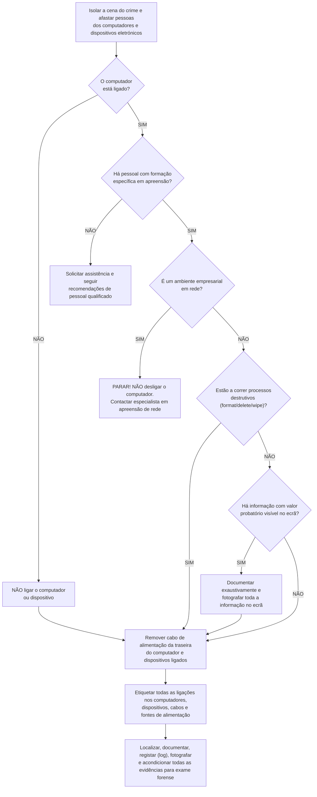

# Princípios de Aquisição Forense, Resposta Inicial e Camadas de Abstração

A **aquisição de dados (*Data Acquisition*)** ocorre tipicamente durante a fase de **preservação do sistema** (embora também possa ser realizada num sistema em execução), constituindo uma etapa crítica: se não for conduzida corretamente, os dados podem perder-se para sempre ou ver a sua validade legal comprometida em tribunal. A recolha deve ser efetuada, sempre que possível, ao **nível físico** (do primeiro ao último bit do suporte, incluindo setores não alocados e áreas ocultas HPA/DCO), ajustando o tamanho do bloco de leitura ao tamanho do setor físico do dispositivo.

---

## 1. Enquadramento e Protocolo de Primeira Intervenção (*What to do if...*)

Na chegada à cena do crime digital, a atuação sobre o equipamento depende do seu estado elétrico e operacional (com base no guia *Electronic Crime Scene Investigation: A Guide for First Responders, Second Edition — U.S. Department of Justice*):

* **Se o computador estiver desligado (*off*)** $\rightarrow$ **Remover o cabo de alimentação elétrica** (*remove power cord*) e **NÃO ligar** o computador ou dispositivo.
* **Se o computador estiver ligado (*on*)**:
  1. **Fotografar o ecrã** (*take a picture of the screen*) e documentar toda a informação visível com valor probatório.
  2. **Verificar se estão em execução processos destrutivos (*destructive processes*)**:
     * *Processos destrutivos*: quaisquer funções destinadas a obliterar dados no disco rígido ou dispositivo de armazenamento (termos visíveis no ecrã como `"format"`, `"delete"`, `"remove"` e `"wipe"` são indicadores de processos destrutivos e devem ser documentados no relatório).
     * **Se existirem processos destrutivos a correr** $\rightarrow$ **Remover imediatamente o cabo de alimentação elétrica** (*remove power cord*).
  3. **Realizar um *dump* da memória RAM e recolher o estado das ligações de rede** (*do a memory dump and get network connections status*):
     * **Atenção**: esta operação **pode destruir ou contaminar evidências** (*may destroy or contaminate evidences*), pelo que deve ser ponderada e executada por pessoal qualificado nas seguintes situações:
       * Quando **não é possível desligar um servidor** (*when you cannot turn off a server* — ex.: ambiente empresarial em rede).
       * Para **obter palavras-passe ou chaves de cifragem armazenadas na RAM** (*to get passwords or encryption keys stored in RAM*).
       * Para **monitorizar atividades de rede de software malicioso** (*to monitor malicious software network activities*).

---

## 2. Camadas de Análise e Aquisição em Suportes de Armazenamento

Os dados num suporte de armazenamento podem ser analisados e adquiridos em **quatro camadas de abstração**:

| Camada (do nível mais baixo ao mais alto) | Âmbito e Limitações Forenses |
| :--- | :--- |
| **1. Física (*Physical*)** | Abrange **desde o primeiro até ao último bit** do suporte de armazenamento (*from the first to the last bit of the storage media*). |
| **2. Volume (*Volume* / Lógica)** | Ao adquirir apenas ao nível do volume/partição, **não é possível obter setores não alocados (*unallocated sectors*), a tabela de partições (*partition table*) nem áreas ocultas (*hidden areas*)**. |
| **3. Ficheiro (*File*)** | Cópias de ficheiros individuais (ex.: ferramentas de *backup*), tornando **muito menos provável recuperar ficheiros apagados (*deleted files*)** ou espaço *slack*. |
| **4. Aplicação (*Application*)** | Cada aplicação possui a sua própria codificação ou formato de ficheiro interno. |

> [!IMPORTANT] Regra Fundamental da Camada de Aquisição
> **Quanto mais elevada for a camada de aquisição, menos informação poderá ser recuperada** (*The higher the acquisition layer, the less information can be retrieved*).
> **Sempre que possível, a aquisição de dados deve ser realizada ao nível físico (*physical level*)**.
> *(Nota: Outros meios, como tráfego de rede e memória volátil RAM, possuem os seus próprios procedimentos recomendados específicos).*

---

## 3. Cópia de Suportes de Armazenamento: Tamanho de Bloco (*Block Size*) vs. Setor

Durante a cópia física de um suporte de armazenamento, a escolha do **tamanho de bloco de aquisição (*acquisition block size*)** envolve um compromisso direto entre velocidade e tolerância a erros de leitura:
* **Quanto maior for o tamanho do bloco (`bs`), mais rápida será a aquisição**.
* Contudo, **se existirem setores com erros (*bad sectors*), todo o bloco que contém o setor defeituoso ficará inválido** (*the all block will be invalid*).

### Diretrizes de Configuração da Cópia Física
1. **Alinhamento do Tamanho de Bloco com o Tamanho do Setor**:
   * O tamanho de bloco de aquisição **deve coincidir com o tamanho do setor (*sector size*)** do dispositivo:
     * Para discos rígidos magnéticos (**HDD**), o tamanho padrão do setor é de **`512 bytes`** (ou `4096 bytes` em discos *Advanced Format* modernos).
     * Para unidades de estado sólido (**SSD**), o tamanho do setor/página **depende da marca, do modelo e da capacidade** da unidade.
2. **Abrangência Integral do Suporte**:
   * A aquisição de dados deve incluir a **totalidade do suporte de armazenamento (nível físico)**, abrangendo:
     * **Setores não alocados (*unallocated sectors*)**; e
     * **Áreas ocultas (*hidden areas*)**: **HPA (*Host Protected Area*)** ou **DCO (*Device Configuration Overlay*)** — caso existam, **recomendam-se 2 aquisições distintas**: uma primeira aquisição com a área oculta ativa (*in place*) e uma segunda aquisição com as áreas ocultas desativadas (*disabled*).

---

## Implicações Forenses

* **Consequência de um `bs` Excessivo em Discos Danificados**: Se um perito configurar `bs=1M` (1 Megabyte) num disco rígido antigo que tenha apenas 1 setor físico de `512 bytes` ilegível no meio desse megabyte, a ferramenta de aquisição descartará e preencherá com zeros a totalidade do bloco de `1 MB` (perdendo 2047 setores bons adjacentes!). Reduzir `bs=512` (ou usar ferramentas que reduzem automaticamente o bloco perante erros) limita a perda estritamente aos `512 bytes` defeituosos.
* **Articulação com as Regras LabCIF**: Os passos finais do fluxograma do DOJ (*etiquetar todas as ligações, cabos e fontes de alimentação; documentar e fotografar*) materializam-se diretamente nos procedimentos laboratoriais de etiquetagem e fotografia pericial ([[Registo, Etiquetagem e Fotografia Pericial (Regras LabCIF)]]).

---

## Além da aula

* **Correlação com as Camadas de Organização de Dados (Capítulo 3 de AFD1) e Artefactos de [[00 ASSI|ASSI]]**:
  * As 4 camadas de análise/aquisição (*Physical*, *Volume*, *File*, *Application*) espelham diretamente a arquitetura estudada em [[Camadas de Organização de Dados e Análise de Sistemas de Ficheiros]] no Capítulo 3 de AFD1.
  * Em **ASSI**, diversos procedimentos de recuperação forense dependem de dados que residem abaixo da camada de ficheiro ativo:
    * O acesso a snapshots anteriores através do [[Volume Shadow Service (VSS) - Arquitetura e Funcionamento|Volume Shadow Service (VSS)]] e [[Acesso Forense e Montagem de Shadow Copies]] opera ao nível de blocos de volume (*copy-on-write*), os quais se perdem numa simples cópia ao nível do ficheiro (*File layer*), mas são integralmente preservados numa aquisição física ou de volume.
    * O *carving* de registos eliminados em ficheiros [[Jump Lists - Arquitetura, AppIDs e Carving|Jump Lists]] ou de miniaturas órfãs em [[Caches de Ícones e Miniaturas (IconCache e Thumbcache)]] e a recuperação de ficheiros apagados no espaço não alocado exigem uma aquisição ao nível físico.
    * A recolha de processos e ligações num sistema *live* (quando o fluxograma indica não desligar a máquina) utiliza utilitários como `tasklist`, `pslist` e `netstat` estudados em [[Processos e linha de comandos no Windows]].

---

## Perguntas de revisão

- Perante um computador encontrado ligado na cena do crime, que verificação crítica deve ser feita no ecrã antes de decidir entre realizar um *memory dump* ou desligar imediatamente o cabo de alimentação?
- Em que três situações específicas se justifica realizar um *dump* de memória e recolha de estado de rede num sistema ligado, apesar do risco de contaminação?
- Quais são as quatro camadas de análise de informação num suporte de armazenamento e porque é que a aquisição deve ser feita, sempre que possível, ao nível físico?
- Qual é o compromisso entre velocidade e perda de dados na escolha do tamanho de bloco (`block size`) durante a aquisição de um disco com setores defeituosos?

## Notas relacionadas

- [[Procedimentos de Aquisição - Post-Mortem vs Live, Erros de Disco, HPA-DCO e Write Blockers]]
- [[Armazenamento da Aquisição - Clonagem vs Imagem, Formatos, Aquisição Remota e Assinatura de Hashes]]
- [[Investigação Forense Digital - Análise Live vs Post-Mortem]]
- [[Fases da Investigação Forense Digital]]
- [[Preservação do Sistema e Integridade de Dados]]
- [[Princípios e Rota do Manuseamento de Evidência Digital]]
- [[Diretrizes de Manuseamento - Identificação, Preservação, Isolamento e Correlação]]
- [[Registo, Etiquetagem e Fotografia Pericial (Regras LabCIF)]]
- [[Camadas de Organização de Dados e Análise de Sistemas de Ficheiros]]
- [[Processos e linha de comandos no Windows]]
- [[Volume Shadow Service (VSS) - Arquitetura e Funcionamento]]
- [[Acesso Forense e Montagem de Shadow Copies]]
- [[Capítulo 2 - Arranque e Aquisição Forense]]
