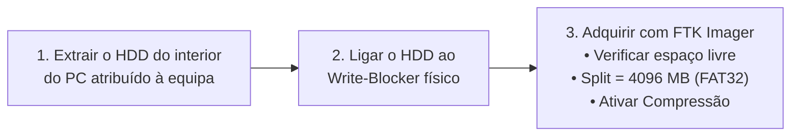

# Exercícios Práticos e de Projeto — WinFE e Aquisição Forense com FTK Imager

O Capítulo 2 (*Forensic Boot*) contempla dois momentos práticos laboratoriais: o **Laboratório 01**, focado na construção de um ambiente de arranque **WinFE (*Windows Forensic Environment*)** e no arranque de uma máquina virtual com esse suporte, e o **Estudo de Caso do Projeto (*Project Case Study*)**, que consiste na extração física do disco rígido (HDD) do computador atribuído ao grupo, ligação a um bloqueador de escrita e aquisição da imagem forense com o **FTK Imager**.

---

## 1. Exercício Laboratorial — *Lab 01: Build WinFE and Boot a Virtual Machine* (Slide 23)

### Enunciado Oficial nos Diapositivos
* **Objetivo**: Construir uma imagem de arranque **WinFE (*Windows Forensic Environment*)** e arrancar uma máquina virtual através dela (*Lab 01 - Build WinFE and boot a virtual machine with it*).

> [!NOTE] Contexto Técnico (Secções 2 e 3 da Aula)
> * Conforme estudado em [[Dispositivos de Arranque Forense - Disquetes DOS, Live CDs Linux, WinFE e USB]] e [[Ferramentas Portáteis de Triagem, Pesquisa e FTK Imager Lite]]:
>   * O **WinFE** (criado por Brett Shavers) requer a construção e configuração prévia da imagem de arranque pelo examinador, incorporando ferramentas portáteis de triagem e aquisição para Windows (como o **FTK Imager Lite**, **RegRipper**, **RegistryReport**, **ForensicUserInfo**, **Mitec WRR** ou **Agent Ransack**).
>   * Ao iniciar a máquina virtual a partir da ISO/USB do WinFE, os discos virtuais internos não sofrem o processo de *auto-mount* em escrita do Windows normal, preservando a integridade da evidência.
>   * *(Nota: Os diapositivos da apresentação contêm apenas a indicação deste laboratório no Slide 23; caso disponha de um guião passo a passo separado para o Lab 01, este poderá ser integrado nesta secção).*

---

## 2. Exercício de Projeto — *Project Case Study: Aquisição Forense* (Slide 54)

Este exercício dá continuidade prática ao trabalho de grupo iniciado no Capítulo 1 ([[Exercício de Projeto - Catalogação e Etiquetagem de Dispositivos e Serviços]]), aplicando os procedimentos formais de preservação e aquisição ao computador físico atribuído à equipa no laboratório.

### Procedimento Obrigatório Passo a Passo

1. **Extração Física do Disco**:
   * Extrair o disco rígido (**HDD**) do interior do computador (**PC**) atribuído à equipa (*extract the HDD inside the PC assigned to your team*).
2. **Proteção contra Escrita**:
   * Ligar o disco rígido extraído ao **bloqueador de escrita (*write-blocker*)** (*connect the HDD to the write-blocker*).
3. **Execução da Aquisição Forense com o FTK Imager**:
   * Iniciar a aquisição forense recorrendo à ferramenta **FTK Imager** (*start the forensic acquisition with FTK Imager*), cumprindo os três requisitos de configuração seguintes:
     * **Verificação de espaço**: Garantir previamente que existe **espaço em disco suficiente** no suporte de destino para armazenar a aquisição (*make sure you have enough disk space for the acquisition*).
     * **Fragmentação (*Splitting*) para compatibilidade FAT32**: Configurar a divisão da imagem em ficheiros de **`4 096 MB` (`4 GB`)** para que possam ser armazenados em sistemas de ficheiros **`FAT32`** se necessário (*split into 4 096 MB files to fit into FAT32 file systems if needed*).
     * **Compressão**: **Ativar a compressão (*enable compression*)** — o processo de aquisição torna-se mais lento, mas ocupa substancialmente menos espaço em disco (*it's slower, but takes less space*).

---

## Implicações Forenses

* **Porquê o limite de `4 096 MB` no `FAT32`?**: No sistema de ficheiros `FAT32`, o campo que guarda o tamanho do ficheiro na entrada de diretório tem exatamente `32 bits` (4 bytes sem sinal), o que limita matematicamente o tamanho máximo de qualquer ficheiro individual a $2^{32} - 1\text{ bytes} \approx 4\text{ GiB}$ (`4 096 MB`). Ao fragmentar a imagem `.E01` em segmentos de `4 096 MB` (ou menos, ex.: `1500 MB` / `2000 MB`), garante-se que a imagem forense pode ser copiada e transportada em discos externos ou pens USB formatadas em `FAT32` sem falhar a meio da escrita.
* **Continuidade da Cadeia de Custódia no Projeto**: Antes de remover o HDD no Passo 1, recorde-se que o equipamento, as cablagens e o disco interno (`PC01.HD01`) devem ser fotografados (os 6 lados da caixa 3D com escala/régua) e etiquetados segundo as regras estudadas em [[Registo, Etiquetagem e Fotografia Pericial (Regras LabCIF)]], registando no formulário do `FTK Imager` os mesmos identificadores de caso, número de evidência e nome do perito.

---

## Perguntas de revisão

- Quais são as três etapas principais do estudo de caso do projeto (*Project case study*) para a aquisição do disco atribuído à equipa?
- Porque se deve configurar a divisão (*split*) da imagem em ficheiros de `4 096 MB` no FTK Imager?
- Qual é o compromisso técnico de ativar a compressão durante a criação da imagem forense no FTK Imager?

## Notas relacionadas

- [[Dispositivos de Arranque Forense - Disquetes DOS, Live CDs Linux, WinFE e USB]]
- [[Ferramentas Portáteis de Triagem, Pesquisa e FTK Imager Lite]]
- [[Ferramentas Gráficas de Aquisição Forense (Guymager, Paladin Toolbox, Tableau Imager e FTK Imager)]]
- [[Procedimentos de Aquisição - Post-Mortem vs Live, Erros de Disco, HPA-DCO e Write Blockers]]
- [[Armazenamento da Aquisição - Clonagem vs Imagem, Formatos, Aquisição Remota e Assinatura de Hashes]]
- [[Registo, Etiquetagem e Fotografia Pericial (Regras LabCIF)]]
- [[Exercício de Projeto - Catalogação e Etiquetagem de Dispositivos e Serviços]]
- [[Capítulo 2 - Arranque e Aquisição Forense]]
