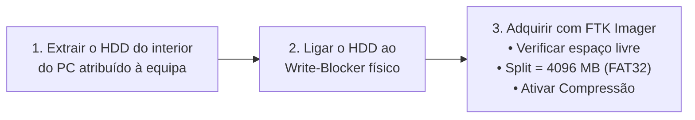

# Exercícios Práticos e de Projeto — WinFE e Aquisição Forense com FTK Imager

Os exercícios do Capítulo 2 consolidam a construção e arranque de uma máquina virtual com WinFE (**Lab 01**) e a aquisição física de um HDD com *write-blocker* e **FTK Imager** no projeto (*split* de `4 096 MB`).

> [!TIP] Lógica de Funcionamento e Valor Forense
> * **Porque existe (Método / Prática)**: Aplicar em laboratório e em hardware real as duas estratégias centrais de recolha forense do capítulo: arranque forense controlado em software (**Lab 01 — WinFE**) e aquisição física com bloqueador de escrita em hardware (**Estudo de Caso do Projeto — FTK Imager**).
> * **Porque importa (Forense)**: Treina o perito a garantir preservação total da evidência — quer impedindo o *auto-mount* ao arrancar uma máquina sem desmontar discos (**WinFE**), quer assegurando cadeia de custódia, espaço de destino suficiente, compatibilidade `FAT32` (`4 096 MB`) e compressão eficiente ao adquirir um disco extraído.
> * **Pontos Críticos e Armadilhas para Exame**:
>   * **Lab 01 (Slide 23)**: Construir uma imagem de arranque **WinFE** (*Windows Forensic Environment*) e arrancar com ela uma máquina virtual contendo ferramentas portáteis Windows (`FTK Imager Lite`, `RegRipper`, etc.).
>   * **Project Case Study (Slide 54)**: (1) Extrair o **HDD** do PC da equipa; (2) ligar ao **write-blocker** físico; (3) adquirir com **FTK Imager** verificando **espaço livre**, **split de `4 096 MB`** (limite máximo de ficheiro em `FAT32`: $2^{32}-1\text{ bytes} \approx 4\text{ GiB}$) e **compressão ativa** (mais lenta, ocupa menos espaço).

---

## 1. Exercício Laboratorial — *Lab 01: Build WinFE and Boot a Virtual Machine* (Slide 23)

### Enunciado Oficial nos Diapositivos

* **Objetivo**: Construir uma imagem de arranque **WinFE (*Windows Forensic Environment*)** e arrancar uma máquina virtual através dela (*Lab 01 - Build WinFE and boot a virtual machine with it*).

> [!NOTE] Contexto Técnico (Secções 2 e 3 da Aula)
> * Conforme estudado em [[Dispositivos de Arranque Forense - Disquetes DOS, Live CDs Linux, WinFE e USB]] e [[Ferramentas Portáteis de Triagem, Pesquisa e FTK Imager Lite]]:
>   * O **WinFE** (criado por Brett Shavers) requer a construção e configuração prévia da imagem de arranque pelo examinador, incorporando ferramentas portáteis de triagem e aquisição para Windows (como o **FTK Imager Lite**, **RegRipper**, **RegistryReport**, **ForensicUserInfo**, **Mitec WRR** ou **Agent Ransack**).
>   * Ao iniciar a máquina virtual a partir da ISO/USB do WinFE, os discos virtuais internos não sofrem o processo de *auto-mount* em escrita do Windows normal, preservando a integridade da evidência.
>   * *(Nota: Os diapositivos da apresentação contêm apenas a indicação deste laboratório no Slide 23; caso disponha de um guião passo a passo separado para o Lab 01, este poderá ser integrado nesta secção).*

---

## 2. Exercício de Projeto — *Project Case Study: Aquisição Forense* (Slide 54)

Este exercício dá continuidade prática ao trabalho de grupo iniciado no Capítulo 1 ([[Exercício de Projeto - Catalogação e Etiquetagem de Dispositivos e Serviços]]), aplicando os procedimentos formais de preservação e aquisição ao computador físico atribuído à equipa no laboratório.

### Procedimento Obrigatório Passo a Passo

1. **Extração Física do Disco**:
   * Extrair o disco rígido (**HDD**) do interior do computador (**PC**) atribuído à equipa.
2. **Proteção contra Escrita**:
   * Ligar o disco rígido extraído ao **bloqueador de escrita (*write-blocker*)**.
3. **Execução da Aquisição Forense com o FTK Imager**:
   * Iniciar a aquisição forense recorrendo à ferramenta **FTK Imager**, cumprindo os três requisitos de configuração seguintes:
     * **Verificação de espaço**: Garantir previamente que existe **espaço em disco suficiente** no suporte de destino para armazenar a aquisição.
     * **Fragmentação (*Splitting*) para compatibilidade FAT32**: Configurar a divisão da imagem em ficheiros de **`4 096 MB` (`4 GB`)** para que possam ser armazenados em sistemas de ficheiros **`FAT32`** se necessário.
     * **Compressão**: **Ativar a compressão** — o processo de aquisição torna-se mais lento, mas ocupa substancialmente menos espaço em disco.

---

## Implicações Forenses

* **Porquê o limite de `4 096 MB` no `FAT32`?**: No sistema de ficheiros `FAT32`, o campo que guarda o tamanho do ficheiro na entrada de diretório tem exatamente `32 bits` (4 bytes sem sinal), o que limita matematicamente o tamanho máximo de qualquer ficheiro individual a $2^{32} - 1\text{ bytes} \approx 4\text{ GiB}$ (`4 096 MB`). Ao fragmentar a imagem `.E01` em segmentos de `4 096 MB` (ou menos, ex.: `1500 MB` / `2000 MB`), garante-se que a imagem forense pode ser copiada e transportada em discos externos ou pens USB formatadas em `FAT32` sem falhar a meio da escrita.
* **Continuidade da Cadeia de Custódia no Projeto**: Antes de remover o HDD no Passo 1, recorde-se que o equipamento, as cablagens e o disco interno (`PC01.HD01`) devem ser fotografados (os 6 lados da caixa 3D com escala/régua) e etiquetados segundo as regras estudadas em [[Registo, Etiquetagem e Fotografia Pericial (Regras LabCIF)]], registando no formulário do `FTK Imager` os mesmos identificadores de caso, número de evidência e nome do perito.

---

## Perguntas de revisão

1. **Quais são as três etapas principais do estudo de caso do projeto (*Project Case Study*) para a aquisição do disco atribuído à equipa?**

> [!success]- Ver Resposta
> 1. **Extrair fisicamente o HDD** do interior do computador atribuído à equipa.
> 2. **Ligar o HDD ao bloqueador de escrita (*write-blocker*)**.
> 3. **Adquirir a imagem forense com o FTK Imager**, verificando previamente o espaço livre no destino, configurando o *split* para `4 096 MB` e ativando a compressão.

2. **Porque se deve configurar a divisão (*split*) da imagem em ficheiros de `4 096 MB` no FTK Imager?**

> [!success]- Ver Resposta
> Para garantir compatibilidade caso os segmentos precisem de ser armazenados ou transportados num sistema de ficheiros **`FAT32`**, cujo limite matemático por ficheiro (campo de tamanho de `32 bits` na entrada de diretório) é $2^{32}-1\text{ bytes} \approx 4\text{ GiB}$ (`4 096 MB`).

3. **Qual é o compromisso técnico de ativar a compressão durante a criação da imagem forense no FTK Imager?**

> [!success]- Ver Resposta
> A aquisição torna-se **mais lenta** devido ao processamento de CPU exigido pela compressão, mas o ficheiro de imagem resultante **ocupa substancialmente menos espaço em disco**.

4. **Qual é o objetivo do *Lab 01* e por que razão o arranque da máquina virtual com WinFE protege os discos virtuais internos?**

> [!success]- Ver Resposta
> O *Lab 01* consiste em construir uma imagem de arranque **WinFE (*Windows Forensic Environment*)** e arrancar uma máquina virtual através dela. Como o WinFE é um Windows PE modificado sem *auto-mount* em escrita para unidades locais, os discos virtuais internos não são montados nem modificados ao iniciar, permitindo usar ferramentas portáteis Windows (`FTK Imager Lite`, `RegRipper`) sem alterar a evidência.

---

## Navegação e Notas Relacionadas

| Percurso | Nota | Contexto |
| :--- | :--- | :--- |
| **Anterior** | [[Ferramentas Gráficas de Aquisição Forense (Guymager, Paladin Toolbox, Tableau Imager e FTK Imager)]] | `mesmo bloco` |
| **Seguinte** | [[Capítulo 2 - Arranque e Aquisição Forense]] · [[00 AFD1]] | Fim do capítulo |
| **Índice** | [[Capítulo 2 - Arranque e Aquisição Forense]] · [[00 AFD1]] | `Bloco 05` |

### Conceitos Relacionados

* [[Dispositivos de Arranque Forense - Disquetes DOS, Live CDs Linux, WinFE e USB]] · `Bloco 02`
* [[Ferramentas Portáteis de Triagem, Pesquisa e FTK Imager Lite]] · `Bloco 03`
* [[Procedimentos de Aquisição - Post-Mortem vs Live, Erros de Disco, HPA-DCO e Write Blockers]] · `Bloco 04`
* [[Armazenamento da Aquisição - Clonagem vs Imagem, Formatos, Aquisição Remota e Assinatura de Hashes]] · `Bloco 04`
* [[Registo, Etiquetagem e Fotografia Pericial (Regras LabCIF)]] · `Cap. 1`
* [[Exercício de Projeto - Catalogação e Etiquetagem de Dispositivos e Serviços]] · `Cap. 1`
