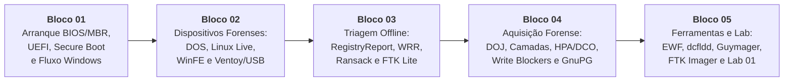

# Capítulo 2 — Arranque e Aquisição Forense (*Forensic Boot*)

Mapa de estudo do **Capítulo 2** de [[00 AFD1|Análise Forense Digital I (AFD1)]] (LabCIF — Miguel Frade e Baltazar Rodrigues), cobrindo **55 diapositivos** em **12 notas** e **1 Cheat Sheet**.

> [!TIP] Guia de Consulta Rápida para Exame
> Para tabelas comparativas (`BIOS vs. UEFI`, `WinFE vs. Linux Live`, `Clonagem vs. Imagem`, `ewfmount vs. xmount`), dissecação de comandos (`dcfldd`, `ewf-tools`, `hdparm`) e armadilhas de exame, consulta a **[[Cheat Sheet - Método de Investigação, Arranque e Aquisição Forense]]**.

---

## 1. Processo de Arranque e Arranque Forense (`01 - Processo de Arranque e Arranque Forense`)

| Nota | O que vais estudar |
| :--- | :--- |
| [[Arranque Forense e Processo de Boot (BIOS e Código Máquina)]] | Motivação para arranque forense, fronteira de intocabilidade, fases do *boot*, código máquina (`0xB400`) e BIOS/MBR. |
| [[Processo de Arranque UEFI, Secure Boot e Fluxo do Windows]] | Arquitetura UEFI/ESP, exigência do Secure Boot, comparação BIOS vs. UEFI e fluxo `Bootmgr`/`Winload`/`Winresume`. |

---

## 2. Dispositivos e Ambientes de Arranque Forense (`02 - Dispositivos e Ambientes de Arranque Forense`)

| Nota | O que vais estudar |
| :--- | :--- |
| [[Dispositivos de Arranque Forense - Disquetes DOS, Live CDs Linux, WinFE e USB]] | Disquetes MS-DOS (`format`/`attrib`), Live CDs Paladin/DEFT, ambientes WinFE/Ventoy e gravação USB com Rufus/Etcher/`dd`. |

---

## 3. Ferramentas de Triagem Forense (`03 - Ferramentas de Triagem Forense`)

| Nota | O que vais estudar |
| :--- | :--- |
| [[Ferramentas de Triagem Forense no Windows Registry (RegistryReport, ForensicUserInfo e WRR)]] | Triagem *offline* dos *hives* `SAM`, `SOFTWARE`, `SYSTEM` e `NTUSER.DAT` com RegistryReport, ForensicUserInfo e WRR. |
| [[Ferramentas Portáteis de Triagem, Pesquisa e FTK Imager Lite]] | Pesquisa rápida com Agent Ransack, sete utilitários portáteis de triagem e funções do FTK Imager Lite. |

---

## 4. Fundamentos e Procedimentos de Aquisição Forense (`04 - Fundamentos e Procedimentos de Aquisição Forense`)

| Nota | O que vais estudar |
| :--- | :--- |
| [[Princípios de Aquisição Forense, Resposta Inicial e Camadas de Abstração]] | Árvore de decisão DOJ na resposta inicial, quatro camadas de aquisição e compromisso `block`/`sector size`. |
| [[Procedimentos de Aquisição - Post-Mortem vs Live, Erros de Disco, HPA-DCO e Write Blockers]] | Acesso direto vs. BIOS, *post-mortem* vs. *live*, *bad sectors* (`000000`), áreas HPA/DCO e *write blockers* CFTT. |
| [[Armazenamento da Aquisição - Clonagem vs Imagem, Formatos, Aquisição Remota e Assinatura de Hashes]] | Clonagem vs. imagem, formatos `RAW`/`EWF` e compressão, aquisição remota e assinatura de *hashes* com GnuPG. |

---

## 5. Ferramentas de Aquisição Forense e Exercícios (`05 - Ferramentas de Aquisição Forense e Exercícios`)

| Nota | O que vais estudar |
| :--- | :--- |
| [[Aquisição e Montagem em Linux - Formato EWF (ewf-tools, ewfmount e xmount)]] | Projeto CFTT, sete utilitários `ewf-tools`, exemplo `ewfacquire` e montagem `.E01` via `ewfmount` ou `xmount`/`udisksctl`. |
| [[Aquisição em Linha de Comandos no Linux - dcfldd e Derivados do dd]] | Sete melhorias do `dcfldd` face ao `dd`, derivados forenses, parâmetros completos de comando e `SHA256.txt`. |
| [[Ferramentas Gráficas de Aquisição Forense (Guymager, Paladin Toolbox, Tableau Imager e FTK Imager)]] | Guymager (`/etc/guymager/local.cfg`), Paladin Toolbox (aquisição lógica em SSDs), Tableau Imager (HPA/DCO) e FTK Imager. |
| [[Exercícios Práticos e de Projeto - WinFE e Aquisição Forense com FTK Imager]] | Lab 01 (imagem WinFE em máquina virtual) e projeto de aquisição HDD com *write-blocker* e *split* `FAT32`. |

---

## Navegação

* [[00 AFD1|Voltar ao Índice de AFD1]]
* [[Cheat Sheet - Método de Investigação, Arranque e Aquisição Forense|Ir para a Cheat Sheet dos Capítulos 1 e 2]]
* [[Capítulo 1 - Método de Investigação|Recuar para o Capítulo 1 — Método de Investigação]]
* [[Capítulo 3 - Organização de Dados|Avançar para o Capítulo 3 — Organização de Dados]]
* [[Capítulo 1 - Sistemas Operativos, Serviços e Artefactos Forenses|Pontes com ASSI — Capítulo 1 (UEFI Secure Boot, Hives do Registry e Triagem no Windows)]]
* [[Home|Voltar ao Hub Central do MCIF]]
