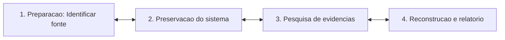
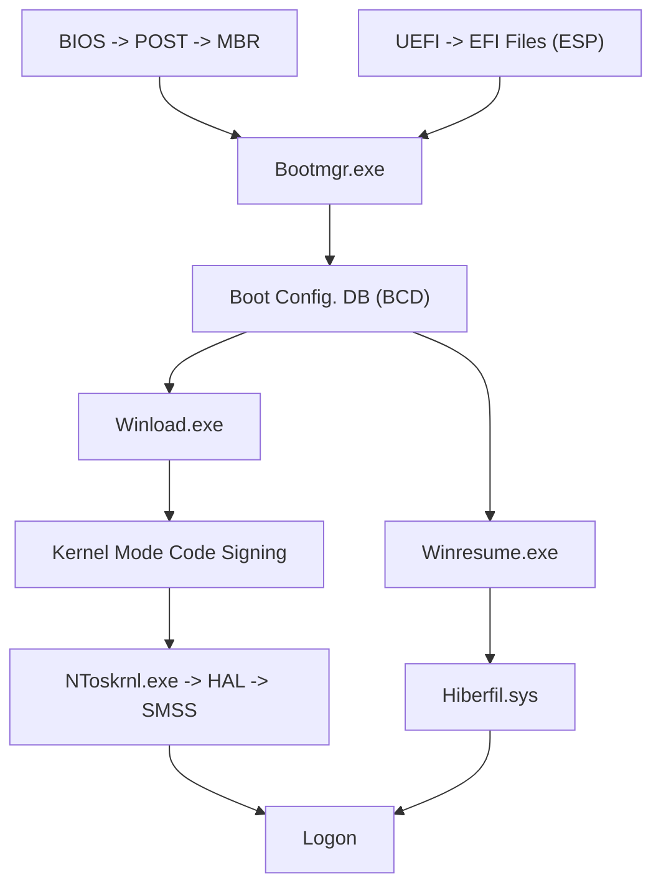

# Cheat Sheet — Método de Investigação, Arranque e Aquisição Forense

Guia de consulta rápida dos **Capítulos 1 e 2 de AFD1**, condensando metodologia científica, análise *live* vs. *post-mortem*, integridade criptográfica, **Ordem de Volatilidade (7 níveis)**, regras **LabCIF**, ética **ISFCE**, arranque **BIOS/UEFI/Windows**, dispositivos e ferramentas de triagem, fluxograma de primeira intervenção, camadas de aquisição, **HPA/DCO**, *write blockers*, **`ewf-tools` / `ewfmount` / `xmount`**, **`dcfldd`**, comparativo GUI e armadilhas de exame.

> [!TIP] Finalidade desta Folha de Consulta Rápida
> Este documento sintetiza os **105 diapositivos** dos Capítulos 1 (`50` slides) e 2 (`55` slides) de [[00 AFD1|AFD1]], bem como todas as **23 notas temáticas e de exercício** associadas. Serve de guia de bolso para revisão rápida, preparação de exame, triagem e aquisição laboratorial.

---

## Parte 1 — Capítulo 1: Metodologia, Integridade, Ordem de Volatilidade e LabCIF

### 1.1 Conceito Forense, Método Científico e *Live* vs. *Post-Mortem*

* **Investigação Digital** ([[Investigação Digital e Evidência Digital]]): responde a *what, who, when, how* (e por vezes *where, why*) perante crimes físicos preparados/registados em dispositivos ou eventos digitais ilícitos; segue o **método científico** — formular hipótese e procurar ativamente evidências que a **refutem** (demonstrem ser impossível).
* **Evidência Digital** (*Digital Evidence*): objeto digital com informação fidedigna que suporta ou refuta uma hipótese; tem de cumprir **4 requisitos**: **Admissível** (*admissible*), **Autêntica** (*authentic*), **Precisa/Exata** (*accurate*) e **Completa** (*complete*). Desafios: *hard to control* e *diversity and complexity*.
* **Forense (*Forensic*)** ([[Investigação Forense Digital - Análise Live vs Post-Mortem]]): exige cumprimento de requisitos legais para aceitação em **tribunal** (*Brian Carrier, 2005*).

| Abordagem | Mecanismo | Vantagem Principal | Desvantagem / Risco Crítico | Regra de Escolha |
| :--- | :--- | :--- | :--- | :--- |
| **Análise *Live*** | Usa o próprio SO e recursos do sistema suspeito em execução. | Permite aceder à memória **RAM** (processos, ligações, chaves criptográficas). | Risco de **informação falsa** por adulteração maliciosa (ex.: *rootkits*). | Usar apenas quando não é possível desligar (servidores críticos ou volumes cifrados abertos). |
| **Análise *Post-Mortem*** | Usa aplicações e SO de confiança em **ambiente laboratorial isolado**. | Ambiente **100% controlado**, sem interferência do sistema suspeito. | A informação da memória **RAM perde-se** (ex.: chaves de cifra em claro). | **Abordagem ideal** sempre que tecnicamente e operacionalmente exequível. |

---

### 1.2 As 4 Fases da Investigação, Integridade e Assinatura Digital

O processo é **cíclico e bidirecional** ([[Fases da Investigação Forense Digital]], [[Preservação do Sistema e Integridade de Dados]], [[Pesquisa de Evidências e Reconstrução de Eventos]]):



| Fase | Objetivo e Técnicas Centrais |
| :--- | :--- |
| **1. Preparação / Identificação** | Identificar fisicamente a fonte, decidir abordagem (*live* vs. *post-mortem*), apreensão de equipamento. |
| **2. Preservação do Sistema** | Preservar estado e minimizar perdas segundo requisitos **legais, de negócio ou operacionais** (de *pull the plug* + cópia integral até sem preservação formal em *honeypot*/*spyware*).<br>**Post-mortem**: *pull the plug*, cópias duplicadas, *write blockers*.<br>**Live**: terminar/suspender processos, ligar cabo de rede a ***hub* ou *switch* vazio** (mantém *link up* e evita logs de *dead link*), filtros de rede, *backup* seletivo. |
| **3. Pesquisa de Evidências** | Procurar vestígios que suportem **ou refutem** hipóteses. Locais comuns: hábitos Web (*cache*, histórico, marcadores); intrusão Linux (*rootkits*, novas contas). Critérios: **nomes/padrões**, ***keywords***, **dados temporais**, **valores de *hash*** contra base **NSRL (NIST)** (deteta ficheiros mesmo renomeados) e **rede** (cabeçalhos + *payload*). |
| **4. Reconstrução e Relatório** | Determinar **como** os eventos ocorreram (ex.: browser vs. *malware* — refutar *Trojan defense*) e correlacionar com eventos físicos; exige conhecer diferenças entre versões do SO (Windows XP, 7, 8, 10) e apps (Firefox, Chrome). |

#### Algoritmos de Hash Criptográfico e Assinaturas Digitais

| Família / Algoritmo | Tamanho (*Digest*) | Ano | Estado / Aplicação Forense ([[Preservação do Sistema e Integridade de Dados\|Integridade]] & [[Exercícios Práticos - Integridade de Dados e Hashes\|Exercícios]]) |
| :--- | :---: | :---: | :--- |
| **`MD5`** (MD Family) | 128 bits | 1992 | **Quebrado desde 2004** (colisões — Peter Selinger e certificados forjados); usar **apenas por retrocompatibilidade**. |
| **`MD6`** (MD Family) | Variável | 2008 | Concorrente ao padrão SHA-3. |
| **`SHA-1`** (SHA Standard) | 160 bits | 1995 | Primeira geração padrão SHA. |
| **`SHA-2` (`SHA-256`, `512`)** | 224, 256, 384, 512 bits | 2002 | **Padrão recomendado** (`sha256sum * > SHA256.txt` e `sha256sum -c SHA256.txt`; **HashCalc** no Windows). |
| **`SHA-3` (*Keccak*)** | 224, 256, 384, 512 bits | 2008 | Vencedor da competição SHA-3. |
| **`RIPEMD`** / **`Whirlpool`** | 160–320 / 512 bits | 1996 / 2004 | Alternativa europeia (`RIPEMD`) e resumo de 512 bits (`Whirlpool`). |

> [!IMPORTANT] Limitação do Hash Isolado vs. Assinatura Digital (Cartão de Cidadão)
> * **Hash isolado**: $H(M) = h$ **não envolve segredo** — quem tiver acesso ao repositório pode alterar a mensagem para $M'$ e substituir $h$ por $H(M')$. Além disso, hashes de palavras comuns sem *salt* são revertidos por *lookup tables* (ex.: **CrackStation**; em Linux usar `echo -n "Miguel" | sha256sum` porque sem `-n` o `\n` altera o resumo!).
> * **Solução**: **Assinatura Digital** baseada numa **chave privada** conhecida apenas pelo signatário, preferencialmente em **dispositivo físico seguro** como o **Cartão de Cidadão**.

---

### 1.3 Princípios de Manuseamento, Rota da Evidência e Ordem de Volatilidade

* **4 Princípios de Manuseamento** ([[Princípios e Rota do Manuseamento de Evidência Digital]] — alinhados com **ACPO** / **ISO/IEC 27037**):
  1. Ações dos *first responders* **não devem alterar** dados originais sujeitos a tribunal.
  2. Acesso excecional aos originais exige **competência técnica** (*skills*) para prestar depoimento explicando relevância e implicações.
  3. Manter **cadeia de custódia** auditável garantindo **repetibilidade** por uma terceira parte independente.
  4. O responsável pela investigação assume a **responsabilidade legal global**.
* **Rota da Evidência Digital**: `Incident` $\to$ `Known location?` (**Yes**: `Identification` $\to$ `Preservation` $\to$ `Validation`; **No**: `Authorization?` $\to$ se **Yes**: `Sorting` $\to$ `Identification` $\to$ `Preservation` $\to$ `Validation`; se **No**: direto a `Preservation` $\to$ `Validation`) $\to$ `Transport` / `Storage` / `Recovery` / `Analysis` $\to$ `Proof of evidence`.
* **5 Diretrizes de Manuseamento** ([[Diretrizes de Manuseamento - Identificação, Preservação, Isolamento e Correlação]]):
  1. **Identificação**: 4 estados (*stored*, *in transit*, *in reception*, *in creation*), 4 fontes (*storage*, *temporary*, *peripheral*, *active network*) e 3 tipos (*simple human-readable*, *complex/structured*, *raw/streams*).
  2. **Preservação**: analisar sempre a **cópia**, calcular hashes/assinatura, usar *write-blocker*, minimizar ficheiros criados/abertos em *live*, respeitar a **Ordem de Volatilidade** e fazer **Triagem (*Data Sorting*) só com autorização legal**.
  3. **Isolamento**: usar **VMs** (VMware, VirtualBox, Xen) e **redes isoladas** (abrir HTML suspeito pode executar scripts e contactar servidor remoto!).
  4. **Correlação**: cruzar com logs e rede para detetar *timestamps* forjados.
  5. **Registo (*Log*)**: documentar toda a ação, especialmente alterações em análise *live*.

#### Ordem de Volatilidade (7 Níveis — do Mais Volátil ao Menos Volátil)

| Prioridade | Nível de Volatilidade | Exemplos Concretos |
| :---: | :--- | :--- |
| **1** | **CPU, *cache* e registos (*registers*)** | Estado interno do processador (perda instantânea). |
| **2** | **Tabela de encaminhamento (*routing table*), *cache* ARP, tabela de processos, estatísticas do *kernel*** | Estado volátil de rede e processos ativos no sistema. |
| **3** | **Memória RAM** | Memória de aplicações, chaves criptográficas em claro, sessões. |
| **4** | **Sistema de ficheiros temporário, espaço de *swap*** | `pagefile.sys`, `swapfile.sys`, partições *swap* Linux, ficheiros temporários. |
| **5** | **Dados em suportes de armazenamento local** | Discos rígidos (HDD), SSDs, pens USB, cartões de memória. |
| **6** | **Dados registados remotamente** | Servidores *syslog*, registos em firewalls/SIEM externos. |
| **7** | **Dados em suportes de arquivo (*archival media / backups*)** | Fitas magnéticas (*tapes*), discos óticos e cópias *off-site*. |

---

### 1.4 Regras LabCIF de Etiquetagem, Fotografia Pericial e Ética ISFCE

Em processos reais podem existir **30+ suspeitos e 200+ dispositivos** ([[Registo, Etiquetagem e Fotografia Pericial (Regras LabCIF)]], [[Exercício de Projeto - Catalogação e Etiquetagem de Dispositivos e Serviços]]):

* **Formato da Etiqueta LabCIF**: **`ownerID.deviceID[.inside_deviceID]`**
  * **`ownerID`**: letras maiúsculas (`A`, `B`, `C`...).
  * **`deviceID`**: acrónimo + 2 dígitos: `FPHxx`, `SPHxx`, `SIMxx`, `MCxx`, `GPSxx`, `CAMxx`, `PCxx`, `LAPxx`, `HDDxx`, `SSDxx`, `PENxx` (serviços: `DNS01`, `WEB01`...).
  * **Exemplo**: `A.SPH01` (smartphone), `A.SPH01.SIM01`, `A.SPH01.SIM02`, `A.SPH01.MC01`; disco interno: `PC01.HD03` ou `A.PC01.HDD01`.
* **Regras de Fotografia Pericial LabCIF**:
  1. Fotografar **sempre depois** de colocar as etiquetas físicas.
  2. Incluir **sempre a escala de uma régua** (*scale of a ruler*) na fotografia (*overview* + *close-up* para S/N, IMEI, ligações).
  3. **Caixa 3D (6 vistas padronizadas)**: **`Top`**, **`Bottom`**, **`Left`**, **`Right`**, **`Front`**, **`Back`** (definir consistentemente a face `Front` em SIM, USB, SD e câmaras).
  4. **Nome dos ficheiros**: **`tagID-view_name[-detail].jpg`** (ex.: `A.SPH01-front.jpg`, `A.SPH01-back-serial.jpg`, `A.SPH01.MC01-front.jpg`).
  * **4 Erros Clássicos a Evitar**: (1) SIM sem *tag* e sem régua; (2) etiqueta manuscrita + reflexo de *flash* + sem régua; (3) esquadro sem *tag ID* e IMEI/S/N ilegível; (4) HDD com *post-it* manuscrito (`"TABELAS PARTIÇÃO"`) e S/N ilegível.

| Código de Ética **ISFCE** ([[Código de Ética na Investigação Forense Digital (ISFCE)]]) | Exigências Absolutas |
| :--- | :--- |
| **Fará SEMPRE (*Will always*)** | Compromisso/diligência; integridade; **máxima objetividade** e precisão; **procedimentos validados**; **testemunhar com verdade**; evitar conflito de interesses; cumprir ordens judiciais; examinar tudo **dentro do âmbito (*scope*)**. |
| **NUNCA fará (*Will never*)** | **Omitir ou reter evidência relevante** (quer incrimine quer ilibe); revelar dados confidenciais sem ordem/autorização; **expressar opinião sobre culpa ou inocência**; conduta ilegal/antiética; aceitar tarefa **além da capacidade técnica**; deturpar credenciais; enviesamento (*bias*); **exceder a autorização**. |

---

## Parte 2 — Capítulo 2: Arranque Forense e Ferramentas de Triagem

### 2.1 Arranque Forense: BIOS/MBR vs. UEFI/ESP e Fluxo Windows

* **Motivação** ([[Arranque Forense e Processo de Boot (BIOS e Código Máquina)]]): se o SSD estiver **soldado à *motherboard*** ou usar **interface não padronizada**, não dá para extrair o disco $\to$ adquirir no próprio PC com **dispositivo de arranque forense** (*boot diskette*, Live CD, USB).
* **Regra de Ouro**: o hardware não altera o disco até o momento em que transfere o controlo para o *boot device*; já um arranque normal altera dados do sistema.
* **2 Fases do Arranque**: (1) configurar/iniciar hardware (CPU lê ROM $\to$ sonda hardware $\to$ procura *boot code*); (2) localizar e executar o SO.
* **Código Máquina**: reside em localização específica; ex.: **`0xB400`** = **`MOV AH, 00`** (difícil distinguir visualmente de dados aleatórios).

| Característica | **BIOS + MBR** ([[Arranque Forense e Processo de Boot (BIOS e Código Máquina)\|BIOS]]) | **UEFI + ESP** ([[Processo de Arranque UEFI, Secure Boot e Fluxo do Windows\|UEFI & Windows]]) |
| :--- | :--- | :--- |
| **Local do *Boot Code*** | **1.º setor do disco (`MBR`)** — **512 bytes** (partilhado com tabela de partições) $\to$ 1.º setor da partição (`VBR`) $\to$ SO. | Lê ficheiros executáveis **`.efi`** diretamente numa partição dedicada — **EFI System Partition (`ESP`)**. |
| **Limites Técnicos** | Forte limitação de 512 B no MBR; discos até ~2 TB em MBR legado. | Sem limite do 1.º setor; arranca discos **`> 2 TB`**; **independente da CPU**; suporta **GUI** no arranque. |
| **Segurança (*Secure Boot*)** | Sem verificação criptográfica nativa de arranque. | **Secure Boot**: exige todo o código de arranque **assinado digitalmente** (previne *bootkits*). **Dispositivo forense tem de suportar Secure Boot!** |

#### Fluxograma de Arranque do Windows (`Bootmgr.exe` $\to$ `BCD`)



> [!WARNING] Perigo em Máquinas Hibernadas ou com *Fast Startup*
> Se o Windows estiver em hibernação (ou *Fast Startup*), deixar arrancar pelo disco interno ativa **`Winresume.exe` $\to$ `Hiberfil.sys`**, consumindo e destruindo a cópia da RAM guardada em disco!

---

### 2.2 Dispositivos de Arranque Forense (DOS, Linux Live, WinFE, Ventoy e USB)

| Tipo / Ferramenta | Funcionamento e Detalhes Críticos de Exame ([[Dispositivos de Arranque Forense - Disquetes DOS, Live CDs Linux, WinFE e USB\|Dispositivos de Arranque]]) |
| :--- | :--- |
| **Disquete MS-DOS** *(legado/industrial)* | **3 ficheiros obrigatórios**: **`O.SYS` (`IO.SYS`)**, **`MSDOS.SYS`**, **`COMMAND.COM`**. Opcionais a remover (`DRVSPACE.BIN`, `DBLSPACE.BIN`, `CONFIG.SYS`, `AUTOEXEC.BAT`).<br>Win98: **`format a: /U /S`** (`/U` incondicional, `/S` transfere sistema) + **`attrib -H -R -S <ficheiro>`** antes de apagar protegidos + adicionar `CONFIG.SYS`/`AUTOEXEC.BAT` e *write-blockers* próprios. Alternativa: **HP USB Disk Format Tool**. |
| **Live CDs Linux** | **Paladin** (`sumuri.com`, inclui **Autopsy** e *Paladin Toolbox*) e **DEFT** (Ubuntu Live CD). Desvantagem: nem todos os *first responders* estão confortáveis com Linux. |
| **Ambientes Windows** | **WinFE** (*Windows Forensic Environment*, gratuito — requer licença Windows; criado por **Brett Shavers**; corre **FTK Imager**, **RegRipper**, etc.; tem de ser **construído previamente** — *Lab 01*); comerciais: **SAFE** (*Forensic Soft*), **Gargoyle Investigator** (*Wetstone*). |
| **USB Multi-imagem e Gravação** | **Ventoy** (*open source*, arranca diretamente `ISO`/`WIM`/`IMG`/`VHD(x)`/`EFI`). Windows: **Rufus**, **UNetBootIn**. Linux: **Gnome Multi-Writer**, **Etcher**, **UNetBootIn** e **`sudo dd bs=4M if=input.iso of=/dev/sdx conv=fdatasync`** (`conv=fdatasync` garante escrita física dos buffers). |

---

### 2.3 Ferramentas de Triagem Forense (Registry, Pesquisa, Portáteis e FTK Imager Lite)

| Ferramenta | Hives / Alvo | Capacidades-Chave e Regras Operacionais ([[Ferramentas de Triagem Forense no Windows Registry (RegistryReport, ForensicUserInfo e WRR)\|Triagem Registry]] & [[Ferramentas Portáteis de Triagem, Pesquisa e FTK Imager Lite\|Portáteis]]) |
| :--- | :--- | :--- |
| **RegistryReport** | `SAM`, `SOFTWARE`, `SYSTEM`, `NTUSER.DAT` | **NÃO analisa o Registry do SO em execução** (exige hives extraídos / WinFE). Relatórios configuráveis, pesquisáveis e imprimíveis (SO, software, última atividade e definições do utilizador). |
| **ForensicUserInfo** | `SAM`, `SOFTWARE`, `SYSTEM` | Extrai contas locais: **`RID`** (`500` Admin, `501` Guest, `1000+`), **`LM Hash` / `NT Hash`**, datas (*Last Login*, *Password Reset*, *Account Expiry*, *Login Fail*), *Login Count*, *Failed Logins*, *Profile Path*, *Groups* (ex. aula: `RID 1003 — Mr. Evil`). |
| **Mitec WRR** | Hives de máquinas *crashed* | File Info (`CRC32`/`MD4`/`MD5`/`SHA1`, `HBINs`), SAM, Security, Windows Install, Hardware, Startup, Services/Drivers, Network/Firewall, Outlook Express, Raw Data (exporta `REGEDIT4`). |
| **Agent Ransack** | Ficheiros locais / rede | Pesquisa rápida gratuita com **expressões booleanas** e **Perl regex**; pesquisa **dentro de MS Office e LibreOffice**. |
| **Portable Tools** | `portablefreeware.com` | **`DataProtectionDecryptor`** (Outlook, Win Credentials, Wi-Fi, IE, Chrome); **`JumpListsView`**; **`Windows File Analyzer`** (Prefetch, LNK, Thumbs.db, Index.dat); **`BinText`** (ASCII/Unicode); **`Data Converter`**; **`EXIF Viewer`**; **`eMule MET Viewer`**. |
| **FTK Imager Lite** | Portátil ideal para **WinFE** | Pesquisa ficheiros (e **apagados** — cruz vermelha); **copia ficheiros protegidos/bloqueados** (Registry/cache); **identifica ADS**; adquire **discos e RAM**; **monta `.E01`**. |

---

## Parte 3 — Capítulo 2: Aquisição Forense, `ewf-tools`, `dcfldd` e GUI

### 3.1 Resposta Inicial (DOJ), 4 Camadas, *Bad Sectors*, HPA/DCO e *Write Blockers*

* **Fluxograma U.S. DOJ *First Responders*** ([[Princípios de Aquisição Forense, Resposta Inicial e Camadas de Abstração]]):
  * **PC Desligado (*Off*)**: **NÃO ligar** $\to$ remover cabo de alimentação traseiro.
  * **PC Ligado (*On*)**: confirmar formação técnica $\to$ se for **ambiente empresarial em rede**: **PARAR! NÃO desligar** (chamar especialista) $\to$ verificar **processos destrutivos** (`format`, `delete`, `remove`, `wipe`) $\to$ se ativos, **remover imediatamente o cabo de alimentação** $\to$ senão, fotografar prova visível no ecrã e desligar cabo de alimentação (ou ponderar ***memory dump* + ligações de rede**, sabendo que **pode contaminar evidências**: só quando não se pode desligar servidor, para obter passwords/chaves na RAM ou monitorizar tráfego de malware). Etiquetar todos os cabos e fontes antes de acondicionar.

| Camada de Abstração | Âmbito e Limitações (Regra: *quanto maior a camada, menos informação se recupera!*) |
| :--- | :--- |
| **1. Física (*Physical*)** | **1.º ao último bit** do suporte (inclui não alocado, tabela de partições, HPA/DCO). **Preferir sempre!** |
| **2. Volume** | Partição lógica: **perde setores não alocados**, **tabela de partições** e **áreas ocultas**. |
| **3. Ficheiro (*File*)** | Cópias de ficheiros individuais: muito difícil recuperar **apagados** e ***file slack***. |
| **4. Aplicação (*Application*)** | Estrutura/codificação interna própria de cada aplicação. |

* **Tamanho de Bloco (`bs`) vs. Setor**: `bs` maior = cópia mais rápida, mas **1 *bad sector* invalida todo o bloco**. Alinhar `bs` com o **tamanho do setor físico**: **`512 bytes`** em HDDs tradicionais (`4096 B` em *Advanced Format*); variável por marca/modelo/capacidade em SSDs.
* **Leitura e Modalidade** ([[Procedimentos de Aquisição - Post-Mortem vs Live, Erros de Disco, HPA-DCO e Write Blockers]]):
  * **Via BIOS** pode reportar tamanho incorreto em discos grandes $\to$ **Direct Access** (ignora BIOS) é a melhor escolha.
  * ***Post-Mortem*** (cuidado com *boot too fast* e *spyware* no firmware HDD — revelações NSA) vs. ***Alive/Online*** (risco de *rootkits* — só em casos especiais).
* **3 Requisitos para *Bad Sectors***: (1) preencher setores ilegíveis com zeros **`000000`** para **manter o alinhamento** dos *offsets*; (2) registar em **ficheiro de *log***; (3) **reduzir automaticamente o *block size* para o *sector size*** na zona defeituosa.
* **Áreas Ocultas (`HPA` vs. `DCO`) — Regra das 2 Aquisições**:
  * **HPA (*Host Protected Area*)**: acessível temporariamente no Linux via **`hdparm`** (**um reinício restaura** o estado oculto).
  * **DCO (*Device Configuration Overlay*)**: a remoção é **permanente**!
  * **Procedimento obrigatório**: fazer **1.ª aquisição com HPA/DCO intacta (*in place*)** e só depois desativar/remover para fazer a **2.ª aquisição** completa. (**Tableau Imager** lê HPA e DCO).
* **Write Blockers (catálogos CFTT / NIST)**:
  * **Hardware**: específico por interface (`ATA`, `SATA`, `SCSI`, `Firewire`, `USB`), **independente do SO**, maior velocidade, atua como *proxy*; **melhor opção técnica**, mais caro.
  * **Software**: mais barato, mas **menos eficaz** (pode ser contornado por chamadas de baixo nível ao hardware).

---

### 3.2 Clonagem vs. Imagem Forense, Formatos, Remota e Assinatura de Hashes

| Critério | **Clonagem (*Cloning* — Disco $\to$ Disco)** | **Imagem Forense (*Imaging* — Disco $\to$ Ficheiro)** |
| :--- | :--- | :--- |
| **Uso e Capacidade** | Menos comum; exige discos de preferência do mesmo tamanho (geometria pode diferir). | **Abordagem mais comum**; um disco guarda várias imagens; permite **`split`**. |
| **Preparação do Destino** | Obrigatório **`zero out first`** (evitar restos de casos anteriores em disco maior). | Basta ter espaço livre suficiente para a imagem/segmentos. |
| ***Auto-Mount* e R/W** | **Vulnerável ao *auto-mount*** (Windows monta automaticamente) $\to$ **exige *write blocker* ao analisar o clone!** | **Imune ao *auto-mount*** (monta *read-only*, dispensa *write blocker*); **simula escrita em ficheiro de *cache*** mantendo a imagem intacta. |

* **3 Formatos de Imagem** ([[Armazenamento da Aquisição - Clonagem vs Imagem, Formatos, Aquisição Remota e Assinatura de Hashes]]):
  1. **`RAW`** (`.dd`, `.raw`, `.img`): **mais flexível**, suportado por todo o software forense.
  2. **`RAW` + metadados externos**: ficheiro `.raw` + ficheiro complementar de caso, hashes e tempos.
  3. **`Embedded`** (`EWF / .E01`, `AFF`): metadados e hashes embutidos; suporta **compressão** (poupa espaço para **armazenamento de longo prazo**, mas torna a aquisição mais lenta e nem todas as ferramentas leem comprimidos).
* **Aquisição Remota**: quando não há acesso físico ou adaptadores; mais lenta $\to$ ativar **compressão** e **cifragem do canal** se a rede não for controlada.
* **Integridade por Blocos + GnuPG**: calcular hashes em blocos pequenos (para 1 bit corrompido não invalidar a imagem inteira) e **assinar digitalmente** o ficheiro de hashes (`md5.txt` / `sha256.txt`) com **GnuPG** + **servidor de *timestamping***.

---

### 3.3 `ewf-tools`, Montagem EWF (`ewfmount` vs. `xmount`) e Dissecação `dcfldd`

#### Os 7 Utilitários de `ewf-tools` (`sudo apt install ewf-tools`)

| Comando | Função Forense ([[Aquisição e Montagem em Linux - Formato EWF (ewf-tools, ewfmount e xmount)\|EWF em Linux]]) |
| :--- | :--- |
| **`ewfacquire`** | Adquire dados de uma unidade **localmente** (solicita caso, evidência, perito e nível de compressão `none/empty-block/fast/best`). |
| **`ewfacquirestream`** | Adquire dados **remotamente** a partir de um fluxo (*stream*). |
| **`ewfmount`** | Monta imagem EWF apresentando-a ao sistema como ficheiro bruto `RAW`. |
| **`ewfexport`** | Converte formatos de imagem (ex.: `ewfexport -f raw filename.E??`). |
| **`ewfinfo`** | Exibe metadados embutidos na imagem EWF (ex.: `ewfinfo nps-2008-jean.E0*`). |
| **`ewfrecover`** | Tenta recuperar ficheiros EWF corrompidos. |
| **`ewfverify`** | **Valida integridade do EWF — executar sempre antes de iniciar a análise!** |

#### Montagem de EWF em 2 Passos no Linux

```bash
# OPÇÃO A (com sudo — read-only estrito, expõe $MFT e ADS nativas do NTFS)
sudo ewfmount nps-2008-jean.E?? /mnt/raw
sudo mount -t ntfs -o ro,loop,show_sys_files,streams_interface=windows,offset=$[63*512] /mnt/raw/ewf1 /mnt/loop/

# OPÇÃO B (sem sudo — opção MAIS SEGURA; emula escrita em ficheiro de cache)
# Pré-req: grupos fuse e disk + "user_allow_other" em /etc/fuse.conf
xmount --in ewf nps-2008-jean.E?? --out raw --cache cachefile /mnt
udisksctl loop-setup -f /mnt/nps-2008-jean.dd
udisksctl mount -b /dev/loop0p1
```

#### `dcfldd` (DCFL) e Derivados (`dc3dd`, `ddrescue`, `dd_rescue`, `rdd`)

* **7 Diferenças face ao `dd`** ([[Aquisição em Linha de Comandos no Linux - dcfldd e Derivados do dd]]): **(1)** hash integrado (`md5`, `sha1`, `sha256`, `sha512`); **(2)** log separado de *bad sectors*; **(3)** agregação de erros consecutivos; **(4)** verificação de integridade (`vf=`); **(5)** progresso em tempo real; **(6)** *splitting* nativo; **(7)** preenchimento com zeros nos *bad sectors* para reprodutibilidade.

```bash
dcfldd if=/dev/sourcedrive hash=md5,sha256 hashwindow=1G md5log=md5.txt sha256log=sha256.txt hashconv=after bs=512 conv=noerror,sync split=10G splitformat=aa of=image.dd
```

| Parâmetro `dcfldd` | Significado e Função Pericial |
| :--- | :--- |
| **`hash=md5,sha256`** | Calcula em simultâneo MD5 e SHA-256 durante a leitura. |
| **`hashwindow=1G`** | Gera hashes parciais por janelas de `1 GB` (em `SHA256.txt` lista `inicio - fim: hash` + `Total (sha256): ...`; janelas repetidas idênticas denunciam blocos de zeros). |
| **`md5log=` / `sha256log=`** | Ficheiros de destino para os manifestos de *hash*. |
| **`hashconv=after`** | Calcula hashes **após o tratamento de erros** — garante que os zeros inseridos pelo `sync` entram no hash, coincidindo com a imagem final gravada! |
| **`bs=512`** | Tamanho de bloco de `512 bytes` alinhado com setor físico do HDD. |
| **`conv=noerror,sync`** | `noerror` não aborta em erros de leitura; `sync` preenche setores ilegíveis com zeros (`0x00`) preservando os *offsets*. |
| **`split=10G` / `splitformat=aa`** | Segmenta a imagem `RAW` em ficheiros de `10 GB` (`image.dd.aa`, `image.dd.ab`...). |

---

### 3.4 Comparativo GUI e Estudo de Caso do Projeto

| Ferramenta GUI | SO | Licença | Aquisição Lógica (SSDs) | Notas Críticas de Exame ([[Ferramentas Gráficas de Aquisição Forense (Guymager, Paladin Toolbox, Tableau Imager e FTK Imager)\|GUI]] & [[Exercícios Práticos e de Projeto - WinFE e Aquisição Forense com FTK Imager\|Projeto]]) |
| :--- | :---: | :--- | :---: | :--- |
| **Guymager** | Linux | Gratuito / *Open Source* | **Não** | **Recomendada para Linux**; mais rápida que imagers comerciais Windows; suporta `RAW`, `EWF`, `AFF`. **NUNCA editar `/etc/guymager/guymager.cfg`**, usar **`/etc/guymager/local.cfg`** (`EwfCompression=BEST`). |
| **Paladin Toolbox** | Linux | Gratuito (registo, não OS) | **Sim** | Incluída no Live Linux **Paladin** (Sumuri); suporta **aquisições lógicas recomendadas para SSDs** (TRIM/*Garbage Collection*/*Wear Leveling*). |
| **Tableau Imager** | Windows | Gratuito (registo, não OS) | **Não** | Funciona **exclusivamente com *write blockers* Tableau**; identifica e lê **HPA e DCO**. |
| **FTK Imager** | Windows | Gratuito (proprietário) | **Sim** | **Recomendada para Windows** (tem versão portátil *Lite*); aquisição física e lógica; pré-visualiza **`File Slack`**, `[unallocated space]` e `Unpartitioned Space`; recupera da **Reciclagem**; monta *read-only*; gera *hash reports*.<br>**Projeto em Equipa**: extrair HDD $\to$ ligar a *write blocker* $\to$ **FTK Imager** (verificar espaço livre, **`split = 4 096 MB`** para caber em **`FAT32`**, e **ativar compressão**). |

---

## "Top 10" Armadilhas Clássicas de Exame (Capítulos 1 e 2)

> [!CAUTION] Os 10 Erros Mais Frequentes nos Capítulos 1 e 2 de AFD1
>
> 1. **Confiar no `MD5` para novas perícias ou em valores de hash sem Assinatura Digital**: O **`MD5` está quebrado desde 2004** (colisões); além disso, como $H(M)=h$ não depende de segredo, alguém pode alterar $M$ e $h$. Exija `SHA-256` + assinatura com **Cartão de Cidadão** ou **GnuPG + *timestamping***.
> 2. **Omitir `-n` no `echo` ao calcular hashes em Linux ou assumir irreversibilidade prática**: Sem `-n`, `echo "Miguel" | sha256sum` inclui `\n` e gera o hash errado; além disso, entradas simples sem *salt* são encontradas instantaneamente em *lookup tables* como o **CrackStation**.
> 3. **Inverter a Ordem de Volatilidade ou desligar a rede diretamente em análise *live***: A prioridade começa em **1. CPU/cache/registos**, **2. Routing/ARP/processos/kernel**, **3. RAM**, **4. Temp/swap**, **5. Disco local**, **6. Logs remotos**, **7. Arquivo/backups**. Em *live*, desligar o cabo gera logs de *dead link* (ligar antes a um ***hub/switch* vazio**).
> 4. **Trocar a nomenclatura LabCIF (`tagID` vs. foto) ou violar a neutralidade do Código ISFCE**: A etiqueta segue `ownerID.deviceID[.inside_deviceID]` e o ficheiro fotográfico `tagID-view_name[-detail].jpg` com uma das 6 vistas da caixa 3D (`Top/Bottom/Left/Right/Front/Back`), fotografando **sempre após** etiquetar e **com régua**. Pela ISFCE, o perito **nunca** opina sobre culpa/inocência nem oculta provas que ilibem.
> 5. **Deixar o disco interno arrancar em máquinas hibernadas ou ignorar o *Secure Boot***: Um arranque normal ativa `Winresume.exe` $\to$ `Hiberfil.sys` e destrói a RAM preservada; e em sistemas UEFI com **Secure Boot** ativo, o dispositivo de arranque forense **tem de estar assinado/suportar Secure Boot**.
> 6. **Preparar mal uma disquete MS-DOS ou correr `RegistryReport` sobre o SO ativo**: Na disquete MS-DOS forense só permanecem **`O.SYS`/`IO.SYS`**, **`MSDOS.SYS`** e **`COMMAND.COM`** (remover `DRVSPACE.BIN`, etc., usando `attrib -H -R -S`); e o **`RegistryReport` não processa hives do SO em execução** (usar hives extraídos ou WinFE/FTK Imager Lite).
> 7. **Usar `bs` grande em discos com *bad sectors* ou esquecer `hashconv=after` e `conv=noerror,sync` no `dcfldd`**: Um único *bad sector* invalida o bloco inteiro (usar `bs=512` em HDD); sem `sync` os *offsets* ficam desalinhados (`000000` ausente) e sem **`hashconv=after`** o hash calculado não inclui os zeros gravados na imagem.
> 8. **Remover uma `DCO` antes da primeira aquisição**: Ao contrário da **HPA** (que `hdparm` destranca temporariamente até reiniciar), **a remoção da DCO é permanente** — faça **sempre 2 aquisições**: primeiro com HPA/DCO ativa, depois removida.
> 9. **Clonar para um disco maior sem *zero out* ou analisar o clone sem *write blocker***: Sem **`zero out first`**, restos de casos anteriores no disco destino contaminam o *carving*; e como o Windows faz **`auto-mount`**, um clone físico exige *write blocker* (ao contrário de ficheiros de imagem).
> 10. **Editar `/etc/guymager/guymager.cfg`, saltar `ewfverify` ou esquecer os limites de SSDs e `FAT32`**: Personalizar o Guymager apenas em **`/etc/guymager/local.cfg`**, correr sempre **`ewfverify`** antes da análise, usar **Paladin Toolbox** ou **FTK Imager** para aquisições lógicas de SSDs (Guymager e Tableau Imager não suportam) e configurar **`split = 4 096 MB`** no FTK Imager para compatibilidade `FAT32`.

---

## Navegação

* [[00 AFD1|Voltar ao Índice de AFD1]]
* [[Capítulo 1 - Método de Investigação|Índice do Capítulo 1 — Método de Investigação]]
* [[Capítulo 2 - Arranque e Aquisição Forense|Índice do Capítulo 2 — Arranque e Aquisição Forense]]
* [[Cheat Sheet - Organização de Dados, Codificações e Timestamps|Avançar para Cheat Sheet AFD1 Capítulo 3]]
* [[Preservação do Sistema e Integridade de Dados]]
* [[Diretrizes de Manuseamento - Identificação, Preservação, Isolamento e Correlação]]
* [[Registo, Etiquetagem e Fotografia Pericial (Regras LabCIF)]]
* [[Código de Ética na Investigação Forense Digital (ISFCE)]]
* [[Processo de Arranque UEFI, Secure Boot e Fluxo do Windows]]
* [[Dispositivos de Arranque Forense - Disquetes DOS, Live CDs Linux, WinFE e USB]]
* [[Procedimentos de Aquisição - Post-Mortem vs Live, Erros de Disco, HPA-DCO e Write Blockers]]
* [[Armazenamento da Aquisição - Clonagem vs Imagem, Formatos, Aquisição Remota e Assinatura de Hashes]]
* [[Aquisição e Montagem em Linux - Formato EWF (ewf-tools, ewfmount e xmount)]]
* [[Aquisição em Linha de Comandos no Linux - dcfldd e Derivados do dd]]
* [[Ferramentas Gráficas de Aquisição Forense (Guymager, Paladin Toolbox, Tableau Imager e FTK Imager)]]
