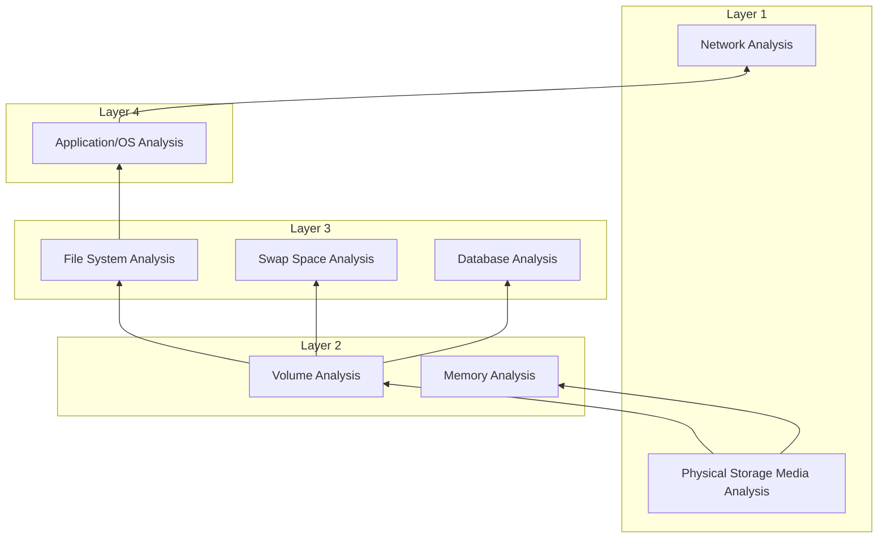
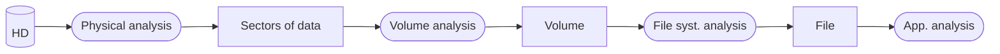

# Camadas de Organização de Dados e Análise de Sistemas de Ficheiros

Os sistemas de armazenamento de dados estruturam-se em **quatro camadas de abstração** (desde os meios físicos e de rede até às aplicações e sistemas operativos), sendo o foco central de **AFD1** a **Análise de Sistemas de Ficheiros (*File System Analysis*)**. Na inspeção de um sistema de ficheiros, distingue-se entre **dados essenciais** (nomes de ficheiros e localização física em *clusters*, nos quais o sistema tem de confiar para aceder ao conteúdo) e **dados não essenciais** (metadados como o último acesso, que podem estar incorretos ou adulterados sem invalidar o conteúdo do ficheiro).

---

## As 4 Camadas de Organização e Análise de Dados

Os sistemas de armazenamento de dados possuem várias camadas hierárquicas de análise:

### Camada 1 (*Layer 1*) — Meios Físicos e Comunicação
* Exige **laboratórios especializados** (*requires specialized laboratories*).
* **Dispositivos de comunicação**: Ethernet, 3G, UMTS, etc.
* **Suportes de armazenamento físico (*physical store mediums*)**: discos rígidos (*hard disks*), chips de memória, CD-ROMs, etc.

### Camada 2 (*Layer 2*) — Leitura de Dados Lógicos (Fluxos de `0`s e `1`s)
* **Memória volátil (RAM)**: dados tipicamente organizados por processos.
* **Armazenamento não volátil**: dados tipicamente organizados em **volumes** (partições, matrizes RAID, etc.).
  * Analisar dados ao nível do volume permite encontrar possíveis **dados ocultos** (*hidden data* — por exemplo, entre partições ou fora dos limites declarados pelo sistema de ficheiros).

### Camada 3 (*Layer 3*) — Estruturas de Armazenamento Lógico
* **Sistema de ficheiros (*File System*)**: o conteúdo mais comum e **foco central desta unidade curricular**.
* **Espaço temporário (*Temporary space*)**: espaço de *swap* no Linux ou *pagefile* no Windows.
* **Bases de dados diretas (*Direct database*)**: armazenamento sem sistema de ficheiros tradicional (ex.: *Google File System*, etc.).

### Camada 4 (*Layer 4*) — Sistema Operativo e Aplicações
* **Sistemas operativos**: Windows, Mac OSX, Linux, Android, iOS, etc.
* **Aplicações**: dependentes do sistema operativo.

---

## Análise de Sistemas de Ficheiros (*File System Analysis*)

Um sistema de ficheiros consiste numa **coleção de estruturas de dados** que permite a uma aplicação criar, ler e escrever ficheiros.

* **Objetivos da análise forense do sistema de ficheiros**:
  1. Encontrar ficheiros (*find files*).
  2. Recuperar ficheiros apagados (*recover deleted files*).
  3. Encontrar dados ocultos (*find hidden data*).
* **Resultados obtidos**:
  * Conteúdo de ficheiros (*file content*).
  * Fragmentos de dados (*data fragments*).
  * Metadados associados aos ficheiros (*metadata associated with files*).

---

## Dados Essenciais vs. Dados Não Essenciais no Sistema de Ficheiros

O sistema de ficheiros organiza os dados dentro de um volume, associando nomes de ficheiros ao respetivo conteúdo:

| Categoria | Exemplos | Fiabilidade e Implicações Forenses |
| :--- | :--- | :--- |
| **Dados Essenciais** (*Essential data*) | **Nomes de ficheiros** e **localização do conteúdo** (*cluster* inicial e tamanho) | **Dados fidedignos (*trustful data*)**, pois o sistema operativo depende deles para ler o ficheiro; contudo, o conteúdo apontado pode já ser inválido (ex.: ficheiros apagados cujos *clusters* foram reutilizados). |
| **Dados Não Essenciais** (*Non-essential data*) | **Data/hora do último acesso** (*last access time*) | Mesmo que este dado esteja errado, **o conteúdo do ficheiro continua a ser válido**. Não podemos confiar cegamente em dados não essenciais (o relógio do sistema pode estar incorreto ou o utilizador pode ter alterado a hora), pelo que devemos procurar fontes de dados adicionais para suportar uma hipótese de incidente. |

### Exemplo de Mapeamento de Entrada de Diretório para Clusters
* **Registo de metadados**: `Filename: 01-Lab2.txt` | `Cluster: 345` | `Size: 56` | `Last accessed: 2015-01-03`
* **Clusters de dados no volume**:
  * `Cluster 343`: `"Instituto Politécnico de Leiria"`
  * `Cluster 344`: `"Fundamentos da Análise digital"`
  * `Cluster 345` (apontado pela entrada de `01-Lab2.txt`): `"Exercise: perform digital signatures with GnuPG"`

---

## Análise do Conteúdo de Ficheiros e Fluxo Completo

* A estrutura interna de dados depende da aplicação ou do SO que criou o ficheiro (ex.: a estrutura de dados de um ficheiro `HTML` difere completamente de um `.jpeg`).
* As ferramentas de análise variam consoante a aplicação criadora.
* A análise de **ficheiros de configuração** é crucial para determinar que programas estavam em execução.

---

## Implicações Forenses

* **Anti-Forense em Dados Essenciais vs. Não Essenciais**: Se um utilizador ou atacante corromper um *dado essencial* (como o ponteiro para o *cluster* `345`), o próprio sistema operativo deixa de conseguir abrir o ficheiro; porém, se adulterar um *dado não essencial* (*timestomping* sobre a data de último acesso), o ficheiro continua perfeitamente funcional enquanto engana uma análise superficial baseada apenas em datas.

---

## Perguntas de revisão

- Quais são as quatro camadas de organização de dados e que tipo de análise ocorre em cada uma?
- Qual é a diferença entre dados essenciais e dados não essenciais num sistema de ficheiros? Dê exemplos de ambos.
- Qual é a sequência completa de análise de dados desde o disco rígido físico (`HD`) até à análise aplicacional (`App. analysis`)?

## Notas relacionadas

- [[Sistemas de Numeração e Conversão entre Bases]]
- [[Organização de Estruturas de Dados em Binário]]
- [[Representação Forense de Data e Hora (Timestamps e SQLite)]]
- [[Capítulo 3 - Organização de Dados]]
