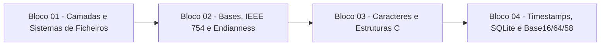

# Capítulo 3 — Organização de Dados (*Data Organization*)

Mapa de estudo do **Capítulo 3** de [[00 AFD1|AFD1]] (Docentes **Miguel Frade** e **Baltazar Rodrigues**), cobrindo **34 diapositivos** em **4 blocos temáticos**, **8 notas** e **1 Cheat Sheet**.

> [!TIP] Guia de Consulta Rápida para Exame
> Para tabelas de conversão numérica, estrutura IEEE 754, comparação Big vs. Little-endian, codificações `"Olá"`, constantes de épocas (`11644473600`), queries SQLite e alfabetos Base16/64/58, consulta a **[[Cheat Sheet - Organização de Dados, Codificações e Timestamps]]**.

---

## 1. Camadas de Organização e Análise de Sistemas de Ficheiros (`01 - Camadas de Organização e Análise de Sistemas de Ficheiros`)

| Nota | O que vais estudar |
| :--- | :--- |
| [[Camadas de Organização de Dados e Análise de Sistemas de Ficheiros]] | Quatro camadas de análise, foco em sistemas de ficheiros e distinção entre dados essenciais e não essenciais. |

---

## 2. Representação Numérica, Vírgula Flutuante e Endianness (`02 - Representação Numérica, Vírgula Flutuante e Endianness`)

| Nota | O que vais estudar |
| :--- | :--- |
| [[Sistemas de Numeração e Conversão entre Bases]] | Bases decimal, binária e hexadecimal, fórmula polinomial posicional e conversão direta de 4 bits por dígito. |
| [[Números em Vírgula Flutuante (IEEE 754)]] | Norma IEEE 754 em 32 e 64 bits com sinal, expoente em excesso e mantissa normalizada. |
| [[Endianness e Ordem de Armazenamento]] | Ordenação Big-endian vs. Little-endian em valores multi-byte, arquiteturas de CPU e *network byte order*. |

---

## 3. Codificação de Caracteres e Estruturas de Dados (`03 - Codificação de Caracteres e Estruturas de Dados`)

| Nota | O que vais estudar |
| :--- | :--- |
| [[Codificação de Caracteres - ASCII, Latin-1 e Unicode]] | Padrões ASCII, Latin-1 e Unicode (UTF-8, UTF-16, UTF-32) com comparação hexadecimal de `"Olá"`. |
| [[Organização de Estruturas de Dados em Binário]] | Mapeamento de `struct` C de 64 bytes com *padding* e dedução de *endianness* via *hex dump*. |

---

## 4. Data, Hora e Codificação Binário-para-Texto (`04 - Data, Hora e Codificação Binário-para-Texto`)

| Nota | O que vais estudar |
| :--- | :--- |
| [[Timestamps e Épocas Temporais (UNIX Epoch vs. Windows FILETIME)]] | Épocas de 1970 e 1601, matriz de 14 formatos de software e queries SQLite Firefox/Chrome. |
| [[Codificação Binário-para-Texto (Base16, Base64 e Base58)]] | Reversibilidade e inflação sem chave secreta em Base16, Base64 com *padding* e Base58 no Bitcoin. |

> [!NOTE] Exercícios Laboratoriais do Capítulo 3 (Slide 34)
> O diapositivo 34 referencia três exercícios práticos de laboratório (*Lab 1 – Endianness, read binary file*, *Lab 2 – Identify different character encodings* e *Lab 3 – Character encoding conversions*), cujos guiões detalhados serão integrados assim que disponibilizados.

---

## Navegação

* [[00 AFD1|Voltar ao Índice de AFD1]]
* [[Cheat Sheet - Organização de Dados, Codificações e Timestamps|Ir para a Cheat Sheet do Capítulo 3]]
* [[Capítulo 2 - Arranque e Aquisição Forense|Recuar para o Capítulo 2 — Arranque e Aquisição Forense]]
* [[Capítulo 1 - Método de Investigação|Recuar para o Capítulo 1 — Método de Investigação]]
* [[Capítulo 1 - Sistemas Operativos, Serviços e Artefactos Forenses|Pontes com ASSI — Capítulo 1 (Estruturas Binárias, Timestamps e SQLite no Windows)]]
* [[Home|Voltar ao Hub Central do MCIF]]
