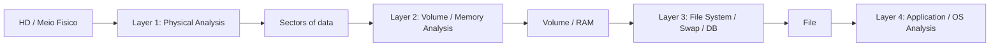

# Cheat Sheet — Organização de Dados, Codificações e Timestamps

Guia de consulta rápida do **Capítulo 3 de AFD1**, condensando as 4 camadas de organização de dados, dados essenciais vs. não essenciais, conversões entre bases, vírgula flutuante **IEEE 754**, **Endianness** (*Big* vs. *Little-Endian*), anatomia de **`struct`** em binário, codificações **ASCII / Latin-1 / UTF-8 / UTF-16 / UTF-32**, **Base16 / Base64 / Base58**, formatos de **Timestamps**, queries **SQLite** para Firefox e Chrome e armadilhas de exame.

> [!TIP] Finalidade desta Folha de Consulta Rápida
> Este documento sintetiza os **34 diapositivos** (71 páginas) de *Data Organization* e todas as **8 notas temáticas** dos Blocos `01` a `04` do [[Capítulo 3 - Organização de Dados|Capítulo 3 de AFD1]]. Serve de guia de bolso para revisão rápida, leitura de *hex dumps* e preparação de exame.

---

## 1. Camadas de Organização (4 Camadas) & Dados Essenciais vs. Não Essenciais

O armazenamento de dados organiza-se em **4 camadas hierárquicas** ([[Camadas de Organização de Dados e Análise de Sistemas de Ficheiros]]):



| Camada | Escopo de Análise | Notas Técnicas e Foco de AFD1 |
| :--- | :--- | :--- |
| **Layer 1** | *Physical Storage Media* (HDD, chips, CD-ROM) e *Network* (Ethernet, 3G, UMTS) | Exige **laboratórios especializados**. |
| **Layer 2** | *Volume Analysis* (partições, RAID) e *Memory Analysis* (RAM por processos) | Fluxos de `0`s e `1`s; a análise ao nível do volume deteta **dados ocultos** entre partições ou fora dos limites do sistema de ficheiros. |
| **Layer 3** | ***File System Analysis***, *Swap Space* (`swap` / `pagefile`) e *Direct Databases* (sem FS tradicional, ex.: Google FS) | **Foco central de AFD1**: (1) encontrar ficheiros, (2) recuperar ficheiros apagados, (3) encontrar dados ocultos. |
| **Layer 4** | *Application / OS Analysis* (Windows, macOS, Linux, Android, iOS) | Estrutura interna dependente da app (`.html` vs. `.jpeg`) e **ficheiros de configuração**. |

### Dados Essenciais vs. Dados Não Essenciais no Sistema de Ficheiros

| Categoria | Exemplos | Fiabilidade e Implicação Pericial |
| :--- | :--- | :--- |
| **Dados Essenciais** (*Essential data*) | **Nome do ficheiro** e **localização física** (*cluster* inicial e tamanho — ex.: `01-Lab2.txt`, `Cluster: 345`, `Size: 56`) | **Dados fidedignos (*trustful*)**: o SO depende deles para ler o ficheiro. *(Atenção: em ficheiros apagados, o cluster pode já ter sido reutilizado)*. |
| **Dados Não Essenciais** (*Non-essential data*) | **Data/hora do último acesso** (*last access time*) | Mesmo estando incorreto ou manipulado (*timestomping* / relógio errado), **o conteúdo do ficheiro continua válido**. Nunca confiar cegamente — corroborar noutras fontes! |

---

## 2. Conversões de Bases & Vírgula Flutuante (IEEE 754)

### 2.1 Sistemas de Numeração e Relação Byte–Hexadecimal

* **Relação Fundamental**: **$1\text{ Byte} = 8\text{ bits} = 2\text{ dígitos hexadecimais}$** ($1\text{ dígito hex} = 1\text{ nibble} = 4\text{ bits}$) ([[Sistemas de Numeração e Conversão entre Bases]]).
* **Posicional**: *Most Significant* à **esquerda**; *Less Significant* à **direita** ($p = 0$ na direita).
* **Fórmula Geral (Base $b \to$ Decimal)**: $\sum s_i \times b^i = s_p \times b^p + \dots + s_1 \times b^1 + s_0 \times b^0$
  * Binário $1001\,0011_b \to 128 + 16 + 2 + 1 = \mathbf{147_d}$ | Conversão direta de 4 em 4 bits: $1001_b = \text{0x9}$, $0011_b = \text{0x3} \implies \mathbf{\text{0x93}}$.
  * Hexadecimal $\text{0x8BE4} \to 8\times 4096 + 11\times 256 + 14\times 16 + 4\times 1 = \mathbf{35\,812_d}$.

| Dec | Bin | Hex | Dec | Bin | Hex | Dec | Bin | Hex | Dec | Bin | Hex |
| :---: | :---: | :---: | :---: | :---: | :---: | :---: | :---: | :---: | :---: | :---: | :---: |
| `0` | `0000` | `0x0` | `4` | `0100` | `0x4` | `8` | `1000` | `0x8` | `12` | `1100` | `0xC` |
| `1` | `0001` | `0x1` | `5` | `0101` | `0x5` | `9` | `1001` | `0x9` | `13` | `1101` | `0xD` |
| `2` | `0010` | `0x2` | `6` | `0110` | `0x6` | `10` | `1010` | `0xA` | `14` | `1110` | `0xE` |
| `3` | `0011` | `0x3` | `7` | `0111` | `0x7` | `11` | `1011` | `0xB` | `15` | `1111` | `0xF` |

### 2.2 Norma IEEE 754 (`float` 32 bits vs. `double` 64 bits)

A norma **IEEE 754** divide o número em **3 campos** ([[Números em Vírgula Flutuante (IEEE 754)]]):

1. **Signal (`1` bit)**: `0` positivo, `1` negativo.
2. **Exponent in excess**: permite **comparação direta** entre valores sem descompactar.
3. **Mantissa (*significand*) normalizada**: o dígito **`1` inteiro** à esquerda da vírgula é **omitido/implícito** (em somas/subtrações desnormaliza-se com perda gradual de precisão).

| Precisão | Total | Sinal | Expoente | Excesso | Intervalo do Expoente | Mantissa |
| :--- | :---: | :---: | :---: | :---: | :---: | :---: |
| **Simples (`float`)** | **32 bits** (4 B) | `1` bit | **`8` bits** | **`127`** | $[2^{-126}, 2^{+127}]$ | **`23` bits** |
| **Dupla (`double`)** | **64 bits** (8 B) | `1` bit | **`11` bits** | **`1023`** | $[2^{-1022}, 2^{+1023}]$ | **`52` bits** |

```text
Precisao Simples (32 bits): [ Sinal: 1 bit | Expoente: 8 bits (excesso 127)  | Mantissa: 23 bits ]
Precisao Dupla   (64 bits): [ Sinal: 1 bit | Expoente: 11 bits (excesso 1023)| Mantissa: 52 bits ]
```

> [!NOTE] Dica Visual Forense em *Hex Dumps*
> Um `float` (32 bits) próximo de $1{,}0$ a $2{,}0$ tem o seu byte mais significativo em **`0x3F`** ou **`0x40`** (expoente em excesso próximo de `127` = `01111111` com sinal `0`). Se esse byte `3F`/`40` aparecer à **direita** do grupo de 4 bytes (ex.: `c9 76 9e 3f`), confirma armazenamento **Little-Endian**!

---

## 3. Endianness & Estruturas Binárias (`struct`)

### 3.1 Big-Endian vs. Little-Endian (`0x12345678`)

Como $1\text{ Byte}$ só guarda $2^8 = 256$ valores (`0`–`255`), números maiores agrupam **2, 4 ou 8 bytes** (**16, 32 ou 64 bits**) ([[Endianness e Ordem de Armazenamento]]):

| Ordem / Arquitetura | Regra para `0x12345678` (Endereços `91`–`94`) | Processadores e Protocolos |
| :--- | :--- | :--- |
| **Big-Endian** | `91: 12` \| `92: 34` \| `93: 56` \| `94: 78` (*MSB* no 1.º endereço) | `SPARC`, `PowerPC`, `MIPS`, `Motorola 68k`, `Alpha` e **Redes IP (*Network Byte Order*)**. |
| **Little-Endian** | `91: 78` \| `92: 56` \| `93: 34` \| `94: 12` (*LSB* no 1.º endereço) | **`x86`**, **`x86-64`**, `amd64`, `z80`, `VAX` (otimizações em *pipelines*). |
| **Bi-Endian** | Configurável em ambos os modos (*programável*) | **`ARM`**. |

### 3.2 Anatomia da `struct` C de 64 Bytes (`0x40` bytes)

Uma estrutura de dados funciona como um **mapa interpretativo** — **a definição da `struct` em si não é gravada** no ficheiro binário ([[Organização de Estruturas de Dados em Binário]]).

```c
typedef struct {
    char name[32];         // 32 B: Offsets 0x00 - 0x1F (ASCII -> NAO inverte!)
    char postalcode[16];   // 16 B: Offsets 0x20 - 0x2F (ASCII -> NAO inverte!)
    uint32_t partner_num;  //  4 B: Offsets 0x30 - 0x33 (Multi-byte -> Depende do Endianness)
    float quota;           //  4 B: Offsets 0x34 - 0x37 (IEEE 754   -> Depende do Endianness)
    char empty[8];         //  8 B: Offsets 0x38 - 0x3F (Padding p/ multiplos de 16 bytes)
};                         // Total = 64 bytes (0x40)
```

```text
0000000: 4d69 6775 656c 2046 7261 6465 0000 0000  Miguel Frade....
0000010: 0000 0000 0000 0000 0000 0000 0000 0000  ................
0000020: 3234 3131 2d39 3031 0000 0000 0000 0000  2411-901........
0000030: b300 0d00 c976 9e3f 0000 0000 0000 0000  .....v.?........
```

| Campo (`Offset`) | Bytes no Disco | Se fosse **Big-Endian** | Em **Little-Endian** (Real) | Regra Pericial |
| :--- | :--- | :--- | :--- | :--- |
| `name` (`0x00–0x1F`) | `4d 69 67 75...` | `"Miguel Frade"` | **`"Miguel Frade"`** | **Strings de 1 byte são imunes** à inversão de *endianness*. |
| `postalcode` (`0x20–0x2F`) | `32 34 31 31 2d...` | `"2411-901"` | **`"2411-901"`** | Lido da esquerda para a direita sem inversão. |
| `partner_num` (`0x30–0x33`) | `b3 00 0d 00` | `0xb3000d00` = `3 003 124 992` | **`0x000d00b3`** = **`852 147`** | Números multi-byte **invertem** os bytes em Little-Endian. |
| `quota` (`0x34–0x37`) | `c9 76 9e 3f` | `0xc9769e3f` = `-1 010 147,94` *(absurdo!)* | **`0x3f9e76c9`** = **`1,238`** | Byte `3f` no fim denuncia IEEE 754 positivo pequeno em Little-Endian. |
| `empty` (`0x38–0x3F`) | `00 00 00 00...` | `0` (*padding*) | `0` (*padding*) | Alinha a estrutura a múltiplos de 16 bytes. |

---

## 4. Codificação de Caracteres & Binário-para-Texto

### 4.1 ASCII, Latin-1 e Unicode (`UTF-8`, `UTF-16`, `UTF-32`)

| Padrão | Largura | Endianness? | Uso Típico e Exemplo ([[Codificação de Caracteres - ASCII, Latin-1 e Unicode\|Codificação de Caracteres]]) |
| :--- | :---: | :---: | :--- |
| **ASCII** | **7 bits** (`128` chars) | **Não** (1 B/char) | Texto inglês sem acentos (`"2670-582 LOURES"`, `0x20` = espaço, `0x30–39` = `0–9`, `0x41–5A` = `A–Z`). |
| **Latin-1 (`ISO-8859-1`)** | **8 bits** (`256` chars) | **Não** (1 B/char) | Extensão europeia: `"Olá"` = `4F 6C` **`E1`** (`'á'` ocupa **1 byte**). |
| **UTF-8** *(Unicode)* | **1 a 4 bytes** | **Não** (byte a byte) | `*nix`, WWW, HTML (`>137 000` chars, `146` *scripts*); compatível com ASCII; `"Olá"` = `4F 6C` **`C3 A1`** (`'á'` ocupa **2 bytes**). |
| **UTF-16** *(Unicode)* | **2 a 4 bytes** | **Sim** (LE / BE) | **Windows**, macOS, Java, .NET, KDE; `"Olá"` em UTF-16LE = `4F 00 6C 00 E1 00`. |
| **UTF-32** *(Unicode)* | **4 bytes fixos** | **Sim** (LE / BE) | Largura fixa de 32 bits por carácter. |

### 4.2 Binário-para-Texto: Base16, Base64 e Base58

> [!IMPORTANT] Codificação (*Encoding*) NÃO é Encriptação (*Encryption*)
> * **Encriptação** exige uma **chave secreta** para proteger a confidencialidade.
> * **Codificação** **não usa qualquer chave** — é totalmente **reversível**, **inflaciona** o tamanho dos dados e serve apenas para compatibilidade de transporte em canais textuais (ex.: e-mail).

| Técnica | Alfabeto / Caracteres | Regras, Inflação e Uso ([[Codificação Binário-para-Texto (Base16, Base64 e Base58)\|Binary-to-Text]]) | Exemplo (`"Hello World"` / Bitcoin) |
| :--- | :--- | :--- | :--- |
| **Base16 (Hex)** | `[0..9]`, `[A..F]` / `[a..f]` | **Duplica o tamanho** (1 B = 2 chars); padrão na exibição de hashes (`MD5`, `SHA-256`). | `48656c6c6f20776f726c64` |
| **Base64** | `[A..Z]`, `[a..z]`, `[0..9]`, `[+, /]` | Comprimento **múltiplo de 4** usando **`=`** como *padding* final; usado em **MIME** (e-mail) e **OpenPGP**. | `SGVsbG8gV29ybGQ=` |
| **Base58** | `58` chars alfanuméricos | Remove `+`, `/` e os 4 caracteres visualmente ambíguos **`0`, `O`, `I`, `l`**; usado em **Bitcoin**. | Púb: `1ZNz2KDm8epACBA5bjgKQbRyaGcDt3XV2`<br>Priv: `Ky1ZcCSMziFtdxfDEjANw3PZUZQQLjh6hKpX1CinVtJscnAFnvcn` |

---

## 5. Timestamps Forenses & Queries SQLite

### 5.1 Texto vs. Binário, Épocas e Constante `11644473600`

* **Strings de texto**: legíveis por humanos, mas ineficientes para ordenar/comparar e frequentemente ambíguas (`23-12-2018` PT `DD-MM-YYYY` vs. `12-23-2018` US `MM-DD-YYYY`) ([[Representação Forense de Data e Hora (Timestamps e SQLite)]]).
* **Duas Épocas Fundamentais**:
  1. **Unix Time / POSIX / UNIX Epoch**: origem **`1970-01-01 00:00:00`**, em **segundos** (ou **$\mu\text{s}$** no Firefox) — Unix, Linux, **Firefox**, Python, Java, PHP, JavaScript, Ruby, Perl, Tcl.
  2. **Ciclo do Calendário Gregoriano de 400 anos**: origem **`1601-01-01 00:00:00`**, em **microssegundos ($\mu\text{s}$)** no **Google Chrome** ou **intervalos de $100\text{ ns}$** no **Windows 32/64 bits e NTFS** (também Cobol).
* **Constante de Conversão**: entre `1601-01-01` e `1970-01-01` decorreram $369\text{ anos} = 134\,774\text{ dias} =$ **`11644473600`** **segundos**.
* **Ferramentas GUI**: **`MFT Stampede`** (conversor multi-formato) e NirSoft **`BrowsingHistoryView`** (IE, Firefox, Chrome, Safari).

### 5.2 Referência Rápida dos Formatos Temporais da Aula

| Software / Formato | Representação | Exemplo Equivalente | Software / Formato | Representação | Exemplo Equivalente |
| :--- | :--- | :--- | :--- | :--- | :--- |
| **Win 64 bits BE** | 16 Hex chars | `01 CC A6 3C 91 B9 72 00` | **Firefox SQLite** | **16 dígitos** ($\mu$s / 1970) | `1 321 653 236 000 000` |
| **Win 64 bits LE** | 16 Hex chars | `00 72 B9 91 3C A6 CC 01` | **Chrome SQLite** | **17 dígitos** ($\mu$s / 1601) | `12 966 126 836 000 000` |
| **Unix numeric** | 10 dígitos (s) | `1 321 653 236` | **Cookie hi:low** | 18:19 dígitos | `3 923 586 186:30 188 999` |
| **Unix numeric m.s.** | 13/16 dígitos | `1 321 653 236 000 000` | **DOS wFAT** | 8 Hex chars | `F0 48 64 40` |
| **Unix 32 bits BE** | 8 Hex chars | `4E C6 D3 F4` | **GSM** | 14 dígitos | `99 309 251 619 580` |
| **Unix 32 bits LE** | 8 Hex chars | `F4 D3 C6 4E` | **Samsung Swift** | 8 Hex chars | `E7 8C 94 7D` |
| **HFS+ 32 bits BE** | 8 Hex chars | `CA EC 84 74` | **Nokia Series 40** | 14 Hex chars | `07 D9 04 11 13 27 09` |
| **HFS+ 32 bits LE** | 8 Hex chars | `74 84 EC CA` | **Mac Absolute time** | 9 dígitos | `343 346 036` |

### 5.3 Queries SQLite Prontas (Firefox & Google Chrome)

```sql
-- 1. Mozilla Firefox (places.sqlite) — Epoch 1970-01-01 em microssegundos (16 dígitos)
SELECT datetime(moz_historyvisits.visit_date/1000000, 'unixepoch', 'localtime'), moz_places.url
FROM moz_places, moz_historyvisits
WHERE moz_places.id = moz_historyvisits.place_id;

-- 2. Google Chrome (History) — Epoch 1601-01-01 em microssegundos (17 dígitos)
SELECT datetime(((visits.visit_time/1000000)-11644473600), 'unixepoch'), urls.url, urls.title
FROM urls, visits
WHERE urls.id = visits.url;
```

---

## "Top 8" Armadilhas Clássicas de Exame (Capítulo 3)

> [!CAUTION] Os 8 Erros Mais Frequentes no Capítulo 3 de AFD1
>
> 1. **Tratar `last access time` como dado fiável (ou confundir Dados Essenciais com Não Essenciais)**: Apenas o **nome** e a **localização em clusters** são *dados essenciais* dos quais o SO depende; os *timestamps* são *dados não essenciais* que podem ser alterados (*timestomping*) ou estar errados sem invalidar o ficheiro.
> 2. **Trocar os bits ou o excesso do IEEE 754 `float` vs. `double` (e esquecer o bit implícito)**: **`float`** (32 bits) usa **`1 + 8 + 23`** com excesso **`127`**, enquanto **`double`** (64 bits) usa **`1 + 11 + 52`** com excesso **`1023`**; ambos **omitem o bit `1` inteiro** na mantissa normalizada.
> 3. **Inverter strings ASCII/UTF-8 em Little-Endian (ou esquecer de inverter inteiros/`float`)**: Num sistema `x86`/`x86-64`, arrays de 1 byte (`"Miguel Frade"`, `"2411-901"`) leem-se sempre **sem inversão**; já inteiros multi-byte (`b3 00 0d 00` $\to$ `0x000d00b3`) e `float` (`c9 76 9e 3f` $\to$ `0x3f9e76c9` = `1,238`) têm de ser invertidos.
> 4. **Assumir que a definição da `struct` está no ficheiro binário ou ignorar bytes de *padding***: O ficheiro só guarda os bytes brutos dos valores; campos de alinhamento como `char empty[8]` (alinhamento a 16 B) têm de ser contabilizados no mapa de *offsets*.
> 5. **Confundir `'á'` em UTF-8 (`C3 A1`) com Latin-1 (`E1`) ou ignorar UTF-16LE no Windows**: Em `"Olá"`, `'á'` ocupa **2 bytes (`C3 A1`)** em UTF-8 e **1 byte (`E1`)** em Latin-1; no Windows as strings internas estão em **UTF-16LE** (`4F 00 6C 00 E1 00`) e sofrem de *endianness* (ao contrário do ASCII e do UTF-8).
> 6. **Confundir *Encoding* (`Base16`/`Base64`/`Base58`) com Encriptação ou esquecer os caracteres proibidos do Base58**: Codificação **não usa chave secreta** e serve apenas para compatibilidade de transporte; o **Base64** usa `=` no fim e `+`, `/`, enquanto o **Base58** (Bitcoin) exclui `+`, `/` e os 4 caracteres ambíguos **`0`, `O`, `I`, `l`**.
> 7. **Esquecer de subtrair `11644473600` no Chrome ou dividir Firefox pelo fator errado**: O **Firefox (`places.sqlite`)** já usa `1970-01-01` em $\mu\text{s}$ (`16` dígitos $\to$ só `/1000000`); o **Chrome (`History`)** usa `1601-01-01` em $\mu\text{s}$ (`17` dígitos $\to$ `/1000000 - 11644473600`); e o **Windows `FILETIME64`** usa intervalos de **`100 ns`** (`/10000000 - 11644473600`).
> 8. **Ignorar a ambiguidade `DD-MM` vs. `MM-DD` ou confundir *Network Byte Order* com arquitetura do PC**: Uma data textual como `04-05-2019` é ambígua sem contexto regional, e pacotes IP na rede usam **Big-Endian** (*network byte order*) mesmo quando capturados em máquinas `x86-64` (**Little-Endian**).

---

## Navegação

* [[00 AFD1|Voltar ao Índice de AFD1]]
* [[Capítulo 3 - Organização de Dados|Índice do Capítulo 3 — Organização de Dados]]
* [[Cheat Sheet - Método de Investigação, Arranque e Aquisição Forense|Recuar para Cheat Sheet AFD1 Capítulos 1 e 2]]
* [[Camadas de Organização de Dados e Análise de Sistemas de Ficheiros]]
* [[Sistemas de Numeração e Conversão entre Bases]]
* [[Números em Vírgula Flutuante (IEEE 754)]]
* [[Endianness e Ordem de Armazenamento]]
* [[Codificação de Caracteres - ASCII, Latin-1 e Unicode]]
* [[Organização de Estruturas de Dados em Binário]]
* [[Representação Forense de Data e Hora (Timestamps e SQLite)]]
* [[Codificação Binário-para-Texto (Base16, Base64 e Base58)]]
