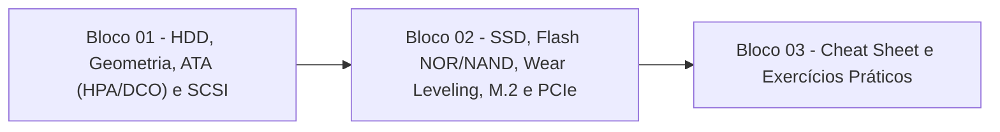

# Capítulo 4 — Dispositivos de Armazenamento (*Storage Devices*)

Mapa de estudo do **Capítulo 4** de [[00 AFD1|AFD1]] (Docentes **Miguel Frade** e **Baltazar Rodrigues**), cobrindo os módulos **04.1 (*Hard Drive Technology*, 26 slides)** e **04.2 (*Solid State Drive Technology*, 28 slides)** em **5 notas temáticas** e **1 Cheat Sheet**.

> [!TIP] Guia de Consulta Rápida para Exame
> Para fórmulas `CHS` $\leftrightarrow$ `LBA`, comandos `hdparm` para `HPA`/`DCO`, tabelas comparativas `ATA` vs. `SCSI` e `HDD` vs. `SSD`, hierarquia `NAND` e chaves `M.2`, consulta a **[[Cheat Sheet - Dispositivos de Armazenamento (HDD, ATA-SCSI, SSD e M.2)]]**.

---

## 1. Tecnologia de Discos Rígidos (HDD), ATA e SCSI (`01 - Tecnologia HDD e Geometria`)

| Nota | O que vais estudar |
| :--- | :--- |
| [[Acesso a Discos (BIOS vs Direto) e Geometria de Discos Rígidos (CHS vs LBA)]] | Acesso direto via controlador vs. BIOS (`INT 13h`), pratos/pistas/cilindros/cabeças/setores, *Zone Bit Recording*, limites `CHS` e fórmula de conversão `LBA`. |
| [[Interfaces de Disco - ATA (IDE-PATA-SATA) e Áreas Protegidas (HPA e DCO)]] | Evolução `ATA-1` a `SATA 3.2`, áreas escondidas `HPA` e `DCO`, deteção e remoção com `hdparm`, e ferramentas forenses (`TAFT`, `SAFE-Block`). |
| [[Interface SCSI, SAS e Comparação SCSI vs ATA]] | Arquitetura `SCSI` (`FCP`, `SAS`, `UAS`), evolução de velocidades e conectores, e comparação sistemática `ATA` vs. `SCSI`. |

---

## 2. Tecnologia de Estado Sólido (SSD) e Memória NAND (`02 - Tecnologia SSD e Memória NAND`)

| Nota | O que vais estudar |
| :--- | :--- |
| [[SSD vs HDD - DRAM, Flash NOR vs NAND e Desafios Forenses (Wear Leveling e Garbage Collection)]] | `DRAM` vs. Flash `NOR`/`NAND`, `SLC` vs. `MLC`, hierarquia `Cell`/`Byte`/`Sector`/`Block`, *wear leveling*, *garbage collection* (ativo mesmo com *write blocker*) e impacto forense. |
| [[Arquitetura SSD vs Pen USB, Conetores M.2, PCIe e Apple SSD]] | Produção *consumer* vs. *industrial*, Pen USB (usa CPU) vs. SSD (processador próprio), camadas conector/interface/protocolo, chaves `M.2`, `PCIe` 1.0–5.0 e conectores Apple. |

---

## 3. Consulta Rápida e Laboratórios

- **[[Cheat Sheet - Dispositivos de Armazenamento (HDD, ATA-SCSI, SSD e M.2)]]** — Tabelas de referência rápida, comandos `hdparm` e lista dos exercícios práticos (`04-Lab 1`, `04.2-Lab 1` e `04.2-Lab 2` com `smartmontools`).

## Ligações Transversais
- **Anterior:** [[Capítulo 3 - Organização de Dados]]
- **Relacionado (Cap. 2):** [[Procedimentos de Aquisição - Post-Mortem vs Live, Erros de Disco, HPA-DCO e Write Blockers]]
