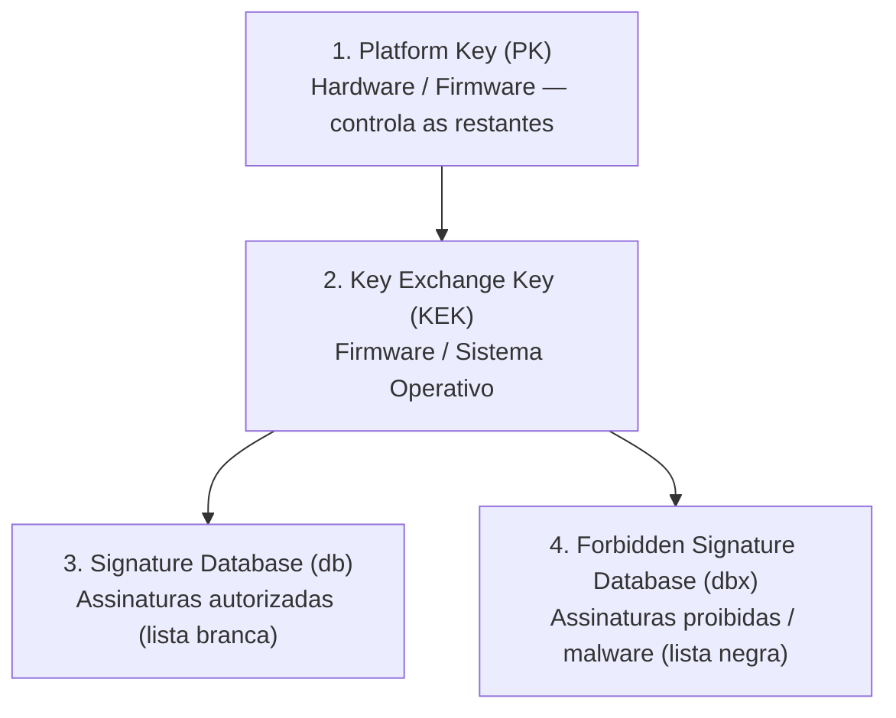

# UEFI Secure Boot — Assinatura Digital e Hierarquia de Chaves

No arranque do Windows com **UEFI Secure Boot**, os vários módulos de arranque são validados criptograficamente por assinatura digital antes da execução, impedindo o carregamento de código ou *bootloaders* não autorizados.

## 1. Assinatura Digital no Arranque

A validação assenta num par de chaves assimétricas:
* **Chave privada**: mantida secreta pelo assinante (OEM / Microsoft), usada exclusivamente para **assinar** o ficheiro;
* **Certificado digital (chave pública)**: incluído no ficheiro assinado e nas bases do firmware, permitindo a qualquer sistema **validar** a autenticidade e integridade da assinatura.

---

## 2. Hierarquia das 4 Chaves / Bases de Dados UEFI

O Secure Boot organiza a confiança em quatro níveis:

| Chave / Base | Âmbito | Função Principal |
| :--- | :--- | :--- |
| **`PK`** (*Platform Key*) | Hardware / Firmware | **Mais importante** — raiz de confiança da plataforma; permite alterar todas as restantes chaves. |
| **`KEK`** (*Key Exchange Key*) | Firmware / Sistema Operativo | Intermediária que autoriza atualizações às bases `db` e `dbx`. |
| **`db`** (*Signature Database*) | Componentes UEFI e arranque | **Lista branca** de assinaturas e certificados autorizados a executar. |
| **`dbx`** (*Forbidden Signature Database*) | Software malicioso / revogado | **Lista negra** usada para negar execução; **prevalece sobre a `db`**. |

> [!IMPORTANT] Risco de Comprometimento da `PK`
> Como a **Platform Key (`PK`)** controla as restantes chaves, a exposição da sua chave privada permite a um atacante substituir o software de arranque por código malicioso mantendo o Secure Boot aparentemente ativo — o cerne da vulnerabilidade [[PKfail - Vulnerabilidade do UEFI Secure Boot|PKfail]].

---

## Além da aula

* **Cadeia típica de arranque Windows**: `UEFI Firmware` → `UEFI Boot Manager` → `bootmgr.efi` → `winload.efi` → `ntoskrnl.exe`.
* **Integração com TPM / BitLocker**: as medições de integridade da cadeia de arranque ficam nos registos PCR do TPM; alterações não autorizadas na `PK` ou no firmware bloqueiam a libertação automática da chave do BitLocker.

---

## Perguntas de revisão

1. **Qual o papel da chave privada vs. chave pública na validação de código do UEFI Secure Boot?**

> [!success]- Ver Resposta
> A **chave privada** (secreta) assina o binário; a **chave pública** (contida no certificado digital e no firmware) permite validar a assinatura antes de executar o módulo.

2. **Qual é a chave mais importante do UEFI Secure Boot e qual a diferença entre `db` e `dbx`?**

> [!success]- Ver Resposta
> A mais importante é a **Platform Key (`PK`)**, pois permite alterar todas as restantes chaves (`KEK`, `db`, `dbx`). A `db` é a lista branca de assinaturas autorizadas a executar, enquanto a `dbx` é a lista negra de assinaturas proibidas (software malicioso/revogado), que nega a execução mesmo que conste na `db`.

---

## Navegação e Notas Relacionadas

| Percurso | Nota | Contexto |
| :--- | :--- | :--- |
| **Anterior** | [[Capítulo 1 - Sistemas Operativos, Serviços e Artefactos Forenses]] | Início do capítulo |
| **Seguinte** | [[PKfail - Vulnerabilidade do UEFI Secure Boot]] | `mesmo bloco` |
| **Índice** | [[Capítulo 1 - Sistemas Operativos, Serviços e Artefactos Forenses]] · [[00 ASSI]] | `Bloco 01` |

### Conceitos Relacionados

* [[Processo de Arranque UEFI, Secure Boot e Fluxo do Windows]] · `AFD1 · Cap. 2`
* [[Arranque Forense e Processo de Boot (BIOS e Código Máquina)]] · `AFD1 · Cap. 2`
* [[Preservação do Sistema e Integridade de Dados]] · `AFD1 · Cap. 1`
