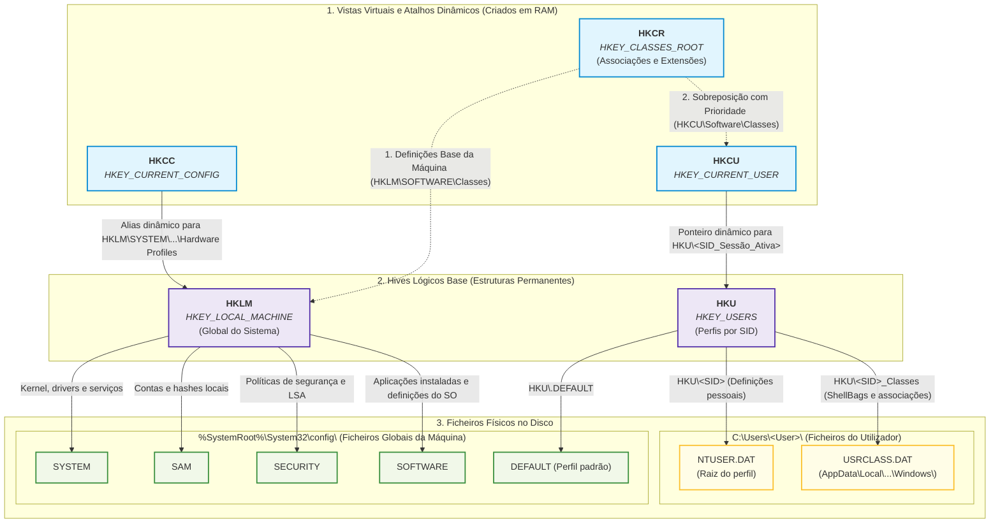

# Estrutura e Hives do Windows Registry

Base de dados hierárquica introduzida no Windows 95 (substituindo `config.sys`, `autoexec.bat` e ficheiros `.ini`) que centraliza configurações de hardware, sistema operativo, aplicações e atividade de utilizadores. Ao nível do *kernel*, a sua gestão e controlo de acesso estão a cargo do **Configuration Manager**.

## 1. Anatomia Lógica: Hives, Chaves e Valores

O Registry funciona como uma árvore semelhante a um sistema de ficheiros:
* **Hives (Colmeias)**: raízes de topo (`HKEY_*`);
* **Chaves (*Keys*) e Subchaves**: contentores análogos a pastas (cada chave regista um *LastWriteTime*);
* **Valores (*Values*)**: pares armazenados dentro de uma chave, cada um com **três elementos**: **Nome**, **Tipo de Dados** e **Dado**.

---

## 2. Vistas Virtuais vs. Ficheiros Físicos vs. Hives Voláteis

Embora o `regedit` mostre uma árvore unificada com 5 ramos (`HKEY_*`), fisicamente o Registry está distribuído por vários ficheiros no disco — e alguns ramos são apenas atalhos em memória:



| Hive Lógico (`regedit`) | Natureza / Ficheiro Físico no Disco | O que guarda (visão prática) |
| :--- | :--- | :--- |
| **`HKLM\SYSTEM`** | `%SystemRoot%\System32\config\system` | Serviços, drivers, `ControlSet`, rede e dispositivos USB (`USBSTOR`). |
| **`HKLM\SOFTWARE`** | `%SystemRoot%\System32\config\software` | Software instalado e chaves globais de arranque/sistema. |
| **`HKLM\SAM`** | `%SystemRoot%\System32\config\sam` | Contas locais de utilizador, grupos e hashes de passwords. |
| **`HKLM\SECURITY`** | `%SystemRoot%\System32\config\security` | Políticas de segurança locais, auditoria e segredos LSA. |
| **`HKU\.DEFAULT`** | `%SystemRoot%\System32\config\default` | Perfil padrão do sistema (`LocalSystem`). |
| **`HKU\{SID}`** | `C:\Users\<user>\NTUSER.DAT` | Configurações e atividade do utilizador (`UserAssist`, `RunMRU`, `RecentDocs`, `ComDlg32`, `TypedPaths`). |
| **`HKU\{SID}_Classes`** | `C:\Users\<user>\AppData\Local\Microsoft\Windows\USRCLASS.DAT` | Associações por utilizador, [[Artefacto Forense ShellBags\|ShellBags]] e `MuiCache`. |
| **`HKCU`** (*Current User*) | **Vista virtual** (aponta para `HKU\{SID}` do utilizador ativo) | Não existe como ficheiro físico numa análise *offline* (usa-se `NTUSER.DAT`). |
| **`HKCC`** (*Current Config*) | **Vista virtual** (alias para `HKLM\SYSTEM\CurrentControlSet\Hardware Profiles\Current`) | Perfil de hardware ativo. |
| **`HKCR`** (*Classes Root*) | **Vista virtual** (funde `HKLM\SOFTWARE\Classes` + `HKCU\Software\Classes`) | Extensões e associações de ficheiros (com prioridade para `HKCU`). |
| **`HKLM\HARDWARE`** e **`HKLM\SYSTEM\Clone`** | **Hives voláteis** (apenas em RAM) | Recriados a cada arranque — perdem-se ao desligar a máquina. |

---

## 3. Chave `hivelist` e Implicações Forenses

Para confirmar exatamente que ficheiros físicos correspondem aos hives montados num sistema ativo, consulta-se a chave **`hivelist`**:

```cmd
reg query HKEY_LOCAL_MACHINE\SYSTEM\CurrentControlSet\Control\hivelist
```
*(Repara que `\REGISTRY\MACHINE\HARDWARE` surge com valor vazio, confirmando que existe apenas em memória RAM.)*

> [!IMPORTANT] Análise *Live* vs. *Offline*
> * **Em sistema ativo (*live*)**: o Configuration Manager mantém os hives bloqueados em acesso exclusivo — `copy` ou `xcopy` falham; a extração exige **VSS** (*Volume Shadow Copy*) ou ferramentas forenses com acesso de baixo nível (`RegistryExplorer`, `FTK Imager`).
> * **Em análise *post-mortem* (*offline*)**: não existe um ficheiro "HKCU"; o perito recolhe os ficheiros físicos (`SYSTEM`, `SOFTWARE`, `SAM`, `SECURITY`, `NTUSER.DAT`, `USRCLASS.DAT`) juntamente com os logs de transação (`.LOG1` / `.LOG2`).

---

## Perguntas de revisão

1. **Porque é que não existe um ficheiro `HKCU` numa imagem forense *offline* e que dois ficheiros de utilizador deve o perito recolher?**

> [!success]- Ver Resposta
> Porque `HKCU` é uma vista virtual dinâmica que aponta para `HKU\{SID}` apenas quando o utilizador tem sessão iniciada. Em disco, os dados residem em `C:\Users\<user>\NTUSER.DAT` (atividade geral: `UserAssist`, `RunMRU`, `RecentDocs`) e `C:\Users\<user>\AppData\Local\Microsoft\Windows\USRCLASS.DAT` (`ShellBags`, `MuiCache`, associações).

2. **Que hives são puramente voláteis (existem apenas em RAM) e que chave do Registry lista o mapeamento de todos os hives montados?**

> [!success]- Ver Resposta
> Os hives voláteis são `HKLM\HARDWARE` e `HKLM\SYSTEM\Clone` (perdem-se ao desligar). O mapeamento completo reside em `HKEY_LOCAL_MACHINE\SYSTEM\CurrentControlSet\Control\hivelist`.

3. **Que componente do kernel gere o Registry e porque falha um `copy` normal sobre `SYSTEM` ou `NTUSER.DAT` num Windows em execução?**

> [!success]- Ver Resposta
> O **Configuration Manager**, que mantém os ficheiros físicos de hive bloqueados em acesso exclusivo durante a execução do SO (exigindo VSS ou ferramentas forenses de baixo nível para aquisição *live*).

---

## Navegação e Notas Relacionadas

| Percurso | Nota | Contexto |
| :--- | :--- | :--- |
| **Anterior** | [[UWP - Artefactos Forenses e Estrutura de Dados]] | `Bloco 04` |
| **Seguinte** | [[Tipos de Dados e Associação de Ficheiros no Registry]] | `mesmo bloco` |
| **Índice** | [[Capítulo 1 - Sistemas Operativos, Serviços e Artefactos Forenses]] · [[00 ASSI]] | `Bloco 05` |

### Conceitos Relacionados

* [[Ferramentas de Análise e Extração do Registry]] · `mesmo bloco`
* [[Arquitetura 32 vs 64 bits no Registry e Executáveis (WOW6432Node)]] · `mesmo bloco`
* [[Cheat Sheet - Registry e Forense]] · `mesmo bloco`
* [[Ferramentas de Triagem Forense no Windows Registry (RegistryReport, ForensicUserInfo e WRR)]] · `AFD1 · Cap. 2`
* [[Dispositivos de Arranque Forense - Disquetes DOS, Live CDs Linux, WinFE e USB]] · `AFD1 · Cap. 2`
* [[Investigação Forense Digital - Análise Live vs Post-Mortem]] · `AFD1 · Cap. 1`
* [[Diretrizes de Manuseamento - Identificação, Preservação, Isolamento e Correlação]] · `AFD1 · Cap. 1`
* [[Camadas de Organização de Dados e Análise de Sistemas de Ficheiros]] · `AFD1 · Cap. 3`
