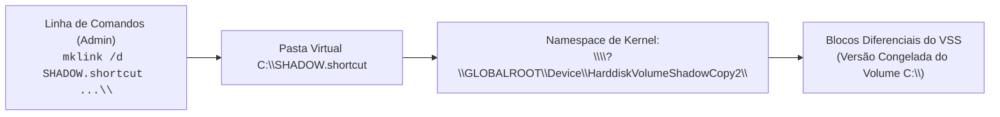

# Acesso Forense e Montagem de Shadow Copies

Uma vez identificadas as cópias de sombra através do [[Gestão e Manipulação de VSS (CLI, PowerShell e Permissões)|vssadmin]], surge o desafio prático de aceder e navegar na árvore de ficheiros contida no snapshot.

Por desenho de segurança do Windows NT, os volumes de sombra não recebem automaticamente uma letra de unidade (`C:`, `D:`) e não são visíveis no Windows Explorer comum. Residem no *namespace* interno do *kernel* acessíveis sob a rota de dispositivo:

```text
\\?\GLOBALROOT\Device\HarddiskVolumeShadowCopy[N]
```

Existem três metodologias principais para montar e explorar estes volumes em perícia forense:
1. **Método Nativo**: Criação de ligações simbólicas de diretório com `mklink /d`.
2. **Método CLI Automatizado**: Montagem em massa com **`VSCMount`** (Eric Zimmerman).
3. **Método Gráfico (GUI)**: Navegação e extração com **`ShadowCopyView`** (NirSoft).

---

## 1. Método Nativo: Ligações Simbólicas (`mklink /d`)

O método mais direto e que não requer instalação de software externo assenta na criação de uma ligação simbólica (*symbolic link*) no interpretador de comandos (`cmd.exe`).



### Procedimento Passo a Passo
1. **Descobrir o caminho do dispositivo**:
   ```cmd
   vssadmin.exe list shadows
   ```
   *Identificar o campo `Shadow Copy Volume` (ex.: `\\?\GLOBALROOT\Device\HarddiskVolumeShadowCopy2`).*

2. **Criar a ligação simbólica (Soft Link)**:
   ```cmd
   mklink /d SHADOW.shortcut \\?\GLOBALROOT\Device\HarddiskVolumeShadowCopy2\
   ```

> [!CAUTION] Armadilha Prática: A Barra Final Obrigatória `\`
> Ao invocar o comando `mklink /d`, é **estritamente obrigatório incluir a barra invertida final (`\`)** no caminho do `GLOBALROOT`. Se a barra for omitida, o subsistema Win32 não reconhece o destino como a raiz de um volume/diretório e a criação da ligação falha ou torna o atalho inacessível.

3. **Exploração e Extração**:
   * O perito pode agora aceder à pasta `SHADOW.shortcut` como se fosse um diretório comum do Windows.
   * Permite copiar ficheiros bloqueados no sistema corrente, tais como os hives em:
     `SHADOW.shortcut\Windows\System32\config\SYSTEM`
     `SHADOW.shortcut\Windows\System32\config\SOFTWARE`
     `SHADOW.shortcut\Users\<User>\NTUSER.DAT`

4. **Remoção da Ligação**:
   ```cmd
   rmdir SHADOW.shortcut
   ```
   *O comando `rmdir` elimina apenas o apontador simbólico, sem afetar a cópia de sombra subjacente.*

---

## 2. Método Automatizado em Linha de Comandos: `VSCMount` (Eric Zimmerman)

O **VSCMount** é um utilitário desenvolvido pelo investigador forense **Eric Zimmerman**, desenhado especificamente para ambientes de triagem pericial.

A ferramenta automatiza o processo de descoberta e montagem, criando atalhos simbólicos simultâneos para **todas as cópias de sombra** existentes numa determinada partição.

### Sintaxe e Parâmetros
```cmd
vscmount --dl <Drive_Letter> --mp <Mount_Point>
```
* `--dl <Letra>`: Letra da unidade a auditar (ex.: `C`).
* `--mp <Caminho>`: Diretório base onde as cópias serão montadas (ex.: `C:\DEMO`).

### Exemplo Prático de Execução
```cmd
vscmount --dl C --mp c:\DEMO
```

```text
Saída típica do VSCMount:
VSCMount version 1.5.0.0
Author: Eric Zimmerman (ericzimmerman@gmail.com)

Command line: --dl C --mp c:\DEMO
Creating directory c:\DEMO_C
Mounting VSCs to c:\DEMO_C

VSCs found on volume C: 2. Mounting
   VSS 3  (Id {72e983d2...}), Created on: 2023-09-26 22:24:14 UTC mounted OK
   VSS 4  (Id {19a4f81c...}), Created on: 2023-10-01 22:37:53 UTC mounted OK

Mounting complete. Navigate VSCs via symbolic links in c:\DEMO_C
To remove VSC access, delete individual VSC directories or the main mountpoint directory
```

### Estrutura de Pastas Gerada
O utilitário cria o diretório `c:\DEMO_C` com pastas nomeadas com carimbos temporais UTC:
* `c:\DEMO_C\vss003-2023-09-26_22-24-14\`
* `c:\DEMO_C\vss004-2023-10-01_22-37-53\`

Para terminar a análise, basta apagar a pasta `c:\DEMO_C`.

---

## 3. Método Gráfico: `ShadowCopyView` (NirSoft)

Para investigadores que preferem inspeção visual interativa, o **ShadowCopyView** da NirSoft disponibiliza uma interface dedicada:

* **Painel Superior**: Lista todos os snapshots presentes no sistema, indicando o respetivo carimbo de data/hora de criação (*Creation Time*), caminho do dispositivo de bloco e caminho UNC da partição administrativa (`\\localhost\C$\@GMT-YYYY.MM.DD-HH.MM.SS`).
* **Painel Inferior**: Navegador de ficheiros integrado que reconstitui a árvore de diretórios do snapshot selecionado.

```text
+-----------------------------------------------------------------------------------------+
| Snapshot Name           Explorer Path                       Creation Time               |
| HarddiskVolumeShadowCopy2 \\localhost\C$\@GMT-2021.09.23-14.31 23/09/2021 15:31:31     |
| HarddiskVolumeShadowCopy3 \\localhost\C$\@GMT-2021.09.30-12.54 30/09/2021 13:54:10     |
+-----------------------------------------------------------------------------------------+
| \Users\user                                                                             |
| Filename        Modified Time        Created Time         File Size   Attributes        |
| Documento.docx  22/10/2021 10:29:24  16/03/2019 12:59:12  45.2 KB     A                 |
| Chave.txt       18/09/2021 14:10:00  18/09/2021 14:10:00  1.2 KB      A                 |
+-----------------------------------------------------------------------------------------+
```

### Funcionalidade Chave: Recuperação de Ficheiros
* Ao selecionar um ou mais ficheiros/pastas, o comando **Copy Selected Files To... (tecla `F8`)** permite extrair cópias íntegras dos dados para o disco da estação pericial sem alterar as marcas temporais nem corromper metadados.

---

## 4. Enquadramento Laboratorial e Bibliografia

### Ficha Laboratorial
Os procedimentos de inspeção com `vssadmin`, criação de atalhos simbólicos e utilização das ferramentas `VSCMount` e `ShadowCopyView` constituem a base prática da **Ficha 3 VSS** lecionada em contexto de laboratório.

### Referência Académica
* **Ghafarian, A., & Hills, E. D. (2018)**. *Forensic Analysis of Windows 10 Volume Shadow Copy Service*. Proceedings of the 9th International Multi-Conferences on Complexity, Informatics and Cybernetics: IMCIC 2018.
  * O artigo demonstra a eficácia do VSS para reconstruir linhas de tempo de intrusão, recuperação de artefactos anti-forenses e validação de alterações em ficheiros de sistema ao longo de múltiplos snapshots.

---

## Navegação

- [[Capítulo 1 - Sistemas Operativos, Serviços e Artefactos Forenses|Voltar ao Índice do Capítulo 1]]
- [[Volume Shadow Service (VSS) - Arquitetura e Funcionamento]]
- [[Gestão e Manipulação de VSS (CLI, PowerShell e Permissões)]]
- [[LastActivityView e Reconstituição Temporal Live]]
