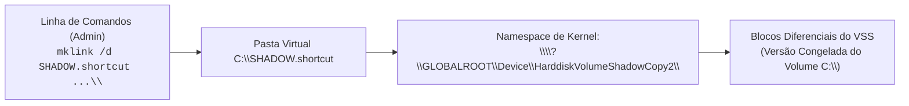

# Acesso Forense e Montagem de Shadow Copies

O acesso forense às cópias de sombra identificadas via [[Gestão e Manipulação de VSS (CLI, PowerShell e Permissões)|vssadmin]] exige a sua exposição no sistema de ficheiros Win32 através de `mklink /d`, `VSCMount` ou `ShadowCopyView`.

> [!TIP] Lógica de Funcionamento e Valor Forense
> - **Porque existe (Sistema)**: Por desenho de segurança do Windows NT, os volumes de sombra residem apenas no *namespace* interno do kernel (`\\?\GLOBALROOT\Device\HarddiskVolumeShadowCopy[N]`) e não recebem uma letra de unidade (`C:`, `D:`), evitando que utilizadores ou programas modifiquem acidentalmente backups históricos.
> - **Porque importa (Forense)**: Como o Windows Explorer e as ferramentas de linha de comandos normais não navegam diretamente em caminhos `GLOBALROOT`, o perito precisa de mapear esses volumes para extrair versões antigas de ficheiros apagados ou copiar *hives* bloqueados no sistema ativo (`SYSTEM`, `SOFTWARE`, `NTUSER.DAT`, `Amcache.hve`).
> - **Pontos Críticos e Armadilhas para Exame**:
>   1. **A Barra Invertida Final (`\`) Obrigatória no `mklink /d`**: No comando `mklink /d C:\Atalho \\?\GLOBALROOT\Device\HarddiskVolumeShadowCopy2\`, omitir a barra invertida final (`\`) faz com que o subsistema Win32 não reconheça o destino como a raiz de um diretório, tornando o atalho inacessível!
>   2. **Remoção Segura com `rmdir`**: Para desmontar o atalho criado com `mklink /d`, usa-se `rmdir <nome_atalho>`, que apaga apenas o apontador simbólico sem destruir os dados da Shadow Copy.
>   3. **3 Metodologias de Montagem**: Nativa (`mklink /d` para um snapshot específico), CLI em massa (`VSCMount --dl C --mp C:\DEMO` de Eric Zimmerman para montar todos os snapshots de uma vez) e GUI (`ShadowCopyView` da NirSoft, extração com tecla `F8`).

---

## 1. Comparação das 3 Metodologias de Acesso Forense

| Metodologia | Ferramenta | Vantagem Principal | Comando / Ação Chave |
| :--- | :--- | :--- | :--- |
| **1. Método Nativo** | `mklink /d` (`cmd.exe`) | Não requer binários externos (*Living off the Land*). | `mklink /d SHADOW.shortcut \\?\GLOBALROOT\...\HarddiskVolumeShadowCopy2\` |
| **2. CLI Automatizado** | **`VSCMount`** (Eric Zimmerman) | Monta **todas** as Shadow Copies do volume de uma só vez com timestamps UTC no nome da pasta. | `vscmount --dl C --mp c:\DEMO` |
| **3. Gráfico (GUI)** | **`ShadowCopyView`** (NirSoft) | Navegação visual em árvore e extração preservando metadados. | Selecionar ficheiros $\to$ **Copy Selected Files To... (`F8`)** |

---

## 2. Método Nativo: Ligações Simbólicas (`mklink /d`)

O método mais direto e que não requer instalação de software externo assenta na criação de uma ligação simbólica de diretório (*directory symbolic link*) no interpretador de comandos (`cmd.exe`) executado como Administrador.



### Procedimento Passo a Passo e Anatomia do Comando

**1. Descobrir o caminho do dispositivo no kernel:**

```cmd
vssadmin.exe list shadows
```

*Identificar o campo `Shadow Copy Volume` (ex.: `\\?\GLOBALROOT\Device\HarddiskVolumeShadowCopy2`).*

**2. Criar a ligação simbólica de diretório (Soft Link):**

```cmd
mklink /d SHADOW.shortcut \\?\GLOBALROOT\Device\HarddiskVolumeShadowCopy2\
```

* **`mklink`**: Comando interno do `cmd.exe` para criação de ligações simbólicas ou físicas.
* **`/d`**: Especifica que o destino é um **diretório/volume** (por omissão, o `mklink` tenta criar uma ligação para um ficheiro individual).
* **`SHADOW.shortcut`**: Nome da pasta virtual criada no diretório atual.
* **`\\?\GLOBALROOT\Device\HarddiskVolumeShadowCopy2\`**: Caminho do dispositivo de sombra terminado obrigatoriamente por `\`.

> [!CAUTION] Armadilha Clássica de Exame: A Barra Final Obrigatória (`\`)
> Ao invocar o comando `mklink /d`, é **estritamente obrigatório incluir a barra invertida final (`\`)** no caminho do `GLOBALROOT`. Se a barra for omitida (`...HarddiskVolumeShadowCopy2`), o subsistema Win32 interpreta o destino como um objeto de dispositivo bruto em vez do diretório raiz do sistema de ficheiros NTFS contido nele, e qualquer tentativa de abrir o atalho falha!

**3. Exploração e Extração de Ficheiros Bloqueados:**

* O perito pode agora aceder à pasta `SHADOW.shortcut` como se fosse um diretório comum do Windows.
* Permite copiar ficheiros bloqueados no sistema corrente (*live*), tais como os hives do Registry em:
  * `SHADOW.shortcut\Windows\System32\config\SYSTEM`
  * `SHADOW.shortcut\Windows\System32\config\SOFTWARE`
  * `SHADOW.shortcut\Users\<User>\NTUSER.DAT`

**4. Remoção Segura da Ligação:**

```cmd
rmdir SHADOW.shortcut
```

*O comando `rmdir` elimina apenas o apontador simbólico (`SHADOW.shortcut`), sem afetar nem apagar a cópia de sombra subjacente.*

---

## 3. Método Automatizado em CLI: `VSCMount` (Eric Zimmerman)

O **VSCMount** é um utilitário desenvolvido pelo investigador forense **Eric Zimmerman**, desenhado especificamente para ambientes de triagem pericial rápida. A ferramenta automatiza a descoberta e montagem, criando atalhos simbólicos simultâneos para **todas as cópias de sombra** existentes numa partição.

### Sintaxe e Anatomia dos Parâmetros

```cmd
vscmount --dl <Drive_Letter> --mp <Mount_Point>
```

* **`--dl <Letra>`** (*Drive Letter*): Letra da unidade de disco a auditar (ex.: `C`).
* **`--mp <Caminho>`** (*Mount Point*): Diretório base onde as ligações simbólicas das cópias sombra serão criadas (ex.: `c:\DEMO`).

### Exemplo Prático de Execução

```cmd
vscmount --dl C --mp c:\DEMO
```

```text
Saída típica do VSCMount:
VSCMount version 1.5.0.0
Author: Eric Zimmerman (ericzimmerman@gmail.com)

Command line: --dl C --mp c:\DEMO
Creating directory c:\DEMO_C
Mounting VSCs to c:\DEMO_C

VSCs found on volume C: 2. Mounting
   VSS 3  (Id {72e983d2...}), Created on: 2023-09-26 22:24:14 UTC mounted OK
   VSS 4  (Id {19a4f81c...}), Created on: 2023-10-01 22:37:53 UTC mounted OK

Mounting complete. Navigate VSCs via symbolic links in c:\DEMO_C
To remove VSC access, delete individual VSC directories or the main mountpoint directory
```

### Estrutura de Pastas Gerada
O utilitário anexa a letra do volume ao ponto de montagem (`c:\DEMO_C`) e cria subpastas nomeadas com o índice do snapshot e o respetivo carimbo temporal em **UTC**:

* `c:\DEMO_C\vss003-2023-09-26_22-24-14\`
* `c:\DEMO_C\vss004-2023-10-01_22-37-53\`

Para terminar a análise e limpar os pontos de montagem, basta apagar a pasta `c:\DEMO_C`.

---

## 4. Método Gráfico: `ShadowCopyView` (NirSoft)

Para investigadores que preferem inspeção visual interativa sem criar atalhos no disco, o **ShadowCopyView** da NirSoft disponibiliza uma interface dividida em dois painéis:

* **Painel Superior**: Lista todos os snapshots presentes no sistema, indicando o carimbo de data/hora de criação (*Creation Time*), o nome do snapshot e o caminho UNC da partição administrativa com token temporal (`\\localhost\C$\@GMT-YYYY.MM.DD-HH.MM.SS`).
* **Painel Inferior**: Navegador de ficheiros integrado que reconstitui a árvore de diretórios do snapshot selecionado.

```text
+-----------------------------------------------------------------------------------------+
| Snapshot Name             Explorer Path                       Creation Time             |
| HarddiskVolumeShadowCopy2 \\localhost\C$\@GMT-2021.09.23-14.31 23/09/2021 15:31:31       |
| HarddiskVolumeShadowCopy3 \\localhost\C$\@GMT-2021.09.30-12.54 30/09/2021 13:54:10       |
+-----------------------------------------------------------------------------------------+
| \Users\user                                                                             |
| Filename        Modified Time        Created Time         File Size   Attributes        |
| Documento.docx  22/10/2021 10:29:24  16/03/2019 12:59:12  45.2 KB     A                 |
| Chave.txt       18/09/2021 14:10:00  18/09/2021 14:10:00  1.2 KB      A                 |
+-----------------------------------------------------------------------------------------+
```

### Funcionalidade Chave: Recuperação de Ficheiros (`F8`)

* Ao selecionar um ou mais ficheiros/pastas, a opção **Copy Selected Files To... (tecla `F8`)** permite extrair cópias íntegras dos dados para a estação pericial sem alterar as marcas temporais nem corromper metadados.

---

## 5. Enquadramento Laboratorial e Bibliografia

### Ficha Laboratorial
Os procedimentos de inspeção com `vssadmin`, criação de atalhos simbólicos e utilização das ferramentas `VSCMount` e `ShadowCopyView` constituem a base prática da **Ficha 3 VSS** lecionada em contexto de laboratório.

### Referência Académica

* **Ghafarian, A., & Hills, E. D. (2018)**. *Forensic Analysis of Windows 10 Volume Shadow Copy Service*. Proceedings of the 9th International Multi-Conferences on Complexity, Informatics and Cybernetics: IMCIC 2018.
  * O artigo demonstra a eficácia do VSS para reconstruir linhas de tempo de intrusão, recuperação de artefactos anti-forenses e validação de alterações em ficheiros de sistema ao longo de múltiplos snapshots.

---

## Perguntas de revisão

1. **Porque é que o comando `mklink /d C:\VSS_Link \\?\GLOBALROOT\Device\HarddiskVolumeShadowCopy1` falha ao tentar abrir a pasta `C:\VSS_Link`?**

> [!success]- Ver Resposta
> Porque falta a **barra invertida final (`\`)** no caminho do destino (`...HarddiskVolumeShadowCopy1\`). Sem a barra final, o subsistema Win32 aponta para o objeto bruto do dispositivo em vez de montar o diretório raiz do sistema de ficheiros contido na Shadow Copy.

2. **Como se deve remover em segurança um atalho criado com `mklink /d SHADOW.shortcut ...` sem pôr em risco os ficheiros dentro da Shadow Copy?**

> [!success]- Ver Resposta
> Utilizando o comando `rmdir SHADOW.shortcut`, que remove apenas o diretório simbólico (apontador) sem apagar os ficheiros ou blocos da cópia de sombra subjacente.

3. **Qual a vantagem do utilitário `VSCMount` de Eric Zimmerman face ao comando nativo `mklink /d` e qual o significado dos seus parâmetros `--dl` e `--mp`?**

> [!success]- Ver Resposta
> Enquanto o `mklink /d` monta apenas uma cópia sombra de cada vez, o `VSCMount` descobre e monta automaticamente **todas** as cópias sombra existentes no volume indicado por `--dl` (*Drive Letter*, ex.: `C`) dentro da pasta base definida em `--mp` (*Mount Point*, ex.: `c:\DEMO`), incluindo a data de criação em UTC no nome de cada atalho.

4. **No utilitário gráfico `ShadowCopyView` da NirSoft, que tecla de atalho permite extrair ficheiros selecionados de um snapshot para um diretório externo?**

> [!success]- Ver Resposta
> A tecla **`F8`** (*Copy Selected Files To...*), que extrai os ficheiros preservando a integridade dos dados e metadados.

---

## Navegação e Notas Relacionadas

| Percurso | Nota | Contexto |
| :--- | :--- | :--- |
| **Anterior** | [[Gestão e Manipulação de VSS (CLI, PowerShell e Permissões)]] | `mesmo bloco` |
| **Seguinte** | [[Taxonomia dos Artefactos de Execução no Windows]] | `muda para Bloco 10` |
| **Índice** | [[Capítulo 1 - Sistemas Operativos, Serviços e Artefactos Forenses]] · [[00 ASSI]] | `Bloco 09` |

### Conceitos Relacionados

* [[Volume Shadow Service (VSS) - Arquitetura e Funcionamento]] · `mesmo bloco`
* [[LastActivityView e Reconstituição Temporal Live]] · `mesmo bloco`
* [[Investigação Forense Digital - Análise Live vs Post-Mortem]] · `AFD1 · Cap. 1`
* [[Princípios e Rota do Manuseamento de Evidência Digital]] · `AFD1 · Cap. 1`
* [[Camadas de Organização de Dados e Análise de Sistemas de Ficheiros]] · `AFD1 · Cap. 3`
