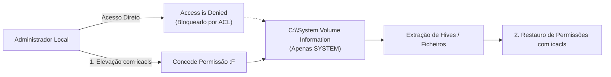

# Gestão e Manipulação de VSS (CLI, PowerShell e Permissões)

A interação com o [[Volume Shadow Service (VSS) - Arquitetura e Funcionamento|Volume Shadow Service]] pode ser realizada através de múltiplos utilitários da linha de comandos e consolas de administração. 

Para além da administração legítima do sistema, o controlo do VSS é um ponto nevrálgico em segurança defensiva: grupos de **ransomware** visam sistematicamente a destruição das cópias de sombra para impedir a recuperação rápida dos dados encriptados sem o pagamento do resgate.

---

## 1. O Utilitário Legado `wmic` e o Vetor de Ransomware

Historicamente, o utilitário **WMIC** (*Windows Management Instrumentation Command-line*) permitia criar e destruir cópias de sombra de forma rápida.

### Criação via WMIC (Requer Elevação)
```cmd
wmic shadowcopy call create Volume=C:\
```
*Gera uma nova instância de `Win32_ShadowCopy` e devolve um código de retorno (`ReturnValue = 0`) juntamente com o respetivo `ShadowID` (GUID).*

### Eliminação Rápida (Técnica Típica de Ransomware)
```cmd
wmic.exe SHADOWCOPY DELETE /nointeractive
```
*O parâmetro `/nointeractive` suprime qualquer pedido de confirmação de segurança, eliminando silenciosamente todas as cópias de sombra do sistema.*

> [!WARNING] Descontinuação do WMIC no Windows 11
> O utilitário `wmic.exe` foi formalmente **descontinuado** nas versões mais recentes do Windows 11 (estando ausente por omissão a partir do Windows 11 24H2). A administração moderna e os scripts de auditoria devem recorrer ao **PowerShell** ou ao utilitário nativo **`vssadmin`**.

---

## 2. Automação Moderna com PowerShell

O PowerShell interage diretamente com as classes WMI/CIM do sistema operativo, oferecendo flexibilidade acrescida para scripts defensivos e forenses:

### 1. Criar uma Cópia Sombra
Numa sessão de PowerShell executada como Administrador:
```powershell
$shadow = (Get-WmiObject -List Win32_ShadowCopy).Create("C:\", "ClientAccessible")
$shadow
```
*O argumento `"ClientAccessible"` assegura que o snapshot fica disponível para consultas de utilizador e versões anteriores.*

### 2. Listar Cópias Sombra Existentes
Para inspecionar os identificadores e o dispositivo de bloco correspondente:
```powershell
Get-WmiObject Win32_ShadowCopy | Select-Object ID, VolumeName, DeviceObject, InstallDate
```

---

## 3. Armazenamento Físico e Permissões NTFS (`icacls`)

As cópias diferenciais e metadados do VSS são armazenados no diretório de sistema protegido na raiz de cada volume:
$$\text{Caminho Físico: } \texttt{C:\textbackslash System Volume Information}$$

Por omissão, o Windows restringe o acesso a esta pasta exclusivamente à conta **`NT AUTHORITY\SYSTEM`**. Qualquer tentativa de acesso direto por parte de um Administrador via Windows Explorer ou terminal resulta em **Acesso Negado (*Access is denied*)**.



### Concessão de Acesso Pericial com `icacls`
Para permitir a inspeção do diretório por uma conta de utilizador pericial:
```cmd
REM Conceder Controlo Total (:F) na raiz da pasta
icacls "C:\System Volume Information" /grant UTILIZADOR:F

REM Conceder Controlo Total recursivo (/t) a todas as subpastas e ficheiros
icacls "C:\System Volume Information" /grant UTILIZADOR:F /t
```

### Boas Práticas Forenses: Restauro de Permissões
Para preservar a integridade da máquina e evitar deixar permissões excessivas expostas após a extração dos dados:
```cmd
REM Remover as permissões concedidas recursivamente
icacls "C:\System Volume Information" /remove UTILIZADOR /t

REM Remover a permissão na raiz da pasta
icacls "C:\System Volume Information" /remove UTILIZADOR
```

---

## 4. O Utilitário Central de Administração: `vssadmin`

O comando `vssadmin.exe` é o utilitário nativo de eleição da Microsoft para auditoria e gestão direta do subsistema VSS a partir do terminal de comandos (`cmd.exe`).

### Mapa de Subcomandos

| Subcomando `vssadmin` | Função e Âmbito de Auditoria |
| :--- | :--- |
| **`vssadmin list shadows`** | Lista todas as cópias de sombra existentes no sistema, os seus GUIDs, volumes originais e caminhos de dispositivo. |
| **`vssadmin delete shadows /shadow={ID}`** | Elimina uma cópia específica indicada pelo seu `Shadow Copy ID` (ou todas via `/all`). |
| **`vssadmin list writers`** | Audita o estado de saúde e estabilidade das aplicações que gravam no sistema (Writers). |
| **`vssadmin list providers`** | Identifica os fornecedores de snapshots registados (ex.: Microsoft Software Provider). |
| **`vssadmin list shadowstorage`** | Reporta as quotas e o espaço em disco ocupado pelas cópias sombra em cada partição. |
| **`vssadmin list volumes`** | Lista as partições e volumes lógicos ativos elegíveis para proteção. |

---

## 5. Exemplos de Saída e Interpretação de `vssadmin`

### 1. Inspecionar Snapshots (`vssadmin list shadows`)
```text
C:\>vssadmin.exe list shadows
vssadmin 1.1 - Volume Shadow Copy Service administrative command-line tool
(C) Copyright 2001-2013 Microsoft Corp.

Contents of shadow copy set ID: {4e580e22-63b7-4c07-b379-43c7cb7ef181}
   Contained 1 shadow copies at creation time: 9/23/2021 3:31:31 PM
      Shadow Copy ID: {72e983d2-5f56-441a-bbbf-616e28c56cbd}
      Original Volume: (C:)\\?\Volume{3a789512-0000-0000-0000-100000000000}\
      Shadow Copy Volume: \\?\GLOBALROOT\Device\HarddiskVolumeShadowCopy2
      Originating Machine: DESKTOP-LAB01
      Service Machine: DESKTOP-LAB01
      Provider: 'Microsoft Software Shadow Copy provider 1.0'
      Type: ClientAccessibleWriters
      Attributes: Persistent, Client-accessible, No auto release, Differential, Auto recovered
```

> [!IMPORTANT] O Caminho de Dispositivo (`GLOBALROOT`)
> O campo **`Shadow Copy Volume`** fornece o endereço físico de baixo nível do snapshot no kernel:
> `\\?\GLOBALROOT\Device\HarddiskVolumeShadowCopy2`
> Este caminho não possui letra de unidade atribuída (`C:`, `D:`) e requer técnicas específicas de montagem para permitir navegação, conforme detalhado em [[Acesso Forense e Montagem de Shadow Copies]].

### 2. Inspecionar Quotas e Ocupação (`vssadmin list shadowstorage`)
```text
C:\>vssadmin.exe list shadowstorage
Shadow Copy Storage association
   For volume: (C:)\\?\Volume{3a789512-0000-0000-0000-100000000000}\
   Shadow Copy Storage volume: (C:)\\?\Volume{3a789512-0000-0000-0000-100000000000}\
   Used Shadow Copy Storage space: 2.41 GB (1%)
   Allocated Shadow Copy Storage space: 2.88 GB (1%)
   Maximum Shadow Copy Storage space: 5.40 GB (2%)
```
*Permite ao perito aferir a rotação de dados: quando o espaço ocupado atinge o `Maximum`, o VSS purga automaticamente as cópias mais antigas (política FIFO).*

### 3. Eliminar uma Cópia Sombra Específica
```cmd
vssadmin delete shadows /shadow={72e983d2-5f56-441a-bbbf-616e28c56cbd}
```
*O utilitário solicita confirmação interativa antes de libertar os blocos de dados.*

---

## Navegação

- [[Capítulo 1 - Sistemas Operativos, Serviços e Artefactos Forenses|Voltar ao Índice do Capítulo 1]]
- [[Volume Shadow Service (VSS) - Arquitetura e Funcionamento]]
- [[Acesso Forense e Montagem de Shadow Copies]]
- [[LastActivityView e Reconstituição Temporal Live]]
