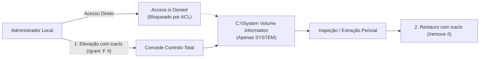

# Gestão e Manipulação de VSS (CLI, PowerShell e Permissões)

A administração e auditoria pericial do [[Volume Shadow Service (VSS) - Arquitetura e Funcionamento|Volume Shadow Service]] realiza-se através de utilitários nativos (`vssadmin`, PowerShell, `wmic`) e gestão de ACLs (`icacls`).

> [!TIP] Lógica de Funcionamento e Valor Forense
> - **Porque existe (Sistema)**: Os administradores necessitam de ferramentas de linha de comandos para listar snapshots, monitorizar o estado dos *VSS Writers*, gerir o espaço de armazenamento (`shadowstorage`) e criar cópias sombra sem depender de interfaces gráficas. Os blocos diferenciais são guardados em `C:\System Volume Information`, protegido por ACLs exclusivas para `NT AUTHORITY\SYSTEM`.
> - **Porque importa (Forense)**: O perito usa `vssadmin list shadows` para descobrir o caminho de dispositivo no kernel (`\\?\GLOBALROOT\Device\HarddiskVolumeShadowCopyN`) ou cria um novo snapshot para extrair ficheiros bloqueados. Além disso, a eliminação silenciosa de cópias sombra é uma assinatura clássica de ataques de **ransomware** antes da cifragem de dados.
> - **Pontos Críticos e Armadilhas para Exame**:
>   1. **Vetor de Ransomware e Descontinuação do WMIC**: O comando `wmic.exe SHADOWCOPY DELETE /nointeractive` apaga todas as cópias sombra sem pedir confirmação; contudo, o `wmic.exe` foi **descontinuado no Windows 11 (ausente por omissão desde o 24H2)**, sendo substituído por PowerShell e `vssadmin`.
>   2. **Acesso a `System Volume Information`**: Mesmo um Administrador recebe *Access is Denied*; é obrigatório conceder permissões explícitas com `icacls ... /grant UTILIZADOR:F /t` e **removê-las no final** (`/remove`) para não fragilizar a segurança da máquina.
>   3. **Rotação FIFO de `shadowstorage`**: Quando o espaço usado (`Used`) atinge o máximo alocado (`Maximum`), o VSS apaga automaticamente os snapshots mais antigos.

---

## 1. O Utilitário Legado `wmic` e o Vetor de Ransomware

Historicamente, o utilitário **WMIC** (*Windows Management Instrumentation Command-line*) permitia criar e destruir cópias de sombra diretamente a partir da linha de comandos.

### Anatomia dos Comandos WMIC (Requer Elevação)

```cmd
REM 1. Criar uma nova cópia de sombra para o volume C:\
wmic shadowcopy call create Volume=C:\

REM 2. Eliminar todas as cópias de sombra sem confirmação (Técnica de Ransomware)
wmic.exe SHADOWCOPY DELETE /nointeractive
```

* **`shadowcopy call create Volume=C:\`**: Invoca o método WMI `Create` da classe `Win32_ShadowCopy`, devolvendo `ReturnValue = 0` (sucesso) e o respetivo `ShadowID` (GUID).
* **`SHADOWCOPY DELETE /nointeractive`**: Apaga todas as cópias sombra presentes no sistema; a flag `/nointeractive` suprime qualquer pergunta de confirmação ao utilizador, razão pela qual grupos de **ransomware** a executam sistematicamente na fase de pré-cifragem para impedir o restauro gratuito do sistema.

> [!WARNING] Descontinuação do WMIC no Windows 11
> O utilitário `wmic.exe` foi formalmente **descontinuado** nas versões mais recentes do Windows 11 (estando ausente por omissão a partir do Windows 11 24H2). A administração moderna e os scripts de auditoria recorrem ao **PowerShell** ou ao utilitário nativo **`vssadmin`**.

---

## 2. Automação Moderna com PowerShell

O PowerShell interage diretamente com as classes WMI/CIM (`Win32_ShadowCopy`) do sistema operativo, oferecendo uma alternativa moderna ao WMIC para scripts defensivos e forenses:

### 1. Criar uma Cópia Sombra via PowerShell (Administrador)

```powershell
$shadow = (Get-WmiObject -List Win32_ShadowCopy).Create("C:\", "ClientAccessible")
$shadow
```

* **Anatomia**: `Get-WmiObject -List Win32_ShadowCopy` obtém a definição da classe WMI para invocar o método estático `.Create()`. O argumento `"ClientAccessible"` é obrigatório para assegurar que o snapshot fica acessível a consultas de utilizador, *Previous Versions* e ferramentas periciais.

### 2. Listar Cópias Sombra Existentes

```powershell
Get-WmiObject Win32_ShadowCopy | Select-Object ID, VolumeName, DeviceObject, InstallDate
```

* **Anatomia**: Consulta todas as instâncias ativas de `Win32_ShadowCopy` e filtra o GUID (`ID`), o volume original (`VolumeName`), o caminho no kernel (`DeviceObject`) e a data de criação (`InstallDate`).

---

## 3. Armazenamento Físico e Permissões NTFS (`icacls`)

As cópias diferenciais e metadados do VSS são armazenados no diretório de sistema oculto e protegido na raiz de cada volume:

```text
C:\System Volume Information
```

Por omissão, o Windows restringe a ACL (*Access Control List*) desta pasta exclusivamente à conta **`NT AUTHORITY\SYSTEM`**. Qualquer tentativa de acesso direto por parte de um Administrador via Windows Explorer ou terminal resulta em **Acesso Negado (*Access is denied*)**.



### Concessão e Restauro de Acesso Pericial com `icacls`

```cmd
REM Passo 1: Conceder Controlo Total (:F) na raiz e recursivamente (/t)
icacls "C:\System Volume Information" /grant UTILIZADOR:F
icacls "C:\System Volume Information" /grant UTILIZADOR:F /t

REM Passo 2 (Boas Práticas Forenses): Remover as permissões após a extração
icacls "C:\System Volume Information" /remove UTILIZADOR /t
icacls "C:\System Volume Information" /remove UTILIZADOR
```

| Parâmetro `icacls` | Significado Técnico |
| :--- | :--- |
| **`/grant UTILIZADOR:F`** | Adiciona uma ACE (*Access Control Entry*) dando à conta `UTILIZADOR` permissão de **Full Control (`:F`)**. |
| **`/t`** | Aplica a operação **recursivamente** (*traverse*) a todos os ficheiros e subpastas já existentes dentro do diretório. |
| **`/remove UTILIZADOR`** | Remove da ACL todas as entradas concedidas ao `UTILIZADOR`, restaurando o isolamento original de fábrica da máquina. |

---

## 4. O Utilitário Central de Administração: `vssadmin`

O comando `vssadmin.exe` é o utilitário nativo da Microsoft para auditoria e gestão direta do subsistema VSS a partir do terminal de comandos (`cmd.exe`) com privilégios de Administrador.

### Mapa de Subcomandos do `vssadmin`

| Subcomando `vssadmin` | Função e Âmbito de Auditoria |
| :--- | :--- |
| **`vssadmin list shadows`** | Lista todas as cópias de sombra existentes no sistema, os seus GUIDs, datas de criação, volumes originais e caminhos de dispositivo (`GLOBALROOT`). |
| **`vssadmin delete shadows /shadow={ID}`** | Elimina uma cópia específica indicada pelo seu `Shadow Copy ID` (ou todas via `/all`, com confirmação interativa a menos que `/quiet` seja usado). |
| **`vssadmin list writers`** | Audita o estado de saúde e estabilidade das aplicações que gravam no sistema (Writers — ex.: `State: [1] Stable`, `Last error: No error`). |
| **`vssadmin list providers`** | Identifica os fornecedores de snapshots registados (ex.: `Microsoft Software Shadow Copy provider 1.0`). |
| **`vssadmin list shadowstorage`** | Reporta as associações, quotas e o espaço em disco usado/alocado/máximo pelas cópias sombra em cada partição. |
| **`vssadmin list volumes`** | Lista as partições e volumes lógicos ativos elegíveis para proteção VSS. |

---

## 5. Exemplos de Saída e Interpretação Pericial de `vssadmin`

### 1. Inspecionar Snapshots (`vssadmin list shadows`)

```text
C:\>vssadmin.exe list shadows
vssadmin 1.1 - Volume Shadow Copy Service administrative command-line tool
(C) Copyright 2001-2013 Microsoft Corp.

Contents of shadow copy set ID: {4e580e22-63b7-4c07-b379-43c7cb7ef181}
   Contained 1 shadow copies at creation time: 9/23/2021 3:31:31 PM
      Shadow Copy ID: {72e983d2-5f56-441a-bbbf-616e28c56cbd}
      Original Volume: (C:)\\?\Volume{3a789512-0000-0000-0000-100000000000}\
      Shadow Copy Volume: \\?\GLOBALROOT\Device\HarddiskVolumeShadowCopy2
      Originating Machine: DESKTOP-LAB01
      Service Machine: DESKTOP-LAB01
      Provider: 'Microsoft Software Shadow Copy provider 1.0'
      Type: ClientAccessibleWriters
      Attributes: Persistent, Client-accessible, No auto release, Differential, Auto recovered
```

> [!IMPORTANT] O Caminho de Dispositivo (`GLOBALROOT`)
> O campo **`Shadow Copy Volume`** fornece o endereço físico de baixo nível do snapshot no namespace do kernel:
> `\\?\GLOBALROOT\Device\HarddiskVolumeShadowCopy2`
> Este caminho não possui letra de unidade atribuída (`C:`, `D:`) e requer técnicas específicas de montagem para permitir navegação, conforme detalhado em [[Acesso Forense e Montagem de Shadow Copies]].

### 2. Inspecionar Quotas e Ocupação (`vssadmin list shadowstorage`)

```text
C:\>vssadmin.exe list shadowstorage
Shadow Copy Storage association
   For volume: (C:)\\?\Volume{3a789512-0000-0000-0000-100000000000}\
   Shadow Copy Storage volume: (C:)\\?\Volume{3a789512-0000-0000-0000-100000000000}\
   Used Shadow Copy Storage space: 2.41 GB (1%)
   Allocated Shadow Copy Storage space: 2.88 GB (1%)
   Maximum Shadow Copy Storage space: 5.40 GB (2%)
```

* **Interpretação Pericial**: Permite ao perito aferir a rotação de dados. Quando o espaço ocupado (`Used`) atinge o `Maximum Shadow Copy Storage space`, o VSS purga automaticamente as cópias mais antigas segundo uma política **FIFO (*First-In, First-Out*)**, o que explica a ausência de snapshots antigos em discos com muita escrita.

### 3. Eliminar uma Cópia Sombra Específica

```cmd
vssadmin delete shadows /shadow={72e983d2-5f56-441a-bbbf-616e28c56cbd}
```

*O utilitário solicita confirmação interativa antes de libertar os blocos de dados.*

---

## Perguntas de revisão

1. **Porque é que grupos de ransomware executam comandos como `wmic.exe SHADOWCOPY DELETE /nointeractive` e qual a limitação deste comando nas versões recentes do Windows 11?**

> [!success]- Ver Resposta
> Os grupos de ransomware executam esse comando para eliminar silenciosamente (sem confirmação no ecrã graças à flag `/nointeractive`) todas as cópias de sombra do volume, impedindo que a vítima recupere os ficheiros encriptados sem pagar o resgate. No Windows 11 moderno (a partir da versão 24H2), o utilitário `wmic.exe` foi descontinuado e removido por omissão, obrigando a usar PowerShell ou `vssadmin`.

2. **Um administrador tenta abrir a pasta `C:\System Volume Information` e recebe o erro *Access is Denied*. Porque é que isto acontece e que sequência de comandos `icacls` deve o perito utilizar?**

> [!success]- Ver Resposta
> Acontece porque, por omissão, a ACL da pasta `C:\System Volume Information` concede permissões exclusivamente à conta `NT AUTHORITY\SYSTEM`. O perito deve conceder controlo total recursivo com `icacls "C:\System Volume Information" /grant UTILIZADOR:F /t` e, terminada a recolha, restaurar a segurança original removendo a permissão com `icacls "C:\System Volume Information" /remove UTILIZADOR /t`.

3. **Qual o subcomando do `vssadmin` que revela o caminho `\\?\GLOBALROOT\Device\HarddiskVolumeShadowCopyN` necessário para montar um snapshot?**

> [!success]- Ver Resposta
> É o comando `vssadmin list shadows`, que apresenta o caminho do dispositivo de kernel no campo `Shadow Copy Volume`.

4. **O que acontece às cópias de sombra existentes quando o valor `Used Shadow Copy Storage space` atinge o limite `Maximum Shadow Copy Storage space` visível em `vssadmin list shadowstorage`?**

> [!success]- Ver Resposta
> O VSS aplica uma política de rotação **FIFO (*First-In, First-Out*)**, eliminando automaticamente as cópias de sombra mais antigas para libertar espaço para os novos blocos diferenciais.

---

## Navegação e Notas Relacionadas

| Percurso | Nota | Contexto |
| :--- | :--- | :--- |
| **Anterior** | [[Volume Shadow Service (VSS) - Arquitetura e Funcionamento]] | `mesmo bloco` |
| **Seguinte** | [[Acesso Forense e Montagem de Shadow Copies]] | `mesmo bloco` |
| **Índice** | [[Capítulo 1 - Sistemas Operativos, Serviços e Artefactos Forenses]] · [[00 ASSI]] | `Bloco 09` |

### Conceitos Relacionados

* [[LastActivityView e Reconstituição Temporal Live]] · `mesmo bloco`
