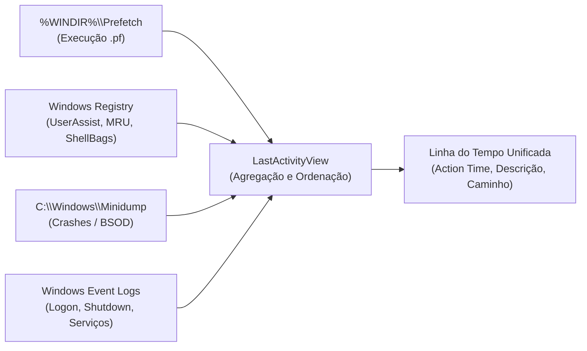

# LastActivityView e Reconstituição Temporal Live

O **LastActivityView** é um utilitário forense da NirSoft concebido para a reconstituição rápida de uma linha do tempo (*timeline*) de ações do utilizador e eventos num sistema Windows ativo (*live*).

> [!TIP] Lógica de Funcionamento e Valor Forense
> - **Porque existe (Sistema)**: Não sendo nativo do Windows, este utilitário agrega fontes dispersas do SO (`Prefetch`, `Registry`, `Event Logs`, `Minidumps`) que o Windows regista de forma isolada para auditoria, otimização e diagnóstico.
> - **Porque importa (Forense)**: Em triagem inicial e resposta a incidentes (*live forensics*), correlacionar manualmente dezenas de artefactos é moroso; a ferramenta gera instantaneamente uma cronologia unificada (`Action Time`, evento e caminho completo) para identificar o que ocorreu nos últimos minutos ou horas.
> - **Pontos Críticos e Armadilhas para Exame**:
>   1. **Privilégios de Administrador obrigatórios**: Sem elevação, falha silenciosamente na leitura de `%WINDIR%\Prefetch`, `HKLM` e `C:\Windows\Minidump`.
>   2. **Invasividade Live**: Executar o `lastactivityview.exe` no sistema alvo altera o próprio sistema (cria um ficheiro `.pf` próprio, altera chaves de Registry e timestamps de acesso).
>   3. **Marco temporal do UAC (`CONSENT.EXE`)**: O aparecimento de `CONSENT.EXE` na timeline assinala o momento exato em que uma ação despoletou um pedido de elevação de privilégios no *User Account Control*.

---

## 1. Fontes de Dados e Mecanismo de Agregação

Em resposta a incidentes, o LastActivityView recolhe e cruza automaticamente artefactos voláteis e não-voláteis, interrogando múltiplas fontes em simultâneo:



### Eventos Identificados e Origem dos Dados

1. **Execução de Aplicações**: Lançamento de ficheiros executáveis (`Run .EXE file`), recolhido de [[Serviço Prefetch e SysMain - Arquitetura e Funcionamento|Prefetch]] e [[Artefacto Forense UserAssist|UserAssist]].
2. **Interação com Ficheiros e Pastas**: Abertura de ficheiros (`Open file or folder`) e seleção de caminhos em caixas de diálogo *Open/Save* (`Select file in open/save dialog`), proveniente de [[Artefactos Forenses de Interação do Utilizador (MRU e TypedPaths)|MRULists e ComDlg32]].
3. **Ciclo de Vida do Sistema Operativo**: Momentos de arranque (*boot*), encerramento (*shutdown*), suspensão e retoma registados nos Event Logs.
4. **Instabilidade e Falhas**: Falhas críticas de aplicações (*AppCrash*) e ecrãs azuis (*Blue Screens of Death* - BSOD) através de minidumps de memória (`C:\Windows\Minidump`).
5. **Conexões de Rede e Dispositivos**: Ações registadas na shell e montagem de volumes.

> [!IMPORTANT] Requisito de Privilégios
> A execução do LastActivityView **requer privilégios de Administrador**. Sem elevação, a ferramenta não consegue aceder ao diretório protegido `%WINDIR%\Prefetch`, a hives globais do Registry (`HKLM`) nem a ficheiros de minidump, produzindo uma linha do tempo incompleta.

---

## 2. Interface e Colunas de Análise

Quando executada com interface gráfica (GUI), a aplicação disponibiliza uma vista tabular ordenada cronologicamente:

| Coluna | Descrição Técnica | Exemplo de Saída |
| :--- | :--- | :--- |
| **Action Time** | Carimbo temporal (data e hora local/UTC) do evento. | `13/09/2026 17:32:42` |
| **Description** | Tipo de ação identificada pela heurística da ferramenta. | `Run .EXE file` / `Open folder` |
| **Filename** | Nome do ficheiro executável ou documento envolvido. | `svchost.exe`, `1.html`, `info.csv` |
| **Full Path** | Caminho absoluto do recurso no sistema de ficheiros. | `C:\Windows\System32\svchost.exe` |
| **More Information** | Dados contextuais (ex.: parâmetros de execução, evento ou utilizador). | Detalhes adicionais do processo |

---

## 3. Automação e Anatomia da Linha de Comandos (CLI)

O LastActivityView suporta execução em linha de comandos (*headless* / *silent*), permitindo que peritos e equipas de SOC exportem dados em scripts de triagem rápida sem abrir janelas gráficas:

### Sintaxe de Exportação e Anatomia das Flags

```cmd
lastactivityview.exe /stab <caminho_ficheiro.csv>
```

| Parâmetro CLI | Formato Gerado | Caso de Uso Pericial |
| :--- | :--- | :--- |
| **`/stab <ficheiro>`** | Ficheiro delimitado por tabulações (*tab-delimited*). | Ideal para importação limpa em Excel/Calc quando os caminhos contêm vírgulas. |
| **`/scomma <ficheiro>`** | CSV padrão delimitado por vírgulas (*comma-separated*). | Ingestão rápida em scripts Python, SIEM ou ferramentas de linha de comandos. |
| **`/stabular <ficheiro>`** | Texto ASCII alinhado em colunas tabulares. | Leitura direta humana num terminal ou bloco de notas. |
| **`/shtml <ficheiro>`** / **`/sverhtml <ficheiro>`** | Relatório HTML (horizontal ou vertical). | Anexação imediata a relatórios preliminares de incidente. |
| **`/sxml <ficheiro>`** | Estrutura XML hierárquica. | Processamento estruturado por parsers documentais. |

---

## 4. Exercício Prático de Aula

No âmbito da exploração inicial da atividade de máquinas em sistemas *live*, executa-se o seguinte procedimento:

**1. Lançamento e Exportação em Linha de Comandos:**

```cmd
lastactivityview.exe /stab c:\temp\info.csv
```

**2. Análise Tabular:**

* Abertura do ficheiro `info.csv` em folha de cálculo (**Microsoft Excel** ou **LibreOffice Calc**).
* Filtragem das ações por `Action Time` para isolar a janela temporal de interesse.
* Identificação dos processos em execução no momento da triagem (ex.: `svchost.exe`, `BACKGROUNDTASKHOST.EXE`, `FASTIR_ARTIFACTS.EXE`, `CONSENT.EXE`).

```text
Exemplo de dados gerados no exercício:
Action Time         Description   Filename               Full Path
13/09/2026 17:32:42 Run .EXE file svchost.exe            C:\Windows\System32\svchost.exe
13/09/2026 17:32:10 Run .EXE file BACKGROUNDTASKHOST.EXE C:\Windows\System32\BACKGROUNDTASKHOST.EXE
13/09/2026 17:32:09 Run .EXE file FASTIR_ARTIFACTS.EXE   C:\Users\patri\DOWNLOADS\FASTIR_ARTIFACTS.EXE
13/09/2026 17:32:06 Run .EXE file CONSENT.EXE            C:\WINDOWS\SYSTEM32\CONSENT.EXE
```

> [!NOTE] Observação Pericial sobre `CONSENT.EXE`
> A presença de `CONSENT.EXE` na linha do tempo indica que uma operação disparou a janela de elevação do **UAC (User Account Control)**, constituindo um marco temporal crítico para identificar o segundo exato em que um processo (como `FASTIR_ARTIFACTS.EXE` logo a seguir) solicitou e obteve direitos administrativos.

---

## 5. Avaliação Pericial: Vantagens vs. Limitações

| Dimensão | Vantagens em Triagem | Limitações e Cuidados Forenses |
| :--- | :--- | :--- |
| **Operacionalidade** | **Velocidade de Triagem**: Panorama imediato do que o utilizador fez nos últimos minutos sem montar imagens de disco. | **Invasividade Live**: A própria execução altera o sistema (cria chaves de Registry, gera `.pf` para `lastactivityview.exe` e altera *timestamps*). |
| **Profundidade** | **Agregação Heurística**: Poupa o esforço inicial de cruzar manualmente chaves de Registry e ficheiros `.pf`. | **Superficialidade em Fontes Específicas**: Não substitui a análise profunda de [[Volume Shadow Service (VSS) - Arquitetura e Funcionamento\|VSS]], [[Estrutura Interna e Algoritmo de Hashing do Prefetch\|Prefetch binário]] ou [[AmCache - Arquitetura, Hives e Evolução para SQLite\|Amcache]]. |
| **Fiabilidade Temporal** | Ordenação cronológica instantânea numa única tabela. | **Dependência do Relógio Local**: Vulnerável a manipulação do relógio do sistema (*timestomping*). |

---

## Perguntas de revisão

1. **Porque é que o LastActivityView tem obrigatoriamente de ser executado com privilégios de Administrador numa triagem live?**

> [!success]- Ver Resposta
> Porque várias das fontes críticas que interroga — nomeadamente o diretório `%WINDIR%\Prefetch`, as chaves globais do Registry (`HKLM`) e a pasta `C:\Windows\Minidump` — estão protegidas por ACLs restritas a administradores e ao sistema. Sem elevação, essas fontes são omitidas da timeline.

2. **Qual o significado forense da entrada `CONSENT.EXE` numa linha do tempo extraída pelo LastActivityView?**

> [!success]- Ver Resposta
> O executável `C:\Windows\System32\consent.exe` é o processo responsável por apresentar a caixa de diálogo de elevação do **UAC (User Account Control)**. O seu registo marca o instante exato em que um utilizador ou processo solicitou privilégios de Administrador.

3. **Qual a diferença entre os parâmetros `/stab` e `/scomma` na linha de comandos do LastActivityView?**

> [!success]- Ver Resposta
> O parâmetro `/stab <ficheiro>` exporta a linha do tempo separada por tabulações (*tab-delimited*), enquanto `/scomma <ficheiro>` exporta os dados separados por vírgulas (CSV padrão).

4. **Quais são as três principais limitações periciais do uso do LastActivityView num sistema suspeito ativo?**

> [!success]- Ver Resposta
> 1) **Invasividade**: altera o estado do sistema alvo ao criar artefactos da sua própria execução (como o seu próprio ficheiro `.pf`); 2) **Falta de profundidade**: não extrai todos os metadados internos de artefactos complexos como VSS, AmCache ou as 8 datas e DLLs completas do Prefetch; 3) **Dependência do relógio local**: pode apresentar incoerências se o atacante tiver alterado a hora do sistema (*timestomping*).

---

## Navegação

- [[Capítulo 1 - Sistemas Operativos, Serviços e Artefactos Forenses|Voltar ao Índice do Capítulo 1]]
- [[Volume Shadow Service (VSS) - Arquitetura e Funcionamento]]
- [[Gestão e Manipulação de VSS (CLI, PowerShell e Permissões)]]
- [[Serviço Prefetch e SysMain - Arquitetura e Funcionamento]]
- [[Investigação Forense Digital - Análise Live vs Post-Mortem]]
- [[Princípios e Rota do Manuseamento de Evidência Digital]]
- [[Diretrizes de Manuseamento - Identificação, Preservação, Isolamento e Correlação]]
