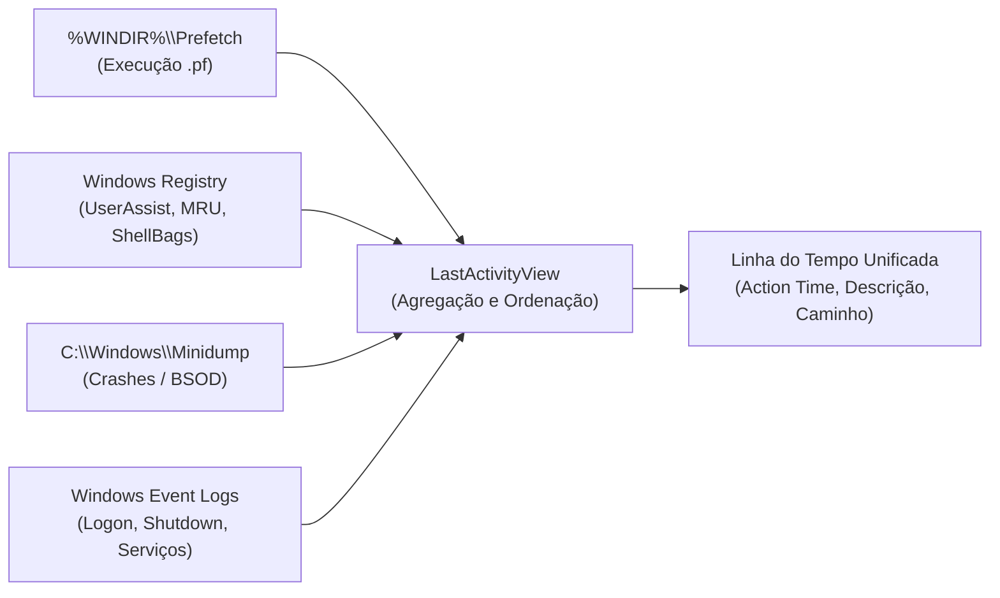

# LastActivityView e Reconstituição Temporal Live

O **LastActivityView** é um utilitário forense desenvolvido pela NirSoft desenhado para a **reconstituição rápida de uma linha do tempo (*timeline*)** de ações do utilizador e eventos de sistema num computador Windows em funcionamento ativo (*live system*).

Em resposta a incidentes e triagem pericial inicial (*live forensics*), correlacionar manualmente dezenas de fontes de dados dispersas é moroso. O LastActivityView recolhe e cruza automaticamente artefactos voláteis e não-voláteis para apresentar uma cronologia unificada dos acontecimentos.

---

## 1. Fontes de Dados e Mecanismo de Agregação

O utilitário interroga múltiplas fontes de artefactos em simultâneo:



### Eventos Identificados
1. **Execução de Aplicações**: Lançamento de ficheiros executáveis (`Run .EXE file`), recolhido de [[Serviço Prefetch e SysMain - Arquitetura e Funcionamento|Prefetch]] e [[Artefacto Forense UserAssist|UserAssist]].
2. **Interação com Ficheiros e Pastas**: Abertura de ficheiros (`Open file or folder`), seleção de caminhos em caixas de diálogo *Open/Save* (`Select file in open/save dialog`), proveniente de [[Artefactos Forenses de Interação do Utilizador (MRU e TypedPaths)|MRULists e ComDlg32]].
3. **Ciclo de Vida do Sistema Operativo**: Momentos de arranque (*boot*), encerramento (*shutdown*), suspensão e retoma.
4. **Instabilidade e Falhas**: Falhas críticas de aplicações e ecrãs azuis (*Blue Screens of Death* - BSOD) através de minidumps de memória.
5. **Conexões de Rede e Dispositivos**: Ações registadas na shell e montagem de volumes.

> [!IMPORTANT] Requisito de Privilégios
> A execução do LastActivityView **requer privilégios de Administrador**. Sem elevação, a ferramenta não consegue aceder ao diretório protegido `%WINDIR%\Prefetch`, a hives globais do Registry (`HKLM`) nem a ficheiros de minidump.

---

## 2. Interface e Colunas de Análise

Quando executada com interface gráfica (GUI), a aplicação disponibiliza uma vista tabular ordenada cronologicamente:

| Coluna | Descrição Técnica | Exemplo de Saída |
| :--- | :--- | :--- |
| **Action Time** | Carimbo temporal (data e hora local/UTC) do evento. | `13/09/2026 17:32:42` |
| **Description** | Tipo de ação identificada pela heurística da ferramenta. | `Run .EXE file` / `Open folder` |
| **Filename** | Nome do ficheiro executável ou documento envolvido. | `svchost.exe`, `1.html`, `info.csv` |
| **Full Path** | Caminho absoluto do recurso no sistema de ficheiros. | `C:\Windows\System32\svchost.exe` |
| **More Information** | Dados contextuais (ex.: parâmetros de execução ou utilizador). | Detalhes adicionais do processo |

---

## 3. Automação e Linha de Comandos (CLI)

O LastActivityView suporta execução em linha de comandos (*headless* / *silent*), permitindo que peritos e equipas de SOC exportem dados em scripts de triagem rápida sem intervenção gráfica:

### Sintaxe de Exportação
```cmd
lastactivityview.exe /stab <caminho_ficheiro.csv>
```

Parâmetros comuns de exportação NirSoft:
* `/stab <ficheiro>`: Exporta os dados delimitados por tabulações (*tab-delimited file*).
* `/scomma <ficheiro>`: Exporta os dados delimitados por vírgulas (CSV padrão).
* `/stabular <ficheiro>`: Exporta em formato tabular legível por humanos em ASCII.
* `/shtml <ficheiro>` / `/sverhtml <ficheiro>`: Exporta para relatório em formato HTML horizontal ou vertical.
* `/sxml <ficheiro>`: Exporta em estrutura XML hierárquica.

---

## 4. Exercício Prático de Aula

No âmbito da exploração inicial da atividade de máquinas em sistemas *live*, foi abordado o seguinte procedimento:

1. **Lançamento e Exportação em Linha de Comandos**:
   ```cmd
   lastactivityview.exe /stab c:\temp\info.csv
   ```
2. **Análise Tabular**:
   * Abertura do ficheiro `info.csv` em folha de cálculo (**Microsoft Excel** ou **LibreOffice Calc**).
   * Filtragem das ações por `Action Time` para isolar a janela temporal de interesse.
   * Identificação dos processos em execução no momento da triagem (ex.: `svchost.exe`, `BACKGROUNDTASKHOST.EXE`, `FASTIR_ARTIFACTS.EXE`, `CONSENT.EXE`).

```text
Exemplo de dados gerados no exercício:
Action Time         Description   Filename              Full Path
13/09/2026 17:32:42 Run .EXE file svchost.exe           C:\Windows\System32\svchost.exe
13/09/2026 17:32:10 Run .EXE file BACKGROUNDTASKHOST.EXE C:\Windows\System32\BACKGROUNDTASKHOST.EXE
13/09/2026 17:32:09 Run .EXE file FASTIR_ARTIFACTS.EXE  C:\Users\patri\DOWNLOADS\FASTIR_ARTIFACTS.EXE
13/09/2026 17:32:06 Run .EXE file CONSENT.EXE           C:\WINDOWS\SYSTEM32\CONSENT.EXE
```

> [!NOTE] Observação Pericial sobre `CONSENT.EXE`
> A presença de `CONSENT.EXE` na linha do tempo indica que uma operação disparou a janela de elevação do **UAC (User Account Control)**, constituindo um marco temporal crítico para identificar quando um processo solicitou direitos administrativos.

---

## 5. Avaliação Pericial: Vantagens vs. Limitações

### Vantagens
* **Velocidade de Triagem**: Permite obter um panorama imediato do que o utilizador estava a fazer nos últimos minutos ou horas sem necessitar de montar imagens de disco.
* **Agregação Heurística**: Poupa ao investigador o esforço de correlacionar manualmente chaves de Registry e ficheiros `.pf`.

### Limitações e Cuidados
* **Invasividade em Sistemas Live**: A execução da própria ferramenta altera o sistema (cria chaves de Registry, gera um ficheiro de Prefetch para `lastactivityview.exe` e altera carimbos temporais de acesso).
* **Falta de Profundidade em Fontes Específicas**: Não substitui a análise aprofundada de artefactos especializados como [[Volume Shadow Service (VSS) - Arquitetura e Funcionamento|VSS]], [[Estrutura Interna e Algoritmo de Hashing do Prefetch|Prefetch binário]] ou [[AmCache - Arquitetura, Hives e Evolução para SQLite|Amcache]].
* **Dependência do Relógio Local**: Se o atacante manipulou o relógio do sistema (*timestomping* de relógio), a linha do tempo apresentará incoerências temporais.

---

## Navegação

- [[Capítulo 1 - Sistemas Operativos, Serviços e Artefactos Forenses|Voltar ao Índice do Capítulo 1]]
- [[Volume Shadow Service (VSS) - Arquitetura e Funcionamento]]
- [[Gestão e Manipulação de VSS (CLI, PowerShell e Permissões)]]
- [[Serviço Prefetch e SysMain - Arquitetura e Funcionamento]]
