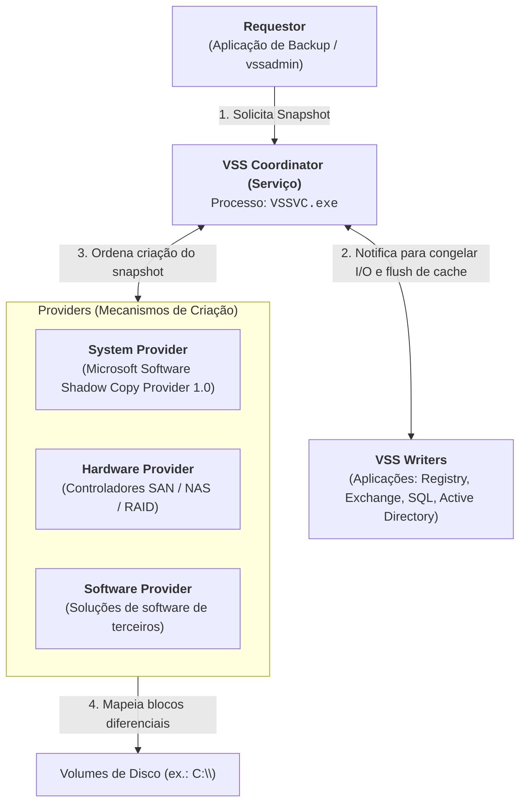

# Volume Shadow Service (VSS) — Arquitetura e Funcionamento

O **Volume Shadow Copy Service (VSS)** (também designado por **Volume Snapshot Service**) é um subsistema nativo do Windows que coordena e cria cópias de segurança instantâneas de volumes de armazenamento (*point-in-time snapshots*), garantindo a integridade dos dados mesmo quando estes se encontram **abertos e em estado de bloqueio exclusivo (*locked*)**.

Do ponto de vista da informática forense e resposta a incidentes, o VSS é um dos artefactos mais valiosos do sistema operativo: permite ao investigador "viajar no tempo" e aceder a versões íntegras de ficheiros eliminados, *hives* de Registry antigos, ficheiros executáveis de malware apagados pelo atacante e registos de auditoria históricos.

---

## 1. Evolução Histórica e Características Principais

* **Introdução no Windows XP (SP2)**:
  * No Windows XP, o VSS processava exclusivamente ficheiros essenciais do sistema operativo.
* **Windows Moderno (Windows 10 e Windows 11)**:
  * O VSS processa a totalidade dos ficheiros do volume (**ficheiros de sistema + ficheiros de utilizador**).
  * Suporta volumes de grande capacidade, alcançando até **64 TiB**.
  * É a tecnologia subjacente utilizada pelo mecanismo de **Pontos de Restauro (*System Restore*)** e por ferramentas corporativas de cópia de segurança.

### Gatilhos de Criação (*Triggers*)
O sistema operativo gera automaticamente um novo ponto de restauro nos seguintes momentos:
1. **Instalação de Aplicações**: Antes de instaladores (ex.: pacotes MSI) modificarem binários e registos do sistema.
2. **Atualizações do Windows (*Windows Update*)**: Antes da aplicação de *patches* cumulativos ou novas compilações (*builds*).
3. **Criação Programada ou Manual**: Desencadeada por tarefas agendadas do sistema ou explicitamente pelo utilizador/administrador.

---

## 2. Arquitetura e Componentes do VSS

O funcionamento do VSS assenta na coordenação harmoniosa entre quatro intervenientes essenciais:

### Papel de Cada Componente
1. **Requestor**: O programa que solicita o início da cópia de segurança (ex.: utilitário `vssadmin`, Windows Backup ou agentes de terceiros).
2. **VSS Service (`VSSVC.exe`)**: O coordenador central implementado no processo de sistema `VSSVC.exe`. Garante que todas as peças comunicam através das APIs unificadas do Windows.
3. **Writers**: Componentes integrados nas aplicações e serviços que mantêm dados críticos em disco. Quando o VSS emite a ordem, os *writers* colocam a aplicação em modo consistente, descarregando transações pendentes da memória para o disco (*flush*) e congelando temporariamente as operações de escrita (*quiesce*).
4. **Providers**: Mecanismos encarregues de criar e gerir os blocos de dados da cópia sombra:
   * **System Provider**: O fornecedor nativo da Microsoft por omissão (`Microsoft Software Shadow Copy provider 1.0`, Provider ID `{b5946137-7b9f-4925-af80-51abd60b20d5}`, versão `1.0.0.7`), baseado em software diferencial (*Copy-on-Write* no NTFS).
   * **Software Providers**: Módulos instalados por soluções de software avançadas.
   * **Hardware Providers**: Módulos de baixo nível fornecidos por fabricantes de controladoras e sistemas de armazenamento (*storage arrays*).

---

## 3. Configuração Nativa na Interface Gráfica (GUI)

O utilizador e o administrador podem gerir a proteção de sistema através das propriedades do sistema:

1. **Acesso**: Digitar `restore point` na caixa de pesquisa do Menu Iniciar $\to$ Abrir **System Properties** $\to$ Separador **System Protection**.
2. **Proteção por Volume**:
   * Identifica unidades disponíveis (ex.: `Local Disk (C:) (System) - Protection: On`).
3. **Operações Disponíveis**:
   * **System Restore...**: Lança o assistente de reversão para um ponto de restauro anterior.
   * **Configure...**:
     * Ativação ou desativação da proteção.
     * **Disk Space Usage**: Definição da quota máxima de espaço em disco alocado ao VSS (ex.: `Max Usage: 10% (23.74 GB)`, com indicação do `Current Usage`).
     * **Delete all restore points**: Elimina a totalidade das cópias de sombra existentes na unidade.
   * **Create...**: Força a criação imediata de um snapshot com uma descrição personalizada.

> [!NOTE] Mecanismo Copy-on-Write (CoW)
> O VSS não duplica o volume inteiro. Utiliza uma estratégia diferencial: apenas os blocos de disco que sofrem alterações após a criação do snapshot são copiados para a área de armazenamento reservada. Por essa razão, uma cópia sombra de um disco de centenas de gigabytes pode ocupar inicialmente apenas algumas centenas de megabytes.

---

## 4. Relevância na Investigação Forense

A existência de cópias sombra altera drasticamente a eficácia de uma perícia:

* **Contorno de Medidas Anti-Forense**: Permite recuperar versões anteriores de ficheiros eliminados propositadamente ou antes da intervenção de ferramentas de limpeza (*wipers*).
* **Análise de Ficheiros do Sistema em Uso**: Dá acesso a cópias estáveis de ficheiros que o Windows nunca permite abrir diretamente com o sistema ativo:
  * Hives de Registry: `SYSTEM`, `SOFTWARE`, `SAM`, `SECURITY`, `NTUSER.DAT`.
  * Logs transacionais e base de dados do Active Directory (`NTDS.dit`).
  * Base de dados do Windows Search (`Windows.edb` / `Windows.db`).
  * Base de dados do [[System Resource Usage Monitor (SRUM) - Arquitetura e Base ESE|SRUM (SRUDB.dat)]].
* **Reconstituição de Estados de Malware**: Permite recuperar o executável original de um ataque ou *payloads* descarregados mesmo após o malware se ter auto-eliminado.

---

## Navegação

- [[Capítulo 1 - Sistemas Operativos, Serviços e Artefactos Forenses|Voltar ao Índice do Capítulo 1]]
- [[LastActivityView e Reconstituição Temporal Live]]
- [[Gestão e Manipulação de VSS (CLI, PowerShell e Permissões)]]
- [[Acesso Forense e Montagem de Shadow Copies]]
- [[Camadas de Organização de Dados e Análise de Sistemas de Ficheiros]]
- [[Diretrizes de Manuseamento - Identificação, Preservação, Isolamento e Correlação]]
