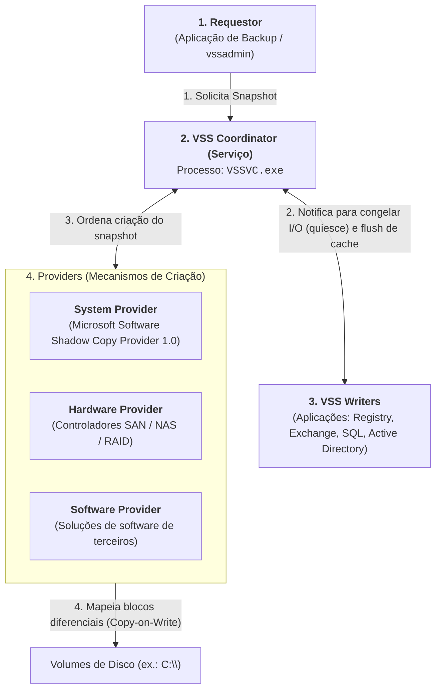

# Volume Shadow Service (VSS) — Arquitetura e Funcionamento

O **Volume Shadow Copy Service (VSS)** é um subsistema nativo do Windows que cria cópias de segurança instantâneas de volumes (*point-in-time snapshots*), mesmo com ficheiros abertos e bloqueados (*locked*).

> [!TIP] Lógica de Funcionamento e Valor Forense
> - **Porque existe (Sistema)**: O Windows bloqueia em modo exclusivo ficheiros vitais durante a execução (hives do Registry, bases de dados AD/ESE). O VSS permite a ferramentas de backup e aos Pontos de Restauro copiarem um estado transacionalmente consistente do disco através de uma arquitetura *Copy-on-Write* (CoW) coordenada por `VSSVC.exe`.
> - **Porque importa (Forense)**: Funciona como uma "máquina do tempo" pericial e permite contornar bloqueios do sistema ativo (*live*): viabiliza a recuperação de ficheiros apagados por atacantes/*wipers* e a extração limpa de ficheiros bloqueados pelo kernel (`SYSTEM`, `SAM`, `NTDS.dit`, `SRUDB.dat`, `Amcache.hve`).
> - **Pontos Críticos e Armadilhas para Exame**:
>   1. **4 Componentes da Arquitetura VSS**: *Requestor* (quem pede, ex.: `vssadmin`), *VSS Coordinator* (`VSSVC.exe`), *Writers* (congelam I/O e fazem *flush* das aplicações) e *Providers* (criam os blocos diferenciais, por omissão o `Microsoft Software Shadow Copy provider 1.0`).
>   2. **Copy-on-Write (CoW)**: O VSS não duplica o disco inteiro; guarda apenas os blocos originais antes de serem sobrescritos, ocupando espaço reduzido até atingir a quota máxima (política FIFO).
>   3. **Evolução XP vs. Moderno**: No Windows XP (SP2) cobria apenas ficheiros de sistema; no Windows 10/11 abrange ficheiros de sistema e de utilizador em volumes até **64 TiB**.

---

## 1. Evolução Histórica e Gatilhos de Criação

| Característica | Windows XP (SP2) | Windows Moderno (Windows 10 e Windows 11) |
| :--- | :--- | :--- |
| **Âmbito de Proteção** | Exclusivamente ficheiros essenciais do sistema operativo. | Totalidade dos ficheiros do volume (**sistema + utilizador**). |
| **Capacidade Máxima** | Volumes standard de época. | Suporta volumes até **64 TiB**. |
| **Integração Nativa** | Restauro básico de sistema. | Base dos **Pontos de Restauro (*System Restore*)** e backups corporativos. |

### Gatilhos de Criação Automática (*Triggers*)
O sistema operativo gera automaticamente um novo ponto de restauro/snapshot nos seguintes momentos:

1. **Instalação de Aplicações**: Antes de instaladores (ex.: pacotes MSI) modificarem binários e chaves de registo do sistema.
2. **Atualizações do Windows (*Windows Update*)**: Antes da aplicação de *patches* cumulativos ou novas compilações (*builds*).
3. **Criação Programada ou Manual**: Desencadeada por tarefas agendadas do sistema ou explicitamente pelo administrador.

---

## 2. Arquitetura e os 4 Componentes do VSS

O funcionamento do VSS assenta na coordenação estrita entre quatro intervenientes essenciais para garantir que os ficheiros abertos não ficam corrompidos a meio de uma escrita:

### Papel Detalhado de Cada Componente

1. **Requestor**: O programa ou utilitário que solicita o início da cópia de segurança (ex.: utilitário `vssadmin`, Windows Backup ou agentes de terceiros).
2. **VSS Service (`VSSVC.exe`)**: O coordenador central implementado no processo de sistema `VSSVC.exe`. Garante que todas as peças comunicam na ordem certa através das APIs unificadas do Windows.
3. **Writers**: Componentes integrados nas aplicações e serviços que mantêm dados críticos em disco (SQL Server, Exchange, Registry, Active Directory). Quando o VSS emite a ordem, os *writers* colocam a aplicação em modo consistente, descarregando transações pendentes da memória RAM para o disco (*flush*) e congelando temporariamente as operações de escrita (*quiesce*) durante frações de segundo.
4. **Providers**: Mecanismos de armazenamento encarregues de criar e gerir os blocos de dados da cópia sombra:
   * **System Provider**: O fornecedor nativo da Microsoft por omissão (`Microsoft Software Shadow Copy provider 1.0`, Provider ID `{b5946137-7b9f-4925-af80-51abd60b20d5}`, versão `1.0.0.7`), baseado em software diferencial (*Copy-on-Write* no NTFS).
   * **Software Providers**: Módulos instalados por soluções de backup de terceiros.
   * **Hardware Providers**: Módulos de baixo nível fornecidos por fabricantes de controladoras e sistemas de armazenamento empresarial (*storage arrays* SAN/NAS).

> [!NOTE] Mecanismo Copy-on-Write (CoW)
> O VSS não duplica o volume inteiro. Utiliza uma estratégia diferencial: apenas os blocos de disco que sofrem alterações após a criação do snapshot têm o seu valor original copiado para a área reservada (`C:\System Volume Information`) antes da escrita. Por essa razão, uma cópia sombra de um disco de centenas de gigabytes ocupa inicialmente apenas algumas centenas de megabytes e é criada em segundos.

---

## 3. Configuração Nativa na Interface Gráfica (GUI)

O utilizador e o administrador podem gerir a proteção de sistema através das propriedades do Windows:

1. **Acesso**: Digitar `restore point` na caixa de pesquisa do Menu Iniciar $\to$ Abrir **System Properties** $\to$ Separador **System Protection**.
2. **Proteção por Volume**: Identifica unidades disponíveis e o estado atual (ex.: `Local Disk (C:) (System) - Protection: On`).
3. **Operações Disponíveis**:
   * **System Restore...**: Lança o assistente de reversão do sistema para um ponto de restauro anterior.
   * **Configure...**:
     * Ativação ou desativação da proteção de sistema no volume.
     * **Disk Space Usage**: Definição da quota máxima de espaço em disco alocado ao VSS (ex.: `Max Usage: 10% (23.74 GB)`, com indicação do `Current Usage`). Quando o limite é atingido, os snapshots mais antigos são eliminados (FIFO).
     * **Delete all restore points**: Elimina a totalidade das cópias de sombra existentes na unidade.
   * **Create...**: Força a criação manual imediata de um snapshot com uma descrição personalizada.

---

## 4. Relevância na Investigação Forense

A existência de cópias sombra altera drasticamente a eficácia de uma perícia e tem duplo valor estratégico:

* **1. Viagem no Tempo e Contorno de Medidas Anti-Forense**:
  * Permite recuperar versões anteriores de ficheiros eliminados propositadamente por um atacante ou antes da intervenção de ferramentas de limpeza (*wipers*).
  * Permite recuperar o executável original de um ataque ou *payloads* descarregados mesmo após o malware se ter auto-eliminado (*self-deleting malware*).
* **2. Extração de Ficheiros do Sistema Bloqueados (*Locked Files*) em Triagem Live**:
  * Num sistema em execução, o kernel bloqueia ficheiros críticos contra leitura direta. Como a Shadow Copy é uma fotografia estática congelada no tempo, o perito pode montar o snapshot e copiar livremente:
    * Hives de Registry: `SYSTEM`, `SOFTWARE`, `SAM`, `SECURITY`, `NTUSER.DAT`.
    * Logs transacionais e base de dados do Active Directory (`NTDS.dit`).
    * Base de dados do Windows Search (`Windows.edb` / `Windows.db`).
    * Base de dados do [[System Resource Usage Monitor (SRUM) - Arquitetura e Base ESE|SRUM (SRUDB.dat)]].

---

## Perguntas de revisão

1. **Quais são os quatro componentes da arquitetura do VSS e qual a função específica dos *VSS Writers*?**

> [!success]- Ver Resposta
> Os quatro componentes são o **Requestor**, o **VSS Service (`VSSVC.exe`)**, os **VSS Writers** e os **VSS Providers**. Os *Writers* são módulos integrados em aplicações críticas (como Registry, SQL ou Active Directory) que, ao serem notificados pelo `VSSVC.exe`, descarregam dados pendentes da RAM para o disco (*flush*) e congelam temporariamente as escritas (*quiesce*) para garantir que o snapshot fica consistente e sem ficheiros corrompidos.

2. **Porque é que a criação de uma Shadow Copy num disco de 500 GB demora apenas alguns segundos e ocupa pouco espaço inicial?**

> [!success]- Ver Resposta
> Porque o fornecedor nativo da Microsoft (`Microsoft Software Shadow Copy provider 1.0`) utiliza a técnica **Copy-on-Write (CoW)** (cópia diferencial). Em vez de duplicar todo o volume, apenas guarda na área de sombra os blocos originais que venham a ser modificados após o momento do snapshot.

3. **De que forma o VSS ajuda o perito forense a adquirir os hives do Registry (`SYSTEM`, `SAM`) ou a base `SRUDB.dat` num sistema *live*?**

> [!success]- Ver Resposta
> Num sistema *live*, o sistema operativo mantém bloqueios exclusivos (*file locks*) sobre esses ficheiros ativos, impedindo a sua cópia normal. Como a Shadow Copy é um volume estático e congelado num ponto no tempo, os ficheiros dentro dela não estão abertos pelo sistema operativo, permitindo ao perito copiá-los sem restrições de bloqueio.

4. **Qual a diferença de âmbito do VSS entre o Windows XP (SP2) e o Windows 10/11?**

> [!success]- Ver Resposta
> No Windows XP (SP2), o VSS protegia apenas ficheiros essenciais do sistema operativo. No Windows 10 e 11, processa a totalidade dos ficheiros do volume (ficheiros de sistema e ficheiros de utilizador) e suporta volumes até **64 TiB**.

---

## Navegação e Notas Relacionadas

| Percurso | Nota | Contexto |
| :--- | :--- | :--- |
| **Anterior** | [[LastActivityView e Reconstituição Temporal Live]] | `mesmo bloco` |
| **Seguinte** | [[Gestão e Manipulação de VSS (CLI, PowerShell e Permissões)]] | `mesmo bloco` |
| **Índice** | [[Capítulo 1 - Sistemas Operativos, Serviços e Artefactos Forenses]] · [[00 ASSI]] | `Bloco 09` |

### Conceitos Relacionados

* [[Acesso Forense e Montagem de Shadow Copies]] · `mesmo bloco`
* [[Camadas de Organização de Dados e Análise de Sistemas de Ficheiros]] · `AFD1 · Cap. 3`
* [[Diretrizes de Manuseamento - Identificação, Preservação, Isolamento e Correlação]] · `AFD1 · Cap. 1`
