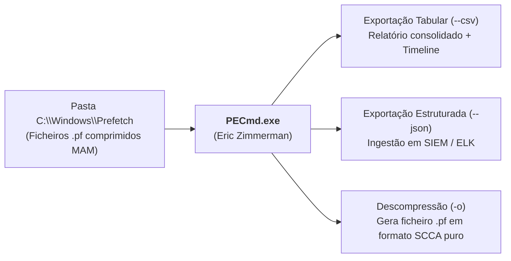

# Análise Forense e Criação a Pedido do Prefetch

A análise forense de artefactos de [[Serviço Prefetch e SysMain - Arquitetura e Funcionamento|Prefetch]] recorre ao `PECmd` e `WinPrefetchView` para descodificar ficheiros `.pf` (incluindo traces `Op-` criados a pedido via API).

> [!TIP] Lógica de Funcionamento e Valor Forense
> - **Porque existe (Sistema)**: Além do tracing automático nos primeiros 10 segundos de arranque, o Windows disponibiliza as APIs Win32 `OperationStart()` e `OperationEnd()` em `advapi32.dll` para que qualquer aplicação possa requisitar programaticamente um ficheiro de Prefetch dedicado (`Op-...pf`) antes de executar operações intensivas de leitura em disco.
> - **Porque importa (Forense)**: Como os ficheiros `.pf` do Windows 10/11 estão comprimidos em formato `MAM`, o perito utiliza o `PECmd` (Eric Zimmerman) ou o `WinPrefetchView` (NirSoft) para descomprimir os ficheiros e exportar relatórios CSV/JSON com todas as execuções e DLLs carregadas.
> - **Pontos Críticos e Armadilhas para Exame**:
>   1. **Flags do `PECmd.exe`**: `-f` processa um único ficheiro `.pf`; `-d` processa um diretório inteiro em lote; `-o` descomprime um ficheiro `.pf` do formato `MAM` para `SCCA` puro (para ver em editor hexadecimal); `--csv` e `--json` exportam relatórios estruturados.
>   2. **Validação de Integridade (`sigcheck`)**: Antes de usar ferramentas forenses em perícia oficial, verifica-se a assinatura digital do binário com `sigcheck.exe -i PECmd.exe`.
>   3. **Prefetch a Pedido (`Op-`) e Limite de 10 Segundos**: Ficheiros criados via `OperationStart()`/`OperationEnd()` têm o formato `Op-[NOME_EXE]-[HASH]-[OPERATION_ID].pf`; se o intervalo entre `OperationStart` e `OperationEnd` **exceder 10 segundos**, o Windows aborta a gravação do trace!

---

## 1. Ferramenta Gráfica e CLI Leve: `WinPrefetchView` (NirSoft)

O **WinPrefetchView** é um utilitário portátil da NirSoft que permite visualizar rapidamente os ficheiros `.pf` guardados na máquina local ou numa pasta extraída de uma imagem forense (*offline*):

```text
+-----------------------------------------------------------------------------------------+
| Filename: 7-ZIPPORTABLE.EXE-606CFA9A.pf      Run Counter: 5                             |
| Created Time:  25/11/2022 17:54:17           Process Path: C:\Users\patri\...\7zip.exe  |
| Modified Time: 02/06/2023 11:40:33           Missing Process: No                        |
| Last Run Time: 02/06/2023 11:40:30, 02/06/2023 11:40:26 ... (últimas 8 execuções)       |
+-----------------------------------------------------------------------------------------+
| DLLs e Ficheiros Mapeados (Painel Inferior):                                            |
| Filename              Full Path                                                         |
| $MFT                  \VOLUME{...}\$MFT                                                 |
| 7-ZIPPORTABLE.EXE     C:\Users\patri\AppData\Local\Temp\7zip\7-ZIPPORTABLE.EXE          |
| 7ZIP_PORTABLE.REG     C:\Users\patri\AppData\Local\Temp\7zip\7ZIP_PORTABLE.REG          |
+-----------------------------------------------------------------------------------------+
```

### Anatomia da Linha de Comandos do `WinPrefetchView`
Para triagem automatizada sobre uma pasta recolhida sem abrir a interface gráfica:

```cmd
REM 1. Analisar uma pasta offline (/folder) e exportar para CSV (/scomma)
WinPrefetchView.exe /folder "D:\Evidencias\C\Windows\Prefetch" /scomma "relatorio_prefetch.csv"

REM 2. Exportar em formato de relatório HTML legível (/shtml)
WinPrefetchView.exe /folder "D:\Evidencias\C\Windows\Prefetch" /shtml "relatorio.html"
```

---

## 2. Ferramenta CLI de Referência: `PECmd` (Eric Zimmerman)

O utilitário **PECmd** (*Prefetch Command Line Parser*), desenvolvido por **Eric Zimmerman**, é a ferramenta padrão da indústria para análise forense de Prefetch em larga escala. Escrito em C#, descompacta transparentemente os ficheiros `.pf` comprimidos em formato `MAM` (Windows 10 e 11) e exporta a totalidade dos metadados, as 8 marcas temporais, listas de ficheiros e tabelas de volumes.



### Anatomia das Flags e Exemplos de Execução do `PECmd`

| Parâmetro `PECmd` | Função Técnica | Exemplo Prático |
| :--- | :--- | :--- |
| **`-f <ficheiro>`** | Aponta para um **único ficheiro** `.pf` a analisar. | `PECmd.exe -f "C:\Windows\Prefetch\CMD.EXE-4A81B364.pf"` |
| **`-d <diretório>`** | Processa em lote **todos os ficheiros `.pf` de um diretório**. | `PECmd.exe -d "C:\Windows\Prefetch" --csv "C:\Temp\CSVdir"` |
| **`-o <ficheiro/dir>`** | **Descomprime** um ficheiro `.pf` do formato `MAM` (W10/11) e grava-o em formato `SCCA` não comprimido. | `PECmd.exe -f "C:\...\CMD.EXE-4A81B364.pf" -o "C:\Temp\CMD_Decomp.pf"` |
| **`--csv <dir>`** | Diretório onde serão gravados os relatórios tabulares CSV. | `PECmd.exe -d "C:\Windows\Prefetch" --csv "C:\Temp\CSVdir"` |
| **`--json <dir>`** | Diretório onde será gravada a saída em formato JSON. | `PECmd.exe -f "C:\...\CMD.EXE-4A81B364.pf" --json "C:\Temp\JsonOutput"` |

```cmd
REM 1. Análise rápida de ficheiro único no ecrã
PECmd.exe -f "C:\Windows\Prefetch\CMD.EXE-4A81B364.pf"

REM 2. Descompactar um ficheiro MAM (W10/11) para SCCA puro para inspeção em Editor Hexadecimal (HxD)
PECmd.exe -f "C:\Windows\Prefetch\CMD.EXE-4A81B364.pf" -o "C:\Temp\Prefetch_Decomp"

REM 3. Exportação estruturada em JSON
PECmd.exe -f "C:\Windows\Prefetch\CMD.EXE-4A81B364.pf" --json "C:\Temp\JsonOutput"

REM 4. Processamento em massa de toda a pasta Prefetch para CSV
PECmd.exe -d "C:\Windows\Prefetch" --csv "C:\Temp\CSVdir"
```

---

## 3. Garantia de Integridade das Ferramentas (`sigcheck`)

O repositório de Eric Zimmerman (`https://ericzimmerman.github.io/`) disponibiliza binários especializados para toda a perícia Windows (`AmcacheParser`, `AppCompatCacheParser`, `JLECmd`, `LECmd`, `SrumECmd`, `PECmd`, `VSCMount`).

Por boas práticas forenses e validação da cadeia de custódia (*chain of custody*), antes de executar o binário deve validar-se a sua assinatura digital com o utilitário **`sigcheck`** da suite Sysinternals:

```cmd
sigcheck.exe -i PECmd.exe
```

* **Anatomia**: A flag **`-i`** exibe a cadeia completa de certificação digital e catálogo de assinatura, garantindo que o executável forense é autêntico e não foi trocado nem trojanizado.

---

## 4. Criação de Prefetch a Pedido (*Programaticamente via API Win32*)

Além do registo automático durante os primeiros 10 segundos do arranque de um processo, uma aplicação em execução pode requisitar explicitamente ao sistema operativo a criação de um ficheiro de Prefetch dedicado para otimizar uma fase específica de leitura intensiva de dados.

### Mecanismo das APIs `OperationStart` e `OperationEnd`
O procedimento baseia-se num par de funções exportadas pela biblioteca nativa `advapi32.dll`:

1. **`OperationStart()`**: Invocada pela aplicação imediatamente antes de iniciar as operações intensivas de leitura, passando uma estrutura que define um identificador numérico inteiro escolhido pelo programador (**`OperationId`**).
2. **`OperationEnd()`**: Invocada para assinalar o fim da janela de gravação e ordenar ao `SysMain` o *commit* do ficheiro para o disco.

> [!IMPORTANT] Limite Estrito da Janela: Máximo de 10 Segundos
> O intervalo de tempo decorrido entre a chamada a `OperationStart()` e `OperationEnd()` **não pode exceder 10 segundos**. Se a operação demorar mais de 10 segundos a chamar `OperationEnd()`, o sistema operativo **aborta a gravação do trace** por considerar a operação demasiado longa para pré-carregamento.

### Convenção de Nomenclatura dos Ficheiros Gerados (`Op-`)
Quando um programa utiliza esta API, o ficheiro resultante em `%WINDIR%\Prefetch` recebe o prefixo distintivo **`Op-`** e inclui o `OperationId` no final:

```text
Op-[NOME_EXE]-[HASH]-[OPERATION_ID].pf
```

* **Exemplo real de aula**: `Op-PYTHON3.11.EXE-CA90C813-00373331.pf`
  *(Criado via script Python utilizando chamadas à API Win32 documentadas pelo investigador Mikhail Suhanov)*.

```python
# Conceito de invocação em Python (via ctypes / Win32 API advapi32.dll)
# 1. Inicia trace de otimização com um OperationId específico
advapi32.OperationStart(byref(operation_info))

# 2. Realiza operações intensivas de leitura de ficheiros (obrigatoriamente < 10 segundos)
# ...

# 3. Encerra a janela e ordena ao SysMain a escrita de Op-[EXE]-[HASH]-[ID].pf
advapi32.OperationEnd(byref(operation_info))
```

Em contexto pericial, encontrar ficheiros com o prefixo `Op-` prova que o binário (ou um script executado por um interpretador como `python.exe`) invocou explicitamente as APIs `OperationStart`/`OperationEnd` (por otimização legítima ou para manipular traces de leitura).

---

## 5. Enquadramento Laboratorial e Bibliografia

### Ficha Laboratorial
Os procedimentos práticos de extração de ficheiros `.pf`, descompressão `MAM` com `PECmd` e análise comparativa de carimbos temporais constituem o guião da **Ficha 04 – Windows Prefetch**.

### Referências Académicas

* **Shashidhar, N. K., & Novak, D. (2015)**. *Digital forensic analysis on prefetch files*. International Journal of Information Security Science, 4(2), 39-49.
* **Venault, M., & David, B. (2021)**. *Superfetch: the famous unknown spy*. Journal of Computer Virology and Hacking Techniques, 17(2), 91-104.
* **Suhanov, M. (2021)**. *Prefetch a pedido programático em Python*. [GitHub Gist](https://gist.github.com/msuhanov/8636611d65b7d1aac4c2b00510fd10c1).

---

## Perguntas de revisão

1. **Qual o comando exato do `PECmd` para descomprimir um único ficheiro `.pf` do Windows 11 (formato `MAM`) para o formato `SCCA` sem compressão, de modo a poder inspecioná-lo num editor hexadecimal?**

> [!success]- Ver Resposta
> Utiliza-se a flag **`-f`** (ficheiro de entrada) combinada com a flag **`-o`** (destino descomprimido):
> `PECmd.exe -f "C:\Windows\Prefetch\CMD.EXE-4A81B364.pf" -o "C:\Temp\Prefetch_Decomp"`

2. **Qual a diferença entre os parâmetros `-f` e `-d` no `PECmd.exe` e como se verifica a integridade da assinatura digital do próprio `PECmd.exe` antes da perícia?**

> [!success]- Ver Resposta
> O parâmetro `-f` aponta para um único ficheiro `.pf`, enquanto `-d` processa todos os ficheiros `.pf` de um diretório inteiro em lote. Para validar a assinatura digital e cadeia de certificação do executável antes da perícia, executa-se `sigcheck.exe -i PECmd.exe`.

3. **Como são gerados os ficheiros de Prefetch cujo nome começa pelo prefixo `Op-` (ex.: `Op-PYTHON3.11.EXE-CA90C813-00373331.pf`)?**

> [!success]- Ver Resposta
> São ficheiros de **Prefetch a pedido**, criados programaticamente quando uma aplicação invoca o par de funções da API Win32 **`OperationStart()`** e **`OperationEnd()`** (em `advapi32.dll`), associando a operação a um identificador numérico (`OperationId`, representado no último bloco do nome do ficheiro).

4. **O que acontece se uma aplicação invocar `OperationStart()`, demorar 15 segundos a ler ficheiros e só depois invocar `OperationEnd()`?**

> [!success]- Ver Resposta
> Como o intervalo entre `OperationStart()` e `OperationEnd()` **não pode exceder 10 segundos**, o sistema operativo aborta a gravação do trace e o ficheiro `Op-...pf` não é criado.

---

## Navegação

- [[Capítulo 1 - Sistemas Operativos, Serviços e Artefactos Forenses|Voltar ao Índice do Capítulo 1]]
- [[Taxonomia dos Artefactos de Execução no Windows]]
- [[Serviço Prefetch e SysMain - Arquitetura e Funcionamento]]
- [[Estrutura Interna e Algoritmo de Hashing do Prefetch]]
- [[Application Compatibility e ShimCache (AppCompatCache)]]
- [[Preservação do Sistema e Integridade de Dados]]
- [[Princípios e Rota do Manuseamento de Evidência Digital]]
- [[Exercícios Práticos - Integridade de Dados e Hashes]]
