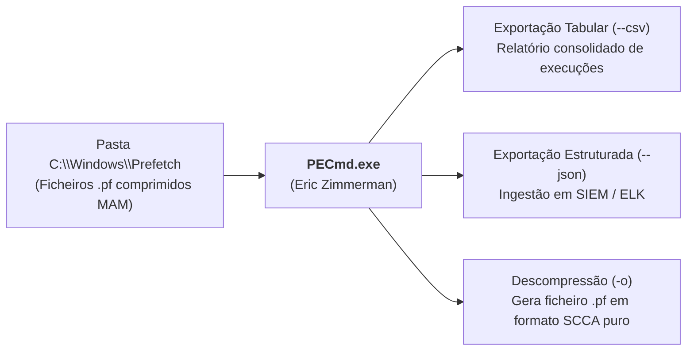

# Análise Forense e Criação a Pedido do Prefetch

A extração e interpretação pericial de artefactos de [[Serviço Prefetch e SysMain - Arquitetura e Funcionamento|Prefetch]] exige ferramentas capazes de descodificar o formato de compressão `MAM` e processar metadados em lote.

Simultaneamente, o Windows disponibiliza APIs programáticas que permitem a uma aplicação requisitar a criação de traces de Prefetch sob demanda (*Prefetch a pedido*), criando padrões binários específicos identificáveis em perícia.

---

## 1. Ferramenta Gráfica: `WinPrefetchView` (NirSoft)

O **WinPrefetchView** é um utilitário portátil que permite visualizar rapidamente os ficheiros `.pf` guardados na máquina local ou numa pasta extraída de uma imagem forense (*offline*):

```text
+-----------------------------------------------------------------------------------------+
| Filename: 7-ZIPPORTABLE.EXE-606CFA9A.pf      Run Counter: 5                             |
| Created Time:  25/11/2022 17:54:17           Process Path: C:\Users\patri\...\7zip.exe  |
| Modified Time: 02/06/2023 11:40:33           Missing Process: No                        |
| Last Run Time: 02/06/2023 11:40:30, 02/06/2023 11:40:26 ... (últimas 8 execuções)      |
+-----------------------------------------------------------------------------------------+
| DLLs e Ficheiros Mapeados (Painel Inferior):                                            |
| Filename              Full Path                                                         |
| $MFT                  \VOLUME{...}\$MFT                                                 |
| 7-ZIPPORTABLE.EXE     C:\Users\patri\AppData\Local\Temp\7zip\7-ZIPPORTABLE.EXE          |
| 7ZIP_PORTABLE.REG     C:\Users\patri\AppData\Local\Temp\7zip\7ZIP_PORTABLE.REG          |
+-----------------------------------------------------------------------------------------+
```

### Operação em Linha de Comandos (CLI)
Para triagem automatizada sem interface gráfica:
```cmd
REM Apontar para uma pasta de Prefetch recolhida de uma imagem forense
WinPrefetchView.exe /folder "D:\Evidencias\C\Windows\Prefetch" /scomma "relatorio_prefetch.csv"

REM Exportar em formato de relatório HTML legível
WinPrefetchView.exe /folder "D:\Evidencias\C\Windows\Prefetch" /shtml "relatorio.html"
```

---

## 2. Ferramenta CLI de Referência: `PECmd` (Eric Zimmerman)

O utilitário **PECmd** (*Prefetch Command Line Parser*), desenvolvido por **Eric Zimmerman**, é a ferramenta padrão da indústria para análise forense em larga escala. 

Escrito em C#, o `PECmd` descompacta de forma transparente os ficheiros `.pf` comprimidos em formato `MAM` (Windows 10 e 11) e exporta a totalidade dos metadados, carimbos temporais e tabelas de volumes para ficheiros CSV estruturados.



### Sintaxe e Exemplos de Execução

1. **Análise de Ficheiro Único**:
   ```cmd
   PECmd.exe -f "C:\Windows\Prefetch\CMD.EXE-4A81B364.pf"
   ```
2. **Descompactar o Ficheiro `.pf` para Análise Hexadecimal**:
   ```cmd
   PECmd.exe -f "C:\Windows\Prefetch\CMD.EXE-4A81B364.pf" -o "C:\Temp\Prefetch_Decomp"
   ```
   *Grava a versão descompactada (em formato `SCCA`), permitindo inspecionar strings e estruturas com editores hexadecimais (HxD).*

3. **Exportação Estruturada em JSON**:
   ```cmd
   PECmd.exe -f "C:\Windows\Prefetch\CMD.EXE-4A81B364.pf" --json "C:\Temp\JsonOutput"
   ```
4. **Processamento em Massa de um Diretório Completo**:
   ```cmd
   PECmd.exe -d "C:\Windows\Prefetch" --csv "C:\Temp\CSVdir"
   ```
   *Gera um ficheiro CSV unificado que sumariza a totalidade dos programas executados no sistema, facilitando a construção de linhas de tempo.*

---

## 3. Garantia de Integridade: Ferramentas Digitais de Eric Zimmerman

O repositório de ferramentas de Eric Zimmerman (`https://ericzimmerman.github.io/`) disponibiliza binários especializados para toda a cadeia de custódia do Windows (incluindo `AmcacheParser`, `AppCompatCacheParser`, `JLECmd`, `LECmd`, `SrumECmd`).

Por boas práticas de perícia e verificação de cadeia de custódia (*chain of custody*), as ferramentas devem ser validadas quanto à sua assinatura digital utilizando o utilitário **`sigcheck`** da suite Sysinternals:
```cmd
sigcheck.exe -i PECmd.exe
```
*Garante que o executável não foi adulterado e provém do autor fidedigno.*

---

## 4. Criação de Prefetch a Pedido (*Programaticamente*)

Uma aplicação pode requisitar explicitamente ao sistema operativo a criação de um ficheiro de Prefetch dedicado para otimizar o acesso prévio a ficheiros e recursos antes que operações pesadas de E/S tenham início.

### Mecanismo de API Win32
O procedimento baseia-se num par de funções de sistema:
1. **`OperationStart()`**: Chamada imediatamente antes de iniciar as operações intensivas de leitura. A operação é associada a um identificador numérico inteiro (`OperationId`).
2. **`OperationEnd()`**: Chamada para assinalar a conclusão do processo de pré-carregamento.

> [!IMPORTANT] Janela Temporal Máxima: 10 Segundos
> O intervalo de tempo entre a invocação de `OperationStart` e `OperationEnd` **não pode exceder 10 segundos**. Se ultrapassar este limite, o sistema aborta a gravação do trace por considerar a operação excessivamente longa.

### Nomenclatura dos Ficheiros Gerados
Quando um programa utiliza esta API, o ficheiro resultante recebe o prefixo **`Op-`** no nome:
$$\texttt{Op-[NOME\_EXE]-[HASH]-[OPERATION\_ID].pf}$$

*Exemplo real*: `Op-PYTHON3.11.EXE-CA90C813-00373331.pf`
*(Criado via script Python utilizando chamadas à API documentadas pelo investigador Mikhail Suhanov)*.

```python
# Conceito de invocação em Python (via ctypes / Win32 API)
# Inicia trace de otimização
advapi32.OperationStart(byref(operation_info))

# ... Realiza operações intensivas de leitura de ficheiros (< 10s) ...

# Encerra e comita o ficheiro de Prefetch
advapi32.OperationEnd(byref(operation_info))
```

Em contexto pericial, ficheiros com o prefixo `Op-` indicam que o programador do software implementou rotinas explícitas de aceleração de I/O na aplicação.

---

## 5. Enquadramento Laboratorial e Bibliografia

### Ficha Laboratorial
Os procedimentos práticos de extração de ficheiros `.pf`, descompressão `MAM` com `PECmd` e análise comparativa de carimbos temporais constituem o guião da **Ficha 04 – Windows Prefetch**.

### Referências Académicas
* **Shashidhar, N. K., & Novak, D. (2015)**. *Digital forensic analysis on prefetch files*. International Journal of Information Security Science, 4(2), 39-49.
* **Venault, M., & David, B. (2021)**. *Superfetch: the famous unknown spy*. Journal of Computer Virology and Hacking Techniques, 17(2), 91-104.
* **Suhanov, M. (2021)**. *Prefetch a pedido programático em Python*. [GitHub Gist](https://gist.github.com/msuhanov/8636611d65b7d1aac4c2b00510fd10c1).

---

## Navegação

- [[Capítulo 1 - Sistemas Operativos, Serviços e Artefactos Forenses|Voltar ao Índice do Capítulo 1]]
- [[Taxonomia dos Artefactos de Execução no Windows]]
- [[Serviço Prefetch e SysMain - Arquitetura e Funcionamento]]
- [[Estrutura Interna e Algoritmo de Hashing do Prefetch]]
- [[Application Compatibility e ShimCache (AppCompatCache)]]
