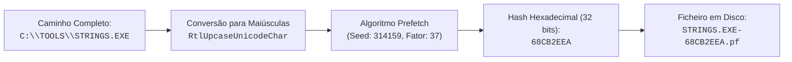

# Estrutura Interna e Algoritmo de Hashing do Prefetch

A estrutura interna de um ficheiro de Prefetch (`[NOME_EXE]-[HASH].pf`) combina um identificador de caminho de 32 bits com o histórico de execuções, volumes e DLLs carregadas.

> [!TIP] Lógica de Funcionamento e Valor Forense
> - **Porque existe (Sistema)**: Podem existir vários executáveis com o mesmo nome em pastas diferentes (ex.: `C:\Temp\setup.exe` e `D:\Install\setup.exe`). Para não misturar os planos de pré-carregamento, o Windows anexa ao nome do ficheiro `.pf` uma **hash de 8 carateres hexadecimais (32 bits)** calculada a partir do **caminho completo do executável** (e, em anfitriões como `svchost.exe`, também dos argumentos CLI). No Windows 10/11, o ficheiro é comprimido no formato `MAM` para poupar espaço e I/O.
> - **Porque importa (Forense)**: Descompactar o `.pf` entrega ao perito o **contador total de execuções** (`Num_time_file_run`), os **carimbos temporais das últimas 8 execuções** (`Time01` a `Time08`), o número de série do volume de origem e a **lista completa de DLLs e ficheiros** lidos nos primeiros 10 segundos — permitindo apanhar *self-deleting malware* mesmo depois de o atacante apagar o `.exe`!
> - **Pontos Críticos e Armadilhas para Exame**:
>   1. **A Hash do Prefetch NÃO é SHA-1/MD5 do conteúdo**: É uma função de dispersão rápida sobre a string do **caminho em maiúsculas** (semente `314159`, fator `37`). Nos processos encapsuladores (`svchost.exe`, `dllhost.exe`, `mmc.exe`, `rundll32.exe`, `teams.exe`), inclui também os **argumentos da linha de comandos**.
>   2. **Formato `SCCA` (W8.1) vs. `MAM` (W10/11)**: Até ao Windows 8.1 o `.pf` começava pelos *magic bytes* `SCCA` (`0x53 0x43 0x43 0x41`, não comprimido); no Windows 10/11 começa por `MAM\x04` (`0x4D 0x41 0x4D 0x04`, comprimido), exigindo descompressão prévia (ex.: `PECmd`) antes de ler strings em editor hexadecimal.
>   3. **Regra de Ouro**: O Prefetch **NÃO identifica o utilizador** que executou o programa (é um artefacto global da máquina).

---

## 1. Convenção de Nomenclatura e o Algoritmo de Hashing

Cada ficheiro gerado no diretório `%WINDIR%\Prefetch` segue rigorosamente o formato:

```text
[NOME_EXECUTAVEL]-[HASH].pf
```

* **Exemplo**: `STRINGS.EXE-68CB2EEA.pf`, onde `STRINGS.EXE` identifica o nome do binário em maiúsculas e `68CB2EEA` é a hash hexadecimal de 8 carateres (32 bits).
* **Regra de Truncagem (29 carateres)**: Se o nome do executável exceder 29 carateres, o Windows trunca-o aos primeiros 29 carateres antes de anexar o hífen e a hash.

### Cálculo da Hash Baseado no Caminho Completo
A hash presente no nome do ficheiro `.pf` **não é uma hash criptográfica do conteúdo do ficheiro** (como SHA-256 ou MD5), mas uma função de dispersão rápida desenhada para distinguir executáveis homónimos localizados em pastas diferentes. Na generalidade das aplicações, é calculada sobre o **caminho absoluto do executável convertido para maiúsculas (Unicode)**:

```c
// Algoritmo de cálculo de Hash do Prefetch (Windows 10 / 11)
uint32_t Result = 314159;
for (int i = 0; i < len(StringToHash); i++) {
    wchar_t char_actual = StringToHash[i];
    wchar_t charmaj = RtlUpcaseUnicodeChar(char_actual);
    Result = (Result * 37 + charmaj) * 37;
}
```

* **Constantes chave para exame**: Semente inicial decimal **`314159`** (inspirada nos dígitos de $\pi$), conversão Unicode para maiúsculas via **`RtlUpcaseUnicodeChar`** e multiplicação iterativa pelo fator **`37`**.



### Exceção Crítica: Processos Anfitriões (*Encapsuladores*)
Para aplicações de sistema que servem de anfitrião (*host*) a múltiplos serviços ou módulos distintos — especificamente **`svchost.exe`**, **`dllhost.exe`**, **`mmc.exe`**, **`rundll32.exe`** e **`teams.exe`** —, calcular a hash apenas sobre o caminho resultaria num único ficheiro `.pf` partilhado por dezenas de serviços diferentes.

Nesses casos específicos, o algoritmo **incorpora os argumentos da linha de comandos** no cálculo da hash:

* `svchost.exe -k LocalService -p` $\longrightarrow$ gera uma hash única;
* `svchost.exe -k RPCSS -p` $\longrightarrow$ gera uma segunda hash distinta;
* `svchost.exe -k DcomLaunch -p` $\longrightarrow$ gera uma terceira hash distinta.

> [!NOTE] Valor Pericial de Múltiplos `SVCHOST.EXE-*.pf`
> A existência de dezenas de ficheiros `SVCHOST.EXE-<HASH>.pf` na pasta `Prefetch` é o comportamento normal do Windows e reflete os diferentes grupos de serviços (`-k ...`) executados. Contudo, se surgir um ficheiro `.pf` de `svchost.exe` cuja análise interna revele um caminho fora de `C:\Windows\System32\` ou `SysWOW64` (ex.: `C:\Users\Public\svchost.exe`), comprova-se de imediato um ataque de mascaramento (*masquerading*).

---

## 2. Comparação de Formato Binário: Windows XP–8.1 (`SCCA`) vs. Windows 10/11 (`MAM`)

A estrutura binária do ficheiro `.pf` sofreu uma alteração fundamental na transição do Windows 8.1 para o Windows 10 (documentada por **Hintea et al., 2017**):

| Parâmetro Técnico | Windows XP / Vista / 7 | Windows 8 / 8.1 | Windows 10 e Windows 11 |
| :--- | :--- | :--- | :--- |
| **Formato do Ficheiro `.pf`** | **`SCCA`** (Não comprimido) | **`SCCA`** (Não comprimido) | **`MAM`** (Comprimido) |
| **Formato do SuperFetch** | N/A (XP) / Comprimido | `MAM` (Comprimido) | `MAM` (Comprimido) |
| **Assinatura Mágica (*Magic Bytes*)** | `0x53 0x43 0x43 0x41` (`SCCA`) | `0x53 0x43 0x43 0x41` (`SCCA`) | `0x4D 0x41 0x4D 0x04` (`MAM\x04`) |
| **Timestamps de Execução** | **1 timestamp** (Última execução) | **8 timestamps** (`Time01` a `Time08`) | **8 timestamps** (`Time01` a `Time08`) |
| **Inspeção Direta em Hex Editor (HxD)** | Strings ASCII/Unicode diretamente legíveis | Strings ASCII/Unicode diretamente legíveis | **Ilegível a olho nu** sem descompressão prévia (ex.: `PECmd -o`) |

```text
Inspeção Hexadecimal comparativa (Offset 0x00):
Windows 8.1:
53 43 43 41 11 00 00 00 ...  -> Assinatura 'SCCA' (não comprimido)

Windows 10 / 11:
4D 41 4D 04 CE FF 04 00 ...  -> Assinatura 'MAM\x04' (comprimido)
```

Como o formato `MAM` comprime todo o corpo do ficheiro, tentar correr `strings` ou abrir um `.pf` do Windows 10/11 diretamente num editor hexadecimal não mostra os nomes das DLLs nem o caminho do executável. O perito tem de usar o [[Análise Forense e Criação a Pedido do Prefetch|PECmd do Eric Zimmerman]] (que descomprime `MAM` em memória ou grava o ficheiro descomprimido com `-o`).

---

## 3. Anatomia dos Metadados Internos do Ficheiro `.pf`

Uma vez descomprimido o ficheiro `.pf`, o analista forense tem acesso a seis categorias de evidência de execução (segundo a especificação de **Heriyanto, 2014**):

| Campo Interno | Tipo / Formato | Relevância e Significado Forense |
| :--- | :--- | :--- |
| **`Actual_file_name`** | String UTF-16LE | Nome original completo do executável que disparou a criação do trace. |
| **`Num_time_file_run`** | Inteiro 32-bit LE | **Contador de execuções (*Run Counter*)**: número total de vezes que o programa foi executado naquela localização. |
| **Última Modificação do `.pf`** | FILETIME / NTFS | No sistema de ficheiros NTFS, reflete aproximadamente o instante da execução mais recente (+10s). |
| **`Time01` a `Time08`** | Array de 8x FILETIME | **Histórico das últimas 8 execuções** (disponível desde o Windows 8+):<br/>• `Time01`: data/hora UTC da **última execução** (mais recente);<br/>• `Time02`: penúltima execução;<br/>• (...)<br/>• `Time08`: 8.ª execução mais antiga retida no array. |
| **Lista de DLLs e Recursos** | Lista de Strings | Todos os ficheiros, bibliotecas (`.dll`) e recursos mapeados pelo processo durante os **primeiros 10 segundos**. |
| **Volume Information** | Serial + Timestamp + Path | Número de série do volume (*Volume Serial Number*), data de criação do volume e caminho do dispositivo onde o executável residia (permite identificar execução a partir de uma pen USB!). |

```text
Exemplo de dados extraídos de NOTEPAD.EXE-C5670914.pf:
actual_file_name:     NOTEPAD.EXE
number_time_file_run: 36
time_01:              2026/09/22 13:34:10 UTC (Última execução)
time_02:              2026/09/22 11:34:02 UTC (Penúltima execução)
time_03:              2026/09/10 18:44:15 UTC
...
time_08:              2026/08/09 13:32:01 UTC (8.ª execução)
```

---

## 4. Deteção de Malware e Anti-Forense via DLL Tracing

A lista de ficheiros e DLLs armazenada dentro do `.pf` é decisiva em dois cenários clássicos de intrusão:

1. **Malware que se Auto-Elimina (*Self-Deleting Malware*)**:
   * Conforme demonstrado por **Duby et al. (2022)**, muitas amostras de malware e *droppers* apagam o seu próprio executável do disco logo após arrancarem para dificultar a resposta a incidentes.
   * No entanto, como o serviço `SysMain` monitorizou o arranque, o ficheiro `.pf` permanece em `C:\Windows\Prefetch`, preservando o nome do binário apagado, o caminho exato de onde correu, as horas em que foi executado e as DLLs/ficheiros temporários que carregou nos primeiros 10 segundos.
2. **Deteção de *DLL Hijacking* e *Side-Loading***:
   * Se o ficheiro `.pf` de uma aplicação legítima assinada mostrar que, nos primeiros 10 segundos, ela carregou uma biblioteca `.dll` a partir de uma pasta suspeita de utilizador (ex.: `C:\Users\Public\` ou `C:\Temp\`) em vez de `C:\Windows\System32\`, fica provado o sequestro de DLL (*DLL Hijacking*).

---

## 5. A Regra de Ouro Pericial: Ausência de Identificação de Utilizador

> [!CAUTION] Armadilha de Exame: O Prefetch NÃO Identifica o Utilizador!
> O Prefetch é um artefacto **global do sistema operativo**, gerido pelo serviço `SysMain` ao nível da máquina.
> 
> * **O que prova**: Prova cabalmente que o programa **foi executado naquela máquina**, de que caminho correu, quantas vezes correu (`Num_time_file_run`) e até às últimas 8 datas/horas exatas (`Time01`–`Time08`).
> * **O que NÃO prova**: Num computador partilhado por vários utilizadores ou num servidor Remote Desktop (RDS), o Prefetch **NÃO guarda o SID nem o nome do utilizador** que lançou o processo.
> * **Como resolver**: Para atribuir a autoria a uma conta humana, o perito tem obrigatoriamente de cruzar o timestamp do Prefetch com o [[Artefacto Forense UserAssist|UserAssist (NTUSER.DAT)]] desse utilizador, `Jump Lists` ou Event Logs de criação de processos (`Event ID 4688`).

---

## 6. Referências Bibliográficas

* **Heriyanto, A. P. (2014)**. *Forensic examination and analysis of the Prefetch files on the banking Trojan malware incidents*. [DOI: 10.4225/75/57b40250fb894](https://doi.org/10.4225/75/57b40250fb894).
* **Hintea, D., Bird, R., & Green, M. (2017)**. *An investigation into the forensic implications of the Windows 10 operating system: recoverable artefacts and significant changes from Windows 8.1*. International Journal of Electronic Security and Digital Forensics, 9(4), 326-345.
* **Duby, A., Taylor, T., Bloom, G., & Zhuang, Y. (2022)**. *Detecting and Classifying Self-Deleting Windows Malware Using Prefetch Files*. IEEE 12th Annual Computing and Communication Workshop and Conference (CCWC), pp. 0745-0751, [DOI: 10.1109/CCWC54503.2022.9720874](https://doi.org/10.1109/CCWC54503.2022.9720874).

---

## Perguntas de revisão

1. **O que representa a hash hexadecimal de 8 carateres no nome de um ficheiro de Prefetch (ex.: `68CB2EEA` em `STRINGS.EXE-68CB2EEA.pf`) e em que casos inclui também os argumentos da linha de comandos?**

> [!success]- Ver Resposta
> Não é uma hash criptográfica do conteúdo do binário, mas sim uma hash de 32 bits calculada sobre o **caminho completo do executável em maiúsculas** (usando a semente `314159` e o fator `37`). Para processos anfitriões/encapsuladores — como `svchost.exe`, `dllhost.exe`, `mmc.exe`, `rundll32.exe` e `teams.exe` —, o algoritmo inclui também os **argumentos da linha de comandos** no cálculo para gerar ficheiros `.pf` distintos por cada serviço ou módulo carregado.

2. **Qual a diferença entre os *magic bytes* de um ficheiro `.pf` no Windows 8.1 face ao Windows 10/11 e que impacto tem isso na inspeção com um editor hexadecimal?**

> [!success]- Ver Resposta
> No Windows 8.1, os ficheiros `.pf` usam o formato não comprimido **`SCCA`** (`0x53 0x43 0x43 0x41`), pelo que os caminhos e nomes de DLLs são diretamente legíveis num editor hexadecimal. No Windows 10 e 11, os ficheiros `.pf` são comprimidos com o formato **`MAM`** (`0x4D 0x41 0x4D 0x04`), tornando o conteúdo ilegível sem descompressão prévia com ferramentas como o `PECmd`.

3. **Se um programa tiver `Num_time_file_run = 25` num sistema Windows 11, quantas datas de execução exatas podem ser recuperadas diretamente do interior desse ficheiro `.pf`?**

> [!success]- Ver Resposta
> Podem ser recuperadas as **últimas 8 datas/horas de execução** (guardadas no array `Time01` a `Time08`, onde `Time01` é a mais recente). As primeiras 17 execuções já foram sobrescritas no array interno, embora o contador total (`25`) se mantenha exato.

4. **Como é que um ficheiro `.pf` permite investigar um malware que se auto-eliminou do disco (*self-deleting malware*) e qual é a única informação crucial que o `.pf` nunca fornece sozinho?**

> [!success]- Ver Resposta
> Mesmo que o executável malicioso se apague após arrancar, o ficheiro `.pf` criado pelo `SysMain` persiste em `%WINDIR%\Prefetch`, revelando o nome e caminho original do malware, quantas vezes correu, as horas das últimas 8 execuções e todas as DLLs/ficheiros em que tocou nos primeiros 10 segundos. Contudo, o `.pf` **nunca fornece o utilizador** responsável pela execução, exigindo correlação com `UserAssist` ou Event Logs.

---

## Navegação

- [[Capítulo 1 - Sistemas Operativos, Serviços e Artefactos Forenses|Voltar ao Índice do Capítulo 1]]
- [[Taxonomia dos Artefactos de Execução no Windows]]
- [[Serviço Prefetch e SysMain - Arquitetura e Funcionamento]]
- [[Análise Forense e Criação a Pedido do Prefetch]]
- [[Artefacto Forense UserAssist]]
- [[Preservação do Sistema e Integridade de Dados]]
- [[Codificação de Caracteres - ASCII, Latin-1 e Unicode]]
- [[Sistemas de Numeração e Conversão entre Bases]]
- [[Representação Forense de Data e Hora (Timestamps e SQLite)]]
