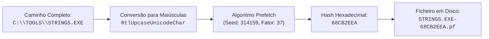

# Estrutura Interna e Algoritmo de Hashing do Prefetch

Os ficheiros de Prefetch (`.pf`) constituem uma das fontes de prova mais robustas para demonstrar a **execução efetiva** de software no sistema operativo Windows.

Para interpretar corretamente estes artefactos numa perícia de DFIR (*Digital Forensics and Incident Response*), é essencial dominar a sua convenção de nomenclatura, o algoritmo proprietário de geração de *hashes*, os formatos de compressão binária e a anatomia dos metadados gravados.

---

## 1. Convenção de Nomenclatura e Estrutura dos Nomes

Cada ficheiro gerado no diretório `%WINDIR%\Prefetch` segue o formato:

```text
[NOME_EXECUTAVEL]-[HASH].pf
```
*Exemplo*: `STRINGS.EXE-68CB2EEA.pf`, onde `STRINGS.EXE` identifica o processo e `68CB2EEA` é a hash em formato hexadecimal de 8 carateres (32 bits).

* **Truncagem de Nome**: Se o nome do executável exceder 29 carateres, o Windows trunca-o aos primeiros 29 carateres antes de anexar a hash.

---

## 2. O Algoritmo de Hashing do Prefetch

A hash presente no nome do ficheiro `.pf` **não é uma hash criptográfica** (como SHA-256 ou MD5), mas uma função de dispersão rápida desenhada para evitar colisões entre executáveis com o mesmo nome que residam em pastas diferentes.

### Cálculo Baseado no Caminho Completo
Na generalidade das aplicações, a hash é calculada com base no **caminho absoluto do ficheiro executável** em maiúsculas (Unicode):

```c
// Algoritmo de cálculo de Hash do Prefetch (Windows 10 / 11)
uint32_t Result = 314159;
for (int i = 0; i < len(StringToHash); i++) {
    wchar_t char_actual = StringToHash[i];
    wchar_t charmaj = RtlUpcaseUnicodeChar(char_actual);
    Result = (Result * 37 + charmaj) * 37;
}
```
*Constantes chave*: Semente inicial decimal `314159`, conversão Unicode em maiúsculas (`RtlUpcaseUnicodeChar`) e multiplicação pelo fator `37`.



### Exceção Crítica: Processos Anfitriões (*Encapsuladores*)
Para aplicações de sistema que servem de anfitrião a serviços ou módulos dinâmicos (`svchost.exe`, `dllhost.exe`, `mmc.exe`, `rundll32.exe`, `teams.exe`), calcular a hash apenas sobre o caminho resultaria numa única entrada partilhada por dezenas de tarefas distintas.

Nesses casos específicos, o algoritmo **incorpora os argumentos da linha de comandos** no cálculo:
* `svchost.exe -k LocalService -p` $\longrightarrow$ gera uma hash única;
* `svchost.exe -k RPCSS -p` $\longrightarrow$ gera uma segunda hash distinta;
* `svchost.exe -k DcomLaunch -p` $\longrightarrow$ gera uma terceira hash distinta.

> [!NOTE] Valor Pericial de Múltiplos `svchost.exe-*.pf`
> A existência de múltiplos ficheiros `SVCHOST.EXE-<HASH>.pf` é o comportamento expectável do sistema e reflete os diferentes grupos de serviços que foram executados. Se surgir um ficheiro `.pf` de `svchost.exe` com uma hash invulgar ou executado fora da pasta `System32`, pode constituir um forte indício de mascaramento de malware (*masquerading*).

---

## 3. Formato Binário e Compressão: Windows 8.1 vs. Windows 10/11

A estrutura binária do ficheiro `.pf` sofreu uma alteração substancial no Windows 10:

| Parâmetro | Windows 8.1 | Windows 10 e Windows 11 |
| :--- | :--- | :--- |
| **Formato do Prefetch** | **`SCCA`** (Não comprimido) | **`MAM`** (Comprimido) |
| **Formato do SuperFetch** | `MAM` (Comprimido) | `MAM` (Comprimido) |
| **Assinatura Mágica (*Magic Bytes*)** | `0x53 0x43 0x43 0x41` (`SCCA`) | `0x4D 0x41 0x4D 0x04` (`MAM\x04`) |
| **Visualização em Editor Hexadecimal** | Texto e cabeçalhos legíveis em ASCII/Unicode | Conteúdo ilegível sem descompressão prévia |

```text
Inspeção Hexadecimal comparativa:
Windows 8.1 (Offset 0x00):
53 43 43 41 11 00 00 00 ...  -> Assinatura 'SCCA' (versão 26/30)

Windows 10/11 (Offset 0x00):
4D 41 4D 04 CE FF 04 00 ...  -> Assinatura 'MAM' comprimido
```

Conforme documentado por **Hintea et al. (2017)**, os investigadores não conseguem extrair diretamente cadeias de texto de ficheiros `.pf` do Windows 10/11 sem recorrer a utilitários capazes de descompactar o algoritmo proprietário de compressão `MAM` da Microsoft (ex.: [[Análise Forense e Criação a Pedido do Prefetch|PECmd do Eric Zimmerman]]).

---

## 4. Metadados e Evidência Registada no Ficheiro `.pf`

Ao analisar um ficheiro `.pf` descompactado, o analista forense tem acesso a um conjunto minucioso de provas de execução (segundo a especificação de **Heriyanto, 2014**):

| Campo Interno | Tipo / Tamanho | Relevância e Significado Forense |
| :--- | :--- | :--- |
| **`Actual_file_name`** | String UTF-16LE | Nome original do executável que disparou a criação do trace. |
| **`Num_time_file_run`** | Inteiro 32-bit LE | **Contador de execuções (*Run Counter*)**: número total de vezes que o programa foi lançado na máquina. |
| **Última Modificação do `.pf`** | FILETIME / NTFS | Corresponde aproximadamente à data da execução mais recente. |
| **`Time01` a `Time08`** | Array de 8x FILETIME | **Histórico das últimas 8 execuções** (disponível desde o Windows 8+):<br/>• `Time01`: data/hora da última execução;<br/>• `Time02`: penúltima execução;<br/>• (...)<br/>• `Time08`: 8.ª execução mais antiga registada. |
| **Lista de DLLs e Recursos** | Lista de Strings | Lista de todas as bibliotecas (`.dll`), ficheiros de configuração e zonas de Registry mapeadas nos **10 primeiros segundos**. |
| **Volume Information** | Volume Serial + Nome | Número de série do volume e identificador do dispositivo onde o executável residia. |

```text
Exemplo de dados extraídos de NOTEPAD.EXE-C5670914.pf:
actual_file_name:   NOTEPAD.EXE
number_time_file_run: 36
time_01:            2026/09/22 13:34:10 UTC (Última execução)
time_02:            2026/09/22 11:34:02 UTC (Penúltima execução)
time_03:            2026/09/10 18:44:15 UTC
...
time_08:            2026/08/09 13:32:01 UTC (8.ª execução)
```

---

## 5. Deteção de Software Malicioso com DLL Tracing

A lista de DLLs armazenada no Prefetch é crucial para investigar ameaças avançadas e código malicioso:

* **Malware que se Auto-Elimina (*Self-Deleting Malware*)**: Conforme demonstrado por **Duby et al. (2022)**, mesmo que o executável malicioso elimine o seu ficheiro do disco após a execução para impedir a recolha pericial, o ficheiro `.pf` preserva o histórico de que ele correu, o caminho de onde foi lançado e que DLLs usou para se injetar.
* **Injeção de DLLs e DLL Hijacking**: Se uma aplicação legítima surgir num `.pf` com chamadas a bibliotecas localizadas na pasta `C:\Users\Public\` ou `C:\Temp\`, comprova-se o sequestro de dependências.

---

## 6. A Regra de Ouro Pericial: Ausência de Identificação de Utilizador

> [!CAUTION] O Prefetch NÃO Identifica o Utilizador
> O Prefetch é um artefacto **global do sistema operativo**, gerido pelo serviço SysMain para toda a máquina.
> 
> O ficheiro `.pf` prova cabalmente que a aplicação **foi executada no sistema**, quando foi executada e quantas vezes correu. No entanto, num computador partilhado por múltiplos utilizadores ou num servidor Remote Desktop (RDS), o Prefetch **NÃO indica qual foi o utilizador ou conta de logon responsável pelo lançamento**. Para determinar a autoria, o analista tem obrigatoriamente de cruzar o Prefetch com o [[Artefacto Forense UserAssist|UserAssist (NTUSER.DAT)]] ou com os registos de auditoria de processos nos Event Logs.

---

## 7. Referências Bibliográficas

* **Hintea, D., Bird, R., & Green, M. (2017)**. *An investigation into the forensic implications of the Windows 10 operating system: recoverable artefacts and significant changes from Windows 8.1*. International Journal of Electronic Security and Digital Forensics, 9(4), 326-345.
* **Duby, A., Taylor, T., Bloom, G., & Zhuang, Y. (2022)**. *Detecting and Classifying Self-Deleting Windows Malware Using Prefetch Files*. IEEE 12th Annual Computing and Communication Workshop and Conference (CCWC), pp. 0745-0751, [DOI: 10.1109/CCWC54503.2022.9720874](https://doi.org/10.1109/CCWC54503.2022.9720874).

---

## Navegação

- [[Capítulo 1 - Sistemas Operativos, Serviços e Artefactos Forenses|Voltar ao Índice do Capítulo 1]]
- [[Taxonomia dos Artefactos de Execução no Windows]]
- [[Serviço Prefetch e SysMain - Arquitetura e Funcionamento]]
- [[Análise Forense e Criação a Pedido do Prefetch]]
- [[Artefacto Forense UserAssist]]
