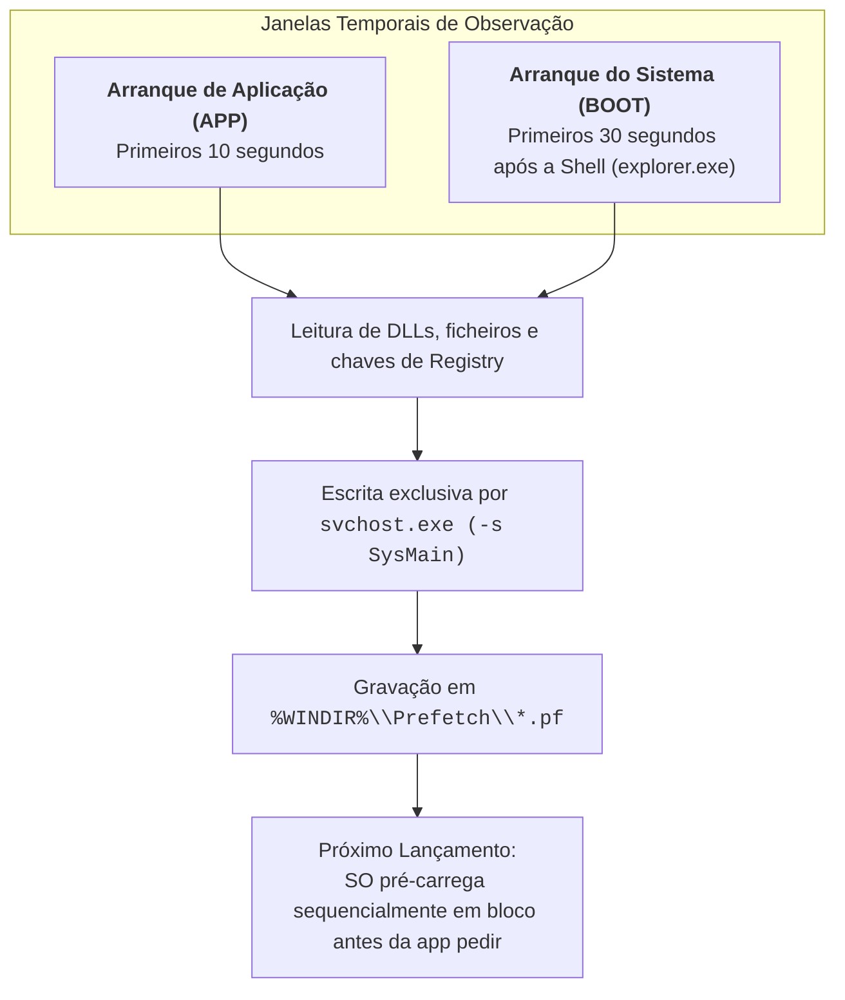

# Serviço Prefetch e SysMain — Arquitetura e Funcionamento

O **Prefetch** (gerido pelo serviço **SysMain**, antigo *SuperFetch*) é o subsistema do Windows que monitoriza os primeiros segundos de arranque das aplicações para pré-carregar recursos em RAM e acelerar futuras execuções.

> [!TIP] Lógica de Funcionamento e Valor Forense
> - **Porque existe (Sistema)**: Quando um programa arranca, faz centenas de leituras fragmentadas no disco (código, DLLs, ficheiros). Para eliminar essa latência, o Windows observa os **primeiros 10 segundos** de cada aplicação (e os **primeiros 30 segundos** após o `explorer.exe` no *boot*) e grava um plano de carregamento em `%WINDIR%\Prefetch\*.pf` para ler tudo em bloco da próxima vez.
> - **Porque importa (Forense)**: Como um ficheiro `.pf` só é criado ou atualizado quando o processo é efetivamente carregado em memória pelo kernel, a presença de `NOME-HASH.pf` é **prova incontestável de execução** no sistema.
> - **Pontos Críticos e Armadilhas para Exame**:
>   1. **Escritor Exclusivo**: Apenas o serviço `svchost.exe -s SysMain` escreve em `%WINDIR%\Prefetch`; a aplicação monitorizada nunca escreve no seu próprio `.pf`.
>   2. **Limites de Retenção (XP-W7 vs. W8-W11)**: Máximo de **128 ficheiros `.pf`** até ao Windows 7/2008; aumentado para **1024 ficheiros `.pf`** no Windows 8, 8.1, 10 e 11 (rotação FIFO).
>   3. **Armadilha Anti-Forense da Chave `EnablePrefetcher`**: No Windows 10/11, alterar `EnablePrefetcher` para `0` no Registry **NÃO desativa o Prefetch**, pois a função `PfSvSuperfetchCheckAndEnable` do SysMain repõe o valor para `3`! Para o desativar é obrigatório parar o serviço (`sc config SysMain start=disabled` + `sc stop SysMain`).

---

## 1. Evolução Histórica e Comparação entre Versões do Windows

| Característica / Parâmetro | Windows XP / Server 2003 | Windows Vista / 7 / 2008 | Windows 8 / 8.1 | Windows 10 (1809+) e Windows 11 |
| :--- | :--- | :--- | :--- | :--- |
| **Nome do Mecanismo / Serviço** | Prefetcher | **SuperFetch** (introduz predição em RAM) | SuperFetch | Renomeado para **`SysMain`** (desde W10 v1809) |
| **Limite Máximo de Ficheiros `.pf`** | **128 ficheiros** | **128 ficheiros** | **1024 ficheiros** | **1024 ficheiros** (política FIFO) |
| **Valor Padrão `EnablePrefetcher`** | `3` (XP) / `2` (Apenas Boot no Server 2003) | `3` (App + Boot em Desktop) | `3` (App + Boot) | `3` (Forçado dinamicamente por `PfSvSuperfetchCheckAndEnable`) |
| **Formato Binário do `.pf`** | `SCCA` (Não comprimido) | `SCCA` (Não comprimido) | `SCCA` (Não comprimido; SuperFetch já usa `MAM`) | **`MAM`** (Comprimido com algoritmo proprietário) |
| **Histórico de Execuções Registado** | Apenas a última execução (1 timestamp) | Apenas a última execução (1 timestamp) | **Últimas 8 execuções** (`Time01` a `Time08`) | **Últimas 8 execuções** (`Time01` a `Time08`) |

---

## 2. Princípio de Funcionamento e Janelas de Observação

Durante o lançamento de uma aplicação, o sistema realiza múltiplas leituras aleatórias em disco (pesquisa de executáveis, bibliotecas DLL, recursos e chaves de Registry). Em discos mecânicos (HDD), estes acessos fragmentados causavam atrasos significativos (*head seek time*).

O Prefetch resolve este estrangulamento monitorizando e traçando (*tracing*) os acessos em duas janelas temporais estritas:



1. **Janela de Aplicação (APP — 10 segundos)**: O serviço monitoriza todos os ficheiros e DLLs lidos pela aplicação durante os seus **primeiros 10 segundos** de execução. Tudo o que a aplicação carregar após o 10.º segundo não fica registado no `.pf`.
2. **Janela de Arranque (BOOT — 30 segundos)**: No arranque da máquina, o serviço monitoriza a atividade de disco durante os **primeiros 30 segundos** após o carregamento da *Shell* do utilizador (`explorer.exe`).
3. **Pré-Carregamento Eficiente**: Nos arranques subsequentes, o Windows consulta o ficheiro `.pf` correspondente e efetua o pré-carregamento contíguo das DLLs e páginas de memória na RAM antes mesmo de a aplicação as pedir.

---

## 3. Padrões de Uso e Gestão de Memória (SuperFetch / SysMain)

Ao contrário do Prefetch clássico do Windows XP (que apenas otimizava o arranque inicial de programas), o **SuperFetch / SysMain** articula diretamente com o gestor de memória virtual do Windows:

* **Predição Heurística**: Regista padrões temporais de utilização do utilizador (ex.: hábitos de trabalho às segundas-feiras de manhã vs. aplicações executadas imediatamente após o almoço).
* **Manutenção em RAM**: Procura manter na memória RAM as páginas de código das aplicações habituais antes de estas serem abertas, libertando-as instantaneamente se outra tarefa ativa solicitar memória.

### Cenário de Hardware: Discos HDD vs. SSD e `winsat formal`

* O Prefetch confere ganhos substanciais de velocidade em discos rígidos mecânicos (**HDD**).

Em unidades de estado sólido de alta velocidade (**SSD / NVMe**), o impacto da latência de leitura aleatória é praticamente nulo. O Windows avalia automaticamente o desempenho do subsistema de armazenamento através do utilitário *Windows System Assessment Tool*:

```cmd
winsat formal
```

* **Anatomia**: Executa a bateria formal de benchmarks de hardware (CPU, memória, disco e gráficos) e grava os relatórios XML em `C:\Windows\Performance\WinSAT\DataStore`. Em SSDs muito rápidos, o SO pode ajustar internamente partes do pré-carregamento em RAM, mas **continua a gerar ficheiros `.pf` no disco**.

---

## 4. Diretório de Armazenamento e o Processo Escritor Exclusivo

Os ficheiros de Prefetch residem no diretório protegido do sistema (acessível apenas com privilégios de Administrador):

```text
%WINDIR%\Prefetch   (geralmente C:\Windows\Prefetch)
```

> [!IMPORTANT] Exclusividade do `SysMain` na Escrita de Ficheiros `.pf`
> O **único processo** no sistema operativo autorizado a criar e modificar ficheiros no diretório `C:\Windows\Prefetch` é a instância de serviço:
> `svchost.exe -s SysMain` *(ou `svchost.exe -k LocalSystemNetworkRestricted -p -s SysMain`)*.
> 
> * **Implicação Forense 1**: A própria aplicação monitorizada **nunca escreve no seu próprio ficheiro `.pf`**. Se um EDR ou perito detetar outro processo a escrever diretamente em `C:\Windows\Prefetch`, trata-se de adulteração anti-forense ou malware.
> * **Implicação Forense 2 (Processos de Arranque Primitivo)**: Os processos essenciais do *kernel* que iniciam **antes** da entrada em funcionamento do serviço SysMain na cadeia de arranque (ex.: fases iniciais do `smss.exe`) não possuem ficheiros de Prefetch no disco.

---

## 5. Ativação e Desativação: A Armadilha do Registry vs. Serviços

Em contexto de administração de sistemas ou de evasão anti-forense por atacantes, existem dois métodos discutidos para desativar o Prefetch — mas apenas um funciona no Windows moderno:

### 1. A Ilusão da Chave `EnablePrefetcher` no Registry
Historicamente, o comportamento do Prefetch era parametrizado na chave do Registry:

```text
HKLM\SYSTEM\CurrentControlSet\Control\Session Manager\Memory Management\PrefetchParameters
```

Valores históricos do DWORD **`EnablePrefetcher`**:

* `0` = Desativado;
* `1` = Prefetch ativo apenas para aplicações;
* `2` = Prefetch ativo apenas para arranque (*boot*, padrão em Windows Server 2003);
* `3` = Prefetch ativo para arranque e aplicações (**omissão em sistemas desktop**).

> [!CAUTION] Armadilha de Exame (Venault & David, 2021): O Registry NÃO Desativa o SysMain!
> Conforme demonstrado no estudo científico de **Venault & David (2021)**, nos sistemas Windows modernos (Windows 10 e 11), a função interna **`PfSvSuperfetchCheckAndEnable`** presente no serviço `SysMain` monitoriza esta chave e **força dinamicamente o valor de volta para `3`**, independentemente do valor configurado pelo administrador ou atacante!
> 
> Portanto, colocar `EnablePrefetcher = 0` no Registry **não impede a criação de ficheiros `.pf`**. Para desativar efetivamente o registo de Prefetch, é **estritamente obrigatório parar e desativar o serviço `SysMain`** no Service Control Manager.

### 2. Desativação Efetiva via Linha de Comandos (`sc`)
Numa linha de comandos executada com privilégios de Administrador:

```cmd
REM 1. Configurar o serviço SysMain para não iniciar no arranque (Disabled)
sc config SysMain start=disabled

REM 2. Parar imediatamente a instância em execução na sessão atual
sc stop SysMain
```

* **Anatomia**: `sc config SysMain start=disabled` altera o tipo de arranque do serviço no Registry (`Start = 4`), evitando que volte a ligar após um *reboot*; `sc stop SysMain` envia o sinal de paragem imediata ao processo `svchost.exe -s SysMain` ativo em memória.

---

## 6. Referências Bibliográficas

* **Venault, M., & David, B. (2021)**. *Superfetch: the famous unknown spy*. Journal of Computer Virology and Hacking Techniques, 17(2), 91-104.
* **Heriyanto, A. P. (2014)**. *Forensic examination and analysis of the Prefetch files on the banking Trojan malware incidents*. [DOI: 10.4225/75/57b40250fb894](https://doi.org/10.4225/75/57b40250fb894).

---

## Perguntas de revisão

1. **Quais são as janelas temporais de observação do Prefetch para uma aplicação comum e para o arranque do sistema (*boot*)?**

> [!success]- Ver Resposta
> Para uma aplicação comum (**APP**), o Prefetch monitoriza os recursos carregados durante os **primeiros 10 segundos** de execução. Para o arranque do sistema (**BOOT**), monitoriza a atividade de disco durante os **primeiros 30 segundos** após o carregamento da shell (`explorer.exe`).

2. **Qual a diferença no limite máximo de ficheiros `.pf` armazenados em `%WINDIR%\Prefetch` entre o Windows 7 e o Windows 10/11?**

> [!success]- Ver Resposta
> Até ao Windows 7 / Server 2008, o limite máximo era de **128 ficheiros `.pf`**. A partir do Windows 8 (incluindo Windows 8.1, 10 e 11), o limite foi aumentado para **1024 ficheiros `.pf`**, sendo os mais antigos eliminados segundo uma política FIFO quando o limite é atingido.

3. **Um atacante altera o valor `EnablePrefetcher` para `0` no Registry de uma máquina Windows 11 pensando que desativou o Prefetch. Porque é que os seus programas continuam a gerar ficheiros `.pf` e como teria de o desativar realmente?**

> [!success]- Ver Resposta
> Conforme provado por Venault & David (2021), no Windows 10 e 11 a função interna `PfSvSuperfetchCheckAndEnable` do serviço `SysMain` ignora a alteração e repõe automaticamente o valor `EnablePrefetcher` para `3`. Para desativar efetivamente o Prefetch, é obrigatório desativar e parar o serviço `SysMain` através dos comandos `sc config SysMain start=disabled` e `sc stop SysMain`.

4. **Qual é o único processo legítimo que escreve ficheiros na pasta `C:\Windows\Prefetch` e porque é que o processo `smss.exe` inicial não tem ficheiro de Prefetch?**

> [!success]- Ver Resposta
> O único processo legítimo que cria e atualiza ficheiros `.pf` é o `svchost.exe -s SysMain`. Processos primitivos de arranque do kernel como o `smss.exe` inicial não possuem ficheiro de Prefetch porque são executados na sequência de *boot* **antes** de o serviço `SysMain` ter iniciado.

---

## Navegação e Notas Relacionadas

| Percurso | Nota | Contexto |
| :--- | :--- | :--- |
| **Anterior** | [[Taxonomia dos Artefactos de Execução no Windows]] | `mesmo bloco` |
| **Seguinte** | [[Estrutura Interna e Algoritmo de Hashing do Prefetch]] | `mesmo bloco` |
| **Índice** | [[Capítulo 1 - Sistemas Operativos, Serviços e Artefactos Forenses]] · [[00 ASSI]] | `Bloco 10` |

### Conceitos Relacionados

* [[Análise Forense e Criação a Pedido do Prefetch]] · `mesmo bloco`
