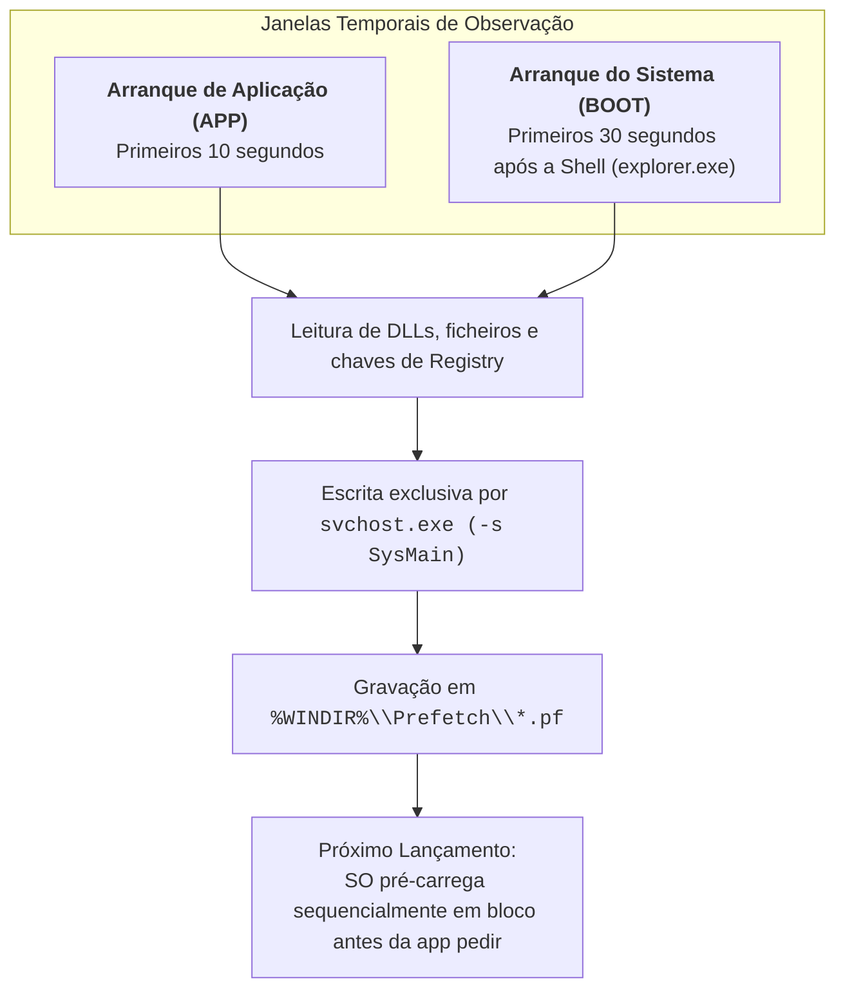

# Serviço Prefetch e SysMain — Arquitetura e Funcionamento

O **Prefetch** é um subsistema de otimização de desempenho concebido pela Microsoft cujo objetivo principal é **reduzir o tempo de carregamento de aplicações e acelerar o arranque (*boot*)** do sistema operativo Windows.

Historicamente introduzido no Windows XP, o mecanismo evoluiu para o **SuperFetch** no Windows Vista (adicionando predição inteligente na memória RAM) e foi formalmente renomeado para **SysMain** a partir do **Windows 10 (versão 1809)**.

---

## 1. Princípio de Funcionamento e Janelas de Observação

Durante o funcionamento normal do computador, o lançamento de uma aplicação obriga o sistema a realizar múltiplas leituras aleatórias em disco (pesquisa de executáveis, bibliotecas DLL, recursos e chaves de Registry). Em discos mecânicos (HDD), estes acessos fragmentados causavam atrasos significativos (*head seek time*).

O Prefetch resolve este estrangulamento monitorizando e traçando (*tracing*) os dados nos seguintes períodos:



1. **Janela de Aplicação (APP)**: O serviço monitoriza detalhadamente os conteúdos lidos pela aplicação durante os seus **primeiros 10 segundos** de execução.
2. **Janela de Arranque (BOOT)**: O serviço monitoriza a atividade de disco durante os **primeiros 30 segundos** após o carregamento da *Shell* do utilizador (`explorer.exe`).
3. **Pré-Carregamento Eficiente**: Nos arranques subsequentes, o Windows consulta o ficheiro de Prefetch correspondente e efetua o pré-carregamento contíguo das DLLs e páginas de memória na RAM, sem esperar que a aplicação invoque individualmente cada biblioteca.

---

## 2. Padrões de Uso e Gestão de Memória (SuperFetch / SysMain)

Ao contrário do Prefetch clássico (que apenas otimiza leituras de disco), o **SysMain** articula diretamente com o gestor de memória virtual do Windows:
* **Predição Heurística**: Regista padrões temporais de utilização do utilizador (ex.: hábitos de trabalho às segundas-feiras de manhã vs. aplicações executadas imediatamente após o almoço).
* **Manutenção em RAM**: Procura manter na memória RAM as páginas de código das aplicações habituais antes de estas serem abertas, libertando-as instantaneamente se outra tarefa com maior prioridade solicitar memória.

### Cenário de Hardware: Discos HDD vs. SSD
* O Prefetch confere ganhos substanciais de velocidade em discos rígidos mecânicos (**HDD**).
* Em unidades de estado sólido de alta velocidade (**SSD / NVMe**), o impacto da latência de leitura é praticamente nulo. O Windows avalia automaticamente o desempenho do subsistema de armazenamento através do comando de teste:
  ```cmd
  winsat formal
  ```
  *(Os relatórios desta auditoria de desempenho residem em `C:\Windows\Performance\WinSAT\DataStore`). Em SSDs muito rápidos, o SO pode desativar internamente partes do pré-carregamento.*

---

## 3. Diretório de Armazenamento e Limites do Sistema

Os ficheiros de Prefetch residem no diretório protegido do sistema:
$$\text{Localização: } \texttt{\%WINDIR\%\textbackslash Prefetch} \quad \text{(geralmente } \texttt{C:\textbackslash Windows\textbackslash Prefetch}\text{)}$$

### Limites de Retenção
O Windows impõe um número máximo de ficheiros com extensão `.pf` mantidos simultaneamente no diretório:
* **Windows XP, 2003, Vista, 7, 2008**: Máximo de **128 ficheiros `.pf`**.
* **Windows 8, 8.1, 10 e 11**: Máximo de **1024 ficheiros `.pf`**.

Quando o diretório atinge o teto de 1024 ficheiros, o serviço elimina automaticamente as entradas com marcas temporais de acesso mais antigas (política FIFO).

---

## 4. O Processo Escritor Exclusivo: `svchost.exe (-s SysMain)`

Uma particularidade técnica fundamental para a integridade forense reside no processo criador dos ficheiros:

> [!IMPORTANT] Exclusividade do SysMain na Escrita de `.pf`
> O **único processo** no sistema operativo autorizado a criar e modificar ficheiros no diretório `C:\Windows\Prefetch` é a instância de serviço:
> `svchost.exe -s SysMain` *(ou `svchost.exe -k LocalSystemNetworkRestricted -p -s SysMain`)*.
> 
> A própria aplicação monitorizada **nunca escreve no seu próprio ficheiro `.pf`**. Se uma ferramenta pericial ou um utilizador detetar um processo de terceiros a manipular diretamente ficheiros `.pf`, trata-se de atividade suspeita ou adulteração anti-forense.

### Processos Anteriores ao Arranque do SysMain
Os processos essenciais do *kernel* que iniciam **antes** da entrada em funcionamento do serviço SysMain durante a cadeia de arranque (ex.: fases primitivas do `smss.exe`) não possuem ficheiros de Prefetch no disco.

---

## 5. Ativação e Desativação: A Armadilha do Registry

Em contexto de administração ou de evasão anti-forense, existem dois métodos teóricos para desativar o Prefetch:

### 1. Desativação Efetiva via Serviços (Método Correto)
Numa linha de comandos com privilégios de Administrador:
```cmd
REM Configurar o serviço para arranque Desativado
sc config SysMain start=disabled

REM Parar a execução imediata do serviço
sc stop SysMain
```

### 2. A Ilusão da Chave `EnablePrefetcher` no Registry
Historicamente, o comportamento do Prefetch era parametrizado na seguinte chave do Registry:
`HKLM\SYSTEM\CurrentControlSet\Control\Session Manager\Memory Management\PrefetchParameters`

Valor DWORD **`EnablePrefetcher`**:
* `0` = Desativado;
* `1` = Prefetch ativo apenas para aplicações;
* `2` = Prefetch ativo apenas para arranque (*boot*, padrão em Windows Server 2003);
* `3` = Prefetch ativo para arranque e aplicações (**omissão em sistemas desktop**).

> [!CAUTION] Armadilha Técnica: O Registry NÃO Desativa o SysMain Moderno!
> Conforme demonstrado no estudo científico de **Venault & David (2021)**, nos sistemas Windows modernos (Windows 10 e 11), a função interna de *kernel* **`PfSvSuperfetchCheckAndEnable`** presente no SysMain monitoriza esta chave e **força dinamicamente o valor de volta para `3`**, independentemente do que o administrador configurou.
> 
> Portanto, alterar o Registry **não tem qualquer impacto na atividade do SysMain**. Para desativar com sucesso o registo de Prefetch, é **estritamente obrigatório desativar o serviço `SysMain` no Service Control Manager**.

---

## 6. Referências Bibliográficas

* **Venault, M., & David, B. (2021)**. *Superfetch: the famous unknown spy*. Journal of Computer Virology and Hacking Techniques, 17(2), 91-104.
* **Heriyanto, A. P. (2014)**. *Forensic examination and analysis of the Prefetch files on the banking Trojan malware incidents*. [DOI: 10.4225/75/57b40250fb894](https://doi.org/10.4225/75/57b40250fb894).

---

## Navegação

- [[Capítulo 1 - Sistemas Operativos, Serviços e Artefactos Forenses|Voltar ao Índice do Capítulo 1]]
- [[Taxonomia dos Artefactos de Execução no Windows]]
- [[Estrutura Interna e Algoritmo de Hashing do Prefetch]]
- [[Análise Forense e Criação a Pedido do Prefetch]]
