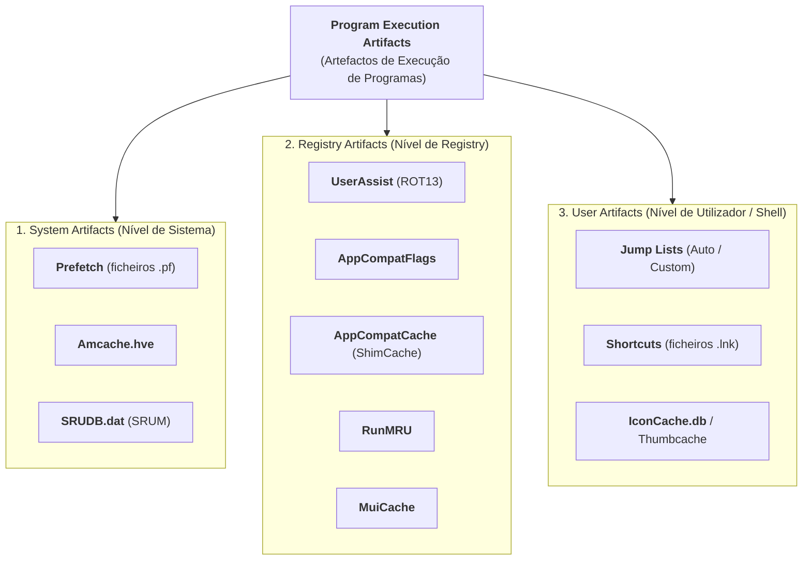

# Taxonomia dos Artefactos de Execução no Windows

A **Taxonomia dos Artefactos de Execução no Windows** classifica as fontes periciais em artefactos de Sistema, Registry e Utilizador para provar a execução ou presença de software.

> [!TIP] Lógica de Funcionamento e Valor Forense
> - **Porque existe (Sistema)**: O Windows não foi desenhado para facilitar perícias forenses; estes registos existem por duas razões de engenharia da Microsoft: **1) Desempenho e User Experience (UX)** (pré-carregar recursos em RAM e lembrar ficheiros recentes) e **2) Retrocompatibilidade (*Legacy Support*)** (garantir que binários antigos correm em versões novas do SO).
> - **Porque importa (Forense)**: Perante ataques de *ransomware* ou intrusões **APT** (*Advanced Persistent Threat*), permite responder às duas questões fundamentais de DFIR: *Qual foi o vetor de entrada?* (para fechar a vulnerabilidade) e *Quais os sistemas visitados?* (para reinstalação e contenção).
> - **Pontos Críticos e Armadilhas para Exame**:
>   1. **Distinção Crítica — Execução vs. Existência**: `Prefetch`, `UserAssist` e `SRUM` provam **execução efetiva** em CPU/RAM; pelo contrário, `ShimCache` e `AmCache` no Windows 10/11 provam apenas **existência/presença** do ficheiro no disco, rede ou USB.
>   2. **As 3 Famílias da Taxonomia (Singh & Singh, 2018)**: *System Artifacts* (`Prefetch`, `Amcache.hve`, `SRUDB.dat`), *Registry Artifacts* (`UserAssist`, `AppCompatFlags`, `AppCompatCache`, `RunMRU`, `MuiCache`) e *User Artifacts* (`Jump Lists`, `.lnk`, `IconCache.db` / `Thumbcache`).
>   3. **Limitação de Autoria do Prefetch**: O Prefetch prova que o binário correu na máquina, mas **não identifica o utilizador**, exigindo correlação com artefactos ao nível do utilizador (`UserAssist`, `Jump Lists`).

---

## 1. Enquadramento em Resposta a Incidentes (Ransomware e APT)

Na resposta a incidentes de segurança (*Incident Response*) e na informática forense (*Digital Forensics*), a determinação rigorosa da **execução de programas** é frequentemente a questão mais crítica de uma investigação.

Perante um ataque bem-sucedido de *ransomware* ou a intrusão de um agente de ameaça persistente avançada (**APT** - *Advanced Persistent Threat*), torna-se imperativo responder a duas perguntas fundamentais:

1. **Qual foi o vetor de entrada da ameaça?** (Permite isolar a vulnerabilidade explorada e evitar reinfeções).
2. **Quais foram os sistemas afetados e "visitados"?** (Sistemas comprometidos por APT exigem reinstalação completa e auditoria de persistência).

---

## 2. Classificação Académica dos Artefactos de Execução

De acordo com os modelos formais da literatura forense (designadamente **Singh & Singh, 2018** e **Đuranec et al., 2019**), os artefactos gerados pela execução e interação de programas no Windows dividem-se em três grandes famílias:

### 1. Artefactos de Sistema (*System Artifacts*)
Operam globalmente ao nível do sistema operativo e não dependem do perfil de um utilizador em particular:

* **[[Serviço Prefetch e SysMain - Arquitetura e Funcionamento|Prefetch]]**: Otimização de arranque do *kernel* que regista evidência de execução recente, contadores e DLLs carregadas nos primeiros 10 segundos.
* **[[AmCache - Arquitetura, Hives e Evolução para SQLite|Amcache.hve]]**: Registo de compatibilidade que indexa metadados de programas instalados, ficheiros e hashes criptográficos SHA-1.
* **[[System Resource Usage Monitor (SRUM) - Arquitetura e Base ESE|SRUDB.dat (SRUM)]]**: Base de dados estatística do consumo de recursos (CPU, tráfego de rede e energia) ao longo de semanas.

### 2. Artefactos do Registry (*Registry Artifacts*)
Chaves e valores armazenados nos *hives* lógicos (`HKLM`, `HKCU`, `HKU`):

* **[[Artefacto Forense UserAssist|UserAssist]]**: Telemetria do Windows Explorer com contadores e datas de execução de aplicações GUI (ofuscado em ROT13 no `NTUSER.DAT`).
* **[[Application Compatibility e ShimCache (AppCompatCache)|AppCompatCache (ShimCache)]]**: Cache de compatibilidade mantida em memória RAM e descarregada no hive `SYSTEM` ao encerrar.
* **[[Artefactos Forenses de Interação do Utilizador (MRU e TypedPaths)|RunMRU e MuiCache]]**: Histórico de comandos manuais digitados na caixa Executar (`Win+R`) e registo de nomes amigáveis de aplicações (`MuiCache`).

### 3. Artefactos de Utilizador (*User Artifacts*)
Gerados pela interação humana com o ambiente gráfico e navegação de ficheiros:

* **[[Jump Lists - Arquitetura, AppIDs e Carving|Jump Lists]]**: Listas de atalhos e ficheiros recentes da barra de tarefas associadas a `AppIDs`.
* **[[Ficheiros LNK (Shell Links) - Metadados e Formato Binário|Ficheiros LNK]]**: Atalhos que guardam números de série de volumes, carimbos temporais do ficheiro alvo e nomes NetBIOS.
* **[[Caches de Ícones e Miniaturas (IconCache e Thumbcache)|IconCache e Thumbcache]]**: Caches visuais de miniaturas e ícones geradas pelo Windows Explorer.

---

## 3. A Razão de Ser dos Artefactos: O Design da Microsoft

A abundância de artefactos forenses presentes no ecossistema Windows resulta diretamente de **duas forças motrizes de engenharia de sistemas**:

1. **User Experience (UX) e Desempenho**:
   * A procura contínua pela perceção de velocidade, produtividade e fluidez.
   * O sistema operativo monitoriza ativamente os padrões de utilização para pré-carregar recursos na memória RAM antes de serem explicitamente solicitados (ex.: Prefetch e SuperFetch / SysMain).
   * Recolha de métricas de telemetria para adaptar a interface ao comportamento do operador humano (ex.: UserAssist, Jump Lists e listas MRU).
2. **Retrocompatibilidade (*Legacy Support*)**:
   * O compromisso histórico da Microsoft de garantir que aplicações antigas (por vezes desenvolvidas para Windows 95 ou XP) continuem a funcionar sem falhas em novas versões do SO (Windows 10 e 11).
   * O sistema implementa motores transparentes de interceção e adaptação de chamadas à API (ex.: *Shims*, `AppCompatCache`, `Amcache` e `AppCompatFlags`).

---

## 4. O Desafio Pericial: Existência vs. Execução vs. Interação

A taxonomia estabelece uma linha de demarcação probatória crítica que orienta o trabalho do perito forense em tribunal e relatórios de incidente:

| Categoria Probatória | Fontes Típicas | O que Comprova na Perícia | Limitação / Cuidado Forense |
| :--- | :--- | :--- | :--- |
| **Prova de Execução Incontestável** | `Prefetch`, `UserAssist`, `SRUM` | O executável correu efetivamente em CPU e memória num determinado instante. | O `Prefetch` não identifica a conta de utilizador; o `UserAssist` só regista chamadas GUI via Explorer. |
| **Prova de Existência / Presença** | `ShimCache`, `Amcache` | O binário residiu no sistema de ficheiros (disco local, partilha de rede UNC ou pen USB). | **Não prova que o binário foi executado** no Windows 10/11 (pode ter sido apenas copiado, enumerado ou indexado). |
| **Prova de Interação com Dados** | `Jump Lists`, `LNK`, `ShellBags` | O utilizador navegou para o recurso ou abriu um documento associado a uma aplicação. | Não comprova que todo o conteúdo do ficheiro tenha sido alterado. |

---

## 5. Referências Bibliográficas

* **Singh, B., & Singh, U. (2018)**. *Program execution analysis in Windows: A study of data sources, their format and comparison of forensic capability*. Computers & Security, 74, 94-114. [DOI: 10.1016/j.cose.2018.01.006](https://doi.org/10.1016/j.cose.2018.01.006).
* **Đuranec, A., Topolčić, D., Hausknecht, K., & Delija, D. (2019)**. *Investigating file use and knowledge with Windows 10 artifacts*. 2019 42nd International Convention on Information and Communication Technology, Electronics and Microelectronics (MIPRO), Opatija, Croatia, pp. 1213-1218, [DOI: 10.23919/MIPRO.2019.8756877](https://doi.org/10.23919/MIPRO.2019.8756877).

---

## Perguntas de revisão

1. **Segundo a taxonomia de Singh & Singh (2018), quais são as três grandes famílias de artefactos de execução no Windows e dê dois exemplos de cada uma?**

> [!success]- Ver Resposta
> As três famílias são:
> 1) **System Artifacts (Nível de Sistema)**: `Prefetch` (`.pf`), `Amcache.hve` e `SRUDB.dat` (SRUM);
> 2) **Registry Artifacts (Nível de Registry)**: `UserAssist`, `AppCompatCache` (ShimCache), `AppCompatFlags`, `RunMRU` e `MuiCache`;
> 3) **User Artifacts (Nível de Utilizador / Shell)**: `Jump Lists`, atalhos `LNK` e `IconCache.db` / `Thumbcache`.

2. **Quais são as duas motivações de engenharia da Microsoft que explicam a criação nativa de tantos artefactos úteis à informática forense?**

> [!success]- Ver Resposta
> 1) **Otimização de Desempenho e User Experience (UX)** (pré-carregamento em memória com Prefetch/SysMain e histórico de atalhos/MRUs para fluidez do utilizador); e 2) **Retrocompatibilidade (*Legacy Support*)** (mecanismos como Shims, ShimCache e AmCache para garantir que aplicações legadas continuam a correr em versões modernas do Windows).

3. **Qual a diferença probatória fundamental entre encontrar um binário no `Prefetch`/`UserAssist` versus encontrá-lo apenas na `ShimCache`/`AmCache` num sistema Windows 10/11?**

> [!success]- Ver Resposta
> O `Prefetch` e o `UserAssist` constituem **prova de execução incontestável** (o binário correu efetivamente em CPU e memória). Já a `ShimCache` e a `AmCache` no Windows 10/11 constituem apenas **prova de existência/presença** no sistema de ficheiros (o binário esteve no disco, USB ou rede UNC, mas pode nunca ter sido executado).

4. **Porque é que, num servidor partilhado por vários administradores, um ficheiro `.pf` não basta para atribuir a autoria da execução de uma ferramenta maliciosa a uma pessoa específica?**

> [!success]- Ver Resposta
> Porque o `Prefetch` é um *System Artifact* global à máquina que não guarda o SID nem o nome da conta de utilizador. Para identificar quem lançou o binário, é necessário correlacioná-lo com artefactos de perfil de utilizador (como `UserAssist` ou `Jump Lists` no `NTUSER.DAT`) ou com o `SRUM` / Event Logs.

---

## Navegação

- [[Capítulo 1 - Sistemas Operativos, Serviços e Artefactos Forenses|Voltar ao Índice do Capítulo 1]]
- [[Serviço Prefetch e SysMain - Arquitetura e Funcionamento]]
- [[Application Compatibility e ShimCache (AppCompatCache)]]
- [[AmCache - Arquitetura, Hives e Evolução para SQLite]]
- [[Investigação Digital e Evidência Digital]]
- [[Pesquisa de Evidências e Reconstrução de Eventos]]
- [[Código de Ética na Investigação Forense Digital (ISFCE)]]
