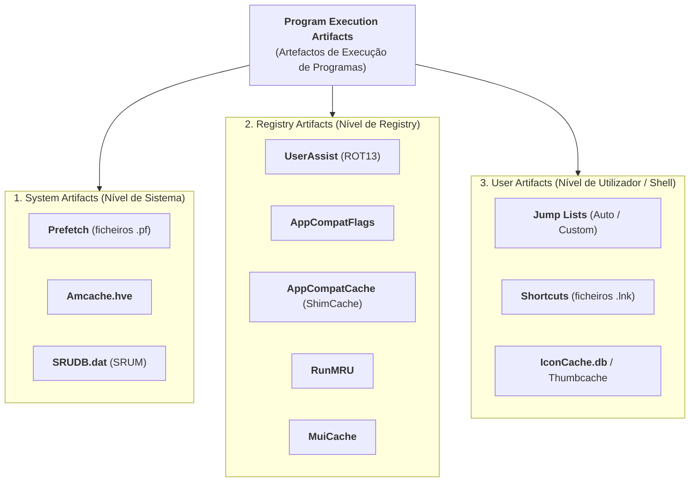

# Taxonomia dos Artefactos de Execução no Windows

Na resposta a incidentes de segurança (*Incident Response*) e na informática forense (*Digital Forensics*), a determinação rigorosa da **execução de programas** é frequentemente a questão mais crítica de uma investigação.

Perante um ataque bem-sucedido de *ransomware* ou a intrusão de um agente de ameaça persistente avançada (**APT** - *Advanced Persistent Threat*), torna-se imperativo responder a duas perguntas fundamentais:
1. **Qual foi o vetor de entrada da ameaça?** (Permite isolar a vulnerabilidade explorada e evitar reinfeções).
2. **Quais foram os sistemas afetados e "visitados"?** (Sistemas comprometidos por APT exigem reinstalação completa e auditoria de persistência).

Para reconstituir a atividade com garantias periciais, os investigadores baseiam-se numa taxonomia formal de fontes de dados dispersas no sistema operativo.

---

## 1. Classificação Académica dos Artefactos de Execução

De acordo com os modelos formais da literatura forense (designadamente **Singh & Singh, 2018** e **Đuranec et al., 2019**), os artefactos gerados pela execução e interação de programas no Windows dividem-se em três grandes famílias:

### 1. Artefactos de Sistema (*System Artifacts*)
Operam globalmente ao nível do sistema operativo e não dependem do perfil de um utilizador em particular:
* **[[Serviço Prefetch e SysMain - Arquitetura e Funcionamento|Prefetch]]**: Otimização de arranque do *kernel* que regista evidência de execução recente, contadores e DLLs carregadas.
* **[[AmCache - Arquitetura, Hives e Evolução para SQLite|Amcache.hve]]**: Registo de compatibilidade que indexa metadados de programas instalados, ficheiros e hashes criptográficos SHA-1.
* **[[System Resource Usage Monitor (SRUM) - Arquitetura e Base ESE|SRUDB.dat (SRUM)]]**: Base de dados estatística do consumo de recursos (CPU, tráfego de rede e energia) ao longo de semanas.

### 2. Artefactos do Registry (*Registry Artifacts*)
Chaves e valores armazenados nos *hives* lógicos (`HKLM`, `HKCU`, `HKU`):
* **[[Artefacto Forense UserAssist|UserAssist]]**: Telemetria do Windows Explorer com contadores e datas de execução de aplicações GUI (cifrado em ROT13).
* **[[Application Compatibility e ShimCache (AppCompatCache)|AppCompatCache (ShimCache)]]**: Cache de compatibilidade em memória descarregada no hive `SYSTEM` ao encerrar.
* **[[Artefactos Forenses de Interação do Utilizador (MRU e TypedPaths)|RunMRU e MuiCache]]**: Histórico de comandos manuais digitados em `Win+R` e registo de nomes amigáveis de aplicações.

### 3. Artefactos de Utilizador (*User Artifacts*)
Gerados pela interação humana com o ambiente gráfico e navegação de ficheiros:
* **[[Jump Lists - Arquitetura, AppIDs e Carving|Jump Lists]]**: Listas de atalhos e ficheiros recentes da barra de tarefas associadas a `AppIDs`.
* **[[Ficheiros LNK (Shell Links) - Metadados e Formato Binário|Ficheiros LNK]]**: Atalhos que guardam números de série de volumes, carimbos temporais do ficheiro alvo e nomes NetBIOS.
* **[[Caches de Ícones e Miniaturas (IconCache e Thumbcache)|IconCache e Thumbcache]]**: Caches visuais de miniaturas e ícones no Windows Explorer.

---

## 2. A Razão de Ser dos Artefactos: O Design da Microsoft

A abundância de artefactos forenses presentes no ecossistema Windows não foi introduzida propositadamente para auditoria pericial, mas resulta de **duas forças motrizes de engenharia**:

1. **User Experience (UX) e Desempenho**:
   * A procura contínua pela perceção de velocidade, produtividade e fluidez.
   * O sistema operativo monitoriza ativamente os padrões de utilização para pré-carregar recursos na memória RAM antes de serem explicitamente solicitados (ex.: Prefetch e SuperFetch).
   * Recolha de métricas de telemetria para adaptar o sistema ao comportamento do operador humano (ex.: Jump Lists e listas MRU).
2. **Retrocompatibilidade (*Legacy Support*)**:
   * O compromisso histórico da Microsoft de garantir que aplicações antigas (por vezes desenvolvidas para Windows 95 ou XP) continuem a funcionar em novas versões do SO (ex.: Windows 10 e 11).
   * O sistema implementa motores transparentes de interceção e adaptação de chamadas à API (ex.: *Shims*, `AppCompatCache`, `Amcache`).

---

## 3. O Desafio Pericial: Existência vs. Execução

A taxonomia estabelece uma linha de demarcação crítica que orienta o trabalho do perito forense:

| Categoria | Fontes Típicas | O que Comprova | Limitação Forense |
| :--- | :--- | :--- | :--- |
| **Prova de Execução Incontestável** | Prefetch, UserAssist, SRUM | O executável correu efetivamente em CPU e memória num determinado instante. | O Prefetch não identifica a conta de utilizador; o UserAssist só regista chamadas GUI via Explorer. |
| **Prova de Existência / Presença** | ShimCache, Amcache | O binário residiu no sistema de ficheiros (disco local, partilha de rede UNC ou pen USB). | **Não prova que o binário foi executado** (pode ter sido apenas copiado, enumerado ou indexado). |
| **Prova de Interação com Dados** | Jump Lists, LNK, ShellBags | O utilizador navegou para o recurso ou abriu um documento associado. | Não comprova que todo o conteúdo do ficheiro tenha sido lido ou alterado. |

---

## 4. Referências Bibliográficas

* **Singh, B., & Singh, U. (2018)**. *Program execution analysis in Windows: A study of data sources, their format and comparison of forensic capability*. Computers & Security, 74, 94-114. [DOI: 10.1016/j.cose.2018.01.006](https://doi.org/10.1016/j.cose.2018.01.006).
* **Đuranec, A., Topolčić, D., Hausknecht, K., & Delija, D. (2019)**. *Investigating file use and knowledge with Windows 10 artifacts*. 2019 42nd International Convention on Information and Communication Technology, Electronics and Microelectronics (MIPRO), Opatija, Croatia, pp. 1213-1218, [DOI: 10.23919/MIPRO.2019.8756877](https://doi.org/10.23919/MIPRO.2019.8756877).

---

## Navegação

- [[Capítulo 1 - Sistemas Operativos, Serviços e Artefactos Forenses|Voltar ao Índice do Capítulo 1]]
- [[Serviço Prefetch e SysMain - Arquitetura e Funcionamento]]
- [[Application Compatibility e ShimCache (AppCompatCache)]]
- [[AmCache - Arquitetura, Hives e Evolução para SQLite]]
