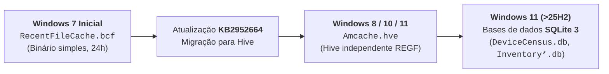

# AmCache — Arquitetura, Hives e Evolução para SQLite

O **AmCache** é um repositório central de inventário de software, controladores e telemetria gerido pela infraestrutura do Windows para monitorizar compatibilidade aplicacional e preparar atualizações do sistema operativo.

Para os investigadores forenses, o AmCache é um dos artefactos mais valiosos do ecossistema Microsoft porque armazena **hashes criptográficos (SHA-1)** de executáveis que residiram no sistema, permitindo correlacionar binários desconhecidos com bases de inteligência de ameaças globais (como o **VirusTotal**).

---

## 1. Evolução Histórica e Natureza dos Ficheiros

O repositório do AmCache atravessou três grandes gerações tecnológicas:



### 1. Primeira Geração: `RecentFileCache.bcf` (Windows 7)
* Armazenado como ficheiro binário proprietário simples em `%WINDIR%\AppCompat\Programs\RecentFileCache.bcf`.
* O ficheiro era recriado pelo sistema a cada **24 horas**.
* A Microsoft disponibilizou o *update* de compatibilidade **KB2952664**, que substituiu formalmente o ficheiro `.bcf` pelo novo formato de *hive*.

### 2. Segunda Geração: `Amcache.hve` (Windows 8 a Windows 11)
* **Formato**: Estrutura binária padrão de *hive* do Windows (**Windows NT Registry File — `REGF`**).
* **Localização no Disco**:
  ```text
  %WINDIR%\AppCompat\Programs\Amcache.hve   (geralmente C:\Windows\AppCompat\Programs)
  ```

> [!IMPORTANT] Hive Independente fora do Registry Principal
> Embora possua internamente a estrutura binária `REGF` (com blocos `nk`, `vk` e células de registo idênticas a um `NTUSER.DAT`), o `Amcache.hve` **não pertence ao Registry principal do Windows**. 
> Não se encontra mapeado em `HKLM` nem listado na chave `hivelist`. Trata-se de um ficheiro de registo independente e privado do subsistema de compatibilidade.

---

## 2. Componentes Operacionais: Serviços e Tarefas Agendadas

A população do AmCache não é instantânea. O subsistema depende do serviço **Application Experience** e de três tarefas agendadas (*scheduled tasks*) configuradas no Escalonador de Tarefas do Windows (`taskschd.msc`):

| Tarefa Agendada | Relação com o AmCache e Finalidade Técnica |
| :--- | :--- |
| **`Microsoft Compatibility Appraiser`** | Associada à telemetria de aplicações (*Application Telemetry*). Avalia a compatibilidade de programas e componentes do sistema com novas compilações do Windows. |
| **`ProgramDataUpdater`** | Responsável por consolidar os dados de software no *hive* **`Amcache.hve`** (e historicamente recriava o `RecentFileCache.bcf` a cada 24 horas no Windows 7). |
| **`StartupAppTask`** | Analisa entradas de arranque (*startup*), emitindo alertas caso exista um número excessivo ou anómalo de programas configurados para iniciar com a máquina. |

---

## 3. Dados e Metadados Armazenados no `Amcache.hve`

Ao contrário da [[Application Compatibility e ShimCache (AppCompatCache)|ShimCache]] (que armazena apenas caminhos e datas de modificação), o `Amcache.hve` recolhe uma vasta gama de metadados:

* **Caminho Completo do Ficheiro**: Diretório e volume onde o ficheiro reside (incluindo caminhos em `Temp` ou em pastas de perfil de utilizador).
* **Carimbos Temporais**: Data de compilação do executável (PE *compile time*), data de criação e modificação.
* **Hash SHA-1 do Ficheiro**: O hash de integridade de 160 bits (40 carateres hexadecimais), calculado com base no conteúdo do ficheiro.
* **Metadados do Cabeçalho PE**: Versão do produto, descrição textual, nome da empresa fabricante (*Publisher*) e linguagem.
* **Executáveis Secundários e Não-Interativos**: Regista dados de programas que **não foram diretamente executados pelo utilizador** (ex.: instaladores que invocam executáveis auxiliares temporários em segundo plano).

---

## 4. Variações do Formato nas Compilações do Windows 10

Conforme demonstrado no relatório técnico do instituto francês de cibersegurança **ANSSI** (**Blanche Lagny, 2019**), a estrutura interna e os ficheiros auxiliares do AmCache sofrem alterações frequentes entre compilações (*builds*) do Windows 10:

| Compilação Windows 10 | Ficheiros de Inventário Envolvidos na Pasta `AppCompat\Programs\` |
| :--- | :--- |
| **10.0.10586 (1511)** | `AmCache.hve`, `Install\INSTALL_ffff_*.xml` |
| **10.0.14913** | `AmCache.hve`, `Install\INSTALL_ffff_*.xml`, `appraiser\APPRAISER_FileInventory.xml` |
| **10.0.16299 (1709)** | `AmCache.hve`, `appraiser\APPRAISER_FileInventory.xml`, `appraiser\APPRAISER_TelemetryBaseline_UNV.bin` |
| **10.0.17134 (1803)** | `AmCache.hve`, `Install\INSTALL_*.txt`, `appraiser\APPRAISER_TelemetryBaseline_UNV.bin` |
| **10.0.17763 (1809)** | `AmCache.hve`, `Install\INSTALL_*.txt`, `appraiser\APPRAISER_TelemetryBaseline_UNV.bin` |

---

## 5. Terceira Geração: A Transição para SQLite 3 no Windows 11 (>25H2)

Nas versões mais recentes do **Windows 11 (>25H2)**, a Microsoft iniciou a transição da arquitetura baseada em *hives* para **bases de dados relacionais SQLite 3**.

Estes novos ficheiros residem no mesmo diretório:

```text
C:\Windows\appcompat\programs\
```

### Principais Ficheiros de Base de Dados SQLite Identificados:
* **`DeviceCensus.db`**: Registo de componentes de hardware e telemetria do sistema (firmware, processador, storage, rede, bateria).
* **`InventoryApplicationFile.db`**: Inventário de ficheiros executáveis presentes no sistema.
* **`InventoryApplication.db`**: Aplicações completas instaladas.
* **`InventoryApplicationShortcut.db`**: Atalhos associados a programas.
* **`InventoryDeviceContainer.db`**: Contentores de dispositivos ligados.

### Análise Forense com SQL e Conversão Temporal
Nas tabelas do SQLite (como `DeviceCensus_0`), os carimbos temporais estão registados em formato de contagem de 100 nanossegundos do Windows (FILETIME). O perito pode utilizar uma consulta SQL direta para converter o valor para formato **Unix Epoch** legível:

```sql
SELECT 
    datetime((LastModified - 116444736000000000) / 10000000, 'unixepoch') AS Timestamp,
    ItemKey,
    Data
FROM DeviceCensus_0;
```

Na base `InventoryApplicationFile.db`, cada registo preserva:
* `Timestamp`: Data de inventário do binário;
* `ProgramId` e `FileId`: Identificadores internos da telemetria;
* `LowerCaseLongPath`: Caminho absoluto do ficheiro em minúsculas;
* `Name`: Nome do binário (ex.: `netsh.exe`, `fastir_artifacts.exe`, `vssadmin.exe`, `winver.exe`).

---

## 6. Referências Bibliográficas

* **Lagny, B. (2019)**. *Analysis of the AmCache (v2)*. Technical Report, Agence nationale de la sécurité des systèmes d’information (ANSSI), France.
* **Singh, B., & Singh, U. (2016)**. *Leveraging the Windows amcache.hve file in forensic investigations*. Journal of Digital Forensics, Security and Law, 11(4), 7.
* **Kim, M., & Lee, S. (2015)**. *Forensic analysis using amcache.hve*. In Digital Forensics and Cyber Crime (ICDF2C 2015), Springer, pp. 215.

---

## Navegação

- [[Capítulo 1 - Sistemas Operativos, Serviços e Artefactos Forenses|Voltar ao Índice do Capítulo 1]]
- [[Application Compatibility e ShimCache (AppCompatCache)]]
- [[Extração da AmCache e Comparação Forense com a ShimCache]]
- [[Mecanismos de Compatibilidade no Windows (WOW64, Shims, PCA, ShimCache e AmCache)]]
- [[Taxonomia dos Artefactos de Execução no Windows]]
- [[Preservação do Sistema e Integridade de Dados]]
- [[Representação Forense de Data e Hora (Timestamps e SQLite)]]
- [[Registo, Etiquetagem e Fotografia Pericial (Regras LabCIF)]]
