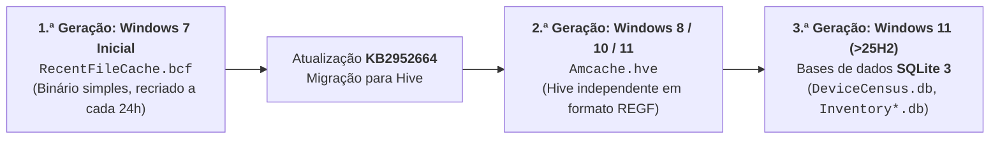

# AmCache — Arquitetura, Hives e Evolução para SQLite

O **AmCache** é o repositório de inventário e telemetria de compatibilidade do Windows (`%WINDIR%\AppCompat\Programs\`) que regista aplicações, drivers, dispositivos e **hashes criptográficos SHA-1** de ficheiros executáveis.

> [!NOTE] Guia de Leitura do Bloco 11
> Para compreender primeiro o panorama integrado das 5 camadas de compatibilidade do Windows (`WOW64` $\to$ `Shims` $\to$ `ShimCache` $\to$ `PCA` $\to$ `AmCache`) e a diferença conceptual entre `ShimCache` e `AmCache`, recomenda-se começar por [[Mecanismos de Compatibilidade no Windows (WOW64, Shims, PCA, ShimCache e AmCache)]].

> [!TIP] Lógica de Funcionamento e Valor Forense
> - **Porque existe (Sistema)**: Antes de atualizar o sistema operativo (*Windows Update* / novas *builds*), a Microsoft precisa de um inventário completo de todo o software instalado, executáveis avulsos, pacotes de drivers e periféricos ligados à máquina para saber se alguma peça irá quebrar após a atualização. Esse inventário é atualizado diariamente em segundo plano pelas tarefas agendadas `Microsoft Compatibility Appraiser` e `ProgramDataUpdater`.
> - **Porque importa (Forense)**: Ao contrário da `ShimCache`, o `Amcache.hve` guarda o **Hash SHA-1 (160 bits)** de cada ficheiro executável, metadados do cabeçalho PE (data de compilação, fabricante, versão) e caminhos completos — permitindo pesquisar diretamente os hashes no **VirusTotal** mesmo que o atacante já tenha apagado os ficheiros maliciosos do disco!
> - **Pontos Críticos e Armadilhas para Exame**:
>   1. **As 3 Gerações do AmCache**: 1.ª Geração no **Windows 7 inicial** (`RecentFileCache.bcf`, recriado a cada 24h, migrado para hive pelo update **`KB2952664`**); 2.ª Geração no **Windows 8 a 11** (`Amcache.hve`, formato binário `REGF`); 3.ª Geração no **Windows 11 (>25H2)** (bases de dados **SQLite 3**: `DeviceCensus.db`, `InventoryApplicationFile.db`, etc.).
>   2. **Hive Independente (`REGF` fora do Registry principal)**: Embora o `Amcache.hve` tenha formato binário de Registry (`REGF`), **não faz parte do Registry principal** (não está montado em `HKLM` nem na `hivelist`).
>   3. **Conversão de Timestamps FILETIME no SQLite (W11 >25H2)**: Nas novas bases SQLite, os timestamps estão em Windows FILETIME (intervalos de 100 ns desde 1601), convertendo-se para Unix Epoch via `(LastModified - 116444736000000000) / 10000000`.

---

## 1. Evolução Histórica: As 3 Gerações do AmCache (Windows 7 a Windows 11 >25H2)

O repositório do AmCache em `%WINDIR%\AppCompat\Programs\` atravessou três grandes gerações tecnológicas:



| Geração / Versão do SO | Ficheiro(s) em `%WINDIR%\AppCompat\Programs\` | Formato Binário | Características Técnicas e Forenses |
| :--- | :--- | :--- | :--- |
| **1.ª Geração: Windows 7 (Inicial)** | **`RecentFileCache.bcf`** | Binário proprietário simples | Recriado pelo sistema a cada **24 horas**. Foi substituído pelo `Amcache.hve` através da atualização da Microsoft **`KB2952664`**. |
| **2.ª Geração: Windows 8, 8.1, 10 e 11** | **`Amcache.hve`** (+ logs transacionais `.LOG1`/`.LOG2`) | **`REGF`** (*Windows NT Registry File*) | Hive independente fora do Registry principal; armazena **Hash SHA-1**, cabeçalhos PE, programas, drivers e dispositivos PnP. |
| **3.ª Geração: Windows 11 (>25H2)** | **`DeviceCensus.db`**, **`InventoryApplicationFile.db`**, **`InventoryApplication.db`**, etc. | **SQLite 3** (Base de dados relacional) | Transição de hives `REGF` para tabelas SQLite 3 consultáveis com SQL; timestamps guardados em formato Windows FILETIME. |

> [!IMPORTANT] `Amcache.hve`: Um Hive `REGF` Independente fora do Registry Principal
> Embora o ficheiro `Amcache.hve` utilize internamente a estrutura binária padrão do Registry do Windows (**`REGF`**, com blocos `nk`, `vk` e células idênticas a um `SYSTEM` ou `NTUSER.DAT`), o `Amcache.hve` **não pertence ao Registry principal do Windows**. Não se encontra mapeado sob `HKLM` no `regedit.exe` nem listado na chave `hivelist`; é um ficheiro de registo autónomo e privado do subsistema de compatibilidade.

---

## 2. Componentes Operacionais: Serviços e as 3 Tarefas Agendadas

Ao contrário da [[Application Compatibility e ShimCache (AppCompatCache)|ShimCache]] (atualizada em RAM pelo kernel e gravada no *shutdown*), a população do AmCache é assíncrona e depende do serviço **Application Experience** e de **três tarefas agendadas** (*scheduled tasks*) no Escalonador de Tarefas (`taskschd.msc`):

| Tarefa Agendada (`taskschd.msc`) | Relação com o AmCache e Finalidade Técnica |
| :--- | :--- |
| **1. `Microsoft Compatibility Appraiser`** | Associada à telemetria de aplicações (*Application Telemetry*). Varre o sistema (tipicamente a cada 24h) para avaliar a compatibilidade de programas, ficheiros e hardware com novas compilações (*builds*) do Windows. |
| **2. `ProgramDataUpdater`** | Consolida os dados recolhidos de software no *hive* **`Amcache.hve`** (e era a tarefa que recriava o `RecentFileCache.bcf` a cada 24 horas no Windows 7). |
| **3. `StartupAppTask`** | Analisa as entradas de arranque automático (*startup*), emitindo alertas caso exista um número excessivo ou anómalo de programas configurados para iniciar com a máquina. |

---

## 3. Dados e Metadados Armazenados no `Amcache.hve`

Enquanto a `ShimCache` armazena apenas três dados por ficheiro (caminho, tamanho e data de modificação), o `Amcache.hve` recolhe um perfil pericial completo de cada binário e do sistema:

* **Hash Criptográfico SHA-1**: Hash de integridade de 160 bits (40 carateres hexadecimais) calculado sobre o conteúdo do ficheiro executável.
* **Caminho Completo do Ficheiro**: Diretório e volume onde o ficheiro reside (incluindo pastas temporárias `%TEMP%`, pastas de utilizador ou pens USB).
* **Carimbos Temporais Múltiplos**: Data de compilação do executável no cabeçalho PE (*LinkDate / Compile Time*), data de criação, data de última modificação e data de registo no AmCache.
* **Metadados do Cabeçalho PE (*Portable Executable*)**: Nome e versão do produto, descrição textual, nome da empresa fabricante (*Publisher*) e código de idioma.
* **Executáveis Secundários e Não-Interativos**: Regista binários que **não foram diretamente executados pelo utilizador** (ex.: instaladores que extraem e invocam executáveis auxiliares temporários em segundo plano).
* **Inventário de Hardware e Drivers**: Contentores de dispositivos periféricos, dispositivos *Plug and Play* (PnP) e pacotes de controladores (*drivers*).

---

## 4. Variações do Formato nas Compilações do Windows 10 (Estudo ANSSI)

Conforme demonstrado no relatório técnico da agência nacional de cibersegurança francesa **ANSSI** (**Blanche Lagny, 2019**), a estrutura interna das chaves do `Amcache.hve` e os ficheiros auxiliares na pasta `C:\Windows\AppCompat\Programs\` evoluíram significativamente entre *builds* do Windows 10:

| Compilação Windows 10 (*Build*) | Ficheiros de Inventário Envolvidos na Pasta `AppCompat\Programs\` |
| :--- | :--- |
| **10.0.10586 (v1511)** | `AmCache.hve`, `Install\INSTALL_ffff_*.xml` |
| **10.0.14913** | `AmCache.hve`, `Install\INSTALL_ffff_*.xml`, `appraiser\APPRAISER_FileInventory.xml` |
| **10.0.16299 (v1709)** | `AmCache.hve`, `appraiser\APPRAISER_FileInventory.xml`, `appraiser\APPRAISER_TelemetryBaseline_UNV.bin` |
| **10.0.17134 (v1803)** | `AmCache.hve`, `Install\INSTALL_*.txt`, `appraiser\APPRAISER_TelemetryBaseline_UNV.bin` |
| **10.0.17763 (v1809)** | `AmCache.hve`, `Install\INSTALL_*.txt`, `appraiser\APPRAISER_TelemetryBaseline_UNV.bin` |

---

## 5. Terceira Geração: A Transição para SQLite 3 no Windows 11 (>25H2)

Nas versões mais recentes do **Windows 11 (>25H2)**, a Microsoft iniciou a substituição da arquitetura baseada no *hive* `REGF` por **bases de dados relacionais SQLite 3**, localizadas no mesmo diretório:

```text
C:\Windows\appcompat\programs\
```

### Principais Bases de Dados SQLite 3 Identificadas

| Ficheiro SQLite (`.db`) | Conteúdo e Valor Forense |
| :--- | :--- |
| **`DeviceCensus.db`** | Componentes de hardware e telemetria do sistema (firmware, processador, storage, rede, bateria). |
| **`InventoryApplicationFile.db`** | Inventário detalhado de **ficheiros executáveis** presentes no sistema (`LowerCaseLongPath`, `Name`, `FileId`, `ProgramId`, `Timestamp`). |
| **`InventoryApplication.db`** | Registo de aplicações completas instaladas no sistema. |
| **`InventoryApplicationShortcut.db`** | Atalhos (`.lnk`) associados a programas instalados. |
| **`InventoryDeviceContainer.db`** | Contentores de dispositivos e periféricos ligados à máquina. |

### Consulta SQL Forense e Conversão de Timestamps FILETIME
Nas tabelas destas bases SQLite (como `DeviceCensus_0`), os carimbos temporais (`LastModified`) estão gravados em formato **Windows FILETIME** (número de intervalos de 100 nanossegundos desde `01/01/1601 00:00:00 UTC`).

Para converter o valor FILETIME para data legível em **Unix Epoch** (segundos desde `01/01/1970`) diretamente numa query SQLite, subtrai-se a diferença entre 1601 e 1970 (`116444736000000000`) e divide-se por $10^7$ (`10000000`):

```sql
SELECT 
    datetime((LastModified - 116444736000000000) / 10000000, 'unixepoch') AS Timestamp,
    ItemKey,
    Data
FROM DeviceCensus_0;
```

Na base **`InventoryApplicationFile.db`**, cada registo de executável preserva:

* `Timestamp`: Data de inventário do binário;
* `ProgramId` e `FileId`: Identificadores internos da telemetria;
* `LowerCaseLongPath`: Caminho absoluto do ficheiro convertido em minúsculas;
* `Name`: Nome do binário (ex.: `netsh.exe`, `fastir_artifacts.exe`, `vssadmin.exe`, `winver.exe`).

---

## 6. Referências Bibliográficas

* **Lagny, B. (2019)**. *Analysis of the AmCache (v2)*. Technical Report, Agence nationale de la sécurité des systèmes d’information (ANSSI), France.
* **Singh, B., & Singh, U. (2016)**. *Leveraging the Windows amcache.hve file in forensic investigations*. Journal of Digital Forensics, Security and Law, 11(4), 7.
* **Kim, M., & Lee, S. (2015)**. *Forensic analysis using amcache.hve*. In Digital Forensics and Cyber Crime (ICDF2C 2015), Springer, pp. 215.

---

## Perguntas de revisão

1. **Descreva a evolução histórica das três gerações do AmCache desde o Windows 7 inicial até ao Windows 11 (>25H2), indicando o nome dos ficheiros e o update de transição no Windows 7.**

> [!success]- Ver Resposta
> * **1.ª Geração (Windows 7 inicial)**: Ficheiro binário simples **`RecentFileCache.bcf`**, recriado a cada 24 horas; foi substituído pelo formato de hive através da atualização **`KB2952664`**.
> * **2.ª Geração (Windows 8, 8.1, 10 e 11)**: Ficheiro **`Amcache.hve`**, um hive independente em formato binário `REGF`.
> * **3.ª Geração (Windows 11 >25H2)**: Transição para bases de dados relacionais **SQLite 3** na pasta `C:\Windows\appcompat\programs\` (como `DeviceCensus.db`, `InventoryApplicationFile.db` e `InventoryApplication.db`).

2. **Quais são as três tarefas agendadas (*scheduled tasks*) associadas ao funcionamento e atualização do AmCache?**

> [!success]- Ver Resposta
> 1) **`Microsoft Compatibility Appraiser`** (recolhe telemetria e avalia a compatibilidade de programas com novas versões do Windows);
> 2) **`ProgramDataUpdater`** (consolida os dados de software no `Amcache.hve` e recriava o `RecentFileCache.bcf` no Windows 7);
> 3) **`StartupAppTask`** (analisa as aplicações configuradas para arrancar com o sistema).

3. **Porque se afirma que o `Amcache.hve` é um hive independente, apesar de ter internamente o formato `REGF`?**

> [!success]- Ver Resposta
> Porque, embora a sua estrutura binária interna siga a especificação `REGF` (*Windows NT Registry File*) igual aos hives `SYSTEM` ou `NTUSER.DAT`, o `Amcache.hve` reside isoladamente em `%WINDIR%\AppCompat\Programs\Amcache.hve`, não estando montado na árvore do Registry principal (`HKLM`/`HKU`) nem listado na chave `hivelist`.

4. **Nas novas bases de dados SQLite do Windows 11 (>25H2), como `DeviceCensus.db`, em que formato numérico está guardado o campo `LastModified` e como se converte numa consulta SQL para data legível?**

> [!success]- Ver Resposta
> Está guardado em formato **Windows FILETIME** (contagem de intervalos de 100 nanossegundos desde 1 de janeiro de 1601). Converte-se para Unix Epoch subtraindo `116444736000000000` (offset entre 1601 e 1970) e dividindo por `10000000` dentro da função `datetime(..., 'unixepoch')`:
> `datetime((LastModified - 116444736000000000) / 10000000, 'unixepoch')`

---

## Navegação e Notas Relacionadas

| Percurso | Nota | Contexto |
| :--- | :--- | :--- |
| **Anterior** | [[Application Compatibility e ShimCache (AppCompatCache)]] | `mesmo bloco` |
| **Seguinte** | [[Extração da AmCache e Comparação Forense com a ShimCache]] | `mesmo bloco` |
| **Índice** | [[Capítulo 1 - Sistemas Operativos, Serviços e Artefactos Forenses]] · [[00 ASSI]] | `Bloco 11` |

### Conceitos Relacionados

* [[Mecanismos de Compatibilidade no Windows (WOW64, Shims, PCA, ShimCache e AmCache)]] · `mesmo bloco`
* [[Taxonomia dos Artefactos de Execução no Windows]] · `Bloco 10`
* [[Preservação do Sistema e Integridade de Dados]] · `AFD1 · Cap. 1`
* [[Timestamps e Épocas Temporais (UNIX Epoch vs. Windows FILETIME)]] · `Comum/`
* [[Registo, Etiquetagem e Fotografia Pericial (Regras LabCIF)]] · `AFD1 · Cap. 1`
