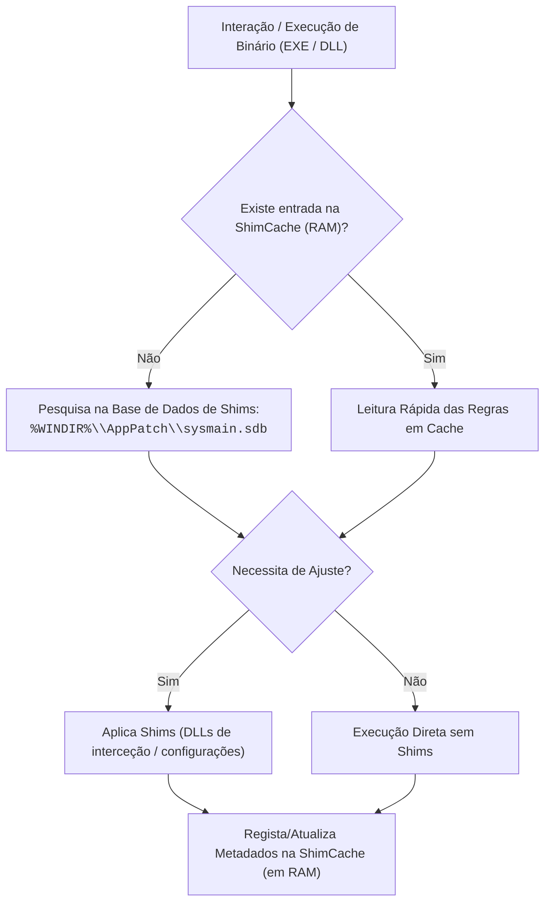
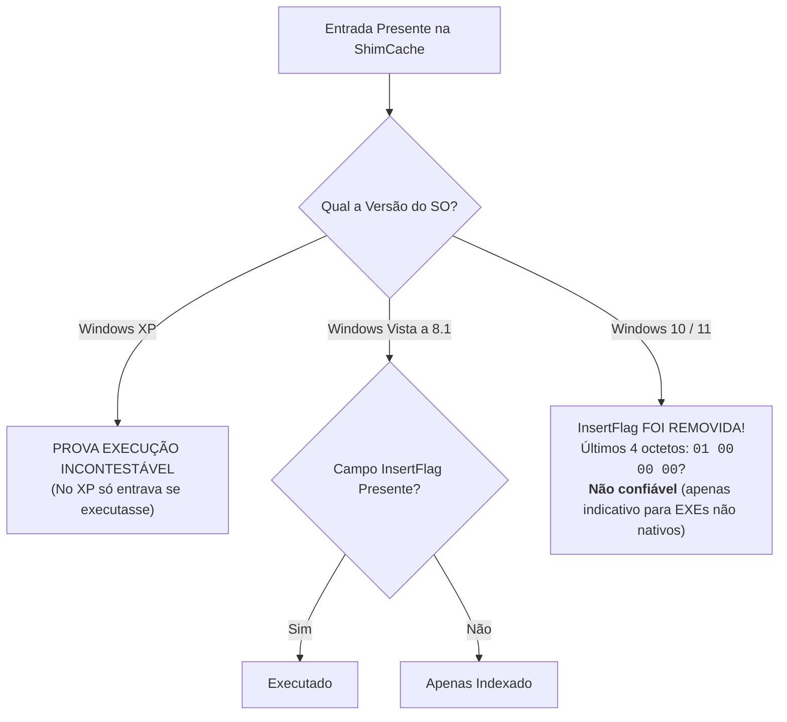

# Application Compatibility e ShimCache (AppCompatCache)

A **Application Compatibility Cache (`ShimCache` / `AppCompatCache`)** é uma estrutura circular mantida em RAM pelo kernel e descarregada no hive `SYSTEM` ao encerrar, que regista metadados de executáveis avaliados quanto à necessidade de *Shims*.

> [!NOTE] Guia de Leitura do Bloco 11
> Para compreender primeiro o panorama integrado das 5 camadas de compatibilidade do Windows (`WOW64` $\to$ `Shims` $\to$ `ShimCache` $\to$ `PCA` $\to$ `AmCache`) e como se articulam entre si, recomenda-se começar por [[Mecanismos de Compatibilidade no Windows (WOW64, Shims, PCA, ShimCache e AmCache)]].

> [!TIP] Lógica de Funcionamento e Valor Forense
> - **Porque existe (Sistema)**: Sempre que o Windows lida com um executável, precisa de saber se esse programa é antigo e requer "calços" de código (*Shims* listados em `%WINDIR%\AppPatch\sysmain.sdb`) para corrigir chamadas à API. Para não pesquisar no ficheiro `sysmain.sdb` em disco a cada segundo, o kernel guarda os últimos ficheiros avaliados numa **cache rápida em memória RAM (`ShimCache`)**, que só é gravada no Registry (`SYSTEM`) quando o computador desliga (*shutdown*).
> - **Porque importa (Forense)**: A `ShimCache` preserva o **caminho completo** (`Path`) e a **data de última modificação** (`LastModifiedTimeUTC`) de até **1024 binários**, incluindo ficheiros que residiram em **pens USB** ou **partilhas de rede UNC** (`\\servidor\partilha\app.exe`), mesmo após terem sido apagados.
> - **Pontos Críticos e Armadilhas para Exame**:
>   1. **Persistência Diferida (RAM $\to$ Shutdown)**: A `ShimCache` vive em RAM durante a sessão; se a máquina sofrer um corte de energia (*power-off* abrupto), as ações da sessão atual **não ficam gravadas no disco**.
>   2. **Evolução Histórica e a Armadilha da `InsertFlag`**: No **XP** (96 entradas) provava execução; no **Vista a 8.1** (512 no Server 2003; 1024 no W7+) existia a `InsertFlag`; no **Windows 10 e 11** a `InsertFlag` **foi removida**, pelo que a `ShimCache` **prova apenas EXISTÊNCIA, NÃO execução** (a coluna `Executed` do `AppCompatCacheParser` não é fiável em W10/11!).
>   3. **Significado do Timestamp**: O timestamp guardado na `ShimCache` é o **`LastModifiedTimeUTC` (`$STANDARD_INFORMATION`) do ficheiro no disco**, e **não** a data em que o programa correu ou entrou na cache.

---

## 1. Tabela Comparativa da ShimCache por Versão do Windows

As diferenças históricas da `ShimCache` entre o Windows XP e o Windows 11 são um tema clássico de avaliação:

| Parâmetro Técnico | Windows XP | Windows Server 2003 | Windows Vista / 7 / 8 / 8.1 | Windows 10 e Windows 11 |
| :--- | :--- | :--- | :--- | :--- |
| **Capacidade Máxima (Buffer Circular FIFO)** | **96 entradas** | **512 entradas** | **512** (Vista/2008) / **1024 entradas** (W7, W8, W8.1) | **1024 entradas** |
| **Subchave no Hive `SYSTEM`** | `...\Session Manager\AppCompatibility\AppCompatCache` | `...\Session Manager\AppCompatCache` | `...\Session Manager\AppCompatCache` | `...\Session Manager\AppCompatCache` |
| **Prova Execução ou Apenas Existência?** | **Prova Execução Incontestável** (só entrava ao ser executado) | Existência + Flag de execução | Existência + **`InsertFlag`** (*Process Execution Flag*) | **Apenas Prova de Existência!** (`InsertFlag` foi **removida**) |
| **Indicador Binário de Execução** | Presença na própria cache | Bit em `InsertFlags` | Bit em `InsertFlags` | Últimos 4 octetos `01 00 00 00` (apenas indicativo para EXEs não nativos; **não confiável**) |
| **Momento de Escrita no Registry** | No *Shutdown* / *Reboot* | No *Shutdown* / *Reboot* | No *Shutdown* / *Reboot* | No *Shutdown* / *Reboot* |

---

## 2. Funcionamento dos Shims (`sysmain.sdb`) e Serviço `PcaSvc`

Para garantir que software desenhado para versões legadas continua a correr nas versões modernas do Windows sem ser recompilado, o sistema recorre a **Shims** (literalmente "calços" ou "cunhas"): bibliotecas de interceção que redirecionam chamadas de API e simulam comportamentos de versões antigas do SO perante a aplicação.



* **Base de Dados Nativa de Shims**: Localizada em `%WINDIR%\AppPatch\sysmain.sdb` (acompanhada por ficheiros auxiliares como `pcamain.sdb` e `AcRes.dll`).
* **Serviço Responsável (Windows 10 e 11)**:
  * **`Program Compatibility Assistant Service (PcaSvc)`**: Serviço partilhado em `svchost.exe` encarregue de monitorizar incompatibilidades e aplicar ajustes dinâmicos durante a instalação e execução de software.

> [!WARNING] Abuso Ofensivo de Shims para Persistência (`sdbinst.exe`)
> A arquitetura de compatibilidade pode ser abusada por atacantes (*Application Shimming* — MITRE ATT&CK T1546.011). Ao instalar uma base de dados `.sdb` maliciosa customizada através do utilitário nativo **`sdbinst.exe`**, um atacante consegue intercetar chamadas de um binário legítimo do Windows para injetar DLLs maliciosas, desativar controlos de segurança ou obter persistência no arranque sem tocar no ficheiro executável original (documentado em `sdb.tools`).

---

## 3. Ciclo de Vida da ShimCache: RAM vs. Registry (`SYSTEM`)

Uma característica decisiva para o perito de DFIR é que a `ShimCache` opera com **persistência diferida**:

1. **Durante a Execução do Sistema (Live)**:
   * Os dados da `ShimCache` são mantidos e atualizados **exclusivamente na memória RAM (Kernel Space)**.
   * Não são gravados em tempo real no disco.
2. **Durante o Encerramento (*Shutdown* / *Reboot*)**:
   * O subsistema efetua o *flush* do buffer da memória RAM e grava-o como um bloco binário único no *hive* `SYSTEM`.

### Localização Exata no Registry

**Windows XP:**

```text
HKLM\SYSTEM\CurrentControlSet\Control\Session Manager\AppCompatibility\AppCompatCache
```

**Windows 7, 8, 10 e 11:**

```text
HKLM\SYSTEM\CurrentControlSet\Control\Session Manager\AppCompatCache
```

### Valores Binários Armazenados na Chave

* **`AppCompatCache`** (`REG_BINARY`): O bloco de dados brutos (*blob* binário) que contém a lista circular de até 1024 ficheiros em cache.
* **`CacheMainSdb`** (`REG_BINARY`): Metadados da base de dados principal de shims.
* **`SdbTime`** (`REG_BINARY`): Carimbo temporal da base de dados SDB.

### Consulta e Exportação Nativa via Linha de Comandos (`reg`)

```cmd
REM 1. Consultar os valores binários da chave via terminal
reg query "HKLM\SYSTEM\CurrentControlSet\Control\Session Manager\AppCompatCache"

REM 2. Exportar a estrutura da chave em formato texto de Registry (Windows Registry Editor Version 5.00)
reg export "HKLM\SYSTEM\CurrentControlSet\Control\Session Manager\AppCompatCache" C:\Windows\Temp\shim.txt
```

---

## 4. Gestão Circular (FIFO), Âmbito e a Armadilha da `InsertFlag`

A `ShimCache` é gerida como uma **lista circular (*ring buffer*)**:

* Quando a capacidade máxima de **1024 entradas** é atingida, cada nova entrada adicionada no topo (`CacheEntryPosition = 0`) empurra as restantes e **elimina a entrada mais antiga** (política FIFO).
* **Âmbito alargado**: Além da partição local (`C:\`), regista executáveis presentes em **unidades amovíveis USB** e em **partilhas de rede via caminhos UNC** (`\\servidor\partilha\app.exe`).

### A Evolução do "Marcador de Execução" (Porque não prova execução no W10/11)



1. **Windows XP**: Um ficheiro só era inserido na cache no momento do lançamento. Estar na `ShimCache` do XP equivalia a certeza absoluta de execução.
2. **Windows Vista até ao Windows 8.1**: A cache passou a indexar ficheiros mesmo quando o utilizador apenas abria uma pasta no Windows Explorer. Para distinguir o que correu do que foi apenas visto, existia a flag **`InsertFlag`** (*Process Execution Flag*).
3. **Windows 10 e Windows 11**:
   * A Microsoft **removeu por completo a `InsertFlag`**.
   * Embora os últimos quatro octetos da entrada (`01 00 00 00`) possam surgir quando um executável **não nativo** do Windows é lançado, **não oferecem garantia pericial formal**.

> [!CAUTION] Regra de Ouro para Exame: A ShimCache NÃO Prova Execução no Windows 10/11!
> Nos sistemas operativos modernos, **uma entrada na ShimCache prova unicamente a EXISTÊNCIA e presença do executável no sistema**, mas **NÃO prova que o ficheiro tenha sido efetivamente corrido**. O ficheiro pode ter entrado na cache apenas por ter sido copiado, extraído de um ZIP ou listado num diretório no Explorer.

---

## 5. Ferramenta de Análise: `AppCompatCacheParser` (Eric Zimmerman)

O utilitário **`AppCompatCacheParser.exe`** de Eric Zimmerman é a ferramenta padrão para extrair e descodificar o valor binário `AppCompatCache` do hive `SYSTEM` (quer num sistema *live* com privilégios de Administrador, quer apontando para um hive `SYSTEM` extraído *offline* com `-f`).

### Sintaxe e Anatomia do Comando

```cmd
REM Analisar o hive SYSTEM do sistema ativo (ou usar -f <caminho_SYSTEM> offline) e exportar para CSV
AppCompatCacheParser.exe --csv C:\Temp\Relatorio_Shim
```

### Anatomia das Colunas do Relatório CSV Gerado

| Coluna CSV | Significado Técnico e Cuidado Forense |
| :--- | :--- |
| **`ControlSet`** | O ControlSet do hive `SYSTEM` de onde o registo foi extraído (ex.: `ControlSet001`). |
| **`CacheEntryPosition`** | Posição ordinal na lista circular (`0` a `1023`), onde `0` é o registo inserido mais recentemente antes do *shutdown*. |
| **`Path`** | Caminho completo do ficheiro executável (local, USB ou rede UNC). |
| **`LastModifiedTimeUTC`** | Data/hora UTC da **última modificação do ficheiro no sistema de ficheiros NTFS** (**Atenção**: NÃO é a data de execução nem a data de entrada na cache!). |
| **`Executed`** | Coluna booleana (`True`/`False`) calculada heurísticamente pelo parser a partir dos últimos 4 bytes (`01 00 00 00`). |

> [!IMPORTANT] A Falácia da Coluna `Executed` no `AppCompatCacheParser`
> Conforme sublinhado nas aulas do Prof. Patrício Domingues, o valor `True` na coluna **`Executed`** do relatório do `AppCompatCacheParser` **NÃO é confiável em Windows 10 e 11** para sustentar pericialmente que um programa correu. Deve ser sempre validado por correlação cruzada com [[Serviço Prefetch e SysMain - Arquitetura e Funcionamento|Prefetch]] e [[Artefacto Forense UserAssist|UserAssist]].

---

## Perguntas de revisão

1. **Compare o número máximo de entradas e a chave do Registry da `ShimCache` no Windows XP, no Windows Server 2003 e no Windows 10/11.**

> [!success]- Ver Resposta
> * **Capacidade máxima**: **96 entradas** no Windows XP; **512 entradas** no Windows Server 2003; **1024 entradas** no Windows 7, 8, 10 e 11.
> * **Chave do Registry**: No Windows XP residia em `HKLM\SYSTEM\CurrentControlSet\Control\Session Manager\AppCompatibility\AppCompatCache`; a partir do Server 2003 e até ao Windows 11 reside em `HKLM\SYSTEM\CurrentControlSet\Control\Session Manager\AppCompatCache`.

2. **Porque é que a coluna `Executed = True` gerada pelo `AppCompatCacheParser` não pode ser usada isoladamente em tribunal para provar a execução de um programa no Windows 10 ou 11?**

> [!success]- Ver Resposta
> Porque no Windows 10 e 11 a Microsoft removeu a `InsertFlag` (*Process Execution Flag*) que existia do Vista ao Windows 8.1. A ferramenta baseia a coluna `Executed` nos últimos 4 octetos (`01 00 00 00`), que são apenas um indicador não fiável para executáveis não nativos. Logo, no Windows 10/11 a ShimCache prova apenas a **existência/presença** do ficheiro, exigindo correlação com `Prefetch` ou `UserAssist` para provar execução.

3. **O que representa exatamente o carimbo temporal `LastModifiedTimeUTC` presente numa entrada da `ShimCache`?**

> [!success]- Ver Resposta
> Representa a data e hora da **última modificação do ficheiro no disco** (atributo `$STANDARD_INFORMATION` do NTFS), e **não** o momento em que o ficheiro foi executado ou adicionado à `ShimCache`.

4. **Por que razão um analista que faça a aquisição de imagem de disco de uma máquina que foi desligada puxando o cabo da tomada não encontrará na `ShimCache` os binários usados pelo atacante nos últimos 30 minutos antes do corte de energia?**

> [!success]- Ver Resposta
> Porque durante o funcionamento do sistema (*live*), a `ShimCache` é mantida e atualizada exclusivamente na **memória RAM do kernel**, só sendo descarregada (*flushed*) para o hive `SYSTEM` em disco durante um encerramento (*shutdown*) ou reinício gracioso do sistema operativo.

---

## Navegação e Notas Relacionadas

| Percurso | Nota | Contexto |
| :--- | :--- | :--- |
| **Anterior** | [[Mecanismos de Compatibilidade no Windows (WOW64, Shims, PCA, ShimCache e AmCache)]] | `mesmo bloco` |
| **Seguinte** | [[AmCache - Arquitetura, Hives e Evolução para SQLite]] | `mesmo bloco` |
| **Índice** | [[Capítulo 1 - Sistemas Operativos, Serviços e Artefactos Forenses]] · [[00 ASSI]] | `Bloco 11` |

### Conceitos Relacionados

* [[Extração da AmCache e Comparação Forense com a ShimCache]] · `mesmo bloco`
* [[Taxonomia dos Artefactos de Execução no Windows]] · `Bloco 10`
* [[Investigação Forense Digital - Análise Live vs Post-Mortem]] · `AFD1 · Cap. 1`
* [[Pesquisa de Evidências e Reconstrução de Eventos]] · `AFD1 · Cap. 1`
* [[Diretrizes de Manuseamento - Identificação, Preservação, Isolamento e Correlação]] · `AFD1 · Cap. 1`
