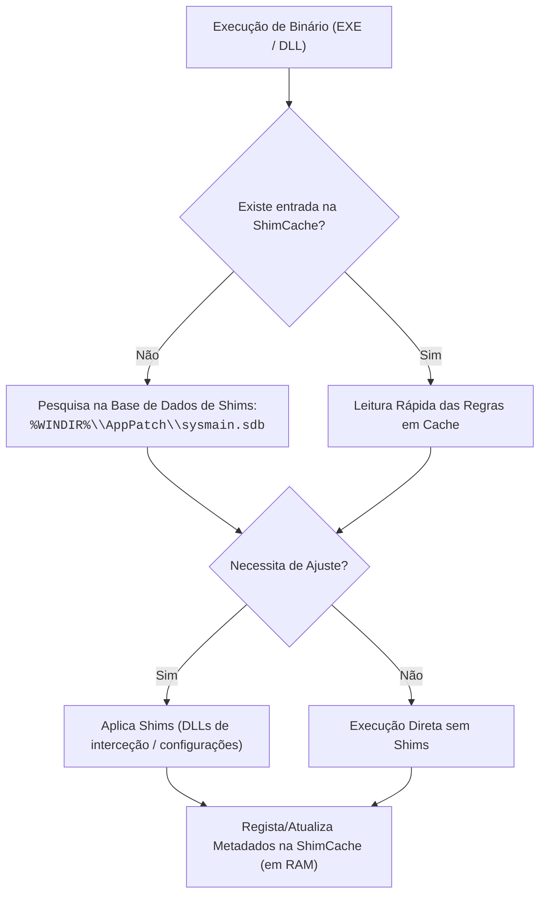
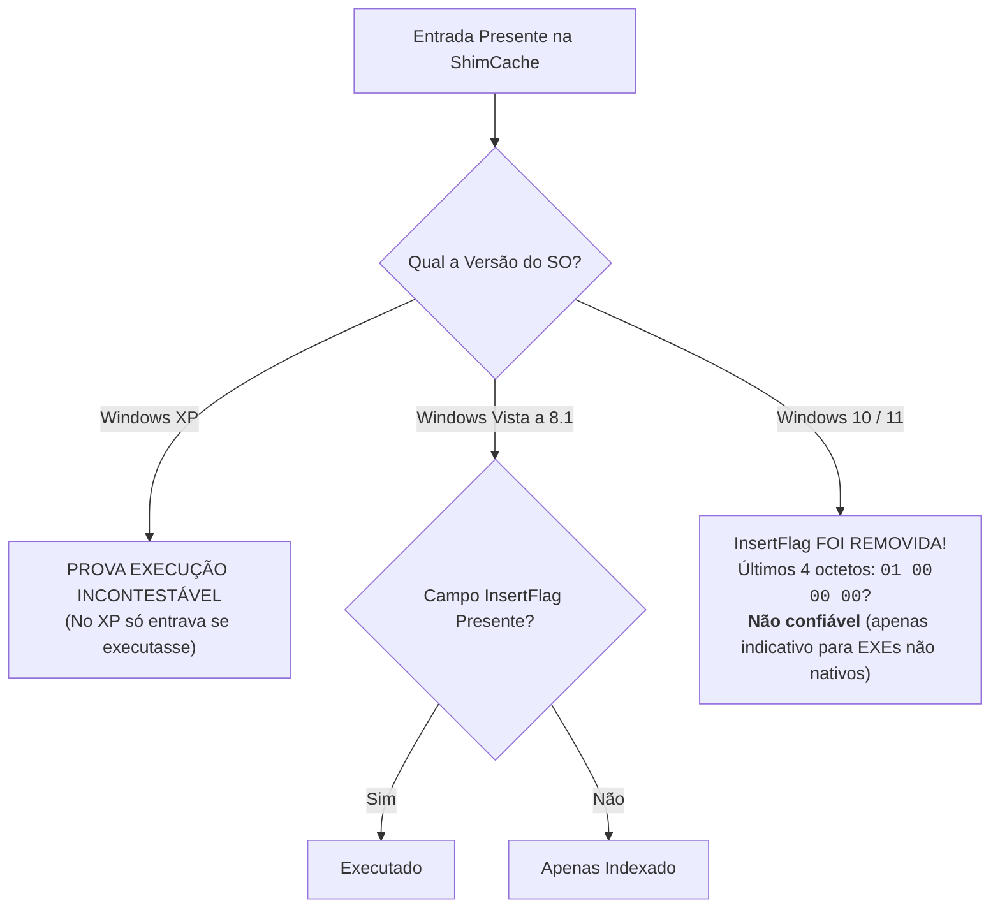

# Application Compatibility e ShimCache (AppCompatCache)

A infraestrutura de compatibilidade de aplicações (**Application Compatibility Infrastructure**) foi introduzida no Windows XP com o objetivo de assegurar que software desenvolvido para versões legadas do sistema operativo continue a ser executado sem falhas nas versões modernas do Windows.

Para alcançar este objetivo de forma transparente, o Windows recorre a **Shims** (literalmente "calços" ou "cunhas"): pequenos blocos de código e bibliotecas de interceção de APIs que simulam comportamentos de sistemas operativos antigos perante a aplicação. 

Como subproduto desta infraestrutura, o sistema mantém uma cache de desempenho designada por **Application Compatibility Cache (ShimCache)**, que regista metadados detalhados de executáveis e bibliotecas DLL.

---

## 1. Funcionamento dos Shims e Serviço `PcaSvc`

Quando um utilizador ou serviço executa um ficheiro executável (`.exe`), o subsistema do Windows interceta o carregamento e pesquisa a base de dados de compatibilidade da Microsoft:



* **Base de Dados Nativa de Shims**: Localizada em `%WINDIR%\AppPatch\sysmain.sdb` (e ficheiros auxiliares como `pcamain.sdb` e `AcRes.dll`).
* **Serviço Responsável (Windows 10 e 11)**:
  * **`Program Compatibility Assistant Service (PcaSvc)`**: Serviço partilhado em `svchost.exe` encarregue de monitorizar incompatibilidades e aplicar ajustes dinâmicos durante a instalação e execução de software.

> [!WARNING] Abuso de Shims para Persistência e Evasão
> A arquitetura de compatibilidade pode ser abusada por atacantes. Através da instalação de bases de dados de shims maliciosas customizadas (utilizando utilitários como `sdbinst.exe`), um atacante consegue intercetar chamadas a funções de sistema para injetar código, desativar mecanismos de segurança ou obter persistência no arranque sem alterar o binário legítimo do alvo (conforme documentado na plataforma pericial `sdb.tools`).

---

## 2. Ciclo de Vida da ShimCache: Retenção em Memória e Escrita no Registry

Uma característica fundamental para os peritos de DFIR reside no facto de a ShimCache operar com um mecanismo de persistência diferida:

1. **Durante a Execução do Sistema (Live)**:
   * Os dados da ShimCache são mantidos e atualizados **exclusivamente na memória RAM (Kernel Space)**.
   * Não são gravados em tempo real no disco.
2. **Durante o Encerramento (*Shutdown*)**:
   * O subsistema efetua o *flush* dos dados da memória e grava-os no Registry de sistema, no *hive* `SYSTEM`.

### Localização no Registry

* **Windows XP**:
  `HKLM\CurrentControlSet\Control\Session Manager\AppCompatibility\AppCompatCache`
* **Windows 7, 8, 10 e 11**:
  $$\texttt{HKLM\textbackslash SYSTEM\textbackslash CurrentControlSet\textbackslash Control\textbackslash Session Manager\textbackslash AppCompatCache}$$

### Valores Binários Armazenados
* **`AppCompatCache`** (`REG_BINARY`): O bloco de dados brutos que contém os registos de ficheiros em cache.
* **`CacheMainSdb`** (`REG_BINARY`): Metadados da base de dados principal de shims.
* **`SdbTime`** (`REG_BINARY`): Carimbo temporal da base de dados SDB.

### Consulta e Exportação via Linha de Comandos
```cmd
REM Consultar a chave via terminal
reg query "HKLM\SYSTEM\CurrentControlSet\Control\Session Manager\AppCompatCache"

REM Exportar a estrutura em formato texto de Registry (regedit 5.00)
reg export "HKLM\SYSTEM\CurrentControlSet\Control\Session Manager\AppCompatCache" C:\Windows\Temp\shim.txt
```

---

## 3. Gestão Circular da Cache e Âmbito de Monitorização

A ShimCache é gerida como uma **lista circular (buffer circular)**:
* Quando a capacidade máxima de $N$ entradas é atingida, as novas adições **eliminam as entradas mais antigas** (política FIFO).

### Capacidades Máximas por Versão do SO
* **Windows XP**: Máximo de **96 entradas**.
* **Windows Server 2003**: Máximo de **512 entradas**.
* **Windows Moderno (> XP — Windows 7, 8, 10 e 11)**: Máximo de **1024 entradas**.

### Âmbito de Monitorização
A ShimCache não monitoriza unicamente os ficheiros presentes na partição do sistema operativo (`C:\`). Indexa igualmente:
* Executáveis e instaladores executados a partir de **unidades amovíveis USB**;
* Ficheiros acedidos em **partilhas de rede via caminhos UNC** (`\\servidor\partilha\app.exe`).

---

## 4. O "Marcador de Execução": Evolução e a Armadilha no Windows 10/11

Um dos pontos de maior discussão e confusão em exames periciais é a interpretação de que uma entrada na ShimCache comprova execução:



### 1. Windows XP
No Windows XP, um ficheiro só era inserido na cache aquando do seu lançamento. **Estar na ShimCache equivalia a certeza absoluta de execução**.

### 2. Windows Vista até ao Windows 8.1
Foi introduzida a chamada **`InsertFlag`** (*Process Execution Flag*). Se a flag estivesse ativa, o binário tinha sido executado; caso contrário, tinha sido apenas enumerado pelo sistema de compatibilidade.

### 3. Windows 10 e Windows 11
* A Microsoft **removeu por completo a `InsertFlag`**.
* Os últimos quatro octetos da entrada (`01 00 00 00`) podem constituir um indicador de que um executável **não nativo** do Windows foi lançado, mas **não oferecem qualquer garantia formal**.

> [!CAUTION] Regra Pericial: A ShimCache NÃO Prova Execução no Windows Moderno!
> Nos sistemas operativos modernos, **uma entrada na ShimCache prova unicamente a EXISTÊNCIA e presença do executável no sistema**, mas **NÃO prova que o ficheiro tenha sido efetivamente corrido**. 
> O ficheiro pode ter sido adicionado à cache por processos de instalação, indexação ou navegação em diretórios.

---

## 5. Ferramenta de Análise: `AppCompatCacheParser` (Eric Zimmerman)

O utilitário **`AppCompatCacheParser`** de Eric Zimmerman é a ferramenta padrão para extrair e descodificar a chave binária do hive `SYSTEM` (seja em sistemas *live* com elevação, seja a partir de imagens de disco *offline*).

### Sintaxe de Execução
```cmd
AppCompatCacheParser.exe --csv C:\Temp\Relatorio_Shim
```

O comando exporta um ficheiro CSV estruturado com as seguintes colunas essenciais:
* **`ControlSet`**: O número do ControlSet do Registry auditado (ex.: `ControlSet001`).
* **`CacheEntryPosition`**: A posição ordinal do registo na lista circular (0 a 1023).
* **`Path`**: O caminho completo do executável no sistema de ficheiros.
* **`LastModifiedTimeUTC`**: A data/hora da **última modificação do ficheiro no disco** (atenção: **não é a data em que o ficheiro foi inserido na cache**).
* **`Executed`**: Coluna booleana gerada pela ferramenta.

> [!IMPORTANT] A Falácia da Coluna `Executed`
> Conforme advertido expressamente nas aulas do Prof. Patrício Domingues, o campo **`Executed`** do relatório do `AppCompatCacheParser` **NÃO é confiável** em Windows 10/11 para concluir com rigor judicial se o executável foi ou não corrido. Deve ser sempre correlacionado com [[Serviço Prefetch e SysMain - Arquitetura e Funcionamento|Prefetch]] e [[Artefacto Forense UserAssist|UserAssist]].

---

## Navegação

- [[Capítulo 1 - Sistemas Operativos, Serviços e Artefactos Forenses|Voltar ao Índice do Capítulo 1]]
- [[Taxonomia dos Artefactos de Execução no Windows]]
- [[AmCache - Arquitetura, Hives e Evolução para SQLite]]
- [[Extração da AmCache e Comparação Forense com a ShimCache]]
