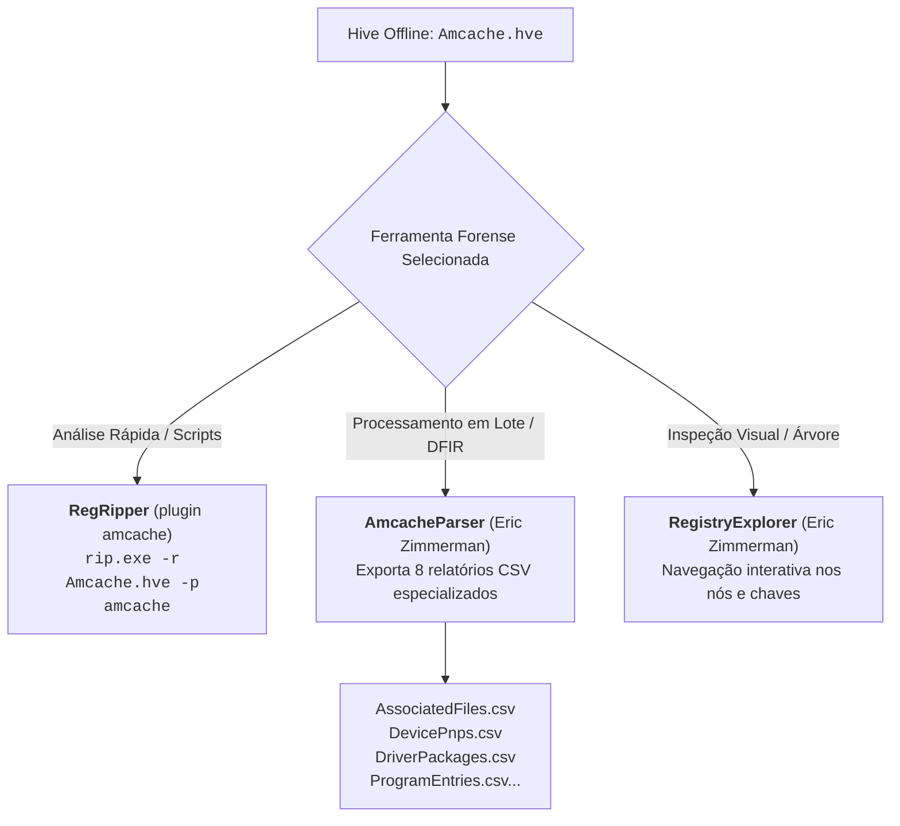
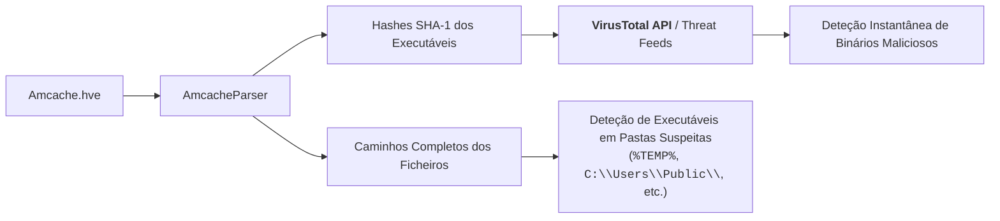

# Extração da AmCache e Comparação Forense com a ShimCache

A exploração pericial do [[AmCache - Arquitetura, Hives e Evolução para SQLite|AmCache]] e da [[Application Compatibility e ShimCache (AppCompatCache)|ShimCache]] constitui a espinha dorsal da análise de presença de programas no sistema operativo Windows.

No entanto, o manuseamento destes artefactos coloca desafios práticos de aquisição em sistemas ativos e exige uma compreensão estrita dos seus limites probatórios para evitar conclusões periciais erróneas em tribunal ou relatórios de incidentes.

---

## 1. O Desafio da Cópia do Ficheiro Bloqueado (*File in Use*)

Em sistemas ativos (*live*), o ficheiro `C:\Windows\AppCompat\Programs\Amcache.hve` encontra-se permanentemente aberto pelo *kernel* e pelos serviços de telemetria com bloqueio de leitura exclusiva. 
* Qualquer tentativa de cópia direta via Explorador de Ficheiros ou comandos convencionais (`copy`, `xcopy`) resulta na mensagem de erro: **"O ficheiro já está a ser utilizado por outro processo"**.

### Soluções de Aquisição Forense
1. **Recurso ao [[Volume Shadow Service (VSS) - Arquitetura e Funcionamento|VSS (Volume Shadow Service)]]**:
   * Criação de um *snapshot* do volume com `vssadmin` ou PowerShell e extração da versão congelada através de um atalho simbólico (`mklink /d`) ou via [[Acesso Forense e Montagem de Shadow Copies|VSCMount]].
2. **Leitura Direta a Baixo Nível (Raw Disk Access)**:
   * Utilização de ferramentas forenses especializadas (como FTK Imager, KAPE ou CyLR) que interagem diretamente com o sistema de ficheiros NTFS ignorando as travas da API do Win32.

---

## 2. Ferramentas de Extração e Parsing do `Amcache.hve`

Uma vez adquirido o ficheiro de *hive*, o analista dispõe de três abordagens principais:



### 1. RegRipper (Plugin `amcache`)
Permite extrair de forma imediata o histórico de executáveis registados:
```cmd
rip.exe -r C:\Forensics\Amcache.hve -p amcache
```
*Gera um relatório de texto com o caminho, carimbos temporais de última escrita (*LastWrite*), tamanho e o respetivo hash SHA-1.*

### 2. AmcacheParser (Eric Zimmerman)
O utilitário padrão para processamento em larga escala. Converte as estruturas binárias do *hive* num ecossistema de múltiplos ficheiros CSV:
```cmd
AmcacheParser.exe -i --csv C:\Forensics\Amcache_Export -f "C:\Forensics\Amcache.hve"
```

O comando produz ficheiros especializados para cada categoria de dados presente no sistema:
* **`..._Amcache_AssociatedFileEntries.csv`**: Ficheiros executáveis associados a programas e pacotes conhecidos.
* **`..._Amcache_UnassociatedFileEntries.csv`**: Ficheiros executáveis e DLLs autónomas (não associadas a instaladores padrão), frequentemente onde reside software malicioso ou ferramentas de ataque portáteis (*portable tools*).
* **`..._Amcache_ProgramEntries.csv`**: Metadados de programas instalados (nome, versão, editor, data de instalação).
* **`..._Amcache_DeviceContainers.csv`**: Dispositivos periféricos ligados à máquina (impressoras, adaptadores Bluetooth).
* **`..._Amcache_DevicePnps.csv`**: Dispositivos *Plug and Play* (ex.: `DiskDrive` para unidades de armazenamento USB; `NetClass` para interfaces de rede).
* **`..._Amcache_DriveBinaries.csv` & `DriverPackages.csv`**: Binários e pacotes de controladores (*drivers*) de baixo nível presentes no sistema operativo.
* **`..._Amcache_ShortCuts.csv`**: Ficheiros de atalho (.lnk) detetados pelo subsistema.

### 3. RegistryExplorer (Eric Zimmerman)
O `RegistryExplorer` permite carregar o ficheiro `Amcache.hve` como qualquer outro hive do Windows, disponibilizando pesquisa textual, decodificação transparente de metadados e marcadores (*bookmarks*) específicos para o AmCache sem necessidade de passos intermédios.

---

## 3. Threat Intelligence e Triagem com VirusTotal

A presença do **hash SHA-1** em cada entrada do AmCache confere-lhe uma utilidade estratégica na resposta a incidentes:



1. **Correlação Automatizada com VirusTotal**: Os hashes SHA-1 extraídos podem ser validados contra bases de dados globais de reputação, identificando binários maliciosos sem necessidade de recuperar o executável original do disco.
2. **Identificação de Pastas Suspeitas**: O caminho absoluto permite detetar executáveis a correr fora dos diretórios normais de sistema (ex.: pastas temporárias de utilizador, perfis partilhados ou pens USB).

---

## 4. Confronto Pericial: Amcache vs. ShimCache

A tabela seguinte sumariza as divergências técnicas e operacionais entre os dois pilares da infraestrutura de compatibilidade:

| Propriedade / Característica | AmCache (`Amcache.hve`) | ShimCache (`AppCompatCache`) |
| :--- | :--- | :--- |
| **Âmbito do Registo** | Registo da existência de executáveis, aplicações instaladas, pacotes de drivers e dispositivos PnP. | Registo de atributos de ficheiros executáveis e DLLs intercetadas pelo subsistema de compatibilidade. |
| **Formato e Localização** | *Hive* independente em `%WINDIR%\AppCompat\Programs\Amcache.hve` (ou SQLite no W11 recente). | Armazenado na memória RAM durante a sessão e descarregado para `HKLM\SYSTEM\...\AppCompatCache` no *shutdown*. |
| **Hashes Criptográficos** | **Sim (Hash SHA-1 de cada executável)**. | **Não** (apenas PE Checksum em certas versões). |
| **Marcadores Temporais** | Data de compilação PE, data de criação do ficheiro e data de registo pelo sistema. | Data de **última modificação do ficheiro** no sistema de ficheiros (não regista quando entrou na cache). |
| **Capacidade e Gestão** | Sem limite fixo de 1024 entradas; gerido por tarefas agendadas a cada 24 horas. | Buffer circular estrito com máximo de **1024 entradas** no Windows moderno. |
| **Presença de Argumentos CLI** | Não armazena argumentos de linha de comandos. | Não armazena argumentos de linha de comandos. |

---

## 5. A Regra de Ouro Probatória de DFIR

> [!CAUTION] Princípio Pericial Inviolável
> **Nem a AmCache, nem a ShimCache devem ser empregues como prova de que um determinado ficheiro executável foi efetivamente EXECUTADO no sistema em análise.**
> 
> * **O que provam**: Ambas as fontes provam de forma inequívoca que o ficheiro **existiu e esteve presente** no disco rígido local, numa partilha de rede UNC ou num dispositivo USB ligado ao computador.
> * **O que NÃO provam**: Nenhuma das duas garante que o processo correu em memória e CPU. Um executável pode surgir na AmCache e na ShimCache simplesmente por ter sido copiado para o disco, descompactado por um instalador ou inspecionado pelo Windows Defender.
> * **Como provar execução**: A comprovação definitiva de execução exige a correlação cruzada com artefactos dedicados: [[Serviço Prefetch e SysMain - Arquitetura e Funcionamento|Prefetch (.pf)]], [[Artefacto Forense UserAssist|UserAssist (ROT13)]], [[System Resource Usage Monitor (SRUM) - Arquitetura e Base ESE|SRUM]] ou registos de criação de processos nos Event Logs (**Event ID 4688** / **Sysmon Event ID 1**).

---

## 6. Enquadramento Laboratorial e Bibliografia

### Ficha Laboratorial
Os procedimentos práticos de extração com `AmcacheParser`, `AppCompatCacheParser`, correlação com o VirusTotal e análise de ficheiros CSV constituem o núcleo da **Ficha 05 – ShimCache e AmCache**.

### Referências Académicas
* **Batur, A. (2025)**. *Evidence of Program Existence: Amcache and Shimcache*. [Medium / DFIR Review](https://alpbatursahin.medium.com/evidence-of-program-existence-amcache-and-shimcache-502af4d26d61).
* **WithSecure Labs**. *Unleashing the Power of Shimcache with Chainsaw*. [WithSecure Labs](https://labs.withsecure.com/tools/chainsaw-analyse-shimcache).

---

## Navegação

- [[Capítulo 1 - Sistemas Operativos, Serviços e Artefactos Forenses|Voltar ao Índice do Capítulo 1]]
- [[Application Compatibility e ShimCache (AppCompatCache)]]
- [[AmCache - Arquitetura, Hives e Evolução para SQLite]]
- [[Taxonomia dos Artefactos de Execução no Windows]]
- [[Serviço Prefetch e SysMain - Arquitetura e Funcionamento]]
