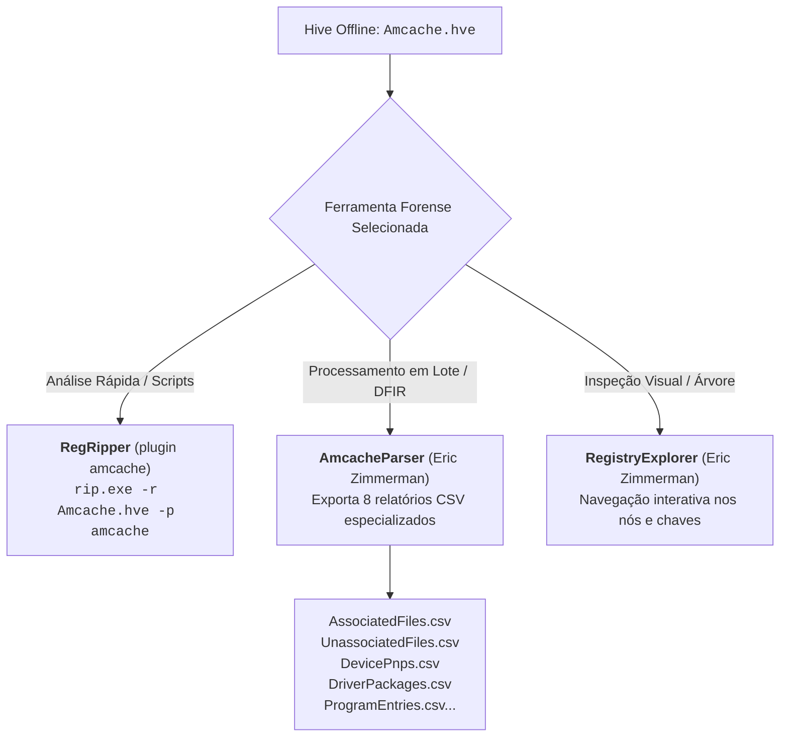
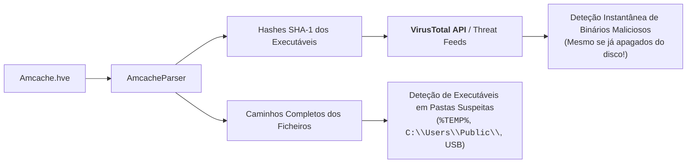

# Extração da AmCache e Comparação Forense com a ShimCache

A extração pericial do [[AmCache - Arquitetura, Hives e Evolução para SQLite|AmCache]] e o seu confronto com a [[Application Compatibility e ShimCache (AppCompatCache)|ShimCache]] permitem cruzar caminhos de ficheiros, dispositivos e **hashes SHA-1** para provar a presença de binários no sistema.

> [!TIP] Lógica de Funcionamento e Valor Forense
> - **Porque existe (Sistema)**: Num sistema Windows ativo (*live*), o ficheiro `C:\Windows\AppCompat\Programs\Amcache.hve` está permanentemente aberto e bloqueado em modo exclusivo pelo kernel e pelos serviços de telemetria, impedindo a cópia normal (`copy`/`xcopy`).
> - **Porque importa (Forense)**: Contornado o bloqueio via **VSS** ou **Raw Disk Access**, o perito usa o `AmcacheParser`, `RegRipper` ou `RegistryExplorer` para extrair 8 relatórios CSV distintos (ficheiros associados e não-associados, programas, drivers, dispositivos PnP e atalhos) e submeter os **hashes SHA-1** diretamente ao **VirusTotal**.
> - **Pontos Críticos e Armadilhas para Exame**:
>   1. **Onde se esconde o Malware Portátil (`UnassociatedFileEntries.csv`)**: O `AmcacheParser` separa os executáveis instalados por pacotes MSI (`AssociatedFileEntries.csv`) dos binários autónomos/portáteis (`UnassociatedFileEntries.csv`), sendo este último o local prioritário para caçar malware, *droppers* e ferramentas de intrusão corridas a partir de `%TEMP%` ou USB.
>   2. **Anatomia do `AmcacheParser.exe`**: `-f` indica o caminho do `Amcache.hve`; `--csv` define a pasta de saída; `-i` inclui entradas de ficheiros associados a programas instalados.
>   3. **Regra Probatória Inviolável**: Tal como a `ShimCache`, o `AmCache` **NÃO prova execução** (apenas **existência/presença** no sistema) e **não guarda argumentos de linha de comandos**.

---

## 1. O Desafio da Aquisição em Sistemas Ativos (*File in Use*)

Em sistemas ativos (*live*), o ficheiro `C:\Windows\AppCompat\Programs\Amcache.hve` encontra-se permanentemente aberto pelo *kernel* com bloqueio exclusivo. Qualquer tentativa de cópia direta via Windows Explorer ou comandos convencionais (`copy`, `xcopy`) falha com o erro: **"O ficheiro já está a ser utilizado por outro processo"**.

### Duas Soluções de Aquisição Forense Live

1. **Recurso ao [[Volume Shadow Service (VSS) - Arquitetura e Funcionamento|VSS (Volume Shadow Service)]]**:
   * Listar ou criar um *snapshot* do volume com `vssadmin` / PowerShell e extrair a versão congelada do `Amcache.hve` através de um atalho simbólico (`mklink /d ... \`) ou via [[Acesso Forense e Montagem de Shadow Copies|VSCMount]].
2. **Leitura Direta a Baixo Nível (*Raw Disk Access*)**:
   * Utilizar ferramentas forenses especializadas (**FTK Imager**, **KAPE** ou **CyLR**) que leem diretamente os clusters do sistema de ficheiros NTFS, contornando os bloqueios da API Win32.

---

## 2. Ferramentas de Extração e Parsing do `Amcache.hve`

Uma vez adquirido o ficheiro `Amcache.hve` (e idealmente os seus ficheiros transacionais `Amcache.hve.LOG1` e `.LOG2`), o analista dispõe de três ferramentas principais:



### 1. RegRipper (`rip.exe` com Plugin `amcache`)
Permite extrair de forma imediata para texto o histórico de executáveis registados:

```cmd
rip.exe -r C:\Forensics\Amcache.hve -p amcache
```

* **Anatomia**: **`-r`** especifica o ficheiro de hive (`Amcache.hve`) a analisar; **`-p amcache`** invoca o plugin Perl dedicado ao AmCache, listando caminho, carimbos temporais de última escrita (*LastWrite*), tamanho e hash **SHA-1**.

### 2. `AmcacheParser` (Eric Zimmerman)
É a ferramenta padrão da indústria para processamento em larga escala, convertendo as chaves internas do `Amcache.hve` em **8 relatórios CSV especializados**:

```cmd
AmcacheParser.exe -i --csv C:\Forensics\Amcache_Export -f "C:\Forensics\Amcache.hve"
```

* **Anatomia das Flags**:
  * **`-f "<caminho>"`**: Caminho para o ficheiro `Amcache.hve` a processar.
  * **`--csv <diretório>`**: Diretório onde serão gerados os ficheiros CSV.
  * **`-i`** (*Include Linked*): Inclui no output as entradas de ficheiros que pertencem a programas formalmente instalados (`AssociatedFileEntries`), além dos ficheiros avulsos.

#### Os 8 Ficheiros CSV Gerados pelo `AmcacheParser` e o seu Valor Pericial

| Ficheiro CSV Gerado (`..._Amcache_*.csv`) | Conteúdo e Relevância na Investigação Forense |
| :--- | :--- |
| **1. `UnassociatedFileEntries.csv`** | **Foco prioritário de caça a Malware**: Executáveis e DLLs autónomos (não instalados por pacotes MSI), onde surgem *droppers*, *ransomware* e ferramentas portáteis de ataque corridas de `%TEMP%`, `Downloads` ou USB (inclui **SHA-1**). |
| **2. `AssociatedFileEntries.csv`** | Ficheiros executáveis associados a programas e pacotes conhecidos instalados no sistema (inclui **SHA-1**). |
| **3. `ProgramEntries.csv`** | Metadados de programas instalados (nome, versão, editor/fabricante, data de instalação e desinstalação). |
| **4. `DeviceContainers.csv`** | Dispositivos periféricos ligados à máquina (impressoras, monitores, adaptadores Bluetooth). |
| **5. `DevicePnps.csv`** | Dispositivos *Plug and Play* (ex.: classe `DiskDrive` para **unidades de armazenamento USB**; `NetClass` para placas de rede). |
| **6. `DriveBinaries.csv`** | Binários de controladores (*drivers* `.sys`) de baixo nível carregados no sistema (útil para detetar *rootkits* / BYOVD). |
| **7. `DriverPackages.csv`** | Pacotes de instalação de controladores (`.inf`) presentes no sistema operativo. |
| **8. `ShortCuts.csv`** | Ficheiros de atalho (`.lnk`) inventariados pelo subsistema de compatibilidade. |

### 3. `RegistryExplorer` (Eric Zimmerman)
Permite abrir visualmente o `Amcache.hve` em árvore gráfica, aplicando *bookmarks* automáticos e descodificando as subchaves (`InventoryApplicationFile`, `InventoryDevicePnp`, etc.) sem necessidade de linha de comandos.

---

## 3. Threat Intelligence e Triagem com VirusTotal

A presença do **hash SHA-1** em cada entrada de ficheiro (`UnassociatedFileEntries` e `AssociatedFileEntries`) confere ao AmCache uma vantagem tática decisiva sobre a ShimCache:



1. **Correlação Automatizada com VirusTotal**: O perito extrai a coluna `SHA1` do CSV e consulta em lote a API do VirusTotal ou bases de IOCs, identificando exatamente qual a variante de malware mesmo quando o atacante apagou o ficheiro `.exe` original do disco.
2. **Caça por Anomalia de Caminho (*Path Hunting*)**: Filtrar a coluna de caminhos por diretórios atípicos (`\AppData\Local\Temp\`, `\Users\Public\`, `\PerfLogs\` ou letras de unidades externas `E:\`, `F:\`) revela rapidamente ferramentas de intrusão.

---

## 4. Confronto Pericial Lado a Lado: `AmCache` vs. `ShimCache`

A tabela seguinte sintetiza todas as diferenças técnicas e probatórias exigidas em exame entre os dois artefactos do Bloco 11:

| Propriedade / Critério Forense | AmCache (`Amcache.hve` / SQLite 3) | ShimCache (`AppCompatCache`) |
| :--- | :--- | :--- |
| **Objetivo no Sistema** | Inventário global de software, drivers e dispositivos para preparar *upgrades* do Windows. | Cache rápida em RAM para o *loader* saber se um binário requer *Shims* (`sysmain.sdb`). |
| **Formato e Localização** | Hive `REGF` independente em `%WINDIR%\AppCompat\Programs\Amcache.hve` (ou bases **SQLite 3** no W11 >25H2). | Mantido em **RAM** durante a sessão; gravado no hive `SYSTEM` (`...\Session Manager\AppCompatCache`) no ***shutdown***. |
| **Momento de Persistência em Disco** | Tarefas agendadas diárias (`Microsoft Compatibility Appraiser` / `ProgramDataUpdater`) e instalações. | **Apenas no encerramento (*shutdown*)** ou reinício limpo (vulnerável a *hard power-off*). |
| **Hashes Criptográficos** | **Sim — guarda o Hash SHA-1 (160 bits)** de cada executável. | **Não guarda qualquer hash criptográfico**. |
| **Marcadores Temporais** | Data de compilação PE (*LinkDate*), criação do ficheiro, modificação e data de registo no inventário. | Apenas **1 timestamp por entrada**: a data de **última modificação do ficheiro** no disco (`LastModifiedTimeUTC`). |
| **Capacidade e Retenção** | Cumulativo (milhares de entradas de ficheiros, programas, drivers e dispositivos PnP). | Buffer circular estrito de **1024 entradas** no Windows 7–11 (512 no Server 2003; 96 no XP) em política FIFO. |
| **Registo de Drivers e USB PnP** | **Sim** (`DriveBinaries`, `DriverPackages`, `DevicePnps`, `DeviceContainers`). | **Não** (apenas ficheiros executáveis/DLLs). |
| **Presença de Argumentos CLI** | **Não** armazena argumentos de linha de comandos. | **Não** armazena argumentos de linha de comandos. |
| **Valor Probatório no Windows 10/11** | **Prova de Existência / Presença** (NÃO prova execução). | **Prova de Existência / Presença** (NÃO prova execução; no XP provava execução). |

---

## 5. A Regra de Ouro Probatória de DFIR

> [!CAUTION] Princípio Pericial Inviolável: Existência $\neq$ Execução
> **Nem a AmCache, nem a ShimCache devem ser empregues isoladamente como prova de que um determinado ficheiro executável foi efetivamente EXECUTADO num sistema Windows 10 ou 11.**
> 
> * **O que provam**: Ambas provam de forma inequívoca que o ficheiro **existiu e esteve presente** no disco local, numa partilha de rede UNC ou num dispositivo USB ligado ao computador.
> * **O que NÃO provam**: Nenhuma das duas garante que o processo correu em memória e CPU (um executável pode surgir em ambas apenas por ter sido copiado, extraído de um arquivo ou varrido pelo antivírus).
> * **Como provar execução**: A comprovação definitiva de execução exige a correlação cruzada com artefactos de execução efetiva: [[Serviço Prefetch e SysMain - Arquitetura e Funcionamento|Prefetch (.pf)]], [[Artefacto Forense UserAssist|UserAssist (ROT13)]], [[System Resource Usage Monitor (SRUM) - Arquitetura e Base ESE|SRUM]] ou registos de criação de processos nos Event Logs (**Event ID 4688** / **Sysmon Event ID 1**).

---

## 6. Enquadramento Laboratorial e Bibliografia

### Ficha Laboratorial
Os procedimentos práticos de extração com `AmcacheParser`, `AppCompatCacheParser`, correlação de hashes SHA-1 com o VirusTotal e análise dos ficheiros CSV constituem o núcleo da **Ficha 05 – ShimCache e AmCache**.

### Referências Académicas e Técnicas

* **Batur, A. (2025)**. *Evidence of Program Existence: Amcache and Shimcache*. [Medium / DFIR Review](https://alpbatursahin.medium.com/evidence-of-program-existence-amcache-and-shimcache-502af4d26d61).
* **WithSecure Labs**. *Unleashing the Power of Shimcache with Chainsaw*. [WithSecure Labs](https://labs.withsecure.com/tools/chainsaw-analyse-shimcache).

---

## Perguntas de revisão

1. **Porque é que o comando `copy C:\Windows\AppCompat\Programs\Amcache.hve C:\Temp\` falha num sistema Windows em funcionamento (*live*) e quais são as duas formas forenses de contornar esse bloqueio?**

> [!success]- Ver Resposta
> Falha porque o ficheiro `Amcache.hve` está permanentemente aberto e bloqueado em modo exclusivo pelo kernel e pelos serviços de compatibilidade (*File in Use*). As duas formas de contornar o bloqueio são: 1) montar uma **Shadow Copy (VSS)** via `mklink /d` ou `VSCMount` e copiar o ficheiro congelado do snapshot; ou 2) usar uma ferramenta de **leitura direta a baixo nível (*Raw Disk Access*)** do NTFS, como o FTK Imager ou o KAPE.

2. **Ao executar o `AmcacheParser.exe`, qual dos 8 ficheiros CSV gerados é o mais importante para procurar ferramentas de ataque portáteis ou malware que não foi instalado por um instalador MSI?**

> [!success]- Ver Resposta
> É o ficheiro **`..._Amcache_UnassociatedFileEntries.csv`**, que agrupa todos os executáveis e binários autónomos (*standalone*) que não estão associados a pacotes de instalação formais, incluindo o respetivo caminho completo e o hash **SHA-1**.

3. **Como se utiliza o `RegRipper` na linha de comandos para extrair os dados de um ficheiro `Amcache.hve` recolhido?**

> [!success]- Ver Resposta
> Através do comando `rip.exe -r C:\Forensics\Amcache.hve -p amcache`, onde `-r` indica o ficheiro de hive a processar e `-p amcache` seleciona o plugin específico do AmCache.

4. **Indique quatro diferenças fundamentais entre o `AmCache` e a `ShimCache` num sistema Windows 10/11.**

> [!success]- Ver Resposta
> 1) **Hash Criptográfico**: O `AmCache` guarda o hash **SHA-1** de cada binário; a `ShimCache` não guarda qualquer hash.
> 2) **Residência e Persistência**: A `ShimCache` vive em **RAM** e só é gravada no hive `SYSTEM` no *shutdown*; o `AmCache` reside em **disco** (`Amcache.hve` ou SQLite 3) e é atualizado por tarefas agendadas.
> 3) **Capacidade**: A `ShimCache` está limitada a um buffer circular de **1024 entradas**; o `AmCache` é cumulativo e guarda milhares de entradas.
> 4) **Amplitude de Dados**: O `AmCache` regista também cabeçalhos PE (compile time, fabricante), pacotes de *drivers* e dispositivos USB *Plug and Play* (`DevicePnps`); a `ShimCache` regista apenas caminho, tamanho e data de última modificação de ficheiros.

---

## Navegação e Notas Relacionadas

| Percurso | Nota | Contexto |
| :--- | :--- | :--- |
| **Anterior** | [[AmCache - Arquitetura, Hives e Evolução para SQLite]] | `mesmo bloco` |
| **Seguinte** | [[Ficha Prática e Questionário - Execução e Compatibilidade (Prefetch, ShimCache e AmCache)]] | `mesmo bloco` |
| **Índice** | [[Capítulo 1 - Sistemas Operativos, Serviços e Artefactos Forenses]] · [[00 ASSI]] | `Bloco 11` |

### Conceitos Relacionados

* [[Application Compatibility e ShimCache (AppCompatCache)]] · `mesmo bloco`
* [[Mecanismos de Compatibilidade no Windows (WOW64, Shims, PCA, ShimCache e AmCache)]] · `mesmo bloco`
* [[Taxonomia dos Artefactos de Execução no Windows]] · `Bloco 10`
* [[Serviço Prefetch e SysMain - Arquitetura e Funcionamento]] · `Bloco 10`
* [[Investigação Digital e Evidência Digital]] · `AFD1 · Cap. 1`
* [[Pesquisa de Evidências e Reconstrução de Eventos]] · `AFD1 · Cap. 1`
* [[Preservação do Sistema e Integridade de Dados]] · `AFD1 · Cap. 1`
* [[Exercícios Práticos - Integridade de Dados e Hashes]] · `AFD1 · Cap. 1`
* [[Código de Ética na Investigação Forense Digital (ISFCE)]] · `AFD1 · Cap. 1`
* [[Ferramentas Gráficas de Aquisição Forense (Guymager, Paladin Toolbox, Tableau Imager e FTK Imager)]] · `AFD1 · Cap. 2`
* [[Ferramentas Portáteis de Triagem, Pesquisa e FTK Imager Lite]] · `AFD1 · Cap. 2`
* [[Dispositivos de Arranque Forense - Disquetes DOS, Live CDs Linux, WinFE e USB]] · `AFD1 · Cap. 2`
