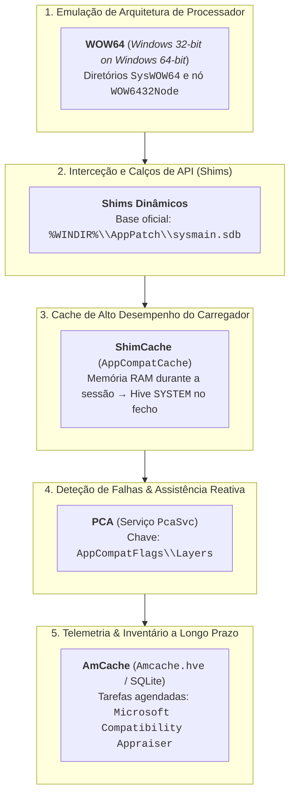
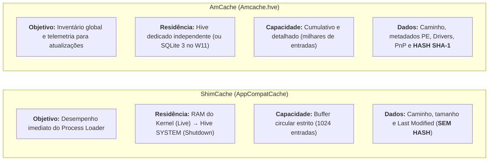
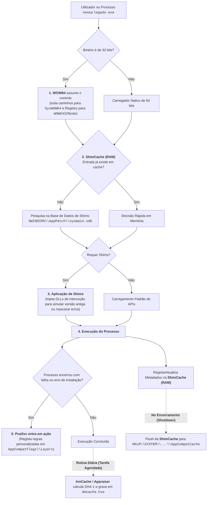

# Mecanismos de Compatibilidade no Windows — Visão Integrada e Forense

A coexistência de múltiplos mecanismos, serviços e ficheiros relacionados com a compatibilidade de software no Windows gera frequentemente a impressão de redundância. No entanto, estes componentes **não competem entre si nem se sobrepõem**: atuam em **camadas de abstração distintas**, cobrindo desde a arquitetura do processador até à telemetria de longo prazo.

Esta nota estabelece a visão holística do ecossistema de compatibilidade, desmonta as confusões conceptuais mais comuns e sintetiza a relevância de cada componente na resposta a incidentes e informática forense (DFIR).

---

## 1. O Dilema da Retrocompatibilidade

A Microsoft mantém como princípio central garantir que aplicações desenvolvidas para sistemas legados (Windows 95, 98, 2000, XP ou arquiteturas de 32 bits) continuem a funcionar em sistemas modernos de 64 bits (Windows 10 e Windows 11).

Para viabilizar este objetivo sem degradar o desempenho global e sem violar os modelos modernos de segurança, o sistema operativo divide o problema em **5 camadas consecutivas**:

---

## 2. A Matriz das 5 Camadas de Compatibilidade

| Camada | Mecanismo / Componente | Papel Principal no Sistema | Momento em que Atua | Rasto / Artefacto Gerado |
| :---: | :--- | :--- | :--- | :--- |
| **1** | **[[Arquitetura 32 vs 64 bits no Registry e Executáveis (WOW6432Node)\|WOW64]]** | Traduz chamadas de 32 bits para o *kernel* de 64 bits e isola caminhos. | No arranque de qualquer binário de 32 bits. | Ficheiros em `SysWOW64`; Chaves de Registry sob `WOW6432Node`. |
| **2** | **Shims** (`sysmain.sdb`) | Interceta chamadas à API e "mente" ao binário (versão do SO, privilégios, ficheiros). | Durante o carregamento das DLLs do processo. | Registo de regras aplicadas; base `%WINDIR%\AppPatch\sysmain.sdb`. |
| **3** | **[[Application Compatibility e ShimCache (AppCompatCache)\|ShimCache]]** | Cache de memória para o carregador saber rapidamente se um binário precisa de shims. | No momento do lançamento do executável. | Mantido na RAM; persistido no hive `SYSTEM` (buffer circular de 1024 entradas) no *shutdown*. |
| **4** | **PCA (`PcaSvc`)** | Monitoriza anomalias/crashes em instaladores antigos e sugere modos de compatibilidade. | Quando um binário ou instalador falha ou encerra de forma anómala. | Chaves de utilizador em `HKCU\...\AppCompatFlags\Layers`. |
| **5** | **[[AmCache - Arquitetura, Hives e Evolução para SQLite\|AmCache]]** | Inventário abrangente de software, drivers e periféricos para preparar *upgrades*. | Em segundo plano por tarefas agendadas ($\approx 24\,\text{h}$). | Ficheiro `Amcache.hve` (com **Hashes SHA-1**) ou bases SQLite no W11 recente. |

---

## 3. As 3 Grandes Confusões Desmistificadas

### Confusão 1: `sysmain.sdb` vs. Serviço `SysMain`
> [!WARNING] Nomes idênticos, funções completamente distintas!
> * **`sysmain.sdb`** (`%WINDIR%\AppPatch\sysmain.sdb`): É o ficheiro de base de dados que contém as assinaturas e regras de **Shims** (compatibilidade de aplicações legadas).
> * **Serviço `SysMain`** (`svchost.exe -s SysMain`): É o antigo serviço **SuperFetch**, responsável pela gestão inteligente de memória RAM e pela escrita dos ficheiros do **[[Serviço Prefetch e SysMain - Arquitetura e Funcionamento|Prefetch (.pf)]]**. O serviço `SysMain` não aplica shims nem avalia incompatibilidades.

---

### Confusão 2: ShimCache vs. AmCache (Por que parecem redundantes?)
Ambos são artefactos de compatibilidade que guardam o caminho de ficheiros executáveis, mas possuem arquiteturas e propósitos opostos:

| Critério de Comparação | [[Application Compatibility e ShimCache (AppCompatCache)\|ShimCache]] | [[AmCache - Arquitetura, Hives e Evolução para SQLite\|AmCache]] |
| :--- | :--- | :--- |
| **Propósito de Engenharia** | Evitar pesquisas repetidas na base de shims a cada arranque. | Inventário persistente para prever falhas de compatibilidade em atualizações do Windows. |
| **Armazenamento Primário** | Memória RAM (Kernel Space). | Disco físico (`%WINDIR%\AppCompat\Programs\Amcache.hve`). |
| **Momento de Escrita no Disco** | **Exclusivamente no encerramento (*shutdown*)** ou reinício. | Regularmente via tarefas agendadas (`Microsoft Compatibility Appraiser`). |
| **Limite de Entradas** | Máximo de **1024 entradas** (política FIFO circular). | Sem limite rígido de 1024; retém longo histórico cumulativo. |
| **Hash Criptográfico** | **Não armazena**. | **Armazena o Hash SHA-1** (ideal para VirusTotal). |

---

### Confusão 3: Shims Nativos vs. Serviço `PcaSvc`
* **Shims Nativos (`sysmain.sdb`)**: São intervenções estáticas transparentes. Se um programa conhecido estiver listado na base de dados da Microsoft, o *loader* aplica o shim no momento do arranque sem qualquer intervenção humana.
* **`PcaSvc` (*Program Compatibility Assistant Service*)**: É o componente dinâmico/reativo. Observa o comportamento da aplicação em execução. Se um instalador terminar com códigos de erro ou ficheiros em falta, o `PcaSvc` apresenta o assistente gráfico ao utilizador e regista ajustes na subchave `AppCompatFlags\Layers` para as próximas execuções.

---

## 4. O Fluxo de Execução Integrado

O diagrama seguinte ilustra o percurso completo de uma aplicação legada ao ser invocada num sistema Windows moderno de 64 bits:

---

## 5. Implicações Forenses (DFIR)

Para o perito de informática forense, a infraestrutura de compatibilidade do Windows traduz-se em duas regras essenciais:

### 1. A Regra de Ouro: Prova de Existência vs. Prova de Execução
> [!CAUTION] Princípio Forense Inviolável
> **Nem a ShimCache nem o AmCache provam, de forma isolada, que um executável correu no Windows 10 ou 11!**
> 
> * **O que provam**: Provam categoricamente que o ficheiro **existiu e esteve presente** no disco, numa unidade USB ou numa partilha de rede UNC (o ficheiro pode ter sido apenas copiado, descompactado ou inspecionado pelo Windows Defender).
> * **Como provar execução**: A prova irrefutável de execução exige a correlação cruzada com artefactos dedicados:
>   * [[Serviço Prefetch e SysMain - Arquitetura e Funcionamento|Prefetch (.pf)]] (execução global do sistema);
>   * [[Artefacto Forense UserAssist|UserAssist]] (execução interativa via GUI do utilizador);
>   * [[System Resource Usage Monitor (SRUM) - Arquitetura e Base ESE|SRUM]] (consumo de CPU, bytes de rede e energia);
>   * **Event Logs** (Event ID 4688 / Sysmon Event ID 1).

### 2. A Armadilha da Linha Temporal de Ativação (*Live Triage vs. Post-Mortem*)
Conforme sistematizado na [[Matriz de Correlação Forense e Cronologia de Ativação dos Artefactos|Matriz de Correlação Forense]]:
* Se uma máquina sob perícia for desligada puxando a ficha da tomada (*hard power-off*), **a ShimCache em disco não refletirá a atividade da sessão atual**, pois os dados residiam na RAM do *kernel* e não foram gravados no hive `SYSTEM`.
* Por outro lado, o **Prefetch** e o **UserAssist** já estarão persistidos no disco (respetivamente $\approx 10\,\text{s}$ e $\approx 3\,\text{s}$ após a execução).

---

## 6. Perguntas de Revisão

1. **Por que razão o Windows divide o Registry em `WOW6432Node` em sistemas de 64 bits?**
   * *Resposta*: Para permitir que aplicações de 32 bits leiam e gravem as suas configurações e componentes COM sem colidir com as chaves de 64 bits com o mesmo nome sob `HKLM\Software`.

2. **Se um analista encontrar uma ferramenta maliciosa na ShimCache de uma máquina Windows 11, pode concluir pericialmente que o atacante executou a ferramenta?**
   * *Resposta*: Não. No Windows 10 e 11, a `InsertFlag` foi removida. A entrada na ShimCache apenas comprova a existência do ficheiro no sistema de ficheiros, exigindo validação com Prefetch, UserAssist ou SRUM para atestar execução.

3. **Qual a vantagem tática do `Amcache.hve` face à `ShimCache` na resposta a incidentes?**
   * *Resposta*: O `Amcache.hve` armazena o hash criptográfico **SHA-1** dos binários e metadados PE detalhados, viabilizando pesquisas diretas e automatizadas contra bases de ameaças como o VirusTotal, enquanto a ShimCache armazena apenas caminhos e timestamps.

4. **Qual a diferença entre o ficheiro `sysmain.sdb` e o serviço `SysMain`?**
   * *Resposta*: `sysmain.sdb` é a base de dados de regras de shims do subsistema de compatibilidade de aplicações (`AppPatch`). O serviço `SysMain` (antigo SuperFetch) gere a otimização de memória RAM e os ficheiros de cache de arranque do `Prefetch`.

---

## Navegação

- [[Capítulo 1 - Sistemas Operativos, Serviços e Artefactos Forenses|Voltar ao Índice do Capítulo 1]]
- [[Taxonomia dos Artefactos de Execução no Windows]]
- [[Application Compatibility e ShimCache (AppCompatCache)]]
- [[AmCache - Arquitetura, Hives e Evolução para SQLite]]
- [[Extração da AmCache e Comparação Forense com a ShimCache]]
- [[Arquitetura 32 vs 64 bits no Registry e Executáveis (WOW6432Node)]]
- [[Matriz de Correlação Forense e Cronologia de Ativação dos Artefactos]]
