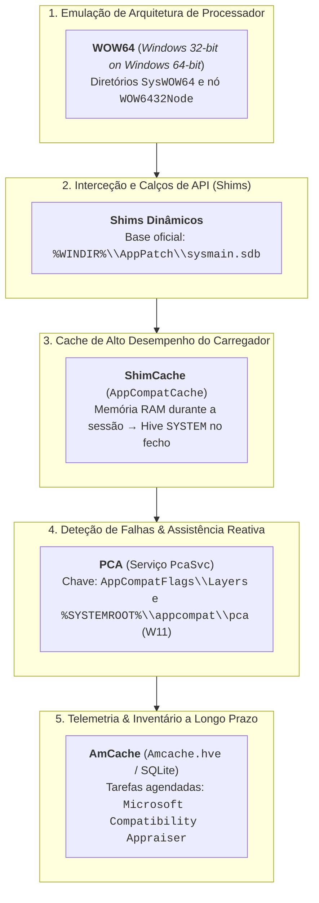
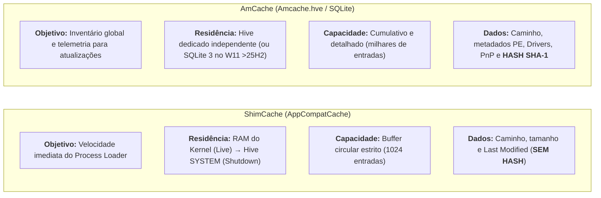
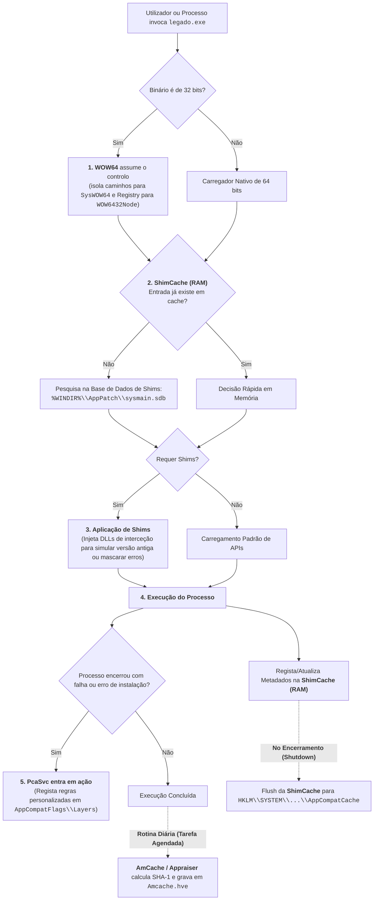

# Mecanismos de Compatibilidade no Windows — Visão Integrada e Forense

A infraestrutura de compatibilidade do Windows articula cinco camadas distintas (`WOW64`, `Shims`, `ShimCache`, `PCA` e `AmCache`) para executar software legado sem degradar o desempenho.

> [!TIP] Simulador Interativo Offline ("Correu ou só Existiu?" + Drill)
> Para testar cenários reais de execução vs. existência (`Prefetch`, `UserAssist`, `ShimCache`, `AmCache`, `SRUM`) e treinar as distinções críticas de exame, abre [assi_execucao_compat.html](../../../_assets/assi_execucao_compat.html).

> [!TIP] Lógica de Funcionamento e Valor Forense
> - **Porque existe (Sistema)**: Para que programas antigos (Windows 95/XP ou 32 bits) funcionem em sistemas modernos de 64 bits (Windows 10/11), o Windows divide o problema em 5 camadas: 1) `WOW64` traduz 32$\to$64 bits; 2) `Shims` (`sysmain.sdb`) intercetam APIs; 3) `ShimCache` guarda em RAM se o binário precisa de shims para não reler a base `sysmain.sdb` sempre que o ficheiro é visto; 4) `PCA` (`PcaSvc`) deteta crashes em tempo de execução; e 5) `AmCache` inventaria binários e drivers a cada 24h para preparar *upgrades* do Windows.
> - **Porque importa (Forense)**: Cada camada deixa um rasto distinto no disco e no Registry, permitindo ao perito saber que binários de 32/64 bits existiram na máquina, quais falharam (`PcaSvc`) e qual o **hash SHA-1** exato de cada executável (`Amcache.hve`).
> - **Pontos Críticos e Armadilhas para Exame**:
>   1. **`sysmain.sdb` $\neq$ Serviço `SysMain`**: `sysmain.sdb` (`%WINDIR%\AppPatch\sysmain.sdb`) é a base de dados de *Shims* de compatibilidade; o serviço `SysMain` é o antigo *SuperFetch* que gera ficheiros de `Prefetch` (`.pf`).
>   2. **`ShimCache` vs. `AmCache`**: A `ShimCache` vive em **RAM** (só vai para o hive `SYSTEM` no *shutdown*, máx. 1024 entradas, **sem hash**); a `AmCache` vive em **disco** (`Amcache.hve` ou SQLite3 no W11 >25H2, atualizada por tarefas agendadas, **com hash SHA-1**).
>   3. **Prova de Existência $\neq$ Prova de Execução**: No Windows 10/11, nem a `ShimCache` nem a `AmCache` provam que o programa correu — provam apenas que o ficheiro **existiu** no sistema.

---

## 1. O Dilema da Retrocompatibilidade e as 5 Camadas

A coexistência de múltiplos serviços e ficheiros relacionados com a compatibilidade gera frequentemente a impressão de redundância. Contudo, estes componentes **não se sobrepõem**: atuam em **5 camadas de abstração consecutivas**, desde a arquitetura do processador até à telemetria de longo prazo:

---

## 2. A Matriz das 5 Camadas de Compatibilidade

| Camada | Mecanismo / Componente | Porque Existe no Sistema (Engenharia) | Momento em que Atua | O que nos dá na Perícia (Artefacto) |
| :---: | :--- | :--- | :--- | :--- |
| **1** | **[[Arquitetura 32 vs 64 bits no Registry e Executáveis (WOW6432Node)\|WOW64]]** | Traduz chamadas de 32 bits para o *kernel* de 64 bits e isola bibliotecas e chaves. | No arranque de qualquer binário de 32 bits. | Ficheiros em `SysWOW64`; Chaves de Registry sob `WOW6432Node`. |
| **2** | **Shims** (`sysmain.sdb`) | Interceta chamadas à API e "mente" ao binário antigo (versão do SO, caminhos, permissões). | Durante o carregamento das DLLs do processo. | Base `%WINDIR%\AppPatch\sysmain.sdb` (e shims customizados instalados com `sdbinst.exe`). |
| **3** | **[[Application Compatibility e ShimCache (AppCompatCache)\|ShimCache]]** | Cache de memória para o *loader* saber rapidamente se um binário precisa ou não de shims. | Quando o binário é lançado ou enumerado pelo sistema. | Mantido na RAM; persistido no hive `SYSTEM` (buffer circular de 1024 entradas) **apenas no *shutdown***. |
| **4** | **PCA (`PcaSvc`)** | Monitoriza anomalias/crashes em instaladores ou programas e aplica modos de compatibilidade. | Quando um binário ou instalador falha ou é monitorizado pelo PCA. | Chaves em `HKCU\...\AppCompatFlags\Layers` e ficheiros em `%SYSTEMROOT%\appcompat\pca` (W11). |
| **5** | **[[AmCache - Arquitetura, Hives e Evolução para SQLite\|AmCache]]** | Inventário abrangente de software, drivers e periféricos para preparar *upgrades* do SO. | Em segundo plano por tarefas agendadas ($\approx 24\,\text{h}$) ou instalação. | Ficheiro `Amcache.hve` (com **Hashes SHA-1**) ou bases SQLite 3 no W11 recente (>25H2). |

---

## 3. As 3 Grandes Confusões Desmistificadas

### Confusão 1: Ficheiro `sysmain.sdb` vs. Serviço `SysMain`

> [!WARNING] Armadilha de Exame: Nomes idênticos, funções completamente distintas!
> * **`sysmain.sdb`** (`%WINDIR%\AppPatch\sysmain.sdb`): É o ficheiro de base de dados estática que contém as assinaturas e regras de **Shims** (compatibilidade de aplicações legadas).
> * **Serviço `SysMain`** (`svchost.exe -s SysMain`): É o antigo serviço **SuperFetch**, responsável pela gestão preditiva de memória RAM e pela escrita exclusiva dos ficheiros do **[[Serviço Prefetch e SysMain - Arquitetura e Funcionamento|Prefetch (.pf)]]**. O serviço `SysMain` não aplica shims nem avalia incompatibilidades.

---

### Confusão 2: `ShimCache` vs. `AmCache` (Por que não são redundantes?)
Embora ambos pertençam à infraestrutura `AppCompat` e registem caminhos de executáveis, resolvem problemas de engenharia opostos:

| Critério de Comparação | [[Application Compatibility e ShimCache (AppCompatCache)\|ShimCache (`AppCompatCache`)]] | [[AmCache - Arquitetura, Hives e Evolução para SQLite\|AmCache (`Amcache.hve` / SQLite)]] |
| :--- | :--- | :--- |
| **Propósito de Engenharia** | Evitar pesquisas lentas e repetidas em `sysmain.sdb` sempre que o sistema interage com um binário. | Inventário persistente de software e hardware para prever incompatibilidades em atualizações do Windows. |
| **Armazenamento Primário** | **Memória RAM** (Kernel Space durante a sessão ativa). | **Disco físico** (`%WINDIR%\AppCompat\Programs\Amcache.hve` ou `.db`). |
| **Momento de Escrita no Disco** | **Exclusivamente no encerramento (*shutdown*)** ou reinício limpo. | Regularmente via tarefas agendadas (`Microsoft Compatibility Appraiser` / `ProgramDataUpdater`). |
| **Limite de Entradas** | Máximo de **1024 entradas** no Windows 7–11 (96 no XP; 512 no Server 2003) em fila FIFO. | Sem limite rígido de 1024; retém longo histórico cumulativo de milhares de ficheiros e drivers. |
| **Hash Criptográfico** | **Não armazena qualquer hash**. | **Armazena o Hash SHA-1** de cada binário (ideal para consultar no VirusTotal). |

---

### Confusão 3: Shims Estáticos (`sysmain.sdb`) vs. Serviço Reativo `PcaSvc`

* **Shims Nativos (`sysmain.sdb`)**: São intervenções preventivas e transparentes. Se um programa antigo já for conhecido pela Microsoft e constar em `sysmain.sdb`, o *loader* injeta o shim no arranque sem qualquer aviso.
* **`PcaSvc` (*Program Compatibility Assistant Service*)**: É o componente dinâmico e reativo. Observa o comportamento da aplicação em execução; se um instalador ou binário terminar com falha ou erro, o `PcaSvc` sugere ajustes ao utilizador, grava regras na subchave `AppCompatFlags\Layers` para futuras execuções e, no Windows 11, mantém registos valiosos de execução em `%SYSTEMROOT%\appcompat\pca` (ex.: `PcaAppLaunchDic.txt` e `PcaGeneralDb*.txt`).

---

## 4. O Fluxo de Execução Integrado das 5 Camadas

O diagrama seguinte ilustra o percurso completo de uma aplicação ao ser invocada num sistema Windows moderno de 64 bits:

---

## 5. Implicações Forenses (DFIR)

### 1. A Regra de Ouro: Prova de Existência vs. Prova de Execução

> [!CAUTION] Princípio Forense Inviolável
> **Nem a ShimCache nem o AmCache provam, de forma isolada, que um executável correu no Windows 10 ou 11!**
> 
> * **O que provam**: Provam categoricamente que o ficheiro **existiu e esteve presente** no disco, numa unidade USB ou numa partilha de rede UNC (o ficheiro pode ter sido apenas copiado, descompactado, visualizado numa pasta pelo Explorer ou inspecionado pelo antivírus).
> * **Como provar execução**: A prova irrefutável de execução exige a correlação cruzada com artefactos dedicados:
>   * [[Serviço Prefetch e SysMain - Arquitetura e Funcionamento|Prefetch (.pf)]] (execução global do sistema, $\approx 10\,\text{s}$ após arranque);
>   * [[Artefacto Forense UserAssist|UserAssist]] (execução interativa via GUI do utilizador, $\approx 3\,\text{s}$);
>   * [[System Resource Usage Monitor (SRUM) - Arquitetura e Base ESE|SRUM]] (consumo de CPU, bytes de rede e energia);
>   * **Event Logs** (Event ID 4688 / Sysmon Event ID 1).

### 2. A Armadilha da Linha Temporal de Ativação (*Hard Power-Off*)
Conforme sistematizado na [[Matriz de Correlação Forense e Cronologia de Ativação dos Artefactos|Matriz de Correlação Forense]]:

* Se uma máquina sob perícia sofrer um corte abrupto de corrente (*hard power-off* ou remoção de bateria), **a ShimCache em disco não refletirá a atividade da sessão atual**, pois os dados residiam na RAM do *kernel* e não sofreram *flush* para o hive `SYSTEM`.
* Por outro lado, o **Prefetch** e o **UserAssist** já estarão persistidos no disco poucos segundos após o lançamento da aplicação.

---

## Perguntas de revisão

1. **Por que razão o Windows divide o Registry em `WOW6432Node` em sistemas de 64 bits?**

> [!success]- Ver Resposta
> Para permitir que aplicações de 32 bits (executadas sob a camada de emulação `WOW64`) leiam e gravem as suas configurações e componentes COM num espaço isolado, sem colidir com as chaves homónimas de aplicações nativas de 64 bits sob `HKLM\Software` e `HKCU\Software`.

2. **Se um analista encontrar uma ferramenta maliciosa na ShimCache de uma máquina Windows 11, pode concluir pericialmente que o atacante executou a ferramenta?**

> [!success]- Ver Resposta
> Não. No Windows 10 e 11, a `InsertFlag` foi removida. A entrada na ShimCache comprova apenas a **existência/presença** do ficheiro no sistema de ficheiros (disco, USB ou rede UNC), exigindo correlação com `Prefetch`, `UserAssist`, `SRUM` ou Event Logs para provar execução efetiva.

3. **Qual a vantagem tática do `Amcache.hve` face à `ShimCache` na resposta a incidentes?**

> [!success]- Ver Resposta
> O `Amcache.hve` armazena o hash criptográfico **SHA-1** de cada binário e metadados PE detalhados (versão, fabricante, compile time), permitindo validar instantaneamente milhares de binários contra bases de Threat Intelligence como o VirusTotal, enquanto a `ShimCache` guarda apenas o caminho, tamanho e data de última modificação (sem hash).

4. **Qual a diferença entre o ficheiro `sysmain.sdb` e o serviço `SysMain`?**

> [!success]- Ver Resposta
> O ficheiro `sysmain.sdb` (`%WINDIR%\AppPatch\sysmain.sdb`) é a base de dados principal de regras de *Shims* do subsistema de compatibilidade de aplicações. Já o serviço `SysMain` (`svchost.exe -s SysMain`, antigo SuperFetch) é o serviço de otimização de memória RAM e disco que escreve os ficheiros `.pf` na pasta `Prefetch`.

5. **O que acontece às entradas da `ShimCache` geradas durante uma sessão se o computador for desligado puxando o cabo de alimentação (*hard power-off*)?**

> [!success]- Ver Resposta
> Perdem-se para a análise em disco (*post-mortem*), porque a `ShimCache` é mantida em memória RAM durante a sessão ativa e só é gravada no hive `SYSTEM` (`AppCompatCache`) durante o processo formal de encerramento (*shutdown*) ou reinício do sistema operativo.

---

## Navegação e Notas Relacionadas

| Percurso | Nota | Contexto |
| :--- | :--- | :--- |
| **Anterior** | [[Análise Forense e Criação a Pedido do Prefetch]] | `Bloco 10` |
| **Seguinte** | [[Application Compatibility e ShimCache (AppCompatCache)]] | `mesmo bloco` |
| **Índice** | [[Capítulo 1 - Sistemas Operativos, Serviços e Artefactos Forenses]] · [[00 ASSI]] | `Bloco 11` |

### Conceitos Relacionados

* [[Taxonomia dos Artefactos de Execução no Windows]] · `Bloco 10`
* [[AmCache - Arquitetura, Hives e Evolução para SQLite]] · `mesmo bloco`
* [[Extração da AmCache e Comparação Forense com a ShimCache]] · `mesmo bloco`
* [[Arquitetura 32 vs 64 bits no Registry e Executáveis (WOW6432Node)]] · `Bloco 05`
* [[Matriz de Correlação Forense e Cronologia de Ativação dos Artefactos]] · `Bloco 15`
