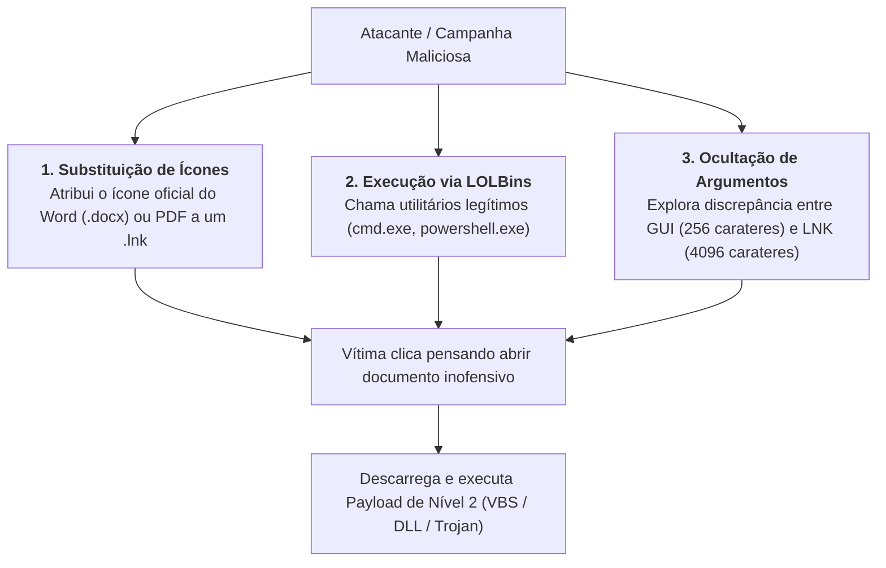
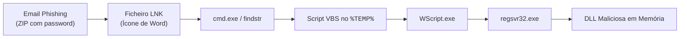

# Abuso e Vetores de Ataque com Ficheiros LNK

Os ficheiros de atalho [[Ficheiros LNK (Shell Links) - Metadados e Formato Binário|Shell Link (.lnk)]] são intensamente explorados por atores de ameaça e campanhas cibercriminosas devido à sua capacidade de executar qualquer comando arbitrário de sistema enquanto simulam documentos legítimos através de engenharia social.

Ao contrário de ficheiros executáveis (`.exe`) ou scripts diretos (`.bat`, `.ps1`), que costumam ser bloqueados por filtros de correio eletrónico e políticas de restrição de software (AppLocker/WDAC), os atalhos `.lnk` beneficiam frequentemente de menor escrutínio por parte de utilizadores e ferramentas de segurança convencionais.

---

## 1. Técnicas de Evasão e Engenharia Social

A exploração maliciosa de ficheiros LNK assenta em três pilares fundamentais:



### 1. Mascaramento de Ícones
O formato LNK permite associar livremente qualquer recurso de ícone (`Icon Location` e `Icon Index`). Um atacante disfarça um atalho executável aplicando o ícone oficial do **Microsoft Word** (`DOCX`) ou do **Adobe Acrobat** (`PDF`). A vítima é levada a crer que se trata de uma fatura ou documento de texto inofensivo.

### 2. Living off the Land Binaries (LOLBins)
Em vez de apontar para um binário compilado suspeito, o `.lnk` invoca ferramentas administrativas nativas já presentes no Windows (como `cmd.exe`, `powershell.exe`, `mshta.exe`, `wscript.exe`, `cscript.exe` ou `AppInstaller.exe`). Uma vez que estes executáveis são assinados pela Microsoft, contornam listas de bloqueio baseadas em nomes ou assinaturas.

---

## 3. Estudo de Caso Real: A Campanha EMOTET

O cavalo de Troia bancário **Emotet** popularizou cadeias de infeção altamente automatizadas baseadas em atalhos LNK:



1. **Entrega**: A vítima recebia um e-mail com um arquivo ZIP protegido por palavra-passe (impedindo a inspeção por soluções de segurança no gateway de e-mail).
2. **Engodo**: Dentro do ZIP residia um atalho LNK com o ícone do Word.
3. **Cadeia de Invocação**:
   * O clique disparava o `cmd.exe`, que utilizava o utilitário nativo `findstr` para extrair um script VBScript embutido.
   * O `WScript.exe` interpretava o ficheiro `.vbs` a partir da pasta temporária (`%TEMP%`).
   * O script invocava o `regsvr32.exe` para descarregar e registar uma biblioteca DLL maliciosa em memória, estabelecendo o canal de comando e controlo (C2).

---

## 4. Ocultação de Scripts no Próprio LNK: O Caso `OutstandingPayment.lnk`

Num caso de estudo abordado nas aulas teóricas, o atacante utilizou o próprio ficheiro LNK como contentor do *payload*:

### A Linha de Comandos Maliciosa:
```cmd
%comspec% /v:on /c hwqcG & if not exist tPUQl (set "fChXE=inds") & (f!fChXE!tr "LMpJG.*" OutstandingPayment.lnk > "%tmp%\NWrfK.vbs" & "%tmp%\NWrfK.vbs") & qFctA
```

Desobfuscando a sintaxe da linha de comandos, a operação resume-se a:
```cmd
cmd.exe /c findstr "LMpJG.*" OutstandingPayment.lnk > "%tmp%\NWrfK.vbs" & "%tmp%\NWrfK.vbs"
```

### Mecanismo de Funcionamento:
1. **Tolerância a Dados Anexos (*Overlay Data*)**: O subsistema Win32 processa ficheiros `.lnk` verificando unicamente a validade dos primeiros blocos de cabeçalho (`4C 00 00 00`). **O Windows não rejeita nem invalida o atalho se existirem bytes adicionais anexados ao final do ficheiro**.
2. **Auto-Extração**: O atacante colocou o código VBScript completo no final do próprio ficheiro `OutstandingPayment.lnk`, precedido pela etiqueta `LMpJG`.
3. O comando `findstr` localiza a linha que contém `LMpJG` dentro do próprio LNK, redireciona o texto seguinte para `%tmp%\NWrfK.vbs` e executa-o imediatamente.

---

## 5. A Armadilha da Interface Gráfica: 256 vs. 4096 Carateres

Uma das limitações mais críticas da interface de utilizador do Windows Explorer reside na forma como renderiza as propriedades de atalhos:

> [!CAUTION] Discrepância Visual Crítica (Vulnerabilidade da GUI)
> * A caixa de diálogo **Propriedades do Atalho (*Shortcut Properties*)** na interface gráfica do Windows **apenas exibe os primeiros 256 carateres** no campo de texto "Target / Destino".
> * No entanto, a especificação técnica do formato binário LNK suporta **até 4096 carateres** como parâmetros da linha de comandos!

### Vetor de Ataque em Grupos APT (ex.: APT10)
Grupos sofisticados como o **APT10** exploram esta limitação inserindo comandos de sistema legítimos seguidos de centenas de espaços em branco ou variáveis vazias:

```text
Visualização na Interface Gráfica (Janela de Propriedades do Windows):
Target: %SystemRoot%\system32\cmd.exe                                          ... (corta aos 256 carateres)
```

```text
Conteúdo Real Completo nos Metadados Binários do Ficheiro LNK (até 4096 carateres):
Target: C:\Windows\System32\cmd.exe /c "set a=ec && call powershell -exec bypass -nop -enc JAAy... [milhares de carateres de código malicioso codificado em Base64]..."
```

* O operador ou analista comum que inspeciona o atalho através do Explorador visualiza apenas `cmd.exe` e assume que se trata de uma linha normal.
* A carga maliciosa em PowerShell permanece **completamente invisível na interface gráfica**.

---

## 6. Procedimento de Deteção e Auditoria Pericial

Para neutralizar esta tentativa de ocultação, os investigadores forenses nunca devem confiar na janela de propriedades da shell do Windows. É mandatário inspecionar o atalho através de ferramentas dedicadas:

1. **Auditoria com `LECmd` (Eric Zimmerman)**:
   ```cmd
   LECmd.exe -f "C:\Caminho\amostra_suspeita.lnk"
   ```
   *O `LECmd` extrai a totalidade da cadeia de argumentos (`COMMAND_LINE_ARGUMENTS`), imprimindo todos os carateres para além do limite visual de 256 carateres.*
2. **Inspeção de Strings com `bstrings` ou `strings`**:
   ```cmd
   bstrings.exe -f amostra_suspeita.lnk -m 20
   ```
   *Permite detetar comandos em PowerShell, chamadas a `findstr` ou pedidos HTTP embutidos nos metadados do Shell Link.*

---

## Navegação

- [[Capítulo 1 - Sistemas Operativos, Serviços e Artefactos Forenses|Voltar ao Índice do Capítulo 1]]
- [[Jump Lists - Arquitetura, AppIDs e Carving]]
- [[Ficheiros LNK (Shell Links) - Metadados e Formato Binário]]
- [[Taxonomia dos Artefactos de Execução no Windows]]
