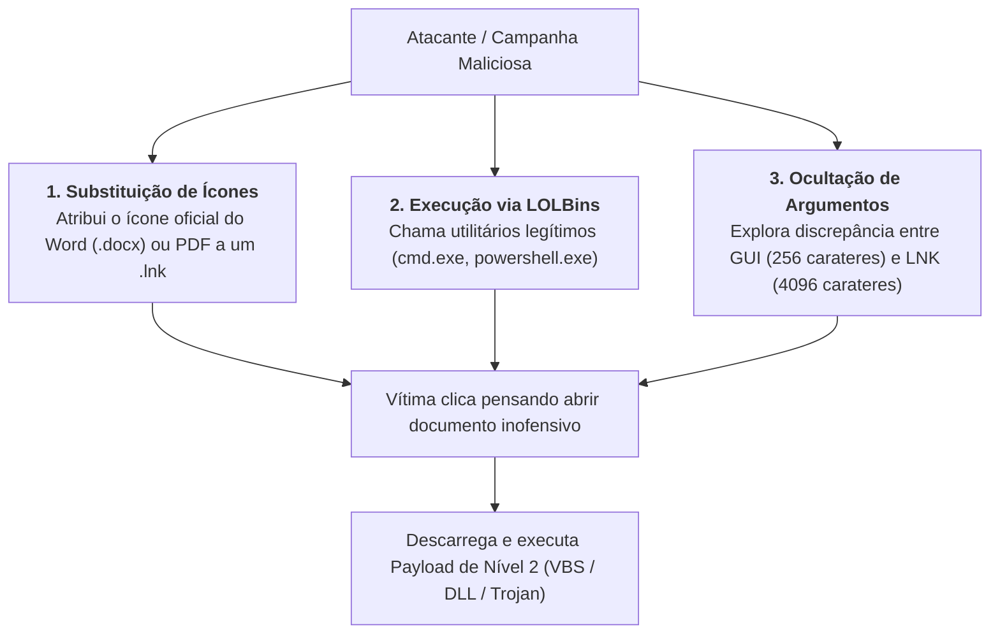
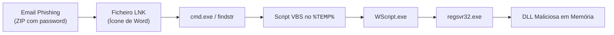

# Abuso e Vetores de Ataque com Ficheiros LNK

O abuso de ficheiros **`.lnk`** explora ícones falsos, binários nativos (*LOLBins*), tolerância a *overlay data* e a truncagem visual da GUI do Windows (256 vs. 4096 carateres) para executar malware.

> [!TIP] Lógica de Funcionamento e Valor Forense
> * **Porque existe (Sistema)**: O formato `[MS-SHLLINK]` foi concebido com grande flexibilidade para permitir que atalhos administrativos invoquem executáveis com até **4096 carateres** de argumentos de linha de comandos e personalizem livremente o ícone exibido (`Icon Location`), enquanto o parser Win32 lê apenas os blocos estruturais definidos no cabeçalho e ignora quaisquer bytes extra anexados no fim do ficheiro (*overlay data*).
> * **Porque importa (Forense)**: Atores de ameaça (como **Emotet**, **Qakbot** e **APT10**) abusam destas propriedades para contornar bloqueios de extensões `.exe`/`.ps1` e políticas AppLocker/WDAC, entregando ficheiros `.lnk` dentro de arquivos ZIP ou imagens ISO que se disfarçam de documentos PDF/Word e extraem scripts maliciosos do próprio `.lnk` via `findstr`.
> * **Pontos Críticos e Armadilhas para Exame**:
>   * **Armadilha de 256 vs. 4096 Carateres**: A janela gráfica de "Propriedades do Atalho" do Windows Explorer exibe apenas os **primeiros 256 carateres** do campo *Target*, mas a estrutura binária aceita **4096 carateres**. Atacantes preenchem centenas de espaços em branco após `cmd.exe` para esconder o *payload* da vista do analista na GUI.
>   * **Tolerância a Overlay + `findstr`**: Anexar código VBScript/PowerShell no final de um `.lnk` não corrompe o atalho, permitindo que o comando invocado pelo `.lnk` use `findstr` sobre si próprio para extrair e executar o *payload* em `%TEMP%`.

---

## 1. Técnicas de Evasão e Engenharia Social

Os ficheiros de atalho [[Ficheiros LNK (Shell Links) - Metadados e Formato Binário|Shell Link (.lnk)]] são intensamente explorados por campanhas cibercriminosas porque o Windows oculta por omissão a extensão `.lnk` no Explorer (mesmo quando a opção "Mostrar extensões de ficheiros conhecidos" está ativa, devido à propriedade `NeverShowExt` no Registry).

A exploração maliciosa de ficheiros LNK assenta em três pilares fundamentais:



> [!IMPORTANT] Sinergia das Técnicas: Operação Combinada no Ataque Real
> Embora o diagrama acima apresente as três técnicas de forma ramificada para facilitar a distinção conceptual de cada vetor, na prática cibercriminosa (campanhas de *Emotet*, *Qakbot* ou atores como o *APT10*) estas técnicas **não operam como caminhos separados nem são alternativas mutuamente exclusivas**.
> 
> Pelo contrário, os atacantes **combinam-nas habitualmente em conjunto no mesmo ficheiro `.lnk`**, de forma a auxiliarem-se mutuamente:
> 1. O **ícone falso** (Word/PDF) garante a engenharia social necessária para a vítima dar o clique inicial;
> 2. O **preenchimento de espaços (*padding*)** oculta a linha de comandos na interface gráfica se as propriedades do atalho forem inspecionadas no Explorer;
> 3. O **LOLBin** (`cmd.exe`/`powershell.exe`) assegura a execução do *payload* contornando listas de bloqueio e políticas de restrição de software (AppLocker/WDAC).

### 1. Mascaramento de Ícones
O formato LNK permite associar livremente qualquer recurso de ícone (`Icon Location` e `Icon Index`, apontando por exemplo para `%SystemRoot%\System32\shell32.dll` ou `imageres.dll`). Um atacante disfarça um atalho executável aplicando o ícone oficial do **Microsoft Word** (`DOCX`) ou do **Adobe Acrobat** (`PDF`). A vítima é levada a crer que se trata de uma fatura ou documento de texto inofensivo.

### 2. Living off the Land Binaries (LOLBins)
Em vez de apontar para um binário compilado suspeito, o `.lnk` invoca ferramentas administrativas nativas já presentes no Windows (como `cmd.exe`, `powershell.exe`, `mshta.exe`, `wscript.exe`, `cscript.exe`, `findstr.exe`, `regsvr32.exe` ou `AppInstaller.exe`). Uma vez que estes executáveis residem em `C:\Windows\System32` e são digitalmente assinados pela Microsoft, contornam listas de bloqueio baseadas em nomes ou assinaturas (AppLocker/WDAC).

---

## 2. Estudo de Caso Real: A Campanha EMOTET

O cavalo de Troia bancário e *loader* **Emotet** popularizou cadeias de infeção altamente automatizadas baseadas em atalhos LNK:



1. **Entrega**: A vítima recebia um e-mail com um arquivo ZIP protegido por palavra-passe (impedindo a inspeção estática e detonação em sandbox pelas soluções de segurança no gateway de e-mail).
2. **Engodo**: Dentro do ZIP residia um atalho LNK com o ícone do Word.
3. **Cadeia de Invocação**:
   * O clique disparava o `cmd.exe`, que utilizava o utilitário nativo `findstr` para extrair um script VBScript embutido no próprio `.lnk`.
   * O `WScript.exe` interpretava o ficheiro `.vbs` a partir da pasta temporária (`%TEMP%`).
   * O script descarregava o payload e invocava o `regsvr32.exe` para carregar uma biblioteca DLL maliciosa em memória, estabelecendo o canal de comando e controlo (C2).

---

## 3. Ocultação de Scripts no Próprio LNK: O Caso `OutstandingPayment.lnk`

Num caso de estudo abordado nas aulas teóricas, o atacante utilizou o próprio ficheiro LNK como contentor poliglota do *payload*:

### A Linha de Comandos Maliciosa:

```cmd
%comspec% /v:on /c hwqcG & if not exist tPUQl (set "fChXE=inds") & (f!fChXE!tr "LMpJG.*" OutstandingPayment.lnk > "%tmp%\NWrfK.vbs" & "%tmp%\NWrfK.vbs") & qFctA
```

#### Anatomia da Obfuscação na Linha de Comandos:

* **`%comspec%`**: Variável de ambiente nativa que resolve para `C:\Windows\System32\cmd.exe`.
* **`/v:on`**: Ativa a expansão retardada de variáveis (*Delayed Environment Variable Expansion*), permitindo avaliar variáveis em tempo de execução com a sintaxe `!variavel!`.
* **`set "fChXE=inds"` e `f!fChXE!tr`**: Constrói dinamicamente a palavra **`findstr`** em memória para evitar deteção por assinaturas estáticas simples (YARA/AV) que procurem a string literal `"findstr"` nos argumentos do `.lnk`.

Desobfuscando a sintaxe da linha de comandos, a operação resume-se a:

```cmd
cmd.exe /c findstr "LMpJG.*" OutstandingPayment.lnk > "%tmp%\NWrfK.vbs" & "%tmp%\NWrfK.vbs"
```

### Mecanismo de Funcionamento:

1. **Tolerância a Dados Anexos (*Overlay Data*)**: O subsistema Win32 processa ficheiros `.lnk` verificando unicamente a validade dos primeiros blocos estruturais iniciados por `4C 00 00 00`. **O Windows não rejeita nem invalida o atalho se existirem bytes adicionais anexados ao final do ficheiro** (após o fecho do bloco `EXTRA_DATA`).
2. **Auto-Extração (*Self-Carving*)**: O atacante concatenou o código VBScript completo no final do próprio ficheiro `OutstandingPayment.lnk`, precedido pela etiqueta marcadora `LMpJG`.
3. O comando `findstr "LMpJG.*" OutstandingPayment.lnk` procura a linha que começa por `LMpJG` dentro do próprio ficheiro `.lnk`, redireciona o código VBS para `%tmp%\NWrfK.vbs` e executa-o imediatamente.

---

## 4. A Armadilha da Interface Gráfica: 256 vs. 4096 Carateres

Uma das limitações mais críticas da interface de utilizador do Windows Explorer reside na discrepância entre o limite do controlo visual da GUI e o limite real da estrutura binária:

| Componente do Windows | Limite Máximo de Carateres | Comportamento Perante Padding de Espaços (`0x20`) |
| :--- | :---: | :--- |
| **Janela Gráfica "Propriedades do Atalho"** (Campo *Target / Destino* no Explorer) | **256 carateres** | Trunca silenciosamente tudo o que estiver após o 256.º caráter; o utilizador vê apenas o comando inicial (`cmd.exe`) e espaços em branco. |
| **Estrutura Binária `[MS-SHLLINK]`** (`COMMAND_LINE_ARGUMENTS` em `STRING_DATA`) | **4096 carateres** | Preserva e passa ao sistema operativo a totalidade dos argumentos até 4096 carateres no momento do clique. |

> [!CAUTION] Discrepância Visual Crítica (Vulnerabilidade da GUI)
> * A caixa de diálogo **Propriedades do Atalho (*Shortcut Properties*)** na interface gráfica do Windows **apenas exibe os primeiros 256 carateres** no campo de texto "Target / Destino".
> * No entanto, a especificação técnica do formato binário LNK suporta **até 4096 carateres** como parâmetros da linha de comandos!

### Vetor de Ataque em Grupos APT (ex.: APT10)
Grupos sofisticados como o **APT10** exploram esta limitação inserindo o caminho de um binário legítimo seguido de mais de 200 espaços em branco (`0x20`) ou tabulações antes dos parâmetros reais:

```text
Visualização na Interface Gráfica (Janela de Propriedades do Windows):
Target: %SystemRoot%\system32\cmd.exe                                          ... (corta aos 256 carateres)
```

```text
Conteúdo Real Completo nos Metadados Binários do Ficheiro LNK (até 4096 carateres):
Target: C:\Windows\System32\cmd.exe                                                                                     /c "set a=ec && call powershell -exec bypass -nop -enc JAAy... [milhares de carateres de código malicioso codificado em Base64]..."
```

* O operador ou analista incauto que inspeciona o atalho clicando com o botão direito $\to$ *Propriedades* visualiza apenas `%SystemRoot%\system32\cmd.exe` e assume que se trata de um atalho benigno.
* A carga maliciosa em PowerShell permanece **completamente invisível na interface gráfica**.

---

## 5. Procedimento de Deteção e Anatomia de Comandos Periciais

Para neutralizar esta tentativa de ocultação, os investigadores forenses nunca devem confiar na janela de propriedades da shell do Windows. É mandatário inspecionar o atalho através de ferramentas de parsing binário e extração de strings:

### 1. Auditoria Estrutural com `LECmd` (Eric Zimmerman)

```cmd
LECmd.exe -f "C:\Caminho\OutstandingPayment.lnk" --json "C:\Temp\Analise_Malware"
```

* **`-f <ficheiro>`**: Carrega diretamente a amostra `.lnk` sem a executar.
* **Valor Pericial**: O `LECmd` lê o comprimento real da estrutura `COMMAND_LINE_ARGUMENTS` na secção `STRING_DATA` e imprime todos os carateres até ao limite de 4096, expondo imediatamente qualquer *padding* de espaços e os argumentos ocultos.

### 2. Inspeção de Strings e Overlay Data com `bstrings` (Eric Zimmerman) ou `strings`
Como o `LECmd` analisa apenas a estrutura formal `[MS-SHLLINK]`, o código malicioso anexado como *overlay data* no final do ficheiro (como o VBScript em `OutstandingPayment.lnk`) deve ser extraído com um extrator de strings ou editor hexadecimal:

```cmd
bstrings.exe -f "C:\Caminho\OutstandingPayment.lnk" -m 20 --lr "http|powershell|findstr|vbs"
```

* **`-f <ficheiro>`**: Ficheiro binário alvo a inspecionar (extrai simultaneamente strings ASCII e Unicode UTF-16LE).
* **`-m 20`**: Define o comprimento mínimo de 20 carateres por string para filtrar ruído binário curto.
* **`--lr <regex>`**: Filtra os resultados através de uma expressão regular (*lookup regex*) para localizar imediatamente URLs, chamadas a `findstr`, scripts `.vbs` ou comandos codificados em Base64 no *overlay* do ficheiro.

---

## Perguntas de revisão

1. **Em que consiste a discrepância de "256 vs. 4096 carateres" nos ficheiros `.lnk` e como é explorada por grupos como o APT10?**

> [!success]- Ver Resposta
> A caixa de diálogo gráfica de "Propriedades do Atalho" do Windows Explorer exibe apenas os **primeiros 256 carateres** do campo de destino (*Target*), enquanto a especificação binária do ficheiro `.lnk` (`COMMAND_LINE_ARGUMENTS`) suporta **até 4096 carateres**. Grupos como o APT10 invocam um binário legítimo (ex.: `cmd.exe`), inserem mais de 200 espaços em branco e colocam o código malicioso após a posição 256, tornando o ataque invisível na inspeção visual pelas Propriedades do Windows.

2. **No estudo de caso do ficheiro malicioso `OutstandingPayment.lnk`, porque é que a adição de um script VBScript no final do ficheiro `.lnk` não corrompeu o atalho nem impediu o Windows de o abrir?**

> [!success]- Ver Resposta
> Porque o parser Win32 de ficheiros Shell Link valida apenas a assinatura mágica (`4C 00 00 00`) e lê sequencialmente as cinco secções estruturais até encontrar o fim do bloco `EXTRA_DATA`. Quaisquer bytes adicionais concatenados após o fim formal da estrutura (*overlay data*) são ignorados pelo parser do Windows, permitindo que o próprio `.lnk` funcione como contentor do script que será extraído via `findstr`.

3. **No comando `%comspec% /v:on /c ... (set "fChXE=inds") & (f!fChXE!tr "LMpJG.*" OutstandingPayment.lnk > "%tmp%\NWrfK.vbs")`, qual é a função do parâmetro `/v:on` e da variável `!fChXE!`?**

> [!success]- Ver Resposta
> O parâmetro **`/v:on`** ativa a expansão retardada de variáveis (*Delayed Variable Expansion*) no `cmd.exe` (`%comspec%`). Isto permite definir a variável `fChXE=inds` e expandi-la imediatamente na mesma linha como `f!fChXE!tr`, reconstruindo dinamicamente o comando **`findstr`** em tempo de execução para evadir regras de deteção estática que procurem a string literal `"findstr"`.

4. **O que são LOLBins (*Living off the Land Binaries*) no contexto de ataques com ficheiros `.lnk` e porque são preferidos pelos atacantes?**

> [!success]- Ver Resposta
> Os **LOLBins** são executáveis nativos, legítimos e assinados digitalmente pela Microsoft que já vêm pré-instalados no sistema operativo Windows (como `cmd.exe`, `powershell.exe`, `wscript.exe`, `mshta.exe`, `regsvr32.exe` e `findstr.exe`). Os atacantes usam-nos como alvo dos atalhos `.lnk` porque não precisam de incluir um `.exe` malicioso no envio e porque estes binários confiáveis contornam políticas de controlo aplicacional (AppLocker/WDAC).

5. **Porque é que um perito forense deve combinar o `LECmd` com o `bstrings` (ou um editor hexadecimal) ao analisar um ficheiro `.lnk` suspeito de malware?**

> [!success]- Ver Resposta
> O **`LECmd`** disseca perfeitamente a estrutura oficial do formato `[MS-SHLLINK]` (revelando o caminho do alvo e a totalidade dos 4096 carateres de `COMMAND_LINE_ARGUMENTS`), mas não extrai payloads arbitrários guardados fora da estrutura formal. O **`bstrings`** varre a totalidade dos bytes do ficheiro (incluindo *overlay data* no final do `.lnk`), garantindo a deteção de scripts VBS, PowerShell ou URLs anexados após os blocos do atalho.

---

## Navegação

- [[Capítulo 1 - Sistemas Operativos, Serviços e Artefactos Forenses|Voltar ao Índice do Capítulo 1]]
- [[Jump Lists - Arquitetura, AppIDs e Carving]]
- [[Ficheiros LNK (Shell Links) - Metadados e Formato Binário]]
- [[Taxonomia dos Artefactos de Execução no Windows]]
- [[Pesquisa de Evidências e Reconstrução de Eventos]]
- [[Codificação Binário-para-Texto (Base16, Base64 e Base58)]]
