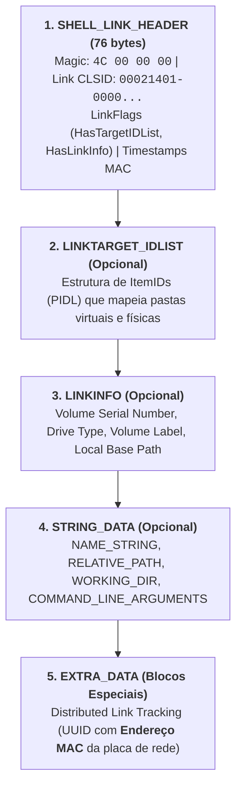

# Ficheiros LNK (Shell Links) — Metadados e Formato Binário

Os ficheiros **`.lnk`** (*Shell Links*, norma `[MS-SHLLINK]`, assinatura `4C 00 00 00`) são atalhos binários que preservam metadados completos de ficheiros abertos, mesmo após a remoção do alvo.

> [!TIP] Lógica de Funcionamento e Valor Forense
> * **Porque existe (Sistema)**: O Windows precisa de um mecanismo resiliente de apontadores (*shortcuts*) que permita abrir ficheiros, pastas ou aplicações a partir do Ambiente de Trabalho, Menu Iniciar ou histórico recente, conseguindo localizar o ficheiro original através do serviço *Distributed Link Tracking* (DLT) mesmo que este seja movido.
> * **Porque importa (Forense)**: Sempre que o utilizador abre um documento, o Windows cria automaticamente um `.lnk` na pasta `Recent` (limite de **149 entradas**). Mesmo que o documento original estivesse numa pen USB removida ou tenha sido apagado do disco, o `.lnk` preserva os carimbos temporais MAC originais do alvo, tamanho, *Volume Serial Number*, entrada MFT, nome NetBIOS e o **endereço MAC da placa de rede** da máquina de origem.
> * **Pontos Críticos e Armadilhas para Exame**:
>   * **Dois conjuntos de Timestamps**: Um ficheiro `.lnk` possui os carimbos temporais do **próprio ficheiro `.lnk`** no sistema de ficheiros (onde `Created` = 1.º acesso ao documento e `Modified` = último acesso) e, dentro do seu cabeçalho binário, os carimbos temporais MAC do **ficheiro alvo original**.
>   * **Assinatura Binária**: Todo o ficheiro `.lnk` (ou stream `SHLLINK` dentro de uma Jump List) começa nos primeiros 4 bytes com **`4C 00 00 00`** (`0x4C` = `'L'` em ASCII, equivalente ao tamanho do cabeçalho de 76 bytes).

---

## 1. Assinatura Mágica e Estrutura Binária

Os ficheiros de atalho com extensão **`.lnk`** pertencem à classe de objetos de sistema designada por **Shell Items**, especificada formalmente pela Microsoft no documento normativo **`[MS-SHLLINK]` (*Shell Link Binary File Format*)**.

Todo o ficheiro `.lnk` válido inicia-se obrigatoriamente com a assinatura mágica de 4 bytes:

```text
Offset 0x00: 4C 00 00 00   (o byte 0x4C = 76 decimal corresponde à letra ASCII 'L' de Link e ao tamanho do Header)
```

A estrutura do formato divide-se em cinco secções sequenciais:



### O Bloco `Distributed Link Tracking` e o Endereço MAC
No bloco `EXTRA_DATA` (`TrackerDataBlock`), o Windows regista metadados do serviço *Distributed Link Tracking* (DLT) para permitir encontrar ficheiros mesmo que mudem de pasta ou volume NTFS.

Como parte da geração do `Droid` / UUID do objeto (norma UUID versão 1, baseada em carimbo temporal de 60 bits e identificador de nó IEEE 802), o Windows grava nos últimos 6 bytes do UUID o **endereço MAC da placa de rede física (NIC)** e o **nome NetBIOS** da máquina onde o ficheiro residia originalmente.

---

## 2. Metadados Extraíveis: Reconstituição de Prova

Ao dissecar um ficheiro `.lnk`, o investigador consegue demonstrar factos periciais mesmo na ausência física do disco ou suporte de armazenamento original:

| Metadado Recuperado | Secção Binária no `.lnk` | Significado Forense e Aplicação Prática |
| :--- | :--- | :--- |
| **Datas MAC do Ficheiro Alvo** | `SHELL_LINK_HEADER` | Datas de *Criação*, *Modificação* e *Último Acesso* (`FILETIME` 64-bit UTC) do documento original no momento em que o atalho foi gerado/atualizado. |
| **Tamanho do Ficheiro Alvo** | `SHELL_LINK_HEADER` | A dimensão física exata do ficheiro original em bytes (*Target File Size*). |
| **Entrada na MFT** | `LINKTARGET_IDLIST` | Número de registo da entrada e número de sequência na Master File Table (`$MFT Entry / Sequence Number`). |
| **Tipo de Unidade (*Drive Type*)** | `LINKINFO` | Identifica se o alvo residia num disco fixo local (`DRIVE_FIXED`), numa unidade amovível (`DRIVE_REMOVABLE` — pen USB/disco externo) ou numa partilha de rede (`DRIVE_REMOTE`). |
| **Nome e Serial do Volume** | `LINKINFO` | Rótulo do volume (*Volume Label*) e o **Volume Serial Number** hexadecimal de 32 bits (permite correlacionar o atalho diretamente com a chave `USBSTOR` e com pens USB apreendidas). |
| **Caminho Absoluto Local / Rede** | `LINKINFO` | O caminho de diretórios exato onde o documento estava guardado (ex.: `E:\Documentos_Confidenciais\Balanco.xlsx` ou caminho UNC `\\Servidor\Partilha`). |
| **Argumentos de Linha de Comandos** | `STRING_DATA` | Parâmetros passados ao executável alvo (`COMMAND_LINE_ARGUMENTS`), essenciais na deteção de [[Abuso e Vetores de Ataque com Ficheiros LNK\|atalhos maliciosos]]. |
| **Identificadores da Máquina** | `EXTRA_DATA` (`TrackerDataBlock`) | Nome NetBIOS do computador anfitrião e endereço físico MAC da placa de rede contido no UUID v1. |

---

## 3. Caso de Estudo: A Pasta `Recent Items` do Utilizador

Sempre que um utilizador clica duas vezes num documento para o abrir na respetiva aplicação pré-definida (ex.: abrir um documento Word, visualizar um PDF ou aceder a uma pasta no Explorador), o sistema operativo cria **automaticamente** um ficheiro `.lnk` na pasta de histórico do perfil:

```text
%APPDATA%\Microsoft\Windows\Recent\   (atalho no comando Executar / Win+R: recent)
```

### Limite Estrito e Política de Rotação

* A pasta `Recent` mantém um **limite máximo estrito de 149 entradas**.
* Quando atinge as 149 entradas, a inserção de um novo atalho substitui e **elimina automaticamente a entrada mais antiga** (política FIFO).

### A Regra Temporal Pericial dos Atalhos `Recent` (Atalho vs. Alvo)
Ao analisar um atalho na pasta `Recent`, o perito deve distinguir rigorosamente os carimbos temporais do ficheiro `.lnk` dos carimbos do ficheiro alvo:

| Fonte do Carimbo Temporal | Campo Temporal | Significado Forense Exato |
| :--- | :--- | :--- |
| **Sistema de Ficheiros do `.lnk`** (MFT do atalho em `Recent\`) | **`Created` do `.lnk`** | Momento da **1.ª vez** que o utilizador abriu/acedeu àquele ficheiro no sistema. |
| **Sistema de Ficheiros do `.lnk`** (MFT do atalho em `Recent\`) | **`Modified` do `.lnk`** | Momento da **última vez** que o utilizador abriu/acedeu àquele ficheiro no sistema. |
| **Cabeçalho Interno do `.lnk`** (`SHELL_LINK_HEADER`) | **`Target Created / Modified / Accessed`** | Timestamps MAC que o **ficheiro original (alvo)** possuía no seu próprio volume (ex.: na pen USB) quando o atalho foi criado ou atualizado. |

```text
Exemplo Pericial:
Ficheiro LNK: Relatorio_Financeiro.docx.lnk
Created (do .lnk):  14/09/2026 09:15:00 UTC  -> Primeiro acesso efetuado pelo operador
Modified (do .lnk): 22/09/2026 18:30:12 UTC  -> Última vez que o ficheiro foi aberto
Target (interno):   D:\Trabalho\Relatorio_Financeiro.docx (Volume Serial: F4FD90F0)
```

---

## 4. Ferramentas Técnicas de Parsing e Anatomia de Comandos

### 1. Script Python `LnkParse3`
Biblioteca e utilitário CLI multiplataforma em Python para dissecção rápida de ficheiros `.lnk` individuais em sistemas Linux, macOS ou Windows:

```bash
# Instalação via gestor de pacotes Python
pip install LnkParse3

# Execução e inspeção detalhada no terminal
lnkparse3 "C:\Forensics\amostra.lnk"
```

* **Funcionamento**: Imprime no ecrão o cabeçalho descodificado (`SHELL_LINK_HEADER`), o `Link CLSID`, as flags binárias ativas (`HasTargetIDList`, `HasLinkInfo`, `HasRelativePath`, `HasWorkingDir`, `HasArguments`), os carimbos temporais UTC, a árvore de pastas alvo e o bloco `DISTRIBUTED_LINK_TRACKER_BLOCK` (incluindo o MAC Address).

### 2. Ferramenta de Referência: `LECmd` (Eric Zimmerman)
O utilitário de topo para auditoria forense profissional em Windows. Suporta processamento em lote com exportação para CSV, JSON, XML e HTML:

```cmd
REM Processamento em lote de todo o diretório Recent com exportação em CSV
LECmd.exe -d "%APPDATA%\Microsoft\Windows\Recent" --csv "C:\Temp\Relatorio_LNK" -q

REM Extração estruturada de um único atalho suspeito para JSON
LECmd.exe -f "C:\Users\user\Desktop\atalho.lnk" --json "C:\Temp\JSON_Export"
```

#### Anatomia Detalhada dos Parâmetros do `LECmd`:

* **`-f <ficheiro>`**: Analisa um único ficheiro `.lnk` especificado pelo caminho.
* **`-d <diretório>`**: Analisa recursivamente todos os ficheiros `.lnk` presentes num diretório (ex.: pasta `Recent` ou `Desktop`).
* **`--csv <diretório>`**: Exporta todas as colunas extraídas (timestamps do `.lnk`, timestamps do alvo, caminhos locais/rede, serial do volume, MFT entry, MAC address e argumentos) para um ficheiro CSV consolidado.
* **`--json <diretório>` / `--html <diretório>` / `--xml <diretório>`**: Formatos alternativos de relatório pericial.
* **`-q`**: Modo silencioso (*quiet*); omite a listagem detalhada na consola e grava diretamente no ficheiro de saída.
* **`--mp`**: Exibe carimbos temporais com precisão superior ao segundo (*more precision*).

```text
Saída de exemplo do LECmd na consola:
>> Volume information
   Drive type: Fixed storage media (Hard drive)
   Serial number: 3455E930
   Label: Win7SSD
   Local path: C:\Windows\System32\DisplaySwitch.exe
--- Target ID information (Format: Type ==> Value) ---
   Absolute path: My Computer\C:\Windows\System32\DisplaySwitch.exe
   -Directory ==> System32
   Modified: 2016-02-06 09:58:00 +00:00
   MFT entry/sequence #: 722/1 (0x2D2/0x1)
```

---

## Perguntas de revisão

1. **Qual é a assinatura mágica hexadecimal de um ficheiro `.lnk` no offset `0x00` e porque é que tem exatamente esse valor?**

> [!success]- Ver Resposta
> A assinatura mágica é **`4C 00 00 00`** (4 bytes em Little-Endian). O byte `0x4C` corresponde em ASCII à letra **`'L'`** (de *Link*) e em decimal ao valor **`76`**, que representa exatamente o tamanho fixo em bytes da primeira secção do ficheiro (`SHELL_LINK_HEADER` = 76 bytes).

2. **Na análise forense de um ficheiro `.lnk` localizado na pasta `%APPDATA%\Microsoft\Windows\Recent\`, qual é o significado pericial da data de Criação (`Created`) e da data de Modificação (`Modified`) do próprio ficheiro `.lnk`?**

> [!success]- Ver Resposta
> Na pasta `Recent`, o carimbo **`Created` do ficheiro `.lnk`** indica a **primeira vez** que o utilizador abriu o ficheiro alvo no sistema, enquanto o carimbo **`Modified` do ficheiro `.lnk`** regista a **última vez** que o utilizador voltou a abrir esse mesmo ficheiro. (Estes não devem ser confundidos com os carimbos MAC do ficheiro alvo guardados dentro do cabeçalho binário do `.lnk`).

3. **Qual é o limite máximo de ficheiros `.lnk` mantidos pelo Windows na pasta `Recent` e o que acontece quando esse limite é ultrapassado?**

> [!success]- Ver Resposta
> A pasta `Recent` possui um limite máximo estrito de **149 entradas**. Quando um 150.º documento distinto é aberto, o sistema aplica uma política de rotação FIFO (*First-In, First-Out*), eliminando automaticamente a entrada mais antiga para dar lugar à nova.

4. **Como é que um ficheiro `.lnk` permite descobrir o endereço físico MAC da placa de rede e o nome NetBIOS da máquina onde o ficheiro alvo foi criado?**

> [!success]- Ver Resposta
> Através da quinta secção da estrutura binária (`EXTRA_DATA`), especificamente no bloco do serviço **Distributed Link Tracking (`TrackerDataBlock`)**. Este bloco armazena o nome NetBIOS da máquina e um identificador `Droid` no formato **UUID versão 1**, cujos últimos 6 bytes incorporam o endereço MAC físico da interface de rede (NIC) do sistema de origem.

5. **Como pode um perito correlacionar um ficheiro `.lnk` encontrado no PC de um suspeito com uma pen USB apreendida na busca domiciliária, mesmo que o ficheiro na pen tenha sido apagado e sobrescrito?**

> [!success]- Ver Resposta
> A secção `LINKINFO` do ficheiro `.lnk` preserva o `Drive Type` (`DRIVE_REMOVABLE`), o rótulo do volume (`Volume Label`) e o **`Volume Serial Number`** (32-bit hex) da partilha/partição onde o ficheiro residia quando foi aberto, permitindo cruzá-lo diretamente com o Volume Serial Number da partição da pen USB apreendida e com os registos em `USBSTOR` / `MountPoints2`.

---

## Navegação e Notas Relacionadas

| Percurso | Nota | Contexto |
| :--- | :--- | :--- |
| **Anterior** | [[Jump Lists - Arquitetura, AppIDs e Carving]] | `mesmo bloco` |
| **Seguinte** | [[Abuso e Vetores de Ataque com Ficheiros LNK]] | `mesmo bloco` |
| **Índice** | [[Capítulo 1 - Sistemas Operativos, Serviços e Artefactos Forenses]] · [[00 ASSI]] | `Bloco 12` |

### Conceitos Relacionados

* [[Taxonomia dos Artefactos de Execução no Windows]] · `Bloco 10`
* [[Artefactos Forenses de Dispositivos USB]] · `Bloco 08`
* [[Organização de Estruturas de Dados em Binário]] · `AFD1 · Cap. 3`
* [[Camadas de Organização de Dados e Análise de Sistemas de Ficheiros]] · `AFD1 · Cap. 3`
* [[Registo, Etiquetagem e Fotografia Pericial (Regras LabCIF)]] · `AFD1 · Cap. 1`
* [[Exercício de Projeto - Catalogação e Etiquetagem de Dispositivos e Serviços]] · `AFD1 · Cap. 1`
