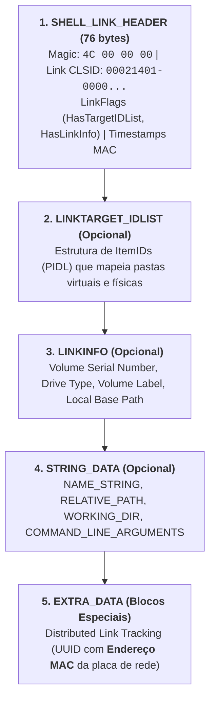

# Ficheiros LNK (Shell Links) — Metadados e Formato Binário

Os ficheiros de atalho com extensão **`.lnk`** pertencem à classe de objetos de sistema designada por **Shell Items**, especificada formalmente pela Microsoft no documento normativo **`[MS-SHLLINK]` (*Shell Link Binary File Format*)**.

Para além da sua função utilitária de facultar atalhos rápidos para ficheiros, pastas ou URLs, os ficheiros `.lnk` constituem uma das "minas de ouro" da informática forense: **mesmo que o ficheiro alvo tenha sido completamente eliminado ou tenha residido numa pen USB entretanto removida, o `.lnk` preserva uma cópia fiel de todos os seus metadados originais**.

---

## 1. Assinatura Mágica e Estrutura Binária

Todo o ficheiro `.lnk` válido inicia-se obrigatoriamente com a assinatura mágica de 4 bytes:
$$\text{Offset 0x00: } \mathbf{\text{4C 00 00 00}} \quad \text{(o byte } \texttt{0x4C}\text{ corresponde à letra ASCII 'L' de Link)}$$

A estrutura do formato divide-se em cinco secções sequenciais:



### O Bloco `Distributed Link Tracking` e o Endereço MAC
No bloco `EXTRA_DATA`, o Windows regista metadados do serviço *Distributed Link Tracking* (DLT) para permitir encontrar ficheiros mesmo que mudem de pasta. 

Como parte da geração do GUID do objeto (versão 1 baseada em tempo e nó de rede), o Windows grava com frequência o **endereço MAC da placa de rede física (NIC)** e o **nome NetBIOS** da máquina onde o ficheiro residia originalmente.

---

## 2. Metadados Extraíveis: Reconstituição de Prova

Ao dissecar um ficheiro `.lnk`, o investigador consegue demonstrar factos periciais mesmo na ausência física do disco ou suporte de armazenamento original:

| Metadado Recuperado | Significado Forense e Aplicação Prática |
| :--- | :--- |
| **Datas MAC do Ficheiro Alvo** | Datas de *Criação*, *Modificação* e *Último Acesso* do documento original no momento em que o atalho foi gerado/atualizado. |
| **Tipo de Unidade (*Drive Type*)** | Identifica se o alvo residia num disco fixo local (`DRIVE_FIXED`), numa unidade amovível (`DRIVE_REMOVABLE` — pen USB/disco externo) ou numa partilha (`DRIVE_REMOTE`). |
| **Nome e Serial do Volume** | Rótulo do volume (*Volume Label*) e o **Volume Serial Number** hexadecimal de 32 bits (permite correlacionar o atalho diretamente com a chave `USBSTOR` e com números de série de pens USB apreendidas). |
| **Caminho Absoluto Local** | O caminho de diretórios exato onde o documento estava guardado (ex.: `E:\Documentos_Confidenciais\Balanco.xlsx`). |
| **Tamanho do Ficheiro Alvo** | A dimensão física exata do ficheiro original em bytes (*Target File Size*). |
| **Identificadores da Máquina** | Nome NetBIOS do computador anfitrião e endereço físico MAC da placa de rede. |
| **Entrada na MFT** | Número de registo da entrada e número de sequência na Master File Table (`$MFT Entry / Sequence Number`). |

---

## 3. Caso de Estudo: A Pasta `Recent Items` do Utilizador

Sempre que um utilizador clica duas vezes num documento para o abrir na respetiva aplicação pré-definida (ex.: abrir um documento Word, visualizar um PDF ou aceder a uma pasta no Explorador), o sistema operativo cria **automaticamente** um ficheiro `.lnk` na pasta de histórico do perfil:

$$\texttt{\%APPDATA\%\textbackslash Microsoft\textbackslash Windows\textbackslash Recent\textbackslash} \quad \text{(atalho no executar: } \texttt{recent}\text{)}$$

### Limite Estrito e Política de Rotação
* A pasta `Recent` mantém um **limite máximo estrito de 149 entradas**.
* Quando atinge as 149 entradas, a inserção de um novo atalho substitui e **elimina automaticamente a entrada mais antiga** (política FIFO).

### A Regra Temporal Pericial dos Atalhos `Recent`
Ao analisar os carimbos de data e hora do próprio ficheiro `.lnk` na pasta `Recent`:
* **Carimbo `CREATED` do `.lnk`**: Corresponde à **1.ª vez** que o utilizador acedeu àquele ficheiro no sistema.
* **Carimbo `MODIFIED` do `.lnk`**: Corresponde à **última vez** que o utilizador acedeu àquele ficheiro no sistema.

```text
Exemplo Pericial:
Ficheiro LNK: Relatorio_Financeiro.docx.lnk
Created:  14/09/2026 09:15:00 UTC  -> Primeiro acesso efetuado pelo operador
Modified: 22/09/2026 18:30:12 UTC  -> Última vez que o ficheiro foi aberto
Target:   D:\Trabalho\Relatorio_Financeiro.docx (Volume Serial: F4FD90F0)
```

---

## 4. Ferramentas Técnicas de Parsing de Ficheiros LNK

### 1. Script Python `LnkParse3`
Biblioteca e utilitário CLI multiplataforma para dissecção rápida de ficheiros individuais:
```bash
# Instalação via gestor de pacotes Python
pip install LnkParse3

# Execução e inspeção
lnkparse3 "C:\Forensics\amostra.lnk"
```
*Apresenta o cabeçalho descodificado, Link CLSID, flags binárias (`HasTargetIDList`, `HasLinkInfo`, `HasRelativePath`), carimbos temporais e estrutura de pastas alvo.*

### 2. Ferramenta de Referência: `LECmd` (Eric Zimmerman)
O utilitário de topo para auditoria forense profissional. Suporta processamento em lote com exportação para CSV, JSON, XML e HTML:

```cmd
REM Processamento em lote de todo o diretório Recent com exportação em CSV
LECmd.exe -d "%APPDATA%\Microsoft\Windows\Recent" --csv "C:\Temp\Relatorio_LNK" -q

REM Extração estruturada de um único atalho para JSON
LECmd.exe -f "C:\Users\user\Desktop\atalho.lnk" --json "C:\Temp\JSON_Export"
```

```text
Saída de exemplo do LECmd:
>> Volume information
   Drive type: Fixed storage media (Hard drive)
   Serial number: 3455E930
   Label: Win7SSD
   Local path: C:\Windows\System32\DisplaySwitch.exe
--- Target ID information (Format: Type ==> Value) ---
   Absolute path: My Computer\C:\Windows\System32\DisplaySwitch.exe
   -Directory ==> System32
   Modified: 2016-02-06 09:58:00 +00:00
   MFT entry/sequence #: 722/1 (0x2D2/0x1)
```

---

## Navegação

- [[Capítulo 1 - Sistemas Operativos, Serviços e Artefactos Forenses|Voltar ao Índice do Capítulo 1]]
- [[Jump Lists - Arquitetura, AppIDs e Carving]]
- [[Abuso e Vetores de Ataque com Ficheiros LNK]]
- [[Taxonomia dos Artefactos de Execução no Windows]]
- [[Artefactos Forenses de Dispositivos USB]]
