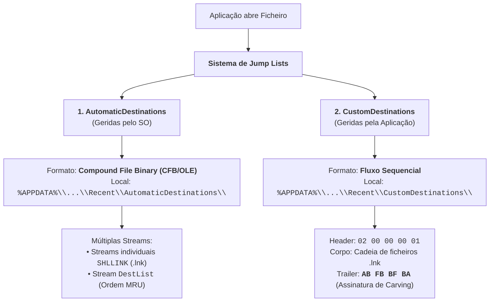

# Jump Lists — Arquitetura, AppIDs e Carving

Introduzidas no Windows 7 e presentes em todas as versões modernas (Windows 8, 10 e 11), as **Jump Lists** são extensões da barra de tarefas e do Menu Iniciar concebidas para permitir ao utilizador aceder rapidamente a documentos e ficheiros recentes (*jump*) associados a uma determinada aplicação.

Em informática forense, as Jump Lists representam um artefacto de valor inestimável: além de registarem a interação voluntária com ficheiros, **a informação persiste mesmo após a desinstalação da respetiva aplicação**, fornecendo evidência irrefutável de atividade prévia.

---

## 1. Dados Registados e Anatomia Funcional

Quando o utilizador clica com o botão direito do rato sobre o ícone de uma aplicação na barra de tarefas ou consulta o Menu Iniciar, a Jump List apresenta quatro secções:
* **Tarefas da Aplicação / Barra**: Ações operacionais (ex.: "Nova Janela Privada", "Fechar Janela");
* **Ficheiros Recentes e Frequentes**: Histórico de ficheiros abertos pelo utilizador;
* **Elementos Fixados (*Pinned Items*)**: Ficheiros explicitamente marcados como favoritos pelo operador.

### Metadados Forenses Preservados
Cada entrada na Jump List guarda:
1. **Caminho Completo do Ficheiro Alvo**;
2. **Carimbos Temporais de Acesso em UTC** (*Timestamp* de abertura);
3. **Volume ID e Volume Serial Number** onde o ficheiro residia;
4. **File ID e MFT Entry/Sequence Number** do ficheiro alvo;
5. **Aplicação Empregada** para abrir o ficheiro.

---

## 2. Tipos de Jump Lists: Automáticas vs. Customizadas

O sistema divide as Jump Lists em duas categorias mutuamente exclusivas com estruturas binárias distintas:



---

## 3. Jump Lists Automáticas (`AutomaticDestinations`)

* **Localização no Disco**:
  $$\texttt{\%APPDATA\%\textbackslash Microsoft\textbackslash Windows\textbackslash Recent\textbackslash AutomaticDestinations\textbackslash}$$
  *(Uma pasta por utilizador, permitindo separar a atividade em sistemas multi-utilizador).*
* **Nomenclatura**: `[AppID].automaticDestinations-ms`
* **Formato Interno**: **Compound File Binary (CFB)** (a estrutura clássica de contentor hierárquico OLE da Microsoft).

### Streams do Contentor CFB
1. **Streams de Atalhos (*SHLLINK*)**: Cada ficheiro aberto na aplicação gera uma stream interna com o formato idêntico a um ficheiro [[Ficheiros LNK (Shell Links) - Metadados e Formato Binário|Shell Link (.lnk)]].
2. **Stream `DestList`**: Funciona como tabela mestra da Jump List. Regista:
   * Versão do `DestList`;
   * Número de entradas ativas;
   * Ordem de utilização mais recente (*MRU List order*);
   * Identificador numérico da entrada (*Entry Number*);
   * Carimbo temporal UTC da última interação.

---

## 4. O Identificador de Aplicação (`AppID`)

O **AppID** é uma chave de **16 carateres hexadecimais** (hash de 64 bits) calculada pelo Windows para identificar unicamente a aplicação responsável pelo ficheiro, independentemente de onde o programa foi instalado.

### Exemplos Notáveis de AppIDs:
* `f01b4d95cf55d32a`: **Windows Explorer** (navegação em pastas locais e partilhas);
* `9b9cdc69c1c24e2b`: **Bloco de Notas (Notepad 64-bit)**;
* `6824F4A902C78FBD`: **Mozilla Firefox**;
* `560D789A6A42AD5A`: **DC++**;
* `1D12F965B876DC87`: **Snagit 2021**;
* `4700FF5AE80A6713`: **PDFCreator**.

> [!TIP] Catálogo Comunitário de AppIDs
> O investigador Eric Zimmerman mantém uma base de dados pública com mais de 700 AppIDs mapeados:
> [Repositório GitHub de AppIDs](https://github.com/EricZimmerman/JumpList/blob/master/JumpList/Resources/AppIDs.txt).

---

## 5. Jump Lists Customizadas (`CustomDestinations`) e File Carving

As aplicações com menus contextuais ricos (ex.: navegadores web com opções de navegação privada, leitores multimédia como o VLC ou software de produtividade da Microsoft) criam e mantêm listas personalizadas.

* **Localização no Disco**:
  $$\texttt{\%APPDATA\%\textbackslash Microsoft\textbackslash Windows\textbackslash Recent\textbackslash CustomDestinations\textbackslash}$$
* **Nomenclatura**: `[AppID].customDestinations-ms`
* **Formato Interno**: Estrutura sequencial em fluxo contínuo.

### A Estrutura de Carving dos 4 Octetos Finais
Conforme demonstrado nas investigações periciais de **Singh & Singh (2018)**:
* **Cabeçalho (*Header*)**: Sequência fixa de bytes `02 00 00 00 01`;
* **Corpo**: Concatenação direta de ficheiros de atalho binários (formato `.lnk`);
* **Marcador de Término (*Trailer / Footer*)**:
  $$\text{Quatro últimos octetos: } \mathbf{\text{AB FB BF BA}}$$

> [!IMPORTANT] Recuperação Pericial por File Carving
> Quando um utilizador ou um agente malicioso apaga deliberadamente o diretório `CustomDestinations`, os blocos permanecem em espaço não-alocado (*unallocated space*). 
> A assinatura de fecho determinística **`AB FB BF BA`** permite que ferramentas de extração direta por blocos (*carvers*) localizem e reconstruam com precisão Jump Lists eliminadas.

---

## 6. Ferramentas Forenses de Extração

### 1. `JumpListsView` (NirSoft)
* Interface gráfica leve para consulta rápida.
* **Limitação Pericial Grave**: O `JumpListsView` da NirSoft **apenas processa as Jump Lists Automáticas** (`AutomaticDestinations`), ignorando completamente as listas customizadas.

### 2. `JLECmd` (Eric Zimmerman — CLI)
A ferramenta de referência para automação em lote. Suporta **ambos os tipos** (Automáticas e Customizadas) e gera ficheiros CSV, JSON ou HTML:

```cmd
JLECmd.exe -d "%APPDATA%\Microsoft\Windows\Recent\AutomaticDestinations" --csv "C:\Temp\JumpLists_CSV" --mp -q
```
* `-d <dir>`: Diretório alvo a processar;
* `--csv <dir>`: Exporta um relatório CSV detalhado por cada AppID identificado;
* `--mp`: Apresenta carimbos temporais com precisão acrescida (*high precision*);
* `-q`: Modo silencioso (*quiet mode*).

### 3. `JumpList Explorer` (Eric Zimmerman — GUI)
Disponibiliza a mesma precisão de parsing do `JLECmd`, mas através de uma interface interativa que permite agrupar registos por aplicação, inspecionar streams binárias e validar parâmetros de lançamento.

---

## 7. Enquadramento Laboratorial e Bibliografia

### Ficha Laboratorial
A análise prática de ficheiros `AutomaticDestinations-ms`, identificação de AppIDs e extração de listas MRU com `JLECmd` e `JumpList Explorer` é lecionada na **Ficha 06 – Jumplists**.

### Referências Académicas
* **Singh, B., & Singh, U. (2016)**. *A forensic insight into Windows 10 Jump Lists*. Digital Investigation, 17, 1-13. [DOI: 10.1016/j.diin.2016.02.001](https://doi.org/10.1016/j.diin.2016.02.001).
* **Singh, B., Singh, U., Sharma, P., & Nath, R. (2018)**. *Recovery of Forensic Artifacts from Deleted Jump Lists*. In IFIP International Conference on Digital Forensics, Springer, pp. 51-65.
* **Weng, S. K., & Tu, J. Y. (2020)**. *A Visualization Jump Lists tool for Digital Forensics of Windows*. KSII Transactions on Internet and Information Systems, 14(1).

---

## Navegação

- [[Capítulo 1 - Sistemas Operativos, Serviços e Artefactos Forenses|Voltar ao Índice do Capítulo 1]]
- [[Ficheiros LNK (Shell Links) - Metadados e Formato Binário]]
- [[Abuso e Vetores de Ataque com Ficheiros LNK]]
- [[Taxonomia dos Artefactos de Execução no Windows]]
