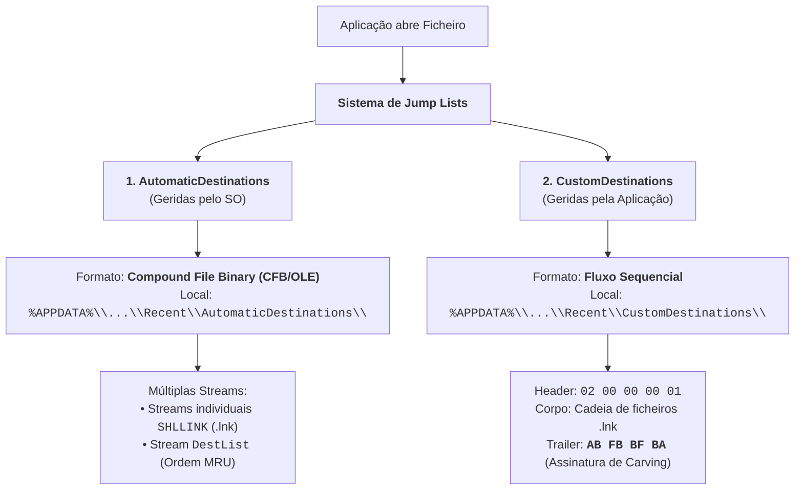

# Jump Lists — Arquitetura, AppIDs e Carving

As **Jump Lists** são contentores binários do Windows 7 ao 11 que registam os ficheiros recentes e tarefas de cada aplicação identificada por `AppID`, persistindo mesmo após a desinstalação do software.

> [!TIP] Lógica de Funcionamento e Valor Forense
> * **Porque existe (Sistema)**: O Windows introduziu as Jump Lists no Windows 7 para acelerar a experiência de utilização na barra de tarefas e no Menu Iniciar, mantendo listas dedicadas de ficheiros recentes, frequentes e fixados (*pinned*) agrupadas por aplicação.
> * **Porque importa (Forense)**: Regista a abertura voluntária de documentos associada ao utilizador específico, preservando caminhos completos, carimbos temporais UTC, números de série de volumes e entradas na MFT. Crucialmente, **os ficheiros da Jump List não são apagados quando a aplicação correspondente é desinstalada**.
> * **Pontos Críticos e Armadilhas para Exame**:
>   * **Automatic vs. Custom**: As `AutomaticDestinations` usam o formato contentor **Compound File Binary (CFB/OLE)** com streams `SHLLINK` e uma stream mestra `DestList`; as `CustomDestinations` são fluxos sequenciais de `.lnk` terminados pelo marcador de carving **`AB FB BF BA`**.
>   * **Armadilha de Ferramentas**: O utilitário gráfico `JumpListsView` (NirSoft) ignora completamente as `CustomDestinations`; em exame ou perícia real deve usar-se o **`JLECmd`** ou o **`JumpList Explorer`** (Eric Zimmerman), que analisam ambos os formatos.

---

## 1. Dados Registados e Anatomia Funcional

Quando o utilizador clica com o botão direito do rato sobre o ícone de uma aplicação na barra de tarefas ou consulta o Menu Iniciar, a Jump List apresenta quatro secções:

* **Tarefas da Aplicação / Barra**: Ações operacionais (ex.: "Nova Janela Privada", "Fechar Janela");
* **Ficheiros Recentes e Frequentes**: Histórico de ficheiros abertos pelo utilizador;
* **Elementos Fixados (*Pinned Items*)**: Ficheiros explicitamente marcados como favoritos pelo operador.

### Metadados Forenses Preservados
Cada entrada na Jump List guarda:

1. **Caminho Completo do Ficheiro Alvo**;
2. **Carimbos Temporais de Acesso em UTC** (*Timestamp* de abertura);
3. **Volume ID e Volume Serial Number** onde o ficheiro residia;
4. **File ID e MFT Entry/Sequence Number** do ficheiro alvo;
5. **Aplicação Empregada** para abrir o ficheiro (mapeada através do seu `AppID`).

---

## 2. Tipos de Jump Lists: Automáticas vs. Customizadas

O sistema divide as Jump Lists em duas categorias mutuamente exclusivas com estruturas binárias distintas:



### Comparação Estrutural Lado a Lado

| Dimensão Técnica | `AutomaticDestinations` | `CustomDestinations` |
| :--- | :--- | :--- |
| **Entidade Gestora** | Sistema Operativo Windows (APIs `SHAddToRecentDocs`) | A própria aplicação (via interface COM `ICustomDestinationList`) |
| **Diretório no Perfil** | `%APPDATA%\Microsoft\Windows\Recent\AutomaticDestinations\` | `%APPDATA%\Microsoft\Windows\Recent\CustomDestinations\` |
| **Extensão do Ficheiro** | `[AppID].automaticDestinations-ms` | `[AppID].customDestinations-ms` |
| **Formato Binário** | **Compound File Binary (CFB / OLE)** (assinatura `D0 CF 11 E0 A1 B1 1A E1`) | **Fluxo Sequencial Contínuo** de estruturas binárias |
| **Organização Interna** | Múltiplas streams numeradas em hex (cada uma é um `SHLLINK` / `.lnk`) + 1 stream mestra **`DestList`** | Cabeçalho `02 00 00 00 01` + ficheiros `.lnk` concatenados + rodapé **`AB FB BF BA`** |
| **Suporte em `JumpListsView`** | Suportado | **Não suportado** (ignorado pela ferramenta da NirSoft) |
| **Suporte em `JLECmd`** | Suportado na totalidade | Suportado na totalidade |

---

## 3. Jump Lists Automáticas (`AutomaticDestinations`)

**Localização no Disco:**

```text
%APPDATA%\Microsoft\Windows\Recent\AutomaticDestinations\
```

*(Uma pasta por utilizador, permitindo separar a atividade em sistemas multi-utilizador).*

* **Nomenclatura**: `[AppID].automaticDestinations-ms`
* **Formato Interno**: **Compound File Binary (CFB)** (a estrutura clássica de contentor hierárquico OLE da Microsoft).

### Streams do Contentor CFB

1. **Streams de Atalhos (*SHLLINK*)**: Cada ficheiro aberto na aplicação gera uma stream interna cujo nome é o número hexadecimal da entrada e cujo conteúdo é idêntico a um ficheiro [[Ficheiros LNK (Shell Links) - Metadados e Formato Binário|Shell Link (.lnk)]].
2. **Stream `DestList`**: Funciona como tabela mestra e índice MRU da Jump List. Regista:
   * Versão do `DestList`;
   * Número de entradas ativas e contador de ações;
   * Ordem de utilização mais recente (*MRU List order*);
   * Identificador numérico da entrada (*Entry Number*);
   * Nome NetBIOS da máquina, carimbo temporal UTC da última interação e caminho Unicode do alvo.

---

## 4. O Identificador de Aplicação (`AppID`)

O **AppID** é uma chave de **16 carateres hexadecimais** (hash CRC64 / 64 bits) calculada pelo Windows para identificar unicamente a aplicação ou processo anfitrião responsável pelo ficheiro, independentemente do idioma do sistema.

### Exemplos Notáveis de AppIDs:

* `f01b4d95cf55d32a`: **Windows Explorer** (navegação em pastas locais e partilhas);
* `9b9cdc69c1c24e2b`: **Bloco de Notas (Notepad 64-bit)**;
* `6824F4A902C78FBD`: **Mozilla Firefox**;
* `560D789A6A42AD5A`: **DC++**;
* `1D12F965B876DC87`: **Snagit 2021**;
* `4700FF5AE80A6713`: **PDFCreator**.

> [!TIP] Catálogo Comunitário de AppIDs
> O investigador Eric Zimmerman mantém uma base de dados pública com mais de 700 AppIDs mapeados:
> [Repositório GitHub de AppIDs](https://github.com/EricZimmerman/JumpList/blob/master/JumpList/Resources/AppIDs.txt).

---

## 5. Jump Lists Customizadas (`CustomDestinations`) e File Carving

As aplicações com menus contextuais ricos (ex.: navegadores web com opções de navegação privada, leitores multimédia como o VLC ou software de produtividade da Microsoft) criam e mantêm listas personalizadas.

**Localização no Disco:**

```text
%APPDATA%\Microsoft\Windows\Recent\CustomDestinations\
```

* **Nomenclatura**: `[AppID].customDestinations-ms`
* **Formato Interno**: Estrutura sequencial em fluxo contínuo.

### A Estrutura de Carving dos 4 Octetos Finais
Conforme demonstrado nas investigações periciais de **Singh & Singh (2018)**:

* **Cabeçalho (*Header*)**: Sequência fixa de bytes `02 00 00 00 01`;
* **Corpo**: Concatenação direta de ficheiros de atalho binários (formato `.lnk`, cada um iniciado por `4C 00 00 00`);
* **Marcador de Término (*Trailer / Footer*)**: **`AB FB BF BA`** (quatro últimos octetos do ficheiro).

> [!IMPORTANT] Recuperação Pericial por File Carving
> Quando um utilizador ou um agente malicioso apaga deliberadamente o diretório `CustomDestinations`, os blocos permanecem em espaço não-alocado (*unallocated space*). 
> A assinatura de fecho determinística **`AB FB BF BA`** permite que ferramentas de extração direta por blocos (*carvers*) localizem e reconstruam com precisão Jump Lists eliminadas.

---

## 6. Ferramentas Forenses de Extração e Anatomia de Comandos

### 1. `JumpListsView` (NirSoft)

* Interface gráfica leve para consulta rápida em triagem.
* **Limitação Pericial Grave**: O `JumpListsView` da NirSoft **apenas processa as Jump Lists Automáticas** (`AutomaticDestinations`), ignorando completamente as listas customizadas (`CustomDestinations`).

### 2. `JLECmd` (Eric Zimmerman — CLI)
A ferramenta de referência para automação em lote. Suporta **ambos os tipos** (Automáticas e Customizadas), resolve automaticamente o `AppID` para o nome amigável do executável e gera ficheiros CSV, JSON ou HTML:

```cmd
JLECmd.exe -d "%APPDATA%\Microsoft\Windows\Recent" --csv "C:\Temp\JumpLists_CSV" --mp -q
```

#### Anatomia Detalhada dos Parâmetros do `JLECmd`:

* **`-d <diretório>`** (ou `-f <ficheiro>`): Aponta para um diretório (processando recursivamente as subpastas `AutomaticDestinations` e `CustomDestinations`) ou para um único ficheiro `*-ms`.
* **`--csv <diretório>`**: Diretório de saída onde serão gravados os relatórios estruturados (`..._AutomaticDestinations.csv` e `..._CustomDestinations.csv`).
* **`--html <diretório>` / `--json <diretório>`**: Alternativas de exportação visual ou para ingestão em SIEM/ELK.
* **`--mp`**: Ativa o modo de alta precisão (*more precision*) nos carimbos temporais exportados.
* **`-q`**: Modo silencioso (*quiet mode*), suprimindo a impressão individual de cada entrada no terminal para acelerar a execução em lote.
* **`--withDir`**: Inclui no processamento os metadados das streams de diretórios/pastas além de ficheiros.

### 3. `JumpList Explorer` (Eric Zimmerman — GUI)
Disponibiliza a mesma precisão de parsing do `JLECmd`, mas através de uma interface interativa que permite agrupar registos por aplicação, inspecionar a estrutura hex da stream `DestList` e auditar cada `SHLLINK` individualmente.

---

## 7. Enquadramento Laboratorial e Bibliografia

### Ficha Laboratorial
A análise prática de ficheiros `AutomaticDestinations-ms`, identificação de AppIDs e extração de listas MRU com `JLECmd` e `JumpList Explorer` é lecionada na **Ficha 06 – Jumplists**.

### Referências Académicas

* **Singh, B., & Singh, U. (2016)**. *A forensic insight into Windows 10 Jump Lists*. Digital Investigation, 17, 1-13. [DOI: 10.1016/j.diin.2016.02.001](https://doi.org/10.1016/j.diin.2016.02.001).
* **Singh, B., Singh, U., Sharma, P., & Nath, R. (2018)**. *Recovery of Forensic Artifacts from Deleted Jump Lists*. In IFIP International Conference on Digital Forensics, Springer, pp. 51-65.
* **Weng, S. K., & Tu, J. Y. (2020)**. *A Visualization Jump Lists tool for Digital Forensics of Windows*. KSII Transactions on Internet and Information Systems, 14(1).

---

## Perguntas de revisão

1. **Qual é a diferença estrutural e de formato binário entre um ficheiro `.automaticDestinations-ms` e um ficheiro `.customDestinations-ms`?**

> [!success]- Ver Resposta
> Os ficheiros `.automaticDestinations-ms` (geridos pelo sistema operativo) utilizam o formato contentor hierárquico **Compound File Binary (CFB/OLE)**, composto por múltiplas streams individuais `SHLLINK` (formato `.lnk`) e uma stream mestra de índice chamada **`DestList`**. Já os ficheiros `.customDestinations-ms` (geridos pela própria aplicação) possuem uma estrutura de **fluxo sequencial contínuo**, iniciada pelo cabeçalho `02 00 00 00 01`, seguida de estruturas `.lnk` concatenadas e encerrada pelo rodapé de 4 bytes **`AB FB BF BA`**.

2. **Um suspeito instalou o cliente de partilha P2P `DC++`, transferiu ficheiros ilícitos e depois desinstalou completamente o programa antes da apreensão. As Jump Lists ainda podem fornecer prova desta atividade?**

> [!success]- Ver Resposta
> **Sim.** O processo de desinstalação de uma aplicação no Windows não remove os ficheiros de Jump Lists associados ao perfil do utilizador. O ficheiro `560D789A6A42AD5A.automaticDestinations-ms` (AppID do DC++) permanece intacto na pasta `Recent\AutomaticDestinations`, preservando os caminhos completos, datas UTC e metadados dos ficheiros abertos.

3. **Qual é a relevância pericial da sequência hexadecimal `AB FB BF BA` segundo a investigação de Singh & Singh (2018)?**

> [!success]- Ver Resposta
> A sequência **`AB FB BF BA`** constitui o marcador de término (*trailer/footer*) de 4 octetos exclusivo dos ficheiros `CustomDestinations`. Caso o suspeito apague as Jump Lists customizadas, este marcador permite às ferramentas de *file carving* delimitar o fim exato do artefacto no espaço não-alocado (*unallocated space*) e recuperar os atalhos `.lnk` internos.

4. **Porque é que o uso exclusivo da ferramenta `JumpListsView` (NirSoft) constitui uma falha metodológica numa perícia forense?**

> [!success]- Ver Resposta
> Porque o `JumpListsView` processa apenas os ficheiros da pasta `AutomaticDestinations`, ignorando na totalidade os ficheiros `CustomDestinations` (onde navegadores como o Firefox/Chrome, leitores multimédia e aplicações Office guardam tarefas e históricos personalizados). Deve utilizar-se o **`JLECmd`** ou o **`JumpList Explorer`** (Eric Zimmerman), que analisam ambos os formatos.

5. **O que representa o `AppID` `f01b4d95cf55d32a` e que tipo de atividade do utilizador permite reconstruir?**

> [!success]- Ver Resposta
> O AppID **`f01b4d95cf55d32a`** identifica o **Windows Explorer** (Explorador de Ficheiros). A sua análise permite reconstruir as pastas locais, unidades externas e partilhas de rede às quais o utilizador acedeu interativamente.

---

## Navegação

- [[Capítulo 1 - Sistemas Operativos, Serviços e Artefactos Forenses|Voltar ao Índice do Capítulo 1]]
- [[Ficheiros LNK (Shell Links) - Metadados e Formato Binário]]
- [[Abuso e Vetores de Ataque com Ficheiros LNK]]
- [[Taxonomia dos Artefactos de Execução no Windows]]
- [[Camadas de Organização de Dados e Análise de Sistemas de Ficheiros]]
- [[Sistemas de Numeração e Conversão entre Bases]]
- [[Pesquisa de Evidências e Reconstrução de Eventos]]
- [[Registo, Etiquetagem e Fotografia Pericial (Regras LabCIF)]]
